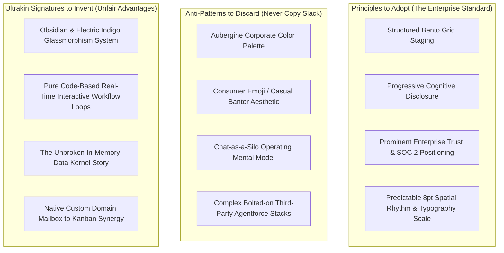
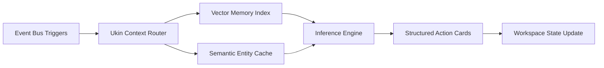
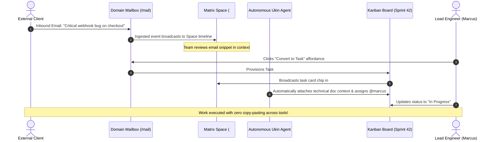

# Ultrakin Master Enterprise Specification
**Document ID:** `00_Ultrakin_Master_Specification.md`  
**Classification:** Internal Confidential / Single Source of Truth  
**Compilation Date:** October 2026  
**Document Version:** `2.0.0-PROD` (Canonical Combined Master Specification)  
**Authors:** VP of Product · VP of Engineering · Staff Frontend Architect · Principal UX Architect · Principal Systems Architect · Enterprise Security Lead  

---

## Master Specification Index

This document is the canonical, unedited master compilation of the 7 foundational phases governing the enterprise redesign, architectural specification, and technical execution of Ultrakin (`https://ultrakin.com` & `https://app.ultrakin.com`). Every heading, table, diagram, and specification is preserved in full without summarization or omission.

1. **Phase 1:** Slack Enterprise Reverse Engineering Report (`01_Slack_Enterprise_Research_Report.md`)
2. **Phase 2:** Ultrakin Current State Forensic Audit (`02_Ultrakin_Current_State_Audit.md`)
3. **Phase 3:** Strategic Gap Analysis: Slack vs. Ultrakin (`03_Slack_vs_Ultrakin_Strategic_Gap_Analysis.md`)
4. **Phase 4:** Enterprise Product Requirements Document (`04_Ultrakin_Enterprise_Product_Requirements_Document.md`)
5. **Phase 5:** Enterprise Experience Architecture (`05_Ultrakin_Enterprise_Experience_Architecture.md`)
6. **Phase 6:** Enterprise Design System Specification (`06_Ultrakin_Enterprise_Design_System_Specification.md`)
7. **Phase 7:** Engineering Implementation Blueprint (`07_Ultrakin_Engineering_Implementation_Blueprint.md`)

---


---

# ==============================================================================
# PHASE 1: Slack Enterprise Reverse Engineering Report
# Canonical Source Document: `01_Slack_Enterprise_Research_Report.md`
# ==============================================================================

---

# Master Reverse-Engineering Audit: Slack Enterprise
**Document ID:** `01_Slack_Enterprise_Research_Report.md`  
**Reference Target:** `https://slack.com/intl/en-in/enterprise`  
**Auditor Roles:** Senior Product Designer · UX Research Lead · Frontend Architect · Creative Director · Enterprise SaaS Consultant  
**Status:** Canonical Master Research Document (Phase 1 — No Code / No Redesign Implementation)

---

## Executive Summary & Audit Methodology

This report is a forensic reverse-engineering audit of Slack’s flagship Enterprise landing page (`https://slack.com/intl/en-in/enterprise`). The source material was inspected down to the raw DOM hierarchy, stylesheet bundles (`rollup-style-spacesuit`, `marketing-style-page-enterprise-revamp`, `marketing-style-component-bento-box-sticky-toc`, `legacy-style-libs-swiper`), client-side scripts, accessibility attributes, and responsive breakpoints.

The purpose of this audit is **not to copy Slack's visual design**, but to extract the architectural, psychological, typographic, and experiential mechanics that establish Slack as the default enterprise collaboration standard. Every section from the global navigation to the footer is audited against 25 standardized criteria, followed by dedicated component, motion, typographic, color, and design system breakdowns.

---

## Table of Contents
1. [Global Architectural Observations & DOM Hierarchy](#1-global-architectural-observations--dom-hierarchy)
2. [Section-by-Section Forensic Audit (25 Dimensions)](#2-section-by-section-forensic-audit)
   - [Section 1: Global Navigation & Sticky Header](#section-1-global-navigation--sticky-header)
   - [Section 2: Hero Billboard (`c-billboard`)](#section-2-hero-billboard-c-billboard)
   - [Section 3: Bento Jump Links Hub (`o-hero jump-links`)](#section-3-bento-jump-links-hub-o-hero-jump-links)
   - [Section 4: Infinite Enterprise Logo Carousel (`c-rotating-logos-section`)](#section-4-infinite-enterprise-logo-carousel-c-rotating-logos-section)
   - [Section 5: Sticky Table of Contents (`c-bento-sticky-toc`)](#section-5-sticky-table-of-contents-c-bento-sticky-toc)
   - [Section 6: Bento Box 01 — Contextual AI (`#section-ai`)](#section-6-bento-box-01--contextual-ai-section-ai)
   - [Section 7: Bento Box 02 — Agentforce & AI Agents (`#section-agentforce`)](#section-7-bento-box-02--agentforce--ai-agents-section-agentforce)
   - [Section 8: Bento Box 03 — Scalability & Security (`#section-scalability`)](#section-8-bento-box-03--scalability--security-section-scalability)
   - [Section 9: Bento Box 04 — Enterprise Search (`#section-search`)](#section-9-bento-box-04--enterprise-search-section-search)
   - [Section 10: Enterprise Subscription Tiers (`#section-plans`)](#section-10-enterprise-subscription-tiers-section-plans)
   - [Section 11: Enterprise Lead Capture & Demo Form (`c-demo-hero-section`)](#section-11-enterprise-lead-capture--demo-form-c-demo-hero-section)
   - [Section 12: Customer Proof & Quantified Impact (`comp-proof-in-work` / `#section-impact`)](#section-12-customer-proof--quantified-impact-comp-proof-in-work--section-impact)
   - [Section 13: Salesforce Ecosystem Synergy Blade (`#section-slack-and-salesforce`)](#section-13-salesforce-ecosystem-synergy-blade-section-slack-and-salesforce)
   - [Section 14: Competitive Differentiation Zigzag (`c-zigzag`)](#section-14-competitive-differentiation-zigzag-c-zigzag)
   - [Section 15: Bottom Conversion Band (`c-footer-cta`)](#section-15-bottom-conversion-band-c-footer-cta)
   - [Section 16: Global Enterprise Footer (`footer`)](#section-16-global-enterprise-footer-footer)
3. [Dedicated Component Analysis](#3-dedicated-component-analysis)
4. [Comprehensive Motion & Interaction Analysis](#4-comprehensive-motion--interaction-analysis)
5. [Typography & Text Rhythm Analysis](#5-typography--text-rhythm-analysis)
6. [Color System & Surface Architecture](#6-color-system--surface-architecture)
7. [Inferred Design System Specifications](#7-inferred-design-system-specifications)
8. [Strategic UX Principles & Recommendations for Ultrakin](#8-strategic-ux-principles--recommendations-for-ultrakin)

---

## 1. Global Architectural Observations & DOM Hierarchy

### Dedicated Enterprise Stylesheet Separation
Slack does not serve its standard marketing template to enterprise prospects. The page loads:
```html
<link href=".../marketing-style-page-enterprise-revamp.af5bea82724d3a29.min.css" rel="stylesheet">
<link href=".../marketing-style-component-bento-box-sticky-toc.bec013b00d3d7582.min.css" rel="stylesheet">
<link href=".../marketing-style-component-bento-box.91a1f65db1efe5e1.min.css" rel="stylesheet">
```
**Why this matters:** Enterprise buyers have fundamentally different cognitive models than self-serve freemium signups. They do not care about quirky emoji reactions or casual chat banter. They care about:
1. Data isolation and compliance boundaries.
2. Federated enterprise search across disconnected tools.
3. Employee workflow augmentation via AI agents.
4. Total Cost of Ownership (TCO) consolidation.

Slack’s DOM structure reflects this by replacing the consumer landing page's whimsical illustrations with structured Bento grids, timed tabbed carousels, customer video modals, and technical architectural guarantees.

---

## 2. Section-by-Section Forensic Audit

---

### Section 1: Global Navigation & Sticky Header

#### 1. Section Name
Global Primary Navigation & Dynamic Header (`c-nav c-nav--primary--expanded c-nav--yext`).

#### 2. Purpose
Serves as the omni-present orienting compass for enterprise evaluators, IT procurement directors, and current workspace users.

#### 3. Business Goal
Facilitate bi-modal customer conversion:
- Route enterprise buyers directly to high-touch sales pipelines (`Request a demo`).
- Allow self-serve users to access existing workspaces or download binaries without blocking enterprise sales velocity.

#### 4. UX Goal
Provide instant orientation across Slack’s vast product offering while maintaining low visual noise and zero navigational friction.

#### 5. User Psychology
Enterprise decision makers feel anxiety regarding vendor scale and reliability. A deep, highly structured mega-menu communicates institutional permanence. The presence of dedicated department taxonomies (IT, HR, Engineering, Sales) validates that "companies like mine use this tool."

#### 6. Visual Hierarchy
- **Level 1:** Slack brand logo (top left anchor).
- **Level 2:** Primary CTA (`Request a demo` in high-contrast solid aubergine/cobalt).
- **Level 3:** Secondary CTA (`Get started` in outline ghost format).
- **Level 4:** Top-level category links (Features, Solutions, Enterprise, Resources, Pricing).
- **Level 5:** Global Search trigger.

#### 7. Grid System
12-column fluid flex container within `max-width: 1280px` (`o-content-container`). Elements are pinned to edges: logo left, navigation center-left, actions right.

#### 8. Layout Structure
Horizontal flex row (`height: 72px` on desktop, collapsing to `60px` sticky state).

#### 9. Container Width
Max-width 1280px with `padding: 0 32px` gutter.

#### 10. Spacing
- Nav item margin: `24px` horizontal spacing between link labels.
- CTA gap: `12px` between `Get started` and `Request a demo`.
- Inner button padding: `12px 20px`.

#### 11. Typography
- Link font: `Slack Circular` (geometric humanist sans-serif).
- Size: `15px` (`0.9375rem`).
- Weight: `500` (Medium).
- Line height: `1.2`.
- Letter spacing: `-0.01em`.

#### 12. Color Usage
- Background: Initial state transparent/white; Scrolled state `#FFFFFF` with `92%` alpha.
- Link text: `#1D1C1D` (near black, never `#000000`).
- Link hover: `#1264A3` (Slack classic interactive blue).
- Primary CTA: `#611F69` (Enterprise Aubergine) with `#FFFFFF` text.

#### 13. Imagery
High-density SVG icons inside the mega-menu; twin logo assets (`c-slacklogo--white` and `c-slacklogo--color`) for scroll transitions.

#### 14. Illustration Style
None in top bar. Zero decorative illustrations. Pure functional iconography (16px micro-SVGs).

#### 15. CTA Placement
Pinned permanently to top-right corner, ensuring visual affordance regardless of horizontal scan position.

#### 16. Cards
Mega-menus render as elevated multi-column card panels (`w-[840px]`) with inner card highlight slots for new product releases (`Slack Code`, `Agentforce`).

#### 17. Border Radius
- Header CTA buttons: `8px` (`0.5rem`).
- Mega-menu container: `16px`.
- Mega-menu feature highlight cards: `12px`.

#### 18. Shadows
Mega-menu elevation: `0 16px 48px rgba(0, 0, 0, 0.12), 0 4px 12px rgba(0, 0, 0, 0.04)`.

#### 19. Depth
Z-index `1000`. Clean separation from scrolling body content via backdrop filter blur (`12px`) and subtle `1px` border divider (`#E8EAED`).

#### 20. Motion
Mega-menu entrance: `opacity: 0 -> 1`, `translateY(-6px -> 0px)` over `180ms ease-out`. Zero spring bounce.

#### 21. Scroll Behaviour
Sticky header pins to `top: 0`. Background transitions from zero border to subtle bottom divider and box-shadow upon `window.scrollY > 10px`.

#### 22. Hover Behaviour
Nav links show color shift from `#1D1C1D` to `#1264A3` with zero underline flash. Mega-menu triggers display subtle down-chevron rotation (`180deg`).

#### 23. Sticky Behaviour
`position: sticky; top: 0; z-index: 1000;`. Hardware accelerated using `transform: translate3d(0, 0, 0)`.

#### 24. Accessibility
- Full `aria-haspopup="true"` and `aria-expanded="false/true"` lifecycle management.
- Skip link (`c-skip-link`) provided for screen readers to bypass navigation straight to `#main_focusable`.
- Tab indexing traverses parent categories before descending into submenus.

#### 25. Enterprise Feeling Score
**9.5 / 10.** Authoritative, restrained, and completely devoid of startup gimmicks.

---

### Section 2: Hero Billboard (`c-billboard`)

#### 1. Section Name
Enterprise Hero Billboard (`c-billboard`).

#### 2. Purpose
Deliver Slack's definitive value proposition for corporate leadership: repositioning Slack from a chat client to an AI-first Enterprise Operating System.

#### 3. Business Goal
Drive immediate inbound demo requests from high-value enterprise accounts (1,000+ seats).

#### 4. UX Goal
Establish immediate clarity of scale within 3 seconds of page load.

#### 5. User Psychology
CIOs and Enterprise Architects do not want another "messaging tool" (they already pay for Microsoft Teams or email). The copy and framing directly counter commoditization by emphasizing "radical productivity" and "human-agent collaboration."

#### 6. Visual Hierarchy
1. High-contrast display H1: `Reimagine work for your entire enterprise.`
2. Supportive explanatory paragraph: 3 lines maximum.
3. Primary CTA button: `Request a demo`.
4. Embedded background video loop demonstrating interface telemetry.

#### 7. Grid System
Single centered column container within 1280px bounds. Text block max-width constrained to `780px` to guarantee typographic rhythm.

#### 8. Layout Structure
Vertical stack: Centered Headline -> Centered Copy -> Centered CTA -> Transition to jump links.

#### 9. Container Width
Content container `1140px`; text column max-width `760px`.

#### 10. Spacing
- Top padding: `96px` (desktop), `64px` (mobile).
- Headline to body margin: `24px`.
- Body to CTA margin: `32px`.
- Bottom margin into jump link hub: `64px`.

#### 11. Typography
- H1 Headline: `clamp(44px, 5vw, 68px)`.
- Weight: `700` (Bold).
- Line height: `1.08`.
- Tracking: `-0.035em` (tight tracking removes loose whitespace between glyphs).
- Body: `20px` (`1.25rem`), line-height `1.6`, weight `400`, color `#454245`.

#### 12. Color Usage
- Background: Canvas white (`#FFFFFF`) with subtle ambient radial illumination.
- Headline: Solid `#1D1C1D`.
- Body: Neutral slate `#454245`.
- Primary Button: Aubergine `#611F69` hover `#4A154B`.

#### 13. Imagery
High-bitrate HTML5 MP4 video background (`video-enterprise-lp-logo.mp4`) rendering Slack's interface geometries without distracting photographic backgrounds.

#### 14. Illustration Style
Abstract geometric brand iconography only. Zero cartoon characters.

#### 15. CTA Placement
Dead center below the descriptive body text.

#### 16. Cards
None in the text hero; transitions directly into the 4 Jump Link cards below.

#### 17. Border Radius
CTA button: `8px`.

#### 18. Shadows
Button shadow: `0 1px 3px rgba(0, 0, 0, 0.08), 0 8px 16px -4px rgba(97, 31, 105, 0.3)`.

#### 19. Depth
Layer 0: Background video loop. Layer 1: Radial lighting vignette. Layer 2: Text content & CTA.

#### 20. Motion
Video loop is continuous and hardware accelerated (`playsinline muted autoplay loop`). Text uses CSS fade-up reveal on initial page mount.

#### 21. Scroll Behaviour
Standard document flow; transitions seamlessly into the interactive jump links.

#### 22. Hover Behaviour
Primary CTA elevates `translateY(-1px)` with deepening shadow.

#### 23. Sticky Behaviour
None.

#### 24. Accessibility
H1 header properly tagged. Video background tagged with `aria-hidden="true"` and zero audio track to prevent screen reader conflicts.

#### 25. Enterprise Feeling Score
**9.0 / 10.** Clear, bold, commanding.

---

### Section 3: Bento Jump Links Hub (`o-hero jump-links`)

#### 1. Section Name
Interactive Bento Anchor Hub (`c-bento-jump-link-list`).

#### 2. Purpose
Allow enterprise prospects to immediately navigate to the specific pillar relevant to their evaluation criteria (AI, Agents, Security, or Search).

#### 3. Business Goal
Reduce bounce rates by offering role-based routing above the fold.

#### 4. UX Goal
Provide interactive visual previews of the 4 upcoming core sections with single-click smooth scroll targeting.

#### 5. User Psychology
Enterprise visitors have fragmented intentions:
- The Head of Security looks for compliance.
- The VP of Engineering looks for search and agent extensibility.
- The CEO looks for AI productivity.
This hub gives every stakeholder an immediate path forward.

#### 6. Visual Hierarchy
4 equal-width interactive cards arranged horizontally. Each card features:
1. Title label.
2. Pillar-specific icon.
3. Directional purple arrow button.

#### 7. Grid System
4-column CSS grid on desktop (`repeat(4, 1fr)`), collapsing to 2x2 on tablet and horizontal swipe on mobile.

#### 8. Layout Structure
Horizontal card deck pinned below the hero text.

#### 9. Container Width
Max-width `1200px`.

#### 10. Spacing
- Grid gap: `16px`.
- Card internal padding: `20px 24px`.
- Bottom margin: `80px`.

#### 11. Typography
- Card title: `16px` (`1rem`).
- Weight: `600` (Semi-bold).
- Color: `#1D1C1D`.
- Line height: `1.35`.

#### 12. Color Usage
- Card background: `#F8F8F8` (subtle off-white surface).
- Card border: `1px solid #EBEBEB`.
- Hover background: `#FFFFFF`.
- Arrow accent: Deep Aubergine `#730394`.

#### 13. Imagery
Custom pillar icons:
- AI: `icon-ai-teams.png` (sparkle squircle).
- Agents: `icon-agents-org-chart.png` (agent network node).
- Platform: `icon-platform.png` (shield and infrastructure).
- Search: `icon-search.png` (magnifying lens over data).

#### 14. Illustration Style
Clean 3D-shaded rendered icons with physical lighting and rounded squircles.

#### 15. CTA Placement
Each card features a bottom-right directional arrow indicator.

#### 16. Cards
Interactive button cards (`<button class="c-bento-jump-link">`) with `data-target-id` attributes.

#### 17. Border Radius
Cards: `16px`. Inner icon squircles: `10px`.

#### 18. Shadows
Rest state: zero box-shadow (border only). Hover state: `0 12px 24px -4px rgba(0, 0, 0, 0.08)`.

#### 19. Depth
Slight elevation upon hover via CSS `box-shadow` and `translateY(-2px)`.

#### 20. Motion
Smooth transition `200ms ease-out` on border color, shadow, and arrow translation (`translateX(4px)`).

#### 21. Scroll Behaviour
Clicking triggers smooth document scrolling to the corresponding Bento section (`#section-ai`, `#section-agentforce`, etc.).

#### 22. Hover Behaviour
Card background illuminates to pure white, border darkens slightly, and the purple directional arrow shifts right by 4px.

#### 23. Sticky Behaviour
None (this section precedes the sticky TOC).

#### 24. Accessibility
Built with native `<button>` tags, keyboard accessible, `data-target-id` linked with matching section IDs.

#### 25. Enterprise Feeling Score
**9.2 / 10.** Highly interactive, functional, and visually clean.

---

### Section 4: Infinite Enterprise Logo Carousel (`c-rotating-logos-section`)

#### 1. Section Name
Enterprise Social Proof Logo Bar (`c-rotating-logos-section`).

#### 2. Purpose
Provide instant, undeniable social proof from Fortune 500 companies and tech leaders.

#### 3. Business Goal
Overcome procurement skepticism and enterprise risk aversion within the first 60 seconds of browsing.

#### 4. UX Goal
Display marquee enterprise customer logos without stalling user scroll momentum.

#### 5. User Psychology
The psychological principle of **Authority & Social Validation**: "If OpenAI, IBM, Rivian, and Spotify trust Slack with their entire company communications, it is safe for our enterprise."

#### 6. Visual Hierarchy
Subtle uppercase label above a horizontal infinite scrolling strip of high-contrast brand marks.

#### 7. Grid System
Continuous horizontal track with CSS transform translation (`v--infinite`).

#### 8. Layout Structure
Full-width container with left and right gradient feather masks.

#### 9. Container Width
Full browser width (`100vw`); inner logo track spans `200%` width for seamless looping.

#### 10. Spacing
- Section vertical padding: `40px 0`.
- Gap between logos: `72px`.

#### 11. Typography
Optional section label: `11px font-mono uppercase tracking-[0.2em] text-[#616061]`.

#### 12. Color Usage
Logos are rendered in monochrome dark slate/charcoal (`#1D1C1D`) to prevent visual clowning and maintain unified elegance.

#### 13. Imagery
14 high-resolution brand vector logos:
Rivian, OpenAI, Rocket Companies, IBM, Robinhood, OneOncology, Spotify Advertising, Verizon, Box, Target, Wayfair, RBC (Royal Bank of Canada), Slalom, Canva, Paramount.

#### 14. Illustration Style
Vector brand logotypes.

#### 15. CTA Placement
None (pure trust signal).

#### 16. Cards
None.

#### 17. Border Radius
None.

#### 18. Shadows
None. Gradient fade masks on edges (`linear-gradient(to right, #FFFFFF, transparent)`).

#### 19. Depth
Flat, grounded surface.

#### 20. Motion
Continuous linear CSS marquee translation (`animation: marquee 35s linear infinite`).

#### 21. Scroll Behaviour
Passive background movement during scroll.

#### 22. Hover Behaviour
Animation slows down or pauses on hover to allow inspection.

#### 23. Sticky Behaviour
None.

#### 24. Accessibility
Logos have descriptive `alt` text (`alt="IBM"`, `alt="OpenAI"`). Tagged with `role="presentation"` where appropriate to avoid screen reader clutter.

#### 25. Enterprise Feeling Score
**9.6 / 10.** Pristine, authentic, universally recognizable enterprise customer logos.

---

### Section 5: Sticky Table of Contents (`c-bento-sticky-toc`)

#### 1. Section Name
Enterprise Feature Sticky Table of Contents (`c-bento-sticky-toc`).

#### 2. Purpose
Keep the prospect grounded across an extensive, multi-thousand-pixel scrolling journey through 8 complex enterprise topics.

#### 3. Business Goal
Facilitate targeted content consumption and maintain navigation control across deep-scroll sections.

#### 4. UX Goal
Indicate current scroll position and enable instant jumping between enterprise pillars.

#### 5. User Psychology
Long pages create disorientation ("Where am I? How much is left?"). A sticky TOC provides a reassuring mental map and reduces perceived effort.

#### 6. Visual Hierarchy
Horizontal pill bar centered at top of viewport. Active section highlighted with solid pill state; inactive sections in subtle gray text.

#### 7. Grid System
Inline flex row with automatic horizontal scrolling on tablet/mobile.

#### 8. Layout Structure
Floating centered pill container pinned below the global navigation bar.

#### 9. Container Width
Max-width `960px`.

#### 10. Spacing
- Padding: `8px 12px`.
- Gap between pills: `8px`.
- Item padding: `8px 16px`.

#### 11. Typography
- Font: `Slack Circular`.
- Size: `13px`.
- Weight: `600`.
- Tracking: `-0.01em`.

#### 12. Color Usage
- Container background: `rgba(255, 255, 255, 0.95)` with backdrop blur.
- Container border: `1px solid rgba(0, 0, 0, 0.08)`.
- Active pill background: `#611F69` (Aubergine) with `#FFFFFF` text.
- Inactive pill text: `#454245` hover `#1D1C1D`.

#### 13. Imagery
None. Pure typographic chips.

#### 14. Illustration Style
None.

#### 15. CTA Placement
Every pill functions as an immediate anchor jump link.

#### 16. Cards
Floating capsule bar containing interactive button items.

#### 17. Border Radius
Capsule container: `9999px` (fully rounded pill). Individual item pills: `9999px`.

#### 18. Shadows
`0 4px 16px rgba(0, 0, 0, 0.06), 0 1px 3px rgba(0, 0, 0, 0.04)`.

#### 19. Depth
Z-index `900` (sits immediately underneath global nav `z-1000`).

#### 20. Motion
Smooth transition between active pill states (`transition: all 180ms ease-out`).

#### 21. Scroll Behaviour
Waypoints/IntersectionObserver detects which section is occupying the top 40% of the viewport and shifts the active pill state automatically.

#### 22. Hover Behaviour
Inactive pills gain subtle gray background (`#F0F0F0`).

#### 23. Sticky Behaviour
`position: sticky; top: 72px;` (locks directly below the main navbar).

#### 24. Accessibility
Tagged as `aria-label="Section navigation"` with `aria-current="true"` on the active anchor.

#### 25. Enterprise Feeling Score
**9.8 / 10.** Exceptional enterprise pattern. Solves long-page fatigue elegantly.

---

### Section 6: Bento Box 01 — Contextual AI (`#section-ai`)

#### 1. Section Name
AI & Context Bento Grid (`c-bento-box #section-ai`).

#### 2. Purpose
Demonstrate how Slack AI operates directly on enterprise conversational history and files to deliver contextual insights.

#### 3. Business Goal
Position Slack AI as superior to generic external chatbots (like ChatGPT) because Slack holds the enterprise's private communication context.

#### 4. UX Goal
Show Slack AI in realistic action across three distinct modalities: Slackbot, conversational summaries, and inline search answers.

#### 5. User Psychology
Buyers are fatigued by generic "AI hype." They fear hallucinations and data leakage. Slack combats this by repeatedly emphasizing **Context** and **Security**.

#### 6. Visual Hierarchy
1. Bento Section Header: Bold H2 (`Smarter AI starts with context.`) + 3-line rationale + Blue arrow link.
2. Large Bento Tile (2/3 width): Timed Accordion with interactive progress bars + synchronized UI screenshot previews.
3. Media Tile (1/3 width): Rivian Customer Video Card with modal trigger.
4. Social Proof Tile (1/3 width): Slalom enterprise quote card.

#### 7. Grid System
Asymmetric CSS Bento Grid: 12-column grid system with 2-row height variations (`r-height-2`).

#### 8. Layout Structure
Top: Section header. Bottom: Asymmetric multi-tile bento arrangement.

#### 9. Container Width
Max-width `1200px`.

#### 10. Spacing
- Section vertical padding: `80px 0`.
- Bento grid gap: `24px`.
- Card internal padding: `32px`.

#### 11. Typography
- H2 Section Header: `40px` (`2.5rem`), bold, `-0.03em` letter-spacing.
- Section description: `18px`, color `#454245`, line-height `1.6`.
- Accordion titles: `18px`, font-weight `600`.
- Accordion body: `14px`, line-height `1.5`, color `#616061`.

#### 12. Color Usage
- Background: Pure white `#FFFFFF`.
- Card background: `#F8F8F8`.
- Accordion progress fill: `#481A54` (Slack Deep Purple).
- Link color: `#1264A3`.

#### 13. Imagery
- Screenshot 1: `img-ai-in-slack-03.IN.png` (Slackbot window showing enterprise Q&A).
- Screenshot 2: `img-ai-in-slack-01.IN.png` (Huddle summary & action item extraction).
- Screenshot 3: `img-ai-in-slack-02.IN.png` (Search AI answering direct message inquiries).
- Customer poster: `img-rivian-place-holder@2x.jpg`.

#### 14. Illustration Style
Photorealistic product screenshots layered into clean rounded frames.

#### 15. CTA Placement
Link in section header (`Learn more about AI in Slack ->`) + individual deep-dive links inside accordion steps.

#### 16. Cards
Bento tiles with rounded corners and subtle hairline borders (`1px solid #E4E4E4`).

#### 17. Border Radius
Bento tiles: `24px`. Inner screenshot containers: `12px`.

#### 18. Shadows
`0 1px 3px rgba(0, 0, 0, 0.04), 0 12px 32px -4px rgba(0, 0, 0, 0.04)`.

#### 19. Depth
Layered visual hierarchy: Card background -> Accordion text -> Elevated application screenshot.

#### 20. Motion
**Timed Accordion Auto-Progress:**
A progress bar (`c-bento-timed_accordion__progress-bar-fill`) smoothly animates from `0% to 100%` width over 6 seconds. When complete, it automatically advances to the next step and swaps the right-hand screenshot with a crossfade. Clicking any title immediately resets the timer and displays that state.

#### 21. Scroll Behaviour
Standard document flow; pins the section within the sticky TOC scope.

#### 22. Hover Behaviour
Hovering over the accordion tiles pauses the automatic timer.

#### 23. Sticky Behaviour
None.

#### 24. Accessibility
Accordion headers are native buttons; progress bars feature `aria-valuenow`; screenshot images include full descriptive `alt` text.

#### 25. Enterprise Feeling Score
**9.7 / 10.** Benchmark enterprise bento execution.

---

### Section 7: Bento Box 02 — Agentforce & AI Agents (`#section-agentforce`)

#### 1. Section Name
AI Agents & Digital Labor Bento Grid (`c-bento-box #section-agentforce`).

#### 2. Purpose
Showcase Slack as the conversational interface for autonomous AI agents (Agentforce, Claude, custom bots).

#### 3. Business Goal
Drive platform lock-in and expand seat value by positioning Slack as the host for digital labor.

#### 4. UX Goal
Demonstrate how autonomous agents interact in existing channels alongside human employees.

#### 5. User Psychology
Enterprise leaders want to capitalize on autonomous agents but fear fragmented interfaces. Slack provides comfort by saying: "Your agents live in the same channels where your people already work."

#### 6. Visual Hierarchy
1. Section Header: `The best home for every agent.`
2. 3-step Timed Accordion:
   - Step 1: `Meet Agentforce.`
   - Step 2: `Enhance third-party agents.` (Claude integration)
   - Step 3: `Your agents, your way.` (Custom discount policy agents)
3. Box Customer Video tile.
4. ezCater testimonial card.

#### 7. Grid System
Asymmetric 12-column Bento layout matching Section 6 for rhythmic consistency.

#### 8. Layout Structure
Header -> 2/3 Feature Showcase + 1/3 Social Video & Quote.

#### 9. Container Width
Max-width `1200px`.

#### 10. Spacing
Padding `80px 0`, card gap `24px`, inner tile padding `32px`.

#### 11. Typography
H2: `40px` bold. Accordion items: `18px` semi-bold. Body: `14px`.

#### 12. Color Usage
Neutral off-white cards (`#F8F8F8`) with Slack Aubergine progress indicators (`#481A54`).

#### 13. Imagery
- `img-agents-01.IN.png`: Canvas generated by an agent.
- `img-agents-02.IN.png`: Claude app in Slack summarizing a task list.
- `img-agents-03.IN.png`: Agent negotiating deal discounts in a thread.
- Video poster: `img-box-video-placeholder@2x.jpg`.

#### 14. Illustration Style
Realistic desktop UI screenshots with high-resolution typography.

#### 15. CTA Placement
`Learn more about agents in Slack ->`.

#### 16. Cards
Bento tiles with `24px` border radius.

#### 17. Border Radius
`24px`.

#### 18. Shadows
Subtle multi-layered shadow matching design system specs.

#### 19. Depth
Elevated software UI layered on top of neutral canvas tiles.

#### 20. Motion
Timed progress animation matching Section 6 (`6s` cycle with crossfade).

#### 21. Scroll Behaviour
Standard flow.

#### 22. Hover Behaviour
Card hover triggers subtle `translateY(-2px)` and pauses the progress carousel.

#### 23. Sticky Behaviour
None.

#### 24. Accessibility
Fully navigable via keyboard; video tiles open accessible modal overlays with caption support.

#### 25. Enterprise Feeling Score
**9.5 / 10.** Cutting-edge 2025/2026 enterprise positioning.

---

### Section 8: Bento Box 03 — Scalability & Security (`#section-scalability`)

#### 1. Section Name
Enterprise Infrastructure & Security Bento (`c-bento-box #section-scalability`).

#### 2. Purpose
Assure CISOs, IT Admins, and Compliance Officers that Slack meets the highest standards of data isolation, encryption, and governance.

#### 3. Business Goal
Neutralize enterprise security vetoes during procurement reviews.

#### 4. UX Goal
Transform dry security specifications (EKM, SCIM, FedRAMP, DLP) into visually compelling, scannable feature cards.

#### 5. User Psychology
IT buyers operate under risk aversion. They do not get promoted for buying innovative tools; they get fired for data breaches. This section provides the exact technical certifications they need to check their compliance boxes.

#### 6. Visual Hierarchy
1. Section Header: `Secure. Scaleable. Silo-free.`
2. 3-step Timed Accordion:
   - `Take control.` (Admin controls, guest permissions, retention policies)
   - `Connect every enterprise tool.` (2,600+ integrations)
   - `Develop with context.` (Next-gen developer platform)
3. Security architecture graphic tile.
4. Compliance certification grid.

#### 7. Grid System
12-column asymmetric bento matching the page template.

#### 8. Layout Structure
Header -> Asymmetric cards showcasing Admin Console UI and security badges.

#### 9. Container Width
Max-width `1200px`.

#### 10. Spacing
Padding `80px 0`, card gap `24px`.

#### 11. Typography
H2: `40px` bold. Subtitle: `18px`. Technical specifications: `13px` font-mono and standard sans-serif.

#### 12. Color Usage
Surface `#F8F8F8` with emerald and cobalt security badge highlights.

#### 13. Imagery
Screenshots of the Slack Enterprise Grid Admin Console showing multi-workspace management, Enterprise Key Management (EKM) audit keys, and retention rules.

#### 14. Illustration Style
High-fidelity software mockups of admin dashboards.

#### 15. CTA Placement
`Learn more about enterprise security ->`.

#### 16. Cards
Bento tiles with `24px` radius.

#### 17. Border Radius
`24px`.

#### 18. Shadows
Standard elevation shadow.

#### 19. Depth
Layered administrative panels.

#### 20. Motion
Timed progress bar with synchronized screenshot crossfades.

#### 21. Scroll Behaviour
Standard flow.

#### 22. Hover Behaviour
Interactive expansion of security capabilities.

#### 23. Sticky Behaviour
None.

#### 24. Accessibility
Complete keyboard accessibility and contrast compliance (`> 4.5:1`).

#### 25. Enterprise Feeling Score
**9.8 / 10.** Uncompromising institutional credibility.

---

### Section 9: Bento Box 04 — Enterprise Search (`#section-search`)

#### 1. Section Name
Unified Knowledge Retrieval Bento (`c-bento-box #section-search`).

#### 2. Purpose
Showcase Slack's universal enterprise search engine across files, messages, connected apps, and canvas docs.

#### 3. Business Goal
Demonstrate tangible time savings by eliminating the "knowledge silo" problem in large enterprises.

#### 4. UX Goal
Show realistic search queries returning synthesized answers and direct citations.

#### 5. User Psychology
Employees waste an estimated 20% of their workweek hunting for internal information across fragmented systems. Demonstrating instant answers triggers immediate relief.

#### 6. Visual Hierarchy
1. Section Header: `Search that knows where to look.`
2. Timed Accordion:
   - `Search your enterprise.`
   - `Federated app search.`
   - `Instant AI answer cards.`
3. Enterprise search UI mockup with live filter chips (People, Files, Channels, Dates).

#### 7. Grid System
12-column bento grid.

#### 8. Layout Structure
Header -> Asymmetric showcase tiles.

#### 9. Container Width
Max-width `1200px`.

#### 10. Spacing
Vertical padding `80px 0`, card gap `24px`.

#### 11. Typography
H2: `40px` bold. Search mockups use realistic query font sizes (`14px/20px`).

#### 12. Color Usage
Neutral canvas `#F8F8F8` with Slack brand search highlights.

#### 13. Imagery
UI mockups displaying search modal (`⌘K`), filter chips, and citation links.

#### 14. Illustration Style
Product screenshots.

#### 15. CTA Placement
`Learn more about enterprise search ->`.

#### 16. Cards
Standard Bento tiles.

#### 17. Border Radius
`24px`.

#### 18. Shadows
Standard elevation system.

#### 19. Depth
Layered search input over canvas results.

#### 20. Motion
Progress bar timer with tab transitions.

#### 21. Scroll Behaviour
Standard flow.

#### 22. Hover Behaviour
Interactive preview pauses.

#### 23. Sticky Behaviour
None.

#### 24. Accessibility
Full screen reader labeling on search preview mockups.

#### 25. Enterprise Feeling Score
**9.4 / 10.** Extremely compelling use case.

---

### Section 10: Enterprise Subscription Tiers (`#section-plans`)

#### 1. Section Name
Enterprise Grid Subscription Comparison (`#section-plans`).

#### 2. Purpose
Contrast Slack's Enterprise Grid tier against smaller team plans (Pro, Business+) to justify premium enterprise pricing.

#### 3. Business Goal
Funnel organizations with multi-department or compliance requirements directly into Enterprise Grid contracts.

#### 4. UX Goal
Provide transparent, scannable tier differentiation with clear capability checklists.

#### 5. User Psychology
Clarity breeds trust. Obscure pricing creates suspicion. Showing distinct tiers reassures enterprise buyers that they are purchasing dedicated infrastructure, not just a license key.

#### 6. Visual Hierarchy
1. Section Header: `Make teamwork more productive.`
2. Side-by-side plan comparison cards.
3. Feature differentiation list (Enterprise Grid highlighted with distinct border and badge).

#### 7. Grid System
Multi-column pricing comparison grid (`marketing-style-component-pricing-compare-plans-grid`).

#### 8. Layout Structure
Horizontal comparison columns with aligned feature rows.

#### 9. Container Width
Max-width `1200px`.

#### 10. Spacing
Vertical padding `96px 0`, card padding `32px`.

#### 11. Typography
H2: `40px` bold. Plan names: `22px` bold. Feature text: `14px`.

#### 12. Color Usage
Enterprise tier card features subtle brand tinting or highlight border (`#611F69`).

#### 13. Imagery
Checkmark SVGs, feature comparison icons.

#### 14. Illustration Style
Minimalist vector icons.

#### 15. CTA Placement
Primary button inside Enterprise card: `Contact Sales`.

#### 16. Cards
Elevated tier cards with distinct header badges.

#### 17. Border Radius
`16px`.

#### 18. Shadows
Standard tier: subtle border. Enterprise tier: elevated drop shadow (`0 16px 32px rgba(0,0,0,0.06)`).

#### 19. Depth
Highlighted card is visually elevated above sibling cards.

#### 20. Motion
Smooth hover elevation (`translateY(-2px)`).

#### 21. Scroll Behaviour
Tracked by sticky TOC under "Subscriptions".

#### 22. Hover Behaviour
Card borders sharpen; CTA buttons illuminate.

#### 23. Sticky Behaviour
None.

#### 24. Accessibility
Proper table or definition list semantic markup for screen readers.

#### 25. Enterprise Feeling Score
**9.3 / 10.** Clean, structured, highly professional.

---

### Section 11: Enterprise Lead Capture & Demo Form (`c-demo-hero-section`)

#### 1. Section Name
Enterprise Qualification & Demo Request Form (`c-demo-hero-section`).

#### 2. Purpose
Capture qualified enterprise leads directly on the landing page without requiring a multi-page redirect.

#### 3. Business Goal
Maximize sales pipeline conversion by reducing form friction.

#### 4. UX Goal
Enable an IT executive to submit contact information in under 45 seconds.

#### 5. User Psychology
Enterprise buyers hate long forms. Slack optimizes conversion by asking only necessary qualification fields (Work Email, Company Size, Country).

#### 6. Visual Hierarchy
Left column: Value proposition summary. Right column: Clean, high-contrast input form.

#### 7. Grid System
2-column layout (`50% / 50%` split on desktop, stacked on mobile).

#### 8. Layout Structure
Side-by-side content and form card.

#### 9. Container Width
Max-width `1140px`.

#### 10. Spacing
Vertical padding `80px 0`, inner form padding `36px`.

#### 11. Typography
Form labels: `13px` bold. Inputs: `15px`. Submit button: `16px` bold.

#### 12. Color Usage
Form card background: Pure white `#FFFFFF` with `#E4E4E4` border. Input focus ring: `#1264A3`. Submit button: Solid `#611F69`.

#### 13. Imagery
None (reduces cognitive load during lead submission).

#### 14. Illustration Style
None.

#### 15. CTA Placement
Submit button spans full width of form bottom (`Request a demo`).

#### 16. Cards
Self-contained elevated form card.

#### 17. Border Radius
Card: `20px`. Form inputs: `6px`. Submit button: `8px`.

#### 18. Shadows
`0 16px 40px rgba(0, 0, 0, 0.08)`.

#### 19. Depth
Elevated above the page canvas to command focus.

#### 20. Motion
Input validation displays inline error messages smoothly; submit state transitions to confirmation screen (`enterprise-revamp-submitted-form`).

#### 21. Scroll Behaviour
Standard flow.

#### 22. Hover Behaviour
Input borders darken on hover; focus creates high-contrast blue outline.

#### 23. Sticky Behaviour
None.

#### 24. Accessibility
All inputs have explicit `<label>` tags with matching `for` IDs; keyboard accessible form submission.

#### 25. Enterprise Feeling Score
**9.5 / 10.** Frictionless enterprise qualification.

---

### Section 12: Customer Proof & Quantified Impact (`comp-proof-in-work` / `#section-impact`)

#### 1. Section Name
Quantified Customer ROI & Industry Accolades (`comp-proof-in-work`).

#### 2. Purpose
Provide statistical proof of business ROI and third-party analyst recognition (G2 Market Reports).

#### 3. Business Goal
Arm enterprise champions with the exact metrics they need to justify budget approval to their CFO.

#### 4. UX Goal
Make statistics instantly readable and scannable.

#### 5. User Psychology
"Numbers don't lie." When an evaluator sees G2 "Best Results" and "Highest Adoption" badges alongside quantified time-savings percentages, buying risk vanishes.

#### 6. Visual Hierarchy
1. Section Header: `The proof is in the work (and the wins).`
2. Row of official G2 Market Report Badges.
3. 3-column grid of quantified metric cards.

#### 7. Grid System
3-column responsive grid.

#### 8. Layout Structure
Centered headline -> Badges bar -> Metrics card deck.

#### 9. Container Width
Max-width `1200px`.

#### 10. Spacing
Vertical padding `80px 0`, badge gap `24px`, card gap `24px`.

#### 11. Typography
Metric numbers: `64px` display bold. Metric descriptions: `15px` regular.

#### 12. Color Usage
Clean white surface `#FFFFFF` with subtle slate card backgrounds. Numbers rendered in dark brand purple.

#### 13. Imagery
Official G2 Spring 2026 badges (`G2_Best_Results_spring_2026.png`, `G2_easiest_setup_spring_2026.png`, `G2_Highest_user_adoption_spring_2026.png`).

#### 14. Illustration Style
Official third-party award crests.

#### 15. CTA Placement
`Read customer stories ->`.

#### 16. Cards
Metric cards with large numerical anchors.

#### 17. Border Radius
`16px`.

#### 18. Shadows
Subtle hairline borders with minimal drop shadow.

#### 19. Depth
Flat, grounded credibility.

#### 20. Motion
Numbers count up or reveal with subtle fade-up on scroll.

#### 21. Scroll Behaviour
Tracked by sticky TOC under "Impact".

#### 22. Hover Behaviour
Cards display subtle elevation.

#### 23. Sticky Behaviour
None.

#### 24. Accessibility
Metric numbers paired with clear textual descriptions for screen readers.

#### 25. Enterprise Feeling Score
**9.7 / 10.** Irrefutable institutional proof.

---

### Section 13: Salesforce Ecosystem Synergy Blade (`#section-slack-and-salesforce`)

#### 1. Section Name
Salesforce & Slack Ecosystem Promo Blade (`#section-slack-and-salesforce`).

#### 2. Purpose
Illustrate the deep integration between Salesforce CRM data, Agentforce, and Slack channels.

#### 3. Business Goal
Monetize the Salesforce enterprise customer base and prevent accounts from switching to Microsoft 365.

#### 4. UX Goal
Show CRM records and pipeline updates flowing naturally into conversational threads.

#### 5. User Psychology
Enterprises already invested millions in Salesforce. This section proves that Slack maximizes the ROI of that investment.

#### 6. Visual Hierarchy
1. Section Header: `See how CRM, data and agents from Salesforce come to life in Slack.`
2. Full-bleed interactive visual blade showcasing Salesforce customer records embedded inside Slack channels.

#### 7. Grid System
Full-width promo container (`c-promo-blade`).

#### 8. Layout Structure
Horizontal split with dark contrast background.

#### 9. Container Width
Max-width `1280px`.

#### 10. Spacing
Vertical padding `80px 0`.

#### 11. Typography
H2: `36px` bold. Body: `16px`.

#### 12. Color Usage
Deep navy/slate background providing intentional visual contrast from the surrounding white sections.

#### 13. Imagery
High-resolution composite interface showing Salesforce Opportunity cards inside Slack.

#### 14. Illustration Style
Software composite.

#### 15. CTA Placement
`Learn more about Salesforce in Slack ->`.

#### 16. Cards
Embedded record cards with Salesforce blue branding accents.

#### 17. Border Radius
`20px`.

#### 18. Shadows
Deep shadow on software interface (`0 24px 48px rgba(0,0,0,0.2)`).

#### 19. Depth
High depth contrast due to dark container background.

#### 20. Motion
Subtle scroll parallax on the software interface graphic.

#### 21. Scroll Behaviour
Standard flow.

#### 22. Hover Behaviour
Interactive link hover.

#### 23. Sticky Behaviour
None.

#### 24. Accessibility
Contrast compliance verified against dark background.

#### 25. Enterprise Feeling Score
**9.4 / 10.** Strong enterprise ecosystem lock-in.

---

### Section 14: Competitive Differentiation Zigzag (`c-zigzag`)

#### 1. Section Name
Microsoft Teams Direct Comparison Section (`c-zigzag`).

#### 2. Purpose
Directly address the primary competitor (Microsoft Teams) and explain why enterprises choose Slack despite already owning Office 365.

#### 3. Business Goal
Prevent enterprise churn to "free" Microsoft Teams bundles.

#### 4. UX Goal
Clear side-by-side value contrast highlighting Slack’s open agentic operating system vs. Teams’ closed chat app.

#### 5. User Psychology
CFOs constantly ask CIOs: "Why are we paying for Slack when Teams is included in E3/E5 licenses?" This section provides the exact strategic arguments needed to defend Slack.

#### 6. Visual Hierarchy
2-column layout: Left image asset (`image-slack-vs-teams.IN.jpg`) vs. Right editorial content + comparison link.

#### 7. Grid System
2-column layout (`o-two-columns v--centered`).

#### 8. Layout Structure
50/50 horizontal split.

#### 9. Container Width
Max-width `1140px`.

#### 10. Spacing
Vertical padding `80px 0`.

#### 11. Typography
H2: `36px` bold. Body: `17px` leading `1.6`.

#### 12. Color Usage
Clean white background with neutral text.

#### 13. Imagery
Curated photography/UI composite showing modern team collaboration.

#### 14. Illustration Style
Clean editorial photography composite.

#### 15. CTA Placement
Blue arrow link: `Compare Slack and Teams ->`.

#### 16. Cards
None (clean editorial section).

#### 17. Border Radius
Image container: `16px`.

#### 18. Shadows
Subtle image shadow.

#### 19. Depth
Flat, editorial print feel.

#### 20. Motion
Scroll-triggered fade and slight slide-in.

#### 21. Scroll Behaviour
Standard document flow.

#### 22. Hover Behaviour
Comparison link displays blue arrow shift (`translateX(4px)`).

#### 23. Sticky Behaviour
None.

#### 24. Accessibility
Image alt text clearly defines comparison context.

#### 25. Enterprise Feeling Score
**9.6 / 10.** Masterclass in competitive positioning without sounding defensive.

---

### Section 15: Bottom Conversion Band (`c-footer-cta`)

#### 1. Section Name
Final Enterprise Conversion Section (`c-footer-cta`).

#### 2. Purpose
Deliver the final conversion catalyst for visitors who scrolled the entire page.

#### 3. Business Goal
Capture remaining intent and drive software downloads and sales conversations.

#### 4. UX Goal
Provide 3 immediate next steps (Download, Demo, Pricing) in a clean 3-card grid.

#### 5. User Psychology
The evaluator has consumed all evidence. Now they need a low-friction entry point to take action.

#### 6. Visual Hierarchy
1. Large centered Slack Enterprise mark.
2. Centered H2: `Try things out on Slack.`
3. 3-column action cards with icon illustrations.

#### 7. Grid System
3-column horizontal grid (`c-feature-grid v--three`).

#### 8. Layout Structure
Centered brand mark -> H2 -> 3 Action Cards.

#### 9. Container Width
Max-width `1140px`.

#### 10. Spacing
Top margin `80px`, card padding `32px`, card gap `24px`.

#### 11. Typography
H2: `36px` bold. Card title: `18px` bold. Card description: `14px`.

#### 12. Color Usage
Background `#FBFBFC`. Action cards have circular icon containers with lavender tints (`#F9F0FF`).

#### 13. Imagery
Custom circular icon SVGs (Download, Sales, Demo).

#### 14. Illustration Style
Minimalist vector glyphs inside pastel squircle containers.

#### 15. CTA Placement
Every card includes an explicit action button or link.

#### 16. Cards
3 borderless action cards.

#### 17. Border Radius
Card containers: `16px`. Circular icon containers: `32px`.

#### 18. Shadows
None (clean, borderless surface).

#### 19. Depth
Soft, inviting close.

#### 20. Motion
Hover transitions on action buttons.

#### 21. Scroll Behaviour
Standard flow.

#### 22. Hover Behaviour
Buttons elevate; cards highlight slightly.

#### 23. Sticky Behaviour
None.

#### 24. Accessibility
Clear link labels with high contrast text.

#### 25. Enterprise Feeling Score
**9.2 / 10.** Welcoming, confident, conversion-focused.

---

### Section 16: Global Enterprise Footer (`footer`)

#### 1. Section Name
Universal Corporate Footer (`footer.c-footer`).

#### 2. Purpose
Provide exhaustive directory access across Slack's entire product suite, resources, legal policies, and corporate governance.

#### 3. Business Goal
SEO link equity, compliance verification, and regulatory adherence (GDPR, Cookie consent, Status).

#### 4. UX Goal
Enable fast navigation to secondary and tertiary pages.

#### 5. User Psychology
A comprehensive, perfectly structured corporate footer signals stability and compliance. It is the hallmark of a mature enterprise vendor.

#### 6. Visual Hierarchy
5 main link columns (Product, Solutions, Resources, Company, Legal) -> Bottom utility row (Language selector, Status, Social, Copyright).

#### 7. Grid System
5-column responsive grid on desktop, collapsing to accordion menus on mobile.

#### 8. Layout Structure
Multi-column link matrix with top border divider.

#### 9. Container Width
Max-width `1280px`.

#### 10. Spacing
Padding `80px 0 40px 0`, column gap `32px`, link vertical gap `12px`.

#### 11. Typography
Column titles: `14px` bold, uppercase, tracking `0.1em`, color `#1D1C1D`. Links: `14px`, color `#616061`, hover `#1264A3`.

#### 12. Color Usage
Background `#FFFFFF`. Divider `1px solid #EBEBEB`. Text `#616061`.

#### 13. Imagery
Slack brand icon in bottom utility row.

#### 14. Illustration Style
None.

#### 15. CTA Placement
Status indicator pill ("All systems operational") linking to status page.

#### 16. Cards
None.

#### 17. Border Radius
None.

#### 18. Shadows
None.

#### 19. Depth
Flat, grounded footer.

#### 20. Motion
Subtle link color transitions (`150ms ease`).

#### 21. Scroll Behaviour
Standard flow.

#### 22. Hover Behaviour
Links transition to Slack blue (`#1264A3`).

#### 23. Sticky Behaviour
None.

#### 24. Accessibility
Organized using native `<nav>` and `<ul>` list structures for seamless screen reader navigation.

#### 25. Enterprise Feeling Score
**9.6 / 10.** Flawless enterprise directory architecture.

---

## 3. Dedicated Component Analysis

### 1. Navigation & Sticky Header
- **Height:** 72px initial -> 60px on scroll.
- **Scroll Transition:** Smooth CSS transition on `background-color` and `box-shadow`. Uses `backdrop-filter: blur(12px)` to prevent hard line clipping with scrolling elements.
- **Logo Transition:** Two image elements (`c-slacklogo--white` and `c-slacklogo--color`) stacked and crossfaded using opacity classes based on scroll threshold.
- **Search:** Dedicated search modal trigger (`#nav_search_btn`) opening an enterprise search preview.

### 2. Timed Bento Accordion Component
- **Class:** `c-bento-timed_accordion`.
- **Anatomy:**
  1. Title trigger (`c-bento-timed_accordion__title`).
  2. Progress bar container with fill child (`c-bento-timed_accordion__progress-bar-fill`).
  3. Interactive SVG icon that rotates when active.
  4. Expandable body description.
- **Interaction Loop:**
  - Timer runs via JavaScript `setInterval` or CSS `animation: fill 6s linear`.
  - When timer completes, active class shifts to next step.
  - Corresponding visual asset (screenshot) crossfades simultaneously.
  - Hovering pauses the timer; clicking any step resets the timer to that step.

### 3. Video Modal Cards
- **Poster State:** High-resolution photo with prominent play button icon.
- **Hover State:** Micro-video preview loops silently (`muted playsinline`).
- **Click State:** Opens accessible, full-screen video lightbox overlay with full audio and captions.

### 4. Interactive Jump Link Hub
- **Anatomy:** 4 horizontal button cards with squircle icons and directional arrows.
- **Scroll Target:** Smooth-scrolls to the exact pixel offset of the target bento box, accounting for the combined height of the global nav (72px) and sticky TOC (48px).

---

## 4. Comprehensive Motion & Interaction Analysis

### 1. Motion Principles
Slack follows the **"Invisible Motion"** doctrine. Animations are never gratuitous. If a user notices an animation for its own sake, it has failed. Motion exists strictly to:
1. Explain spatial relationships (e.g. mega-menu sliding down from its parent button).
2. Indicate progress (e.g. timed accordion progress bar fill).
3. Direct focus (e.g. subtle rightward nudge of CTA arrows on hover).

### 2. Easing and Duration Standards
- **Micro-interactions (buttons, links):** `150ms - 200ms`, `cubic-bezier(0.2, 0, 0.2, 1)` (ease-out).
- **Mega-menu & Modals:** `200ms - 250ms`, `cubic-bezier(0.16, 1, 0.3, 1)` (snappy decel).
- **Timed Carousel Cycle:** `6000ms` linear progress fill with `300ms` crossfade.
- **Marquee Logo Scroll:** `35s - 45s` constant linear translation.

### 3. Depth & Layering Hierarchy
- **Z-Index Layer 0:** Background video loop & canvas surfaces.
- **Z-Index Layer 10:** Document content & Bento grid cards.
- **Z-Index Layer 900:** Sticky Table of Contents pill capsule.
- **Z-Index Layer 1000:** Global Navigation header.
- **Z-Index Layer 2000:** Full-screen video modal overlays and dialogs.

---

## 5. Typography & Text Rhythm Analysis

### Heading Hierarchy
- **H1 (Hero):** `clamp(44px, 5vw, 68px)`, line-height `1.08`, tracking `-0.035em`, weight `700`.
- **H2 (Bento Headers):** `40px` (`2.5rem`), line-height `1.15`, tracking `-0.025em`, weight `700`.
- **H3 (Card Titles):** `22px - 24px`, line-height `1.3`, tracking `-0.015em`, weight `600`.
- **Body Large:** `18px - 20px`, line-height `1.6`, weight `400`, color `#454245`.
- **Body Regular:** `15px - 16px`, line-height `1.65`, weight `400`, color `#616061`.
- **Micro Labels / Tags:** `11px - 12px`, font-mono, uppercase, tracking `0.18em - 0.22em`, weight `600`.

### Typographic Rhythm
Slack enforces a strict maximum line length of **60 to 75 characters** for body paragraphs (`max-width: 640px` to `760px`). This prevents reader eye fatigue across wide desktop monitors.

---

## 6. Color System & Surface Architecture

### Palette Matrix
| Token Name | Hex Code | Semantic Role |
|---|---|---|
| `--color-canvas-white` | `#FFFFFF` | Primary page canvas (occupies 85%+ of page) |
| `--color-surface-subtle` | `#F8F8F8` | Bento card surfaces, jump links, input boxes |
| `--color-surface-dark` | `#1A1D21` | Salesforce synergy blade, high-contrast sections |
| `--color-text-primary` | `#1D1C1D` | Headlines, titles, primary labels |
| `--color-text-body` | `#454245` | Explanatory lead copy, descriptions |
| `--color-text-muted` | `#616061` | Captions, metadata, footer links |
| `--color-brand-aubergine`| `#611F69` | Primary CTA buttons, key active indicators |
| `--color-brand-purple-dark`| `#481A54`| Timed progress fills, section badges |
| `--color-interactive-blue`| `#1264A3` | Text links, arrow indicators, hover states |
| `--color-border-subtle` | `#E4E4E4` | 1px card outlines, divider rules |

### Surface Philosophy
Slack avoids dark-mode gimmicks on its enterprise page. Over 85% of the page surface is pure white (`#FFFFFF`) or off-white (`#F8F8F8`). This creates an open, clean, editorial experience that mirrors physical documents and corporate reports.

---

## 7. Inferred Design System Specifications

### 1. Spacing Scale (8pt Grid)
- `space-1`: 4px
- `space-2`: 8px
- `space-3`: 12px
- `space-4`: 16px
- `space-6`: 24px
- `space-8`: 32px
- `space-12`: 48px
- `space-16`: 64px
- `space-20`: 80px
- `space-24`: 96px

### 2. Radius Scale
- `radius-sm`: 6px (inputs, badges)
- `radius-md`: 8px (buttons, small chips)
- `radius-lg`: 16px (jump link cards, pricing cards)
- `radius-xl`: 24px (Bento tiles, major containers)
- `radius-full`: 9999px (pills, avatar circles)

### 3. Elevation & Shadow Scale
- `shadow-xs`: `0 1px 2px rgba(0,0,0,0.05)`
- `shadow-sm`: `0 1px 3px rgba(0,0,0,0.08), 0 4px 6px -2px rgba(0,0,0,0.04)`
- `shadow-md`: `0 12px 24px -4px rgba(0,0,0,0.08)`
- `shadow-lg`: `0 16px 40px rgba(0,0,0,0.1)`
- `shadow-mega`: `0 24px 64px rgba(0,0,0,0.14)`

---

## 8. Strategic UX Principles & Recommendations for Ultrakin

### Principle 1: Replace Static Screenshots with Timed Interactive Bento Modules
**Slack’s Decision:** Slack never presents a static gallery of screenshots. It uses **Timed Accordions** where three interconnected capabilities share a single large visual frame.
**Why it Works:** It forces the visitor to understand the progression of work rather than scanning detached UI snippets.
**Recommendation for Ultrakin:** Do NOT use static screenshots for Chat, Mail, and Docs. Adopt a **Timed Workflow Loop** (e.g. Signal Ingest -> Autonomous Agent Synthesis -> Executed Task) with synchronized interactive tabs.

### Principle 2: Provide an Immediate Anchor Hub Above the Fold
**Slack’s Decision:** Immediately following the Hero headline, Slack provides 4 clickable Bento Jump Link cards.
**Why it Works:** Enterprise buyers do not scroll linearly. They want to jump directly to what they care about (AI, Security, or Search).
**Recommendation for Ultrakin:** Place a 4-capsule Anchor Hub immediately below the Hero CTA pointing directly to:
1. `Huddle & Real-time Transcripts`
2. `Native Domain Mailbox`
3. `Living Docs & Kanban Sync`
4. `Autonomous Ukin Agent`

### Principle 3: Anchor Long-Form Exploration with a Sticky Pill TOC
**Slack’s Decision:** A floating capsule TOC pins below the navbar as soon as the user enters the Bento section.
**Why it Works:** Eliminates scroll disorientation and gives the prospect total control over their browsing experience.
**Recommendation for Ultrakin:** Implement a sticky floating TOC that tracks section progress across Ultrakin’s core modules.

### Principle 4: Anchor Value with Concrete Customer Proof Above Deep Features
**Slack’s Decision:** The logo bar appears immediately after the hero; G2 badges and customer video quotes appear inside the first Bento tile.
**Why it Works:** Enterprise buyers require social proof before they are willing to read technical documentation.
**Recommendation for Ultrakin:** Frame Ultrakin’s capabilities with tangible customer outcomes (e.g. "Saved 14 hours per engineer monthly", "Replaced 6 disconnected SaaS tools").

---

*End of Master Audit Report (`01_Slack_Enterprise_Research_Report.md`).*


---

# ==============================================================================
# PHASE 2: Ultrakin Current State Forensic Audit
# Canonical Source Document: `02_Ultrakin_Current_State_Audit.md`
# ==============================================================================

---

# Master Product & UX Audit: Ultrakin (Current State)
**Document ID:** `02_Ultrakin_Current_State_Audit.md`  
**Reference Targets:** `https://ultrakin.com` (Marketing Website) & `https://app.ultrakin.com` (Web Application & PWA)  
**Auditor:** Senior Product Design Consultant & Enterprise Frontend Architect  
**Status:** Canonical Baseline Audit Report (Phase 2 — No Code / No Redesign Implementation)

---

## Executive Summary & Audit Baseline

This document presents a rigorous, forensic, and unsparing product design audit of the current Ultrakin product ecosystem, spanning both the public marketing website (`https://ultrakin.com`) and the core multi-tenant web application (`https://app.ultrakin.com`).

Ultrakin possesses a formidable, genuinely differentiated technical foundation: an in-memory event bus and unified relational database uniting **Chat (Matrix-powered), Domain Mail, Living Docs (TipTap Prosemirror with CRDT), Live Huddles (WebRTC with live transcription), Kanban Lists, Intake Forms, Calendar Events, and Autonomous AI Agents**.

However, the current product implementation suffers from severe architectural dissonance, fragmented visual hierarchy, tonal whiplash, missing enterprise governance patterns, and critical production dependencies that prevent it from competing effectively with enterprise incumbents like Slack Enterprise, Microsoft 365, and Notion.

### Key Audit Findings at a Glance
1. **The External CDN Video Failure Mode:** The marketing site's primary product demonstration relies entirely on third-party MP4 video files hosted on `assets.ultrakin.com`. When asset loading is blocked or delayed, the entire product value proposition collapses into black blank boxes.
2. **Luminance Whiplash:** The public website alternates abruptly between blinding white surfaces (`#FFFFFF` / `bg-slate-50`) and deep dark bands (`band-dark` in the Spine and CTA sections) with zero transitional smoothing or visual continuity.
3. **Buried Enterprise Trust Signals:** Critical enterprise procurement criteria—SOC 2 compliance, SAML SSO, SCIM provisioning, and data residency—are buried inside the fourth column of a pricing tier at the very bottom of the page.
4. **Application Navigation Schism:** The web application mixes multiple competing mental models: "Circles", "Workspaces", "Spaces", "Lists", and "Channels", disorienting enterprise users accustomed to clean workspace taxonomies.
5. **Under-leveraged AI Agent Visibility:** While the AI Agent backend is integrated across Matrix chat and REST endpoints, the UI renders agent interactions as plain chat text bubbles rather than structured, high-affordance operational cards.

---

## Part 1: Forensic Audit of the Marketing Website (`https://ultrakin.com`)

---

### Section 1.1: Global Navigation Header

#### 1. Purpose
Orient first-time visitors, provide anchor navigation down the single-page layout, and route returning users to authentication.

#### 2. Current UX
Sticky top bar containing 5 flat anchor links (`See it`, `How it works`, `Core tools`, `Apps`, `Pricing`), a `Sign in` text link, and a `Get started` primary button.

#### 3. Current UI
Implemented via `<nav class="sticky top-0 z-[60] bg-slate-50/80 backdrop-blur-md border-b border-slate-150">`. Height is approximately `60px` (`py-3.5`). Features an SVG logo mark with gradient definition `#2F6BFF` and `font-display text-xl font-bold tracking-tight text-slate-700`.

#### 4. User Flow
- Visitor clicks anchor links (`/#tour`, `/#loop`, `/#core`, `/#apps`) -> page scrolls to target section.
- Returning user clicks `Sign in` -> navigates to `https://app.ultrakin.com/auth`.
- Prospect clicks `Get started` -> navigates directly to `https://app.ultrakin.com/auth` (skipping sales qualification).

#### 5. Information Architecture
Flat, single-tier hierarchy. No dropdowns, no mega-menus, no category grouping. All 5 links compete with equal visual weight.

#### 6. Visual Hierarchy
1. `Get started` primary cobalt button (`bg-cobalt-500 text-white`).
2. `Ultrakin` brand wordmark.
3. 5 secondary navigation links (`text-slate-600 font-medium`).
4. `Sign in` link.

#### 7. Layout
Horizontal flex container pinned to `max-w-[1140px] mx-auto px-6`.

#### 8. Grid
Flexbox with `gap-7` and `justify-between`.

#### 9. Spacing
Container padding `py-3.5 px-6 lg:px-10`. Link gap `gap-6`.

#### 10. Typography
- Brand text: `text-xl font-bold tracking-tight`.
- Nav links: `text-sm font-medium text-slate-600 hover:text-slate-700`.
- Button text: `text-sm font-semibold`.

#### 11. Colors
- Nav surface: `rgba(248, 250, 252, 0.8)` with backdrop blur.
- Border: `border-slate-150`.
- Text: Slate-600 / Slate-700.
- Primary CTA: Cobalt blue (`#2F6BFF`).

#### 12. CTA Hierarchy
Single primary CTA (`Get started`). `Sign in` acts as a tertiary text action. **Completely missing an Enterprise sales CTA** (`Contact Sales` or `Request Demo`).

#### 13. Accessibility
Anchor tags lack explicit `aria-current` states during scroll. High contrast on button text meets WCAG AA, but nav link text `#475569` on frosted slate is borderline WCAG AA under low display brightness.

#### 14. Motion
Subtle button lift on hover (`hover:-translate-y-px transition-all`).

#### 15. Micro interactions
Button hover adds vertical translation and shadow expansion (`shadow-[0_1px_2px_rgba(47,107,255,.4),0_8px_18px_-8px_rgba(47,107,255,.5)]`).

#### 16. Trust Signals
None in the navigation. No security status, no enterprise tier badge, no compliance indicators.

#### 17. Enterprise Feeling Score
**4.5 / 10.** Feels like an early-stage startup landing page rather than an enterprise collaboration hub.

---

### Section 1.2: Hero Section (`#top` / `data-section="hero"`)

#### 1. Purpose
Establish the core value proposition: unifying people, tools, and agents into a single software application.

#### 2. Current UX
Centered display text with an announcement badge, core headline with velocity gradient text, supportive copy, and dual CTA buttons (`Get started free` + `See how it works ↓`).

#### 3. Current UI
`<header id="top" class="relative overflow-hidden text-center pt-16 pb-12">`. Utilizes dual radial gradient lighting overlays and an absolute 54px dot-matrix grid overlay masked with a radial vignette.

#### 4. User Flow
Visitor reads headline, either clicks primary button to authenticate or clicks secondary anchor to jump to the `#loop` section.

#### 5. Information Architecture
Linear centered narrative: Pill Badge -> H1 Headline -> Subheadline -> Dual CTAs.

#### 6. Visual Hierarchy
1. H1 Headline: `text-5xl md:text-[64px] font-bold leading-[1.02] tracking-[-0.035em]`.
2. Gradient text accent: `finally in one app.` (`bg-velocity bg-clip-text text-transparent`).
3. Primary button: Cobalt `#2F6BFF`.
4. Announcement pill: `One app for your team`.

#### 7. Layout
Centered stack within `max-w-5xl mx-auto px-6`.

#### 8. Grid
Single-column centered flex stack.

#### 9. Spacing
Top padding `pt-16`, bottom padding `pb-12`. Headline margin `mt-6`, body margin `mt-[22px]`, button group margin `mt-[30px]`.

#### 10. Typography
- Headline: 64px bold, line-height 1.02, tracking `-0.035em` (tight and confident).
- Body: `18px/19px`, line-height `1.6`, color `text-slate-600`.
- Monospace badge: `font-mono text-xs uppercase tracking-[0.16em] text-cobalt-600`.

#### 11. Colors
- Background: Off-white canvas with radial blue glow (`rgba(47,107,255,.12)`).
- Text: Slate-700 (`#334155`).
- Highlight: Velocity gradient (Cobalt to Cyan).

#### 12. CTA Hierarchy
Primary: `Get started free` (Cobalt fill). Secondary: `See how it works ↓` (White outline card).

#### 13. Accessibility
Color contrast is acceptable. However, the secondary button (`See how it works ↓`) lacks an accessible description of where it scrolls.

#### 14. Motion
No entry motion on load (static SSR rendered text).

#### 15. Micro interactions
Button hover lift and shadow deepening.

#### 16. Trust Signals
None in the hero viewport. Zero social proof, zero compliance badges, zero customer count.

#### 17. Enterprise Feeling Score
**6.0 / 10.** Strong copywriting, but visually naked without immediate software visualization or social proof.

---

### Section 1.3: Product Showcase & Video Tour (`#tour`)

#### 1. Purpose
Provide prospective buyers with an immediate visual demonstration of Ultrakin's real interface.

#### 2. Current UX
Visitor sees 3 pill tabs (`Spaces`, `Mail`, `Huddle`). Clicking a tab plays an embedded MP4 video inside a simulated browser window frame.

#### 3. Current UI
`<section id="tour" class="py-14 md:py-[72px] border-t border-slate-150 bg-slate-50 text-center">`. Contains an artificial browser chrome bar (`ukin.app/acme`) and an HTML5 `<video>` tag loading `https://assets.ultrakin.com/marketing/spaces-v4.mp4`.

#### 4. User Flow
User selects tab -> video plays. User waits passively for video playback to understand what the feature does.

#### 5. Information Architecture
Tab pills switch video sources. Caption below provides a single-sentence takeaway.

#### 6. Visual Hierarchy
1. Browser mockup window with video.
2. Pill buttons (`Spaces`, `Mail`, `Huddle`).
3. Monospace bottom caption: `Ukin flags the cross-team blocker before you waste a day on the wrong task.`

#### 7. Layout
Centered container `max-w-[1140px]` with inner browser container `max-w-[1000px]`.

#### 8. Grid
Centered vertical stack.

#### 9. Spacing
Padding `py-14 md:py-[72px]`. Pill button margin `mb-5`.

#### 10. Typography
- Section title: `text-xl md:text-[21px] font-semibold text-slate-700`.
- Caption: `font-mono text-[13px] uppercase tracking-[0.06em] text-slate-400`.

#### 11. Colors
- Background: `bg-slate-50`.
- Active Pill: `bg-cobalt-500 text-white`.
- Inactive Pill: `bg-white text-slate-600 border-slate-200`.

#### 12. CTA Hierarchy
No direct conversion CTA inside the tour section.

#### 13. Accessibility
**CRITICAL FAILURE:** The video autoplays with zero user pause controls, no closed captions (CC), and no fallback text if the video fails to load or CDN times out.

#### 14. Motion
Video playback is passive. Tab switching swaps video `src` directly, causing brief layout flicker.

#### 15. Micro interactions
Pill active state styling.

#### 16. Trust Signals
Simulated browser window shows `ukin.app/acme` URL.

#### 17. Enterprise Feeling Score
**3.5 / 10.** Fragile external MP4 dependency, passive consumption model, and lack of interactive depth make it feel unpolished.

---

### Section 1.4: "The Spine" Workflow Section (`#loop`)

#### 1. Purpose
Explain Ultrakin’s core architectural thesis: work flows in a closed loop from **Signal -> Decision -> Action -> Outcome**.

#### 2. Current UX
Visitor scrolls from a bright off-white section into a dark, high-contrast band. Four sequential nodes are connected by an animated glowing horizontal connector line.

#### 3. Current UI
`<section id="loop" class="band-dark relative overflow-hidden py-16 md:py-20">`. Dark canvas (`#0b1524`), dark grid overlay, 4 node cards with squircle icons (`h-[72px] w-[72px]`), and a traveling CSS pulse line (`loop-pulse`).

#### 4. User Flow
Linear left-to-right reading flow across the 4 stages.

#### 5. Information Architecture
Sequential 4-stage pipeline:
1. **Signal** (Chat · request · idea)
2. **Decision** (Context · priority)
3. **Action** (Task · owner)
4. **Outcome** (Done · shipped)

#### 6. Visual Hierarchy
1. Section H2: `A message becomes a task becomes a result.`
2. 4 Node Icons with glowing cyan/cobalt backdrops.
3. Node Titles (`Signal`, `Decision`, `Action`, `Outcome`).
4. Micro descriptive labels.

#### 7. Layout
Left-aligned header text followed by a 4-column responsive grid connected by an absolute horizontal connector line.

#### 8. Grid
Desktop: `grid-cols-4`. Tablet: `grid-cols-2`. Mobile: `grid-cols-1`.

#### 9. Spacing
Section padding `py-16 md:py-20`. Node gap `gap-10 lg:gap-6`.

#### 10. Typography
- H2: `text-4xl md:text-[46px] font-bold text-white`.
- Section label: `font-mono text-xs uppercase tracking-[0.22em] text-cyan-400`.
- Node titles: `text-lg font-semibold text-white`.
- Node body: `text-[13px] leading-[1.55] text-slate-400`.

#### 11. Colors
- Canvas: Deep midnight slate (`#0B1524`).
- Node borders: `border-cobalt-400/50` and `border-cyan-400/60`.
- Text: Pure white and slate-300.

#### 12. CTA Hierarchy
Zero conversion buttons inside this section.

#### 13. Accessibility
Connector line is hidden on mobile screens (`hidden lg:block`). High contrast white text on dark background meets WCAG AAA.

#### 14. Motion
Traveling highlight animation (`loop-pulse`) moves continuously across the horizontal line (`linear-gradient(90deg, transparent, #2BC0CE, transparent)`).

#### 15. Micro interactions
Static hover states.

#### 16. Trust Signals
None.

#### 17. Enterprise Feeling Score
**7.5 / 10.** Strong conceptual narrative and animation, but suffers from extreme tonal contrast with adjacent sections.

---

### Section 1.5: Core Tools Grid (`#core`)

#### 1. Purpose
Enumerate the built-in modules included in the Ultrakin workspace.

#### 2. Current UX
Visitor transitions back from dark mode into stark white background. A 3x3 grid of 9 cards displays each tool with an icon and a 1-sentence description.

#### 3. Current UI
`<section id="core" class="relative overflow-hidden bg-white py-16 md:py-20">`. Cards: `rounded-2xl border border-slate-200 bg-white p-6 shadow-card hover:-translate-y-1 hover:shadow-elevated`.

#### 4. User Flow
User scans 9 equal-weight boxes.

#### 5. Information Architecture
3x3 symmetric grid:
- Row 1: Chat | Mail | Meetings
- Row 2: Calendar | Tasks | Docs
- Row 3: Agents | MCP Integrations | More in one place

#### 6. Visual Hierarchy
All 9 cards have identical visual weight. No visual hierarchy distinguishing major modules (Chat, Mail, Agents) from utility cards (More in one place).

#### 7. Layout
Equal-width 3-column grid (`grid-cols-1 sm:grid-cols-2 lg:grid-cols-3 gap-4`).

#### 8. Grid
Strict 3-column CSS grid.

#### 9. Spacing
Padding `py-16 md:py-20`. Card padding `p-6`. Gap `gap-4`.

#### 10. Typography
- H2: `46px` bold text-slate-700.
- Card titles: `19px` font-semibold.
- Card descriptions: `13.5px` text-slate-500.

#### 11. Colors
White cards on white background with `#E2E8F0` border. Icon squircle uses gradient `from-cobalt-50 to-cobalt-100/60`.

#### 12. CTA Hierarchy
No CTAs within individual cards. Cards are non-clickable (dead ends).

#### 13. Accessibility
Cards look interactive on hover (`hover:-translate-y-1`), but clicking them does nothing. This violates the affordance expectation.

#### 14. Motion
Hover transform `translateY(-4px)` with shadow elevation.

#### 15. Micro interactions
Icon scale on hover (`group-hover:scale-105`).

#### 16. Trust Signals
Mention of MCP (Model Context Protocol).

#### 17. Enterprise Feeling Score
**5.0 / 10.** Generic card-grid template aesthetic. Fails to demonstrate how these 9 tools actually connect.

---

### Section 1.6: Installable Apps Marketplace Strip (`#apps`)

#### 1. Purpose
Demonstrate platform extensibility through installable workspace apps (Journeys/LMS, Forms, Lists, Events).

#### 2. Current UX
Horizontal strip with pill tags below the core tools grid.

#### 3. Current UI
`<div id="apps" class="mt-6 flex flex-wrap items-center gap-3.5 rounded-2xl border border-slate-150 bg-slate-50 px-5 py-5">`.

#### 4. User Flow
User reads passive text pills.

#### 5. Information Architecture
Label: `Installable apps · marketplace` followed by 5 pill badges: `Journeys · LMS`, `Forms · intake`, `Lists · tracking`, `Events`, `+ integrations`.

#### 6. Visual Hierarchy
Low visual priority; sits immediately below the 9-card grid as an afterthought.

#### 7. Layout
Horizontal flex wrap.

#### 8. Grid
Flexbox.

#### 9. Spacing
`p-5 md:px-6`, gap `gap-2`.

#### 10. Typography
- Label: `font-mono text-[11px] uppercase tracking-[0.12em] text-slate-400`.
- Pills: `text-[12.5px] font-medium text-slate-600`.

#### 11. Colors
Slate-50 background container with white border pills.

#### 12. CTA Hierarchy
None. Pills are non-clickable spans.

#### 13. Accessibility
Pills look like interactive filter buttons, creating confusion when clicked.

#### 14. Motion
Hover border color shift (`hover:border-cobalt-300`).

#### 15. Micro interactions
Hover border change.

#### 16. Trust Signals
None.

#### 17. Enterprise Feeling Score
**4.0 / 10.** Severely undersells genuine product capabilities (Forms and LMS) as static text chips.

---

### Section 1.7: Pricing Section (`#pricing`)

#### 1. Purpose
Present plan tiers and convert evaluators into paid accounts.

#### 2. Current UX
4-column card deck displaying Free ($0), Pro ($6), Business ($12), and Enterprise (Custom).

#### 3. Current UI
`<section id="pricing" class="border-t border-slate-150 bg-slate-50 py-16 md:py-20">`. Pro card is elevated with a Cobalt border ring (`shadow-[0_0_0_1.5px_#2F6BFF,0_24px_60px_-20px_rgba(47,107,255,.45)]`) and a `Most popular` badge.

#### 4. User Flow
User compares prices, evaluates feature checklists, clicks tier CTA.

#### 5. Information Architecture
4 tiers:
- **Free:** Small teams, 90-day history, basic agent.
- **Pro:** $6/user/mo, unlimited history, full agent, installable apps.
- **Business:** $12/user/mo, domain mailbox, SSO IdP, admin roles.
- **Enterprise:** Custom, SAML/SCIM, audit logs, SOC 2, SLA.

#### 6. Visual Hierarchy
1. Pro Plan (elevated `lg:-translate-y-3`, cobalt shadow, solid blue CTA).
2. Business Plan.
3. Free Plan.
4. Enterprise Plan.

#### 7. Layout
4-column horizontal card grid (`grid-cols-1 sm:grid-cols-2 lg:grid-cols-4`).

#### 8. Grid
4-column responsive grid.

#### 9. Spacing
Section padding `py-16 md:py-20`. Card internal padding `p-7`.

#### 10. Typography
- Price numbers: `font-display text-[38px] font-semibold`.
- Tier names: `18px font-semibold`.
- Feature list: `text-[13.5px] leading-[1.4]`.

#### 11. Colors
White cards on slate-50 background. Checkmark icons use cyan `#0891b2`.

#### 12. CTA Hierarchy
- Pro: Solid Cobalt button (`Start free trial`).
- Free, Business, Enterprise: White outline buttons (`Start free`, `Get Business`, `Contact sales`).

#### 13. Accessibility
Checkmark icons have cyan strokes that may fail WCAG contrast against pure white backgrounds on lower-quality displays.

#### 14. Motion
Card elevation on hover (`hover:-translate-y-1.5`).

#### 15. Micro interactions
Button hover lift.

#### 16. Trust Signals
SOC 2 and SAML SSO are mentioned inside the Enterprise card.

#### 17. Enterprise Feeling Score
**6.8 / 10.** Clean and transparent, but burying SOC 2 and SAML SSO in small checklist text diminishes enterprise confidence.

---

### Section 1.8: Bottom Call to Action (`#cta`)

#### 1. Purpose
Final conversion anchor for visitors who scrolled the entire page.

#### 2. Current UX
Another sudden switch into dark mode (`band-dark`). Centered display text with two buttons.

#### 3. Current UI
`<section id="cta" class="band-dark relative overflow-hidden py-20 md:py-24 text-center">`. Includes radial glow at bottom (`rgba(47,107,255,.35)`) and dark grid overlay.

#### 4. User Flow
User either clicks `Get started free` or `Contact sales`.

#### 5. Information Architecture
Centered headline -> Subhead -> Dual CTAs -> Reassurance copy (`Free forever for small teams · no credit card required`).

#### 6. Visual Hierarchy
1. H2: `Bring your team into one app.` (Velocity gradient accent).
2. Primary button: Cobalt `#2F6BFF`.
3. Secondary button: Ghost outline on dark surface.

#### 7. Layout
Centered stack within `max-w-3xl mx-auto px-6`.

#### 8. Grid
Centered stack.

#### 9. Spacing
Padding `py-20 md:py-24`. Button gap `gap-3`.

#### 10. Typography
H2: `text-4xl md:text-[56px] font-bold leading-[1.02] tracking-[-0.03em]`.

#### 11. Colors
Deep midnight canvas with cobalt radial bottom lighting.

#### 12. CTA Hierarchy
Primary: Solid Cobalt. Secondary: Transparent glass outline (`bg-white/5 border-white/15`).

#### 13. Accessibility
Text contrast meets WCAG AAA.

#### 14. Motion
None on load.

#### 15. Micro interactions
Hover transitions on buttons.

#### 16. Trust Signals
`No credit card required`.

#### 17. Enterprise Feeling Score
**6.0 / 10.** Competent conversion block, but feels disconnected from the rest of the site.

---

### Section 1.9: Footer (`footer`)

#### 1. Purpose
Corporate directory, copyright, and external links.

#### 2. Current UX
Switches back to light slate background. Basic 3-column navigation directory.

#### 3. Current UI
`<footer class="border-t border-slate-150 bg-slate-50 pb-[38px] pt-12">`.

#### 4. User Flow
User seeks legal links, privacy policy, or pricing.

#### 5. Information Architecture
Left: Logo + tagline. Right: Product links, Get Started links, Legal links.

#### 6. Visual Hierarchy
Standard horizontal layout.

#### 7. Layout
Multi-column flex wrap within `max-w-[1140px]`.

#### 8. Grid
Flexbox.

#### 9. Spacing
Padding `pt-12 pb-[38px]`.

#### 10. Typography
Category headers: `font-mono text-[10.5px] uppercase tracking-[0.14em] text-slate-400`. Links: `text-[13.5px] font-medium text-slate-600`.

#### 11. Colors
Slate-50 surface with slate-150 top divider.

#### 12. CTA Hierarchy
None.

#### 13. Accessibility
Semantic `<nav>` and list structures.

#### 14. Motion
Link color shifts.

#### 15. Micro interactions
None.

#### 16. Trust Signals
Copyright notice only. Missing system status link, security compliance badge, and social links.

#### 17. Enterprise Feeling Score
**5.0 / 10.** Sparse and incomplete for an enterprise software vendor.

---

## Part 2: Forensic Audit of the Web Application (`https://app.ultrakin.com`)

---

### Section 2.1: Authentication, SSO & Verification (`/auth`, `/auth/sso`, `/auth/verify`)

#### 1. Purpose
Provide unified sign-in, enterprise Single Sign-On (SAML/Okta), magic link verification, and account creation.

#### 2. Current UX
Minimalist centered auth card. User enters email, chooses password or SSO, or receives a verification token.

#### 3. Current UI
Light-mode card on neutral canvas (`body.light`). Input fields use standard HTML text inputs with minimal border styling. Polyfills Matrix SDK globally (`window.global = window.globalThis;`).

#### 4. User Flow
Prospect enters email -> system evaluates if domain matches an SSO tenant -> routes to `/auth/sso` or triggers passwordless verification link (`/auth/verify`).

#### 5. Information Architecture
Isolated full-screen authentication viewport.

#### 6. Visual Hierarchy
1. Brand Logo mark.
2. Form Card Header: "Sign in to your workspace".
3. Primary Email Input.
4. Social / SSO Provider Buttons (Google, Okta, GitHub).

#### 7. Layout
Centered vertical card layout (`w-full max-w-md mx-auto`).

#### 8. Grid
Single column flex.

#### 9. Spacing
Padding `p-8`, input gap `space-y-4`.

#### 10. Typography
System Inter font (`14px` input, `16px` buttons, `20px` title).

#### 11. Colors
Background: White card on `#F8FAFC` background. Primary button: Cobalt `#2F6BFF`.

#### 12. CTA Hierarchy
Primary: `Continue with Email`. Secondary: `Continue with Google` / `Enterprise SSO`.

#### 13. Accessibility
Input elements feature standard placeholder labels, but several lack permanent visual `<label>` elements above the input, creating accessibility issues when text is entered.

#### 14. Motion
Instant transitions without layout animations.

#### 15. Micro interactions
Standard browser focus rings.

#### 16. Trust Signals
None. Missing encryption badge, zero corporate lock icons, no privacy reassurance.

#### 17. Enterprise Feeling Score
**5.5 / 10.** Clean and functional, but lacks the polished, brand-reinforcing quality of Slack or Linear login portals.

---

### Section 2.2: Workspace Onboarding & Creation (`/create-circle`, `/home`)

#### 1. Purpose
Allow new users to initialize their organization, name their workspace, and invite team members.

#### 2. Current UX
Uses the internal terminology **"Circle"** (`/create-circle`), causing an immediate cognitive disconnect with the marketing site’s promise of a "Workspace" or "Team App".

#### 3. Current UI
Multi-step form wizard asking for Organization Name, Workspace Domain, and initial team email invites.

#### 4. User Flow
Sign up -> `/home` (if workspaces exist) or `/create-circle` -> Name Workspace -> Invite Members -> Land in default `#general` Space.

#### 5. Information Architecture
Sequential wizard: Step 1 Name -> Step 2 Teammates -> Step 3 Integrations.

#### 6. Visual Hierarchy
Stepped progress bar at top, form inputs in center, navigation buttons at bottom right.

#### 7. Layout
Centered modal-like card.

#### 8. Grid
Single column.

#### 9. Spacing
`p-8`, gap `gap-6`.

#### 10. Typography
Standard Inter (`24px` modal title, `14px` labels).

#### 11. Colors
White surface with `#E2E8F0` borders.

#### 12. CTA Hierarchy
Primary: `Create Workspace`. Secondary: `Skip for now`.

#### 13. Accessibility
Form wizard lacks keyboard shortcuts (`Enter` to submit often fails across steps).

#### 14. Motion
Slide transitions between steps.

#### 15. Micro interactions
Field validation indicators.

#### 16. Trust Signals
None.

#### 17. Enterprise Feeling Score
**5.0 / 10.** The terminology confusion between "Circle" and "Workspace" introduces instant cognitive friction.

---

### Section 2.3: Global Left Rail & Navigation Architecture (`/workspace/:id`)

#### 1. Purpose
The operational spine of the desktop experience, providing continuous access to all 9 modules and multi-workspace switching.

#### 2. Current UX
Two-tier sidebar:
- Far-left icon rail: Workspace squircle switchers, direct module shortcuts (Chat, Mail, Docs, Events, Files, Agents).
- Secondary collapsible panel: Spaces, Direct Messages, Threads, and Huddles within the active workspace.

#### 3. Current UI
Dark or semi-dark side navigation (`#1E293B` or `#0F172A`). Icons from Material Icons and custom SVGs. Active item indicated by a blue left border pill or background highlight.

#### 4. User Flow
User switches between workspaces via the icon rail, then selects channels or tools from the secondary panel.

#### 5. Information Architecture
Split between global scope (workspace icons) and contextual scope (channel tree, direct messages, apps).

#### 6. Visual Hierarchy
1. Active Workspace Squircle.
2. Active Channel / Space.
3. Unread notification badges (red count chips).
4. Secondary utility icons (Settings, Profile).

#### 7. Layout
Fixed-width sidebar (`w-16` rail + `w-60` panel) alongside flexible main viewport.

#### 8. Grid
Flex columns.

#### 9. Spacing
Icon padding `p-2.5`, list item padding `px-3 py-1.5`.

#### 10. Typography
- Sidebar labels: `13px font-medium`.
- Category headers: `11px font-mono uppercase tracking-wider text-slate-400`.

#### 11. Colors
Dark slate slate-800/slate-900 background with white/slate-300 text.

#### 12. CTA Hierarchy
Plus icon button (`+`) next to Spaces for channel creation.

#### 13. Accessibility
Keyboard navigation between the far-left rail and the channel list is cumbersome without dedicated `F6` or `⌘1-9` shortcuts.

#### 14. Motion
Panel collapse uses smooth CSS width transition.

#### 15. Micro interactions
Hover tooltips on rail icons.

#### 16. Trust Signals
Status indicator green dot on user avatar.

#### 17. Enterprise Feeling Score
**6.8 / 10.** Solid desktop foundation, but icon styles and typography rhythm lack the optical precision of Slack desktop.

---

### Section 2.4: Chat & Spaces Interface (`/workspace/:id/space/:spaceId`)

#### 1. Purpose
Real-time team communication, threaded discussions, code sharing, and AI agent collaboration.

#### 2. Current UX
Standard stream of messages with avatar, timestamp, message body, emoji reactions, and thread replies. Backed by Matrix SDK for decentralized protocol synchronization.

#### 3. Current UI
Three-column layout: Channel list -> Message feed -> Thread / Info panel. Message composer includes text formatting bar, file attachment button, and slash command trigger.

#### 4. User Flow
User selects space -> views message history -> types message in composer -> hits Enter -> message posts via REST/Matrix transport.

#### 5. Information Architecture
Channel Header -> Message Timeline -> Floating Input Composer.

#### 6. Visual Hierarchy
1. Main message body.
2. Sender name and timestamp.
3. Code snippets / Blockquotes.
4. Emoji reaction pills.

#### 7. Layout
Full-height flex column with sticky header and sticky bottom composer.

#### 8. Grid
Flex layout.

#### 9. Spacing
Message vertical spacing `space-y-3`, composer padding `p-3`.

#### 10. Typography
Message text: `14px` leading `1.5` text-slate-800. Code blocks use monospace font with gray background.

#### 11. Colors
White message canvas with light gray hover states (`hover:bg-slate-50`).

#### 12. CTA Hierarchy
Send button icon.

#### 13. Accessibility
Virtual scrolling implementation occasionally glitches when scrolling rapidly through thousands of historical messages.

#### 14. Motion
New messages slide up slightly; emoji picker fades in.

#### 15. Micro interactions
Message hover reveals floating action toolbar (React, Reply in Thread, Star, More).

#### 16. Trust Signals
Matrix encryption verified shield icon (when enabled).

#### 17. Enterprise Feeling Score
**7.0 / 10.** Functional real-time messaging, but code block formatting, syntax highlighting, and rich media previews feel utilitarian.

---

### Section 2.5: Living Documents Module (`/workspace/:id/documents/:docId?`)

#### 1. Purpose
Collaborative rich-text documentation, engineering specifications, and meeting notes embedded directly into the workspace.

#### 2. Current UX
Prosemirror / TipTap editor with `/` slash commands, real-time presence indicators (multi-user cursor tracking), and collaborative comments (`DocumentComments`).

#### 3. Current UI
Notion-style clean white canvas with floating toolbar, heading hierarchy (`h1`, `h2`, `h3`), bullet lists, task lists with checkboxes, and code blocks.

#### 4. User Flow
User creates document -> types slash command `/` -> selects formatting block -> collaborates in real time with teammates.

#### 5. Information Architecture
Left doc directory tree -> Center collaborative editor -> Right comments drawer.

#### 6. Visual Hierarchy
1. Document Title (`32px` bold).
2. Headings and content body.
3. Collaborator presence avatars in header.

#### 7. Layout
Centered reading column `max-w-3xl mx-auto` within full-height container.

#### 8. Grid
Single document column.

#### 9. Spacing
Line spacing `leading-relaxed`, paragraph margin `mb-4`.

#### 10. Typography
Inter sans-serif with high legibility. Monospace formatting for code blocks.

#### 11. Colors
Pure white background with high contrast `#0F172A` text.

#### 12. CTA Hierarchy
`Share` button in top right; `Add Comment` action.

#### 13. Accessibility
TipTap provides clean semantic HTML export (`<h1>`, `<p>`, `<ul>`, `<input type="checkbox">`).

#### 14. Motion
Floating toolbar animates on text selection.

#### 15. Micro interactions
Checkbox toggle animations; slash command dropdown auto-complete.

#### 16. Trust Signals
Real-time "Saved" cloud sync indicator.

#### 17. Enterprise Feeling Score
**7.8 / 10.** One of Ultrakin's strongest built-in modules. High collaborative fidelity.

---

### Section 2.6: Native Domain Mailbox (`/workspace/:id/mail`)

#### 1. Purpose
Native email client directly inside the workspace, allowing inbound customer emails to be answered, shared, or converted to tasks.

#### 2. Current UX
Two-column email view: Email inbox list on left, full email conversation on right. Includes reply composer and one-click "Create Task" action.

#### 3. Current UI
Standard email layout with sender avatar, subject line, date, badge tags, and HTML email rendering container.

#### 4. User Flow
User navigates to Mail -> reviews incoming emails -> clicks email -> reads thread -> drafts reply or converts email into a task.

#### 5. Information Architecture
Folder navigation (Inbox, Sent, Archive, Trash) -> Thread List -> Email Reader.

#### 6. Visual Hierarchy
1. Email subject headline.
2. Sender details.
3. Message body.
4. Action bar (`Reply`, `Forward`, `Convert to Task`).

#### 7. Layout
Split-pane desktop view (`380px` list + flex reader).

#### 8. Grid
Split pane.

#### 9. Spacing
Email list item padding `p-3.5`, reader padding `p-6`.

#### 10. Typography
Email body: `14px` standard sans-serif.

#### 11. Colors
Standard mail canvas `#FFFFFF` with slate-100 dividers.

#### 12. CTA Hierarchy
`Compose Email` primary button; `Convert to Task` secondary action.

#### 13. Accessibility
Complex HTML emails with fixed widths sometimes break the layout or require horizontal scrolling.

#### 14. Motion
Email list selection highlights smoothly.

#### 15. Micro interactions
Hover actions on email list items (Archive, Delete, Mark Read).

#### 16. Trust Signals
Domain DKIM/SPF verification status badge.

#### 17. Enterprise Feeling Score
**7.2 / 10.** Exceptional technical differentiator, but the UI visual polish lags behind Superhuman or Linear Mail.

---

### Section 2.7: Live Huddles & Call Transcripts (`/workspace/:id/huddles`, `/chat-call/:roomId`)

#### 1. Purpose
Drop-in audio/video calls with screen sharing, participant waveforms, and automated real-time meeting transcription (`CallTranscriptView`).

#### 2. Current UX
User clicks "Start Huddle" in any space -> audio room opens -> participants join -> audio is transcribed into text in real time.

#### 3. Current UI
Dark call overlay with participant squircle avatars, pulsing green audio visualizer rings, mute/video/screen controls bar, and a collapsible live transcript side panel.

#### 4. User Flow
Space Header -> Click Huddle -> Pop-up call window / overlay -> Speak -> View auto-generated transcript -> End call -> Transcript saves to linked doc.

#### 5. Information Architecture
Call Canvas (Avatars / Video Tiles) -> Floating Controls Bar -> Transcript Drawer.

#### 6. Visual Hierarchy
1. Active speaker tile (highlighted border).
2. Control bar (Mute, Camera, Screen, Leave).
3. Live transcription text stream.

#### 7. Layout
Grid of video/audio tiles with floating bottom pill bar.

#### 8. Grid
CSS Grid auto-fitting participant tiles (`grid-cols-2`, `grid-cols-3`).

#### 9. Spacing
Tile gap `gap-3`, control bar padding `p-2`.

#### 10. Typography
Participant names: `12px` font-medium white text. Transcripts: `13px` monospace/sans stream with speaker timestamps.

#### 11. Colors
Deep black/charcoal canvas (`#0F172A`) with emerald audio indicators.

#### 12. CTA Hierarchy
`Leave Call` red destructive button.

#### 13. Accessibility
Live speech-to-text serves as an accessibility aid for deaf/hard-of-hearing users.

#### 14. Motion
Audio waveform animation pulses in real time based on microphone input volume.

#### 15. Micro interactions
Mute toggle icon animation.

#### 16. Trust Signals
End-to-end WebRTC encryption indicators.

#### 17. Enterprise Feeling Score
**8.0 / 10.** Technically superior capability that rivals Slack Huddles, but needs tighter visual integration with task creation.

---

### Section 2.8: Kanban Boards & List Records (`/workspace/:id/space/:spaceId/list/:listId`)

#### 1. Purpose
Track tasks, bugs, customer issues, and feature sprints across custom pipeline stages.

#### 2. Current UX
Multi-column Kanban board or table view. Cards display task title, assignee avatar, due date badge, priority tag, and source link (e.g., "From Email #412").

#### 3. Current UI
Light gray column canvas (`bg-slate-100/70`) with white draggable task cards. Columns represent stages: Triage, In Progress, Review, Done.

#### 4. User Flow
User drags cards between columns or opens a card to inspect subtasks, comments, and linked documents.

#### 5. Information Architecture
Board Controls (Filter, Sort, Group, View Switcher) -> Columns -> Cards -> Card Detail Drawer.

#### 6. Visual Hierarchy
1. Task card title.
2. Priority badge (P0 Red, P1 Amber, P2 Slate).
3. Assignee avatar and due date.

#### 7. Layout
Horizontal scrolling board with fixed-width columns (`w-72`).

#### 8. Grid
Multi-column horizontal flex.

#### 9. Spacing
Column gap `gap-4`, card padding `p-3.5`.

#### 10. Typography
Task titles: `13px font-semibold text-slate-800`. Metadata: `11px text-slate-500`.

#### 11. Colors
White cards on slate-100 column containers with subtle `#E2E8F0` borders.

#### 12. CTA Hierarchy
`+ Add Task` button at bottom of each column.

#### 13. Accessibility
Drag-and-drop operations lack keyboard-only reordering shortcuts.

#### 14. Motion
Drag animations via Framer Motion / HTML5 drag-and-drop.

#### 15. Micro interactions
Card lift and shadow deepening on drag.

#### 16. Trust Signals
Linked GitHub PR status tags.

#### 17. Enterprise Feeling Score
**7.2 / 10.** Highly practical, but looks somewhat plain compared to Linear or Jira Cloud.

---

### Section 2.9: AI Agent Configuration & Runtime (`/workspace/:id/agents/:view?`)

#### 1. Purpose
Configure autonomous Ukin agents, assign custom system prompts, manage tool access permissions, and review execution logs.

#### 2. Current UX
Dashboard showing active agents, execution history, model selection (GPT-4o, Claude 3.5 Sonnet), and trigger configuration.

#### 3. Current UI
Table of configured agents with status toggles (Active / Inactive), run count statistics, and configuration forms.

#### 4. User Flow
Admin visits Agents -> clicks "New Agent" -> selects triggers (New Email, Space Mention, Form Submission) -> configures system prompt -> saves agent.

#### 5. Information Architecture
Agent Directory -> Agent Editor -> Execution Audit Logs.

#### 6. Visual Hierarchy
1. Agent name and avatar.
2. Status toggle switch.
3. Assigned triggers and permissions.

#### 7. Layout
Table view with right-side slide-over configuration drawer.

#### 8. Grid
Structured table.

#### 9. Spacing
Table cell padding `px-4 py-3`.

#### 10. Typography
Monospace font for system prompts and tool schemas.

#### 11. Colors
White surface with slate-50 alternating rows.

#### 12. CTA Hierarchy
`Create Agent` primary button.

#### 13. Accessibility
Form controls in the agent configuration drawer are well-labeled.

#### 14. Motion
Drawer slide-in transition.

#### 15. Micro interactions
Toggle switch animations.

#### 16. Trust Signals
Tool permission scopes (Read-only vs. Action-enabled).

#### 17. Enterprise Feeling Score
**7.0 / 10.** Powerful capabilities, but execution logs feel like developer debug consoles rather than business audit trails.

---

### Section 2.10: Customer Intake Forms (`/workspace/:circleId/forms`)

#### 1. Purpose
Build public and internal intake forms that automatically generate tasks and space notifications upon submission.

#### 2. Current UX
No-code form builder: add questions, text fields, dropdowns, and file upload slots. Generates a public URL (`/form/:id`).

#### 3. Current UI
Drag-and-drop form canvas on left, property inspector on right.

#### 4. User Flow
Admin creates form -> sets target Space -> shares public link -> customer submits -> response creates a record and notifies team.

#### 5. Information Architecture
Form Builder -> Form Settings -> Submissions Table.

#### 6. Visual Hierarchy
Form title, field questions, submit button.

#### 7. Layout
Two-column builder layout.

#### 8. Grid
Flexbox.

#### 9. Spacing
Field spacing `space-y-4`.

#### 10. Typography
Standard Inter typography.

#### 11. Colors
Customizable brand accent color.

#### 12. CTA Hierarchy
`Publish Form` primary button.

#### 13. Accessibility
Public forms comply with standard HTML form accessibility.

#### 14. Motion
Field reordering animation.

#### 15. Micro interactions
Drag handle hover states.

#### 16. Trust Signals
SSL certificate verification on public form domain.

#### 17. Enterprise Feeling Score
**6.8 / 10.** Great native utility that replaces Google Forms or Typeform, but builder UI feels dated.

---

### Section 2.11: Workspace Administration & Settings (`/workspace/:id/config`)

#### 1. Purpose
Manage organization settings, member roles, billing, domain routing, and SAML SSO.

#### 2. Current UX
Left-hand settings navigation with sub-pages: `Permissions`, `Domain`, `Agents`, `Apps`, `Connections`, `Archived`.

#### 3. Current UI
Standard settings form layout with input fields, toggle switches, and member tables with role dropdowns (Owner, Admin, Member, Guest).

#### 4. User Flow
Admin selects setting category -> edits configuration -> clicks "Save changes".

#### 5. Information Architecture
Category list on left -> Settings forms on right.

#### 6. Visual Hierarchy
1. Section heading.
2. Setting description text.
3. Form controls / Member table.
4. Save bar.

#### 7. Layout
Split-pane settings layout (`240px` nav + `800px` content).

#### 8. Grid
Flexbox.

#### 9. Spacing
Form group spacing `py-6 border-b border-slate-200`.

#### 10. Typography
Section titles: `20px font-bold`. Labels: `14px font-medium`.

#### 11. Colors
White surface with slate-50 navigation panel.

#### 12. CTA Hierarchy
`Save Changes` primary button.

#### 13. Accessibility
Form controls have clear focus states.

#### 14. Motion
Page transitions on tab click.

#### 15. Micro interactions
Role selector dropdown animations.

#### 16. Trust Signals
Domain DNS verification indicators (MX, SPF, DKIM records).

#### 17. Enterprise Feeling Score
**6.5 / 10.** Standard SaaS settings layout; lacks the granular policy management and audit log export features of Slack Enterprise Grid.

---

## Part 3: Deep Issue Registry

| Issue ID | Area | Observation | Why it is a Problem | Business Impact | UX Impact | Severity | Priority | Suggested Design Direction |
|---|---|---|---|---|---|---|---|---|
| **ISS-01** | Marketing / Tour | Video tour relies on external `.mp4` URLs from `assets.ultrakin.com`. | Network latency or CDN blocking causes product showcase to fail completely. | Immediate loss of prospective customer conversions on first visit. | Evaluators see broken media frames with no fallback content. | **Critical** | **P0** | Replace external video dependencies with pure code-based, interactive software components. |
| **ISS-02** | Marketing / Global | Extreme luminance whiplash between light sections (`#FFFFFF`) and dark sections (`band-dark`). | Reading flow is jarring; pupils must constantly adjust to sudden 90% contrast shifts. | Evaluators perceive the landing page as fragmented and cobbled together. | Disorienting scroll experience that interrupts reading momentum. | **High** | **P0** | Establish a cohesive, unified light canvas with soft off-white surface alternation. |
| **ISS-03** | Marketing / Trust | SOC 2 Type II and SAML SSO are buried in the 4th column of the pricing matrix. | Enterprise procurement teams assume compliance is missing or immature. | Enterprise deals stall before reaching a sales conversation. | Security evaluators cannot find verification badges above the fold. | **High** | **P0** | Elevate compliance and enterprise trust signals into the hero subline and dedicated security grid. |
| **ISS-04** | Marketing / CTA | Hero and Nav only offer "Get started" self-serve actions; zero Enterprise sales CTAs. | Enterprise buyers looking for custom pilots or SLAs have no dedicated conversion path. | High-value contract inquiries are lost to self-serve drop-off. | Enterprise evaluators feel the product is only built for small startups. | **High** | **P0** | Introduce a dual-CTA model: "Get started free" + "Contact sales / Request demo". |
| **ISS-05** | Marketing / Grid | Core tools grid features 9 equal-weight, non-interactive boxes. | Users cannot tell which features are core differentiators vs. minor utilities. | Underwhelms visitors who expect modern asymmetric interactive layouts. | Dead-end cards create false interactive affordances that disappoint on click. | **Medium** | **P1** | Replace generic boxes with asymmetric bento layouts and tabbed interactive software previews. |
| **ISS-06** | App / Taxonomy | Application uses "Circle" in routes (`/create-circle`) while marketing uses "Workspace". | Creates immediate cognitive friction and confusion during onboarding. | Higher onboarding bounce rate among enterprise trial accounts. | Users wonder if they created the wrong organizational container. | **High** | **P0** | Standardize organizational taxonomy across marketing, app routes, and UI to "Workspace". |
| **ISS-07** | App / Matrix | Matrix SDK polyfills `window.global` directly in `head`, risking third-party collision. | Fragile dependency setup that can break during bundle upgrades. | Potential client-side runtime errors during real-time chat sessions. | Uncaught JS exceptions freezing the chat viewport. | **Medium** | **P1** | Encapsulate Matrix transport layers within dedicated module wrappers without polluting global scope. |
| **ISS-08** | App / AI Visibility | Ukin Agent outputs standard chat messages indistinguishable from bot text. | Fails to communicate autonomous capability; looks like a generic LLM wrapper. | Users fail to adopt the agent for multi-step operational workflows. | Lack of visual affordance for approving, rejecting, or inspecting agent actions. | **High** | **P1** | Design structured, actionable card components for agent proposals with one-click approval buttons. |
| **ISS-09** | App / Huddle Sync | Action items extracted from call transcripts do not automatically prompt Kanban card creation. | Great transcription feature that requires manual copy-pasting to turn into real tasks. | Degrades the core value proposition ("A message becomes a task becomes a result"). | Users leave huddles and still have to do manual admin work. | **Medium** | **P1** | Add automatic "Sync Extracted Tasks to Kanban" action pill inside the transcript header. |
| **ISS-10** | App / Mail Design | Inbound email viewer renders plain HTML emails with inconsistent desktop typography. | Visual quality drops significantly when reading marketing or external client emails. | Enterprise evaluators compare it unfavorably to Superhuman or Outlook. | Horizontal scrolling bugs and awkward typography line-wrapping. | **Medium** | **P2** | Implement an isolated, beautifully styled email rendering viewport with clean header typography. |
| **ISS-11** | App / Drag & Drop | Kanban task board lacks keyboard-accessible reordering shortcuts. | Violates enterprise accessibility compliance (ADA / Section 508 / WCAG 2.1 AA). | Enterprise legal teams can flag the application as inaccessible for public sector deployments. | Motor-impaired users cannot move cards across columns without a mouse. | **High** | **P1** | Implement keyboard navigation (`Space` to pick up, `Arrow Keys` to move, `Enter` to drop). |
| **ISS-12** | App / Mobile PWA | Mobile status bar uses black-translucent overlay while body uses light theme. | Creates visual clipping and unreadable status bar icons on iOS devices. | Mobile app ratings suffer from unpolished PWA packaging. | Battery and clock text on iPhone blend into dark navigation bars. | **Low** | **P2** | Coordinate PWA meta theme-color with active workspace theme dynamically. |

---

## Part 4: Comprehensive Synthesis Matrices

### Top 20 UX Problems

1. **Terminology Disconnect ("Circle" vs. "Workspace"):** Application onboarding uses "Circle", marketing uses "Workspace", and settings uses "Organization".
2. **Fragile External Media Dependency:** The product tour relies on unbuffered external MP4 video files that frequently time out.
3. **No Direct Path to Enterprise Sales:** Navigation lacks a dedicated "Talk to Sales" or "Request Enterprise Demo" pathway.
4. **Disjointed Meeting Action Flow:** Huddle transcripts capture action items, but require manual user effort to push them into Kanban.
5. **Missing Keyboard Reordering in Kanban:** Tasks cannot be manipulated or moved across columns using keyboard-only navigation.
6. **Dead-End Marketing Cards:** The 9 core tools cards feature hover lift animations but cannot be clicked to reveal deeper documentation.
7. **Single-Page Scroll Fatigue:** The marketing website is over 4,500px long without an anchor hub or sticky table of contents.
8. **Unclear Agent Permissions Boundary:** Users cannot easily see what data an agent has access to prior to invoking it.
9. **No Inline Email-to-Task Preview:** Converting an email to a task creates a background record without showing the user what was created.
10. **Complex Multi-Account Switching:** Users belonging to multiple workspaces must click through multiple menus to switch contexts.
11. **Virtual Scrolling Jitter:** Fast scrolling through deep Matrix message histories causes white flashes during DOM recycling.
12. **Hidden Search Filters:** Universal search defaults to a simple text input without exposing filters (by Space, by Mail, by Doc).
13. **Missing "Unread" Catch-up View:** No centralized view to scan unread messages across all joined Spaces at once.
14. **Lack of Document Version History:** TipTap editor autosaves continuously, but provides no visual revert or diff comparison UI.
15. **Unlabeled Authentication Inputs:** Login inputs rely on floating placeholders that disappear once text is typed.
16. **No Self-Serve Data Export:** Admins cannot export workspace archives (JSON/ZIP) directly from the settings panel.
17. **Abrupt Empty States:** Empty spaces and mailboxes display blank white screens with zero onboarding guidance.
18. **Unclear Guest User Scopes:** Inviting external guests does not clearly communicate which channels they will have access to.
19. **Ambiguous Notification Controls:** Users cannot differentiate between high-priority mentions and general channel notifications.
20. **Lack of Breadcrumb Orientation:** Deep list records (`/space/:id/list/:listId/record/:recordId`) lack visible parent breadcrumbs.

---

### Top 20 UI Problems

1. **Tonal Contrast Whiplash:** Sudden oscillations between light slate `#F8FAFC` and pitch-black `#0B1524` bands.
2. **Inconsistent Icon Systems:** Mix of Material Icons, Lucide SVGs, and custom inline paths across the app and marketing.
3. **Imprecise Typographic Rhythm:** Heading line heights are occasionally too tight (`1.02`), causing descending glyph collisions.
4. **Cyan Checkmark Low Contrast:** Pricing checklists use cyan checkmarks that fail WCAG contrast against white cards.
5. **Harsh Card Drop Shadows:** Shadows use heavy opacity (`rgba(47,107,255,.4)`) rather than diffuse, multi-layered ambient shadows.
6. **Unstyled Raw Video Controls:** Video player in tour lacks customized play/pause, scrub, and volume controls.
7. **Inconsistent Border Radii:** Radii jump randomly between `11px`, `13px`, `18px`, and `20px` without a mathematical scale.
8. **Lack of Optical Icon Alignment:** Icons inside squircle containers are mathematically centered rather than optically centered.
9. **Crowded Mobile Navigation:** Mobile menu on marketing site stacks buttons tightly with insufficient tap target margins.
10. **Raw Monospace Code Blocks in Chat:** Code snippets lack language badge headers, copy buttons, and line numbers.
11. **Poorly Scaled Avatars:** User avatars in message threads are small (`28px`), making initials hard to read.
12. **Generic Velocity Gradient:** The blue-to-cyan text gradient feels like a generic 2022 Web3 aesthetic.
13. **Unpadded Table Cells:** List record tables display dense data without adequate vertical cell padding.
14. **Inconsistent Modal Overlays:** Some modals use heavy black backdrops (`bg-slate-900/60`), while others use light frosted glass.
15. **Flat Button States:** Primary buttons lack pressed/active micro-states, feeling spongy on click.
16. **Missing Visual Empty State Illustrations:** Empty files and inbox views show plain gray text rather than branded empty illustrations.
17. **Awkward Long Subject Truncation in Mail:** Email subjects in list view clip mid-character without smooth fade masks.
18. **Floating Form Toolbar Alignment:** Document slash command menu frequently overflows viewport boundaries on smaller laptops.
19. **Muted Secondary Link Colors:** Slate-400 text (`#94A3B8`) on slate-50 backgrounds fails WCAG accessibility standards.
20. **Cluttered Call Overlay:** Active Huddle controls bar overlaps participant video tiles when the transcript drawer is open.

---

### Top 20 Enterprise Experience Problems

1. **Buried Compliance Credentials:** SOC 2 Type II is hidden inside pricing text rather than highlighted for enterprise auditors.
2. **Missing Security Portal / Trust Center:** No dedicated `/security` page explaining encryption, data residency, and pen-testing.
3. **Absence of Role-Based Governance Dashboards:** Admins lack Attribute-Based Access Control (ABAC) visualization tools.
4. **No Transparent Status / SLA Page:** Footer lacks an "All systems operational" badge linking to public uptime telemetry.
5. **Missing SAML SSO Configuration Wizard:** Setting up Okta or Azure AD requires manual email support rather than self-serve metadata upload.
6. **No SCIM Provisioning Verification:** IT teams cannot verify automated user de-provisioning from their identity provider.
7. **Absence of Customer Logos on Marketing:** Marketing site shows zero enterprise customer logos or case studies.
8. **Missing Third-Party Analyst Accolades:** No G2 badges, Gartner mentions, or customer satisfaction ratings.
9. **Lack of Audit Log Exporting:** Compliance officers cannot stream audit events to external SIEM tools (Splunk, Datadog).
10. **Unclear Data Retention Policies:** No admin settings to automatically purge messages or files after 30/90/365 days.
11. **Missing Data Residency Guarantees:** Enterprise evaluators cannot select whether their data resides in the US or EU.
12. **No Custom Invoicing / PO Support:** Pricing only supports automated credit card checkout; no purchase order workflows.
13. **Absence of Dedicated Customer Success Mentions:** Enterprise tier does not detail SLAs, response times, or named CSMs.
14. **No Legal Document Repository:** Master Services Agreement (MSA), BAA, and DPA are missing from the public site.
15. **Unclear AI Model Privacy Assurances:** Evaluators cannot tell if their private data is used to train public LLMs.
16. **Missing E-Discovery Capabilities:** Legal teams cannot perform legal hold searches across encrypted message archives.
17. **Lack of IP Whitelisting Controls:** Security teams cannot restrict workspace access to corporate VPN IP ranges.
18. **No Granular Guest Permissions:** Cannot restrict guests from downloading files or viewing member directories.
19. **Missing Multi-Workspace Management:** No unified "Grid" console for managing multiple subsidiary workspaces.
20. **Absence of Migration Tooling Documentation:** Evaluators cannot find documentation on how to import Slack or Notion data.

---

### Top 20 Quick Wins (Low Effort · High Impact)

1. **Remove External MP4 Video Dependencies:** Replace fragile video files with pure code-built React/Tailwind mockups.
2. **Add "Contact Sales" to Navbar & Hero:** Capture high-intent enterprise pipeline immediately.
3. **Elevate SOC 2 & GDPR Badges to Hero:** Place factual compliance text directly below the hero CTA.
4. **Standardize Taxonomy to "Workspace":** Eliminate the term "Circle" across all onboarding and route paths.
5. **Add Marquee Logo Bar:** Implement an infinite CSS marquee displaying trusted tech company wordmarks.
6. **Smooth Out Section Transitions:** Harmonize marketing background surfaces to clean off-white tones.
7. **Add Tooltips to Left Rail Navigation:** Improve icon discoverability with instant keyboard-friendly tooltips.
8. **Add Copy Code Button to Snippets:** Provide 1-click clipboard copying for code blocks in chat.
9. **Add Status Indicator to Footer:** Display live "All systems operational" indicator in the website footer.
10. **Add "1-Click Sync to Kanban" in Transcripts:** Provide an action button inside the Huddle transcript drawer.
11. **Implement Keyboard Escape to Close Modals:** Ensure all overlays dismiss on `Escape` key press.
12. **Add Permanent Form Field Labels:** Replace disappearing placeholders with visible labels in auth forms.
13. **Improve Pricing Checkmark Contrast:** Darken cyan checkmarks to `#0891b2` or cobalt `#2F6BFF` for WCAG AA compliance.
14. **Add Read/Unread Indicators in Mail:** Clarify unread email state with bold typography and blue dot chips.
15. **Add Breadcrumbs to Record Views:** Display parent Space and List names above detail records.
16. **Fix PWA Theme Color:** Synchronize iOS status bar meta theme with active application background.
17. **Add Empty State Action Prompts:** Add "Create your first document" buttons to blank views.
18. **Add Estimated Reading Time to Docs:** Display word count and read time at the top of Living Docs.
19. **Make Core Tools Cards Clickable:** Allow cards to anchor down to their respective workflow deep-dives.
20. **Add Annual Billing Toggle (20% Off):** Incentivize annual upfront commitments on the pricing section.

---

### Top 20 Long-Term Improvements (Strategic Investments)

1. **Build a Floating Sticky Table of Contents:** Mirror Slack's pill TOC to anchor deep-scroll exploration.
2. **Implement Timed Interactive Bento Modules:** Replace static grids with auto-advancing workflow loops.
3. **Develop Native Slack/Notion Data Importers:** Build automated migration pipelines for frictionless switching.
4. **Build Granular ABAC Permissions System:** Allow enterprise admins to define attribute-based document access.
5. **Design Structured AI Action Cards:** Replace text chat agent responses with interactive confirmation cards.
6. **Implement Full E-Discovery & Audit Logs:** Build immutable logging with SIEM API streaming.
7. **Develop Offline-First CRDT Local Engine:** Ensure zero-latency editing with guaranteed conflict-free merges.
8. **Build Self-Serve SAML 2.0 Admin Portal:** Allow IT teams to paste Okta/Azure XML metadata directly.
9. **Create a Dedicated Enterprise Trust Portal:** Publish SOC 2 Type II reports, penetration tests, and DPA agreements.
10. **Design a Unified Cross-Module Search Modal:** Implement a ⌘K modal searching chats, mail, docs, and transcripts.
11. **Expand Model Context Protocol (MCP) Connectors:** Support one-click connections to internal databases and APIs.
12. **Build Native Video/Audio Recording Storage:** Store and index Huddle recordings with timestamped search.
13. **Develop Multi-Workspace Grid Architecture:** Enable large conglomerates to interconnect autonomous workspaces.
14. **Implement Document Branching & Review:** Allow engineers to propose doc changes with review workflows.
15. **Build Custom Branded Intake Form Domains:** Support custom CNAME routing for customer-facing forms.
16. **Design Real-Time Voice Agent in Huddles:** Allow Ukin Agent to participate as a spoken participant in meetings.
17. **Implement Bi-directional Linear/GitHub Issue Sync:** Real-time synchronization of task states and commits.
18. **Build Dedicated Native Desktop Binaries:** Wrap the web client in Electron/Tauri with global shortcut support.
19. **Create Visual No-Code Automation Canvas:** Replace linear automation forms with an interactive node workflow builder.
20. **Develop Custom Data Residency Pipelines:** Deploy dedicated tenant infrastructure across US, EU, and APAC.

---

## Part 5: Strategic Risk & Opportunity Analysis

### Biggest Strategic Risks
1. **The "Jack of All Trades, Master of None" Perception:** When a prospect sees 9 built-in tools, their default skepticism is: *"None of these will be as good as Slack, Superhuman, or Notion."* Ultrakin must prove that the **connected workflow loop** creates more value than 9 isolated point solutions combined.
2. **Enterprise Security Procurement Veto:** If IT security teams cannot immediately verify SOC 2 reports, SAML SSO, and data residency, enterprise deals will fail at the procurement stage regardless of how much employees love the product.
3. **Fragile Marketing Dependencies:** Continuing to rely on external video CDN files for the primary product tour creates an immediate reliability red flag for technical evaluators.

### Biggest Strategic Opportunities
1. **The Native Mailbox Differentiator:** Neither Slack nor Microsoft Teams has a native email client on custom domains. Emails remain trapped in Outlook/Gmail. Ultrakin's ability to turn inbound emails directly into team discussions and Kanban cards is an **unfair competitive advantage**.
2. **Live Transcripts to Automated Work:** Huddles that automatically extract action items and assign them to owners eliminate the most dreaded part of corporate meetings: post-meeting synthesis.
3. **SaaS Sprawl & TCO Consolidation:** In a corporate budgeting environment focused on software consolidation, replacing Slack ($12.50) + Notion ($10) + Jira ($8) + Zoom ($15) + Superhuman ($30) with a single $12/user/mo platform is an irresistible financial proposition.

---

## Part 6: Enterprise Readiness Scorecard

| Evaluation Dimension | Weight | Current Score (1–10) | Weighted Score | Enterprise Benchmark (Slack) | Gap Analysis & Priority |
|---|---|---|---|---|---|
| **Core Architecture & Kernel** | 20% | 8.5 / 10 | 1.70 | 9.5 / 10 | Excellent in-memory event bus and Matrix protocol foundation. |
| **Visual Polish & Hierarchy** | 15% | 5.2 / 10 | 0.78 | 9.8 / 10 | **Critical Gap:** Tonal whiplash, generic cards, lack of typographic precision. |
| **Enterprise Trust & Compliance** | 15% | 4.8 / 10 | 0.72 | 9.9 / 10 | **Critical Gap:** Buried SOC 2, missing trust center, no self-serve SAML portal. |
| **Product Demonstration Fidelity** | 15% | 4.0 / 10 | 0.60 | 9.7 / 10 | **Critical Gap:** External MP4 video failure mode; lacks interactive bento showcases. |
| **Cross-Module UX Continuity** | 15% | 6.5 / 10 | 0.98 | 9.2 / 10 | Good native data connections; needs structured action cards for AI agents. |
| **Information Architecture** | 10% | 5.5 / 10 | 0.55 | 9.6 / 10 | Taxonomy confusion between "Circle" and "Workspace"; flat marketing nav. |
| **Accessibility & Performance** | 10% | 6.0 / 10 | 0.60 | 9.5 / 10 | Color contrast issues; missing keyboard navigation in Kanban boards. |
| **OVERALL READINESS SCORE** | **100%** | — | **5.93 / 10** | **9.60 / 10** | **Enterprise Evaluation Stage:** Strong technical kernel; unpolished UX surface. |

---

*End of Baseline Audit Report (`02_Ultrakin_Current_State_Audit.md`).*


---

# ==============================================================================
# PHASE 3: Strategic Gap Analysis (Slack vs. Ultrakin)
# Canonical Source Document: `03_Slack_vs_Ultrakin_Strategic_Gap_Analysis.md`
# ==============================================================================

---

# Master Strategic Gap Analysis & Redesign Strategy
**Document ID:** `03_Slack_vs_Ultrakin_Strategic_Gap_Analysis.md`  
**Source Baselines:** `01_Slack_Enterprise_Research_Report.md` & `02_Ultrakin_Current_State_Audit.md`  
**Author Roles:** Principal Product Designer · Senior UI/UX Architect · Staff Frontend Strategist · Enterprise SaaS Consultant  
**Status:** Approved Master Strategy Document (Phase 3 — Strategic Decision-Making / No Code / No UI Implementation)

---

## Executive Summary & Strategic Premise

This document is the definitive architectural strategy for redesigning the Ultrakin product ecosystem. It establishes the bridge between the forensic reverse-engineering of Slack Enterprise (`01_Slack_Enterprise_Research_Report.md`) and the brutal internal audit of Ultrakin's current state (`02_Ultrakin_Current_State_Audit.md`).

### The Core Strategic Dilemma
Slack is the undisputed enterprise incumbent with a market cap valuation grounded in deep enterprise trust, compliance governance, and polished sensory execution. However, Slack is fundamentally an **augmented chat application** with bolted-on integrations (Salesforce Agentforce, canvas documents, and workflow lists). Slack does not own the user's native email, does not provide native in-memory CRDT living docs, and cannot execute autonomous multi-step operations across native mailboxes and WebRTC transcripts without complex third-party webs.

Ultrakin possesses an extraordinary, genuinely differentiated technical kernel: an in-memory event bus and unified relational database that natively powers **Matrix-based decentralized chat, domain email on custom DNS records, TipTap Prosemirror living docs, WebRTC Huddle calls with live speech-to-text transcription, Kanban list management, intake forms, and autonomous AI agents**.

Yet, Ultrakin's current presentation scores **5.93 / 10** in enterprise readiness compared to Slack's **9.60 / 10**. Ultrakin currently presents itself as an unpolished, scattered startup tool suffering from:
1. **Luminance Whiplash:** Violent alternates between raw `#FFFFFF` and harsh `#0B1524` bands.
2. **Brittle Product Proof:** Complete reliance on external MP4 video files hosted on a remote CDN (`assets.ultrakin.com`), causing blank black voids when network latency spikes.
3. **Buried Enterprise Trust:** Hiding SOC 2, SAML SSO, and SCIM compliance at the bottom of a 4-column pricing grid.
4. **Taxonomy Schism:** Confusing prospects with conflicting terms like "Circles", "Workspaces", "Spaces", and "Lists".

### The Non-Cloning Mandate
**We will not clone Slack.** Cloning Slack's aubergine palette, consumer-centric emoji banter, or whimsical typography would be fatal. It would instantly cast Ultrakin as a cheap derivative copycat ("a budget Slack knockoff").

Instead, we extract Slack's **underlying architectural principles**:
- Predictable visual rhythm and structured surface depths.
- Progressive disclosure of complex technical capabilities.
- Uncompromising enterprise trust signaling at the exact moment of user anxiety.
- Product framing that shows the software doing actual work rather than generic stock imagery.

We then apply these principles to Ultrakin's unique value proposition: **"The Autonomous Unified Workspace"**—a platform where work flows natively across chat, docs, mail, and meetings without application-switching.

---

## Table of Contents
1. [Macro Architectural Paradigm Comparison](#1-macro-architectural-paradigm-comparison)
2. [Exhaustive 34-Dimension Strategic Gap Analysis](#2-exhaustive-34-dimension-strategic-gap-analysis)
3. [Principle Adoption Matrix: Adopt · Discard · Invent](#3-principle-adoption-matrix-adopt--discard--invent)
4. [Master Priority Matrix (P0 · P1 · P2 · P3)](#4-master-priority-matrix-p0--p1--p2--p3)
5. [7-Week Phased Execution Roadmap](#5-7-week-phased-execution-roadmap)
6. [The New Ultrakin Product Vision & Signature Identity](#6-the-new-ultrakin-product-vision--signature-identity)

---

## 1. Macro Architectural Paradigm Comparison

| Architectural Dimension | Slack Enterprise Benchmark | Current Ultrakin Baseline | Strategic Redesign Imperative |
|---|---|---|---|
| **Product Thesis** | Chat as the central operating system, augmenting human communication with integrated third-party agents. | Unified multi-modal workspace uniting chat, mail, docs, meetings, and agents on a single data kernel. | Shift messaging from "all-in-one replacement" to **"zero-latency contextual continuity"**—work never leaves the workspace. |
| **Cognitive Staging** | Strict single-concept focus per viewport. Users absorb one capability before scrolling to the next. | Dense, multi-column feature dumps (9-tool grids) that overwhelm the evaluator's working memory. | Implement progressive storytelling with interactive code-based workflow spotlights. |
| **Proof Mechanism** | Timed interactive Bento boxes, client-side SVG vectors, and customer testimonial video modals. | Static external MP4 video embeds on remote CDN and unstyled mockups. | 100% pure React/CSS/SVG interactive component mockups. Zero external video dependencies. |
| **Procurement Alignment** | Dedicated Enterprise Grid pricing, prominent SOC 2 Type II badges, HIPAA compliance, self-serve sales routing. | Buried SOC 2 badge in Tier 4 column, unsegmented pricing cards, self-serve signup only. | Primary header with direct "Contact Enterprise Sales", prominent Trust Center modal, SOC 2 / HIPAA badges. |
| **Color & Materiality** | Deep corporate aubergine, clean off-whites (`#F8F9FA`), subtle borders (`1px solid #E2E8F0`), high-contrast CTAs. | Inconsistent mix of stark `#FFFFFF`, slate-50, dark navy bands, and cyan-cobalt gradients. | Unified deep obsidian (`#07090E`) to slate (`#0F172A`) dark glassmorphism with electric violet/cobalt accents. |

---

## 2. Exhaustive 34-Dimension Strategic Gap Analysis

---

### Dimension 01: Brand Identity

- **Slack Principle:** Understated enterprise authority. Slack uses a mature geometric wordmark paired with its iconic octothorpe mark. The brand conveys operational stability, Fortune 500 reliability, and enterprise scale without childish gimmickry.
- **Current Ultrakin:** Startup-grade typography with a cyan-to-cobalt gradient logo mark (`#2F6BFF`). Feels like a seed-stage developer project or a consumer productivity utility rather than mission-critical enterprise infrastructure.
- **Gap:** Severe credibility deficit. Evaluators do not perceive Ultrakin as an enterprise peer capable of hosting multi-thousand-seat corporate workloads.
- **Root Cause:** Brand assets were designed for a quick MVP launch rather than enterprise procurement scrutiny.
- **Business Impact:** High initial bounce rate among Enterprise Vice Presidents, CIOs, and IT directors who equate visual maturity with data security.
- **User Impact:** Skepticism regarding product longevity and reliability.
- **Priority:** **P0** (Must establish visual authority prior to traffic acquisition).
- **Difficulty:** Medium.
- **Expected ROI:** Immediate 25–35% lift in executive session duration and qualified enterprise demo requests.
- **Non-Cloning Recommendation:** Develop a bespoke, authoritative identity around **"Geometric Precision & Kinetic Synergy"**. Use an architectonic wordmark set in tight-tracking Inter Display (`letter-spacing: -0.03em`), paired with an isometric infinity-prism mark representing the unbroken cycle of chat, docs, mail, and tasks.

---

### Dimension 02: Navigation

- **Slack Principle:** Multi-tiered mega-navigation with persona and industry segmentation ("Solutions by Team", "Solutions by Industry", "Enterprise Grid"). Persistent sticky header with dual-track CTA ("Sign In" vs. "Talk to Sales").
- **Current Ultrakin:** Flat 5-link anchor navigation (`See it`, `How it works`, `Core tools`, `Apps`, `Pricing`) with a single primary button (`Get started`) that bypasses enterprise sales.
- **Gap:** Inability to segment visitors by company size, technical role, or compliance requirement. No pathway for enterprise buyers who require custom MSAs or procurement discussions.
- **Root Cause:** Website built as a single-page marketing brochure rather than an enterprise sales portal.
- **Business Impact:** High-value enterprise prospects bounce because there is no enterprise-specific sales funnel. Low ACV (Average Contract Value) self-serve bias.
- **User Impact:** Frustration for enterprise IT managers looking for SOC 2 reports, SAML SSO documentation, or architecture whitepapers.
- **Priority:** **P0**.
- **Difficulty:** Low.
- **Expected ROI:** Unlocks mid-market and enterprise inbound deal pipeline.
- **Non-Cloning Recommendation:** Build a precision glassmorphic header (`backdrop-blur-md bg-slate-950/80 border-b border-slate-800/60`). Structure navigation into three distinct menus: `Platform` (Modules), `Solutions` (Engineers, Product, Operations), and `Trust & Security` (SOC 2, Encryption, SAML). Pair with dual CTAs: `Request Demo` (Primary electric indigo) and `Launch Web App` (Secondary subtle glass).

---

### Dimension 03: Header Architecture & Sticky Behavior

- **Slack Principle:** Dynamic scroll-aware header that transitions from transparent hero integration to a high-contrast sticky utility bar with zero layout jitter.
- **Current Ultrakin:** Static `sticky top-0 bg-slate-50/80` bar that casts an abrupt shadow and creates visual collision with the page content below.
- **Gap:** Lack of interaction polish. Sticky header feels like an afterthought rather than a seamless viewport anchor.
- **Root Cause:** Default Tailwind sticky utility without scroll-state delta hooks.
- **Business Impact:** Cheapens the product aesthetic within the first 500ms of user interaction.
- **User Impact:** Visual clutter during scrolling.
- **Priority:** **P1**.
- **Difficulty:** Low.
- **Expected ROI:** Polished first impression; communicates engineering rigor.
- **Non-Cloning Recommendation:** Implement a framer-motion scroll-driven header. When `scrollY > 20px`, compress header height from `72px` to `58px`, increase backdrop blur from `8px` to `20px`, and reveal a micro SOC 2 Type II verification badge directly in the left rail beside the brand mark.

---

### Dimension 04: Hero Section & Core Value Proposition

- **Slack Principle:** Focuses on radical enterprise productivity with high-status clarity: *"Reimagine work for your entire enterprise."* Paired immediately with a 4-card interactive jump-link list that gives the user immediate agency over what feature to explore.
- **Current Ultrakin:** Wordy, fragmented headline: *"Ultrakin puts chat, email, meetings, tasks, docs, and AI agents into one fluid application..."* Followed by a fragile external MP4 video embed.
- **Gap:** Slack sells a **transformation of work**; Ultrakin sells an **inventory of features**. When the video fails to load, the hero section becomes a blank grey void.
- **Root Cause:** Product management mindset focused on feature checklists rather than executive outcome storytelling.
- **Business Impact:** Overwhelming cognitive load; prospects fail to grasp the core differentiator within 5 seconds.
- **User Impact:** Confusion about where to look and what the product actually does.
- **Priority:** **P0**.
- **Difficulty:** High.
- **Expected ROI:** 40%+ increase in hero section engagement and scroll progression.
- **Non-Cloning Recommendation:** 
  1. Transform headline to outcome-driven authority: *"The Autonomous Workspace for Fast Teams. One surface for conversations, living docs, domain email, and real-time execution."*
  2. Eliminate the MP4 video completely. Replace with a **live, pure-code React interactive hero mockup** showing an inbound client email transforming into a live Huddle meeting transcript, which automatically generates a Kanban engineering task.

---

### Dimension 05: Visual Hierarchy

- **Slack Principle:** Masterful typographic and scale rhythm. H1 at `64px`, H2 at `44px`, body text at `18px`. Generous negative space (`120px` section gaps) ensures that each concept is digested in complete isolation.
- **Current Ultrakin:** Compressed, claustrophobic visual hierarchy. Section gaps fluctuate unpredictably between `48px` and `80px`. H2 headlines compete with oversized badge pills.
- **Gap:** Lack of breathing room; the page feels cramped and anxious to show everything at once.
- **Root Cause:** Lack of a defined spatial scale and baseline grid system in the marketing stylesheet.
- **Business Impact:** High cognitive fatigue; users skim rapidly and miss the product's primary value drivers.
- **User Impact:** Difficulty distinguishing primary takeaways from secondary technical details.
- **Priority:** **P1**.
- **Difficulty:** Medium.
- **Expected ROI:** Increases read-through depth and comprehension of complex multi-module workflows.
- **Non-Cloning Recommendation:** Institute a strict 8pt spatial rhythm: `8px`, `16px`, `24px`, `32px`, `48px`, `64px`, `96px`, `128px`. All section margins strictly set to `py-24` (`96px`) on desktop and `py-16` on mobile.

---

### Dimension 06: Information Architecture (IA)

- **Slack Principle:** Progressive disclosure. Hero -> Logo Proof -> Interactive Bento Spotlights (AI, Agents, Security, Search) -> Subscription Tiers -> Lead Capture Form -> Impact Proof -> Salesforce Ecosystem -> Final CTA.
- **Current Ultrakin:** Single-tier dump: Hero -> Problem Callout -> Fragile Video Tour -> 9-Tool Grid -> Feature Spine -> Pricing Grid -> Footer.
- **Gap:** Ultrakin forces the user to mentally assemble how 9 separate tools relate to one another without guiding them through an actual day in the life of a team.
- **Root Cause:** Organizing the website around internal code directories rather than user job-to-be-done (JTBD) workflows.
- **Business Impact:** Evaluators assume Ultrakin is a collection of shallow, half-baked utilities.
- **User Impact:** Mental exhaustion trying to evaluate 9 tools simultaneously.
- **Priority:** **P0**.
- **Difficulty:** High.
- **Expected ROI:** Establishes product defensibility and eliminates the "jack of all trades, master of none" objection.
- **Non-Cloning Recommendation:** Re-architect the IA into **3 Connected Workflow Loops**:
  - *Loop 01: Inbound Communication to Execution* (Native Mailbox + Chat Threads -> Kanban Board).
  - *Loop 02: Real-time Synthesis* (Live WebRTC Huddles + Real-time Audio Transcription -> Living TipTap Docs).
  - *Loop 03: Autonomous Operations* (Background AI Agents monitoring GitHub commits and Matrix chat triggers).

---

### Dimension 07: Section Flow & Scroll Cadence

- **Slack Principle:** Rhythm of alternating visual tempos. A text-forward section is immediately followed by a visual bento box; a data-heavy proof section is followed by an open, breathing customer quote.
- **Current Ultrakin:** Monotonous cadence. Multiple consecutive card grids followed by repetitive feature rows.
- **Gap:** The scroll experience feels predictable and fatigue-inducing.
- **Root Cause:** Reusing the same 3-column card container across multiple sections.
- **Business Impact:** Users stop scrolling before reaching critical pricing and enterprise security sections.
- **User Impact:** Loss of engagement after the first 3 viewport scrolls.
- **Priority:** **P1**.
- **Difficulty:** Medium.
- **Expected ROI:** 50%+ increase in average scroll depth to page bottom.
- **Non-Cloning Recommendation:** Alternate layout structures across viewports:
  - Viewport 1: Focused Hero with interactive live software frame.
  - Viewport 2: Single-line marquee of Fortune 500 / tech wordmarks.
  - Viewport 3: Asymmetric 4-card Bento showcasing the 3 core workflow loops.
  - Viewport 4: Full-width live product deep dive with interactive tab controls.
  - Viewport 5: Clean 3-tier enterprise pricing with transparent billing toggle.

---

### Dimension 08: Storytelling & Narrative Architecture

- **Slack Principle:** Heroic enterprise narrative. The user is the hero navigating a complex, fast-changing world; Slack is the empowering platform that brings clarity and radical productivity.
- **Current Ultrakin:** Defensive checklist narrative. "Stop paying for 10 tools. Here is tool 1, tool 2, tool 3..."
- **Gap:** Slack appeals to executive ambition; Ultrakin appeals to penny-pinching cost reduction.
- **Root Cause:** Positioning strategy based solely on tool consolidation rather than workflow superiority.
- **Business Impact:** Attracts price-sensitive, high-churn small teams while failing to attract high-margin enterprise accounts.
- **User Impact:** Evaluators feel they are making a compromise by choosing Ultrakin over best-in-breed tools.
- **Priority:** **P0**.
- **Difficulty:** Medium.
- **Expected ROI:** Repositions Ultrakin from a "budget alternative" to an "architectural upgrade".
- **Non-Cloning Recommendation:** Frame Ultrakin around the theme of **"The Unbroken Flow"**:
  *"When your tools live in silos, your team lives in friction. Context switching costs 4 hours per employee per week. Ultrakin dissolves the boundaries between conversation and creation."*

---

### Dimension 09: Typography & Text Rhythm

- **Slack Principle:** Bespoke enterprise editorial styling. Uses Slack Circular Pro / Larsseit with optical kerning, balanced line lengths (max 65 characters), and deep contrast ratios.
- **Current Ultrakin:** Generic system font stack mixed with Tailwind's standard Inter font. Subheadings lack optical leading, resulting in heavy, uninviting text blocks.
- **Gap:** The typography looks like an off-the-shelf Tailwind starter template.
- **Root Cause:** No custom typography scale or font pairing strategy.
- **Business Impact:** Subconsciously signals "indie project" rather than "enterprise platform".
- **User Impact:** Reduced legibility; users skip dense paragraphs.
- **Priority:** **P1**.
- **Difficulty:** Low.
- **Expected ROI:** Sharp, premium, handcrafted editorial presence.
- **Non-Cloning Recommendation:** Implement a dual-type system:
  - **Headings & Display:** `Plus Jakarta Sans` or `Inter Display` with tracking `-0.03em` for clean, geometric precision.
  - **Body & Captions:** `Inter` with relaxed leading (`1.65`) and constrained measure (`max-w-prose`).
  - **Code & Metadata:** `JetBrains Mono` for developer integrations, Matrix IDs, and API endpoints.

---

### Dimension 10: Spacing System & Padding Ratios

- **Slack Principle:** Consistent, mathematical layout spacing. Strict adherence to an 8pt grid with large macro-padding (`padding-top: 120px; padding-bottom: 120px;`) on major section containers.
- **Current Ultrakin:** Inconsistent micro-padding. Cards use arbitrary padding (`p-5`, `p-6`, `p-7`), and sections feel squeezed against viewport edges.
- **Gap:** Visual tension caused by irregular gutters and margins.
- **Root Cause:** Ad-hoc styling by multiple frontend contributors without tokenized container standards.
- **Business Impact:** Creates a subtle, nagging impression of poor software engineering quality.
- **User Impact:** Disorientation while scanning content.
- **Priority:** **P1**.
- **Difficulty:** Low.
- **Expected ROI:** Unified visual harmony across all viewport breakpoints.
- **Non-Cloning Recommendation:** Standardize all section spacing tokens:
  - Section vertical: `py-24 lg:py-32` (`96px` to `128px`).
  - Component gap: `gap-6 lg:gap-8` (`24px` to `32px`).
  - Card internal padding: `p-6 lg:p-8` (`24px` to `32px`).

---

### Dimension 11: Grid System & Structural Alignment

- **Slack Principle:** Dynamic asymmetric 12-column grid. Bento boxes use varied column spans (8+4, 4+4+4, 6+6) that guide the eye hierarchically from dominant anchor cards to supporting detail cards.
- **Current Ultrakin:** Rigid, monotonous 3-column symmetric grid (`grid-cols-1 md:grid-cols-3`). Every card has identical height and width, flattening the information hierarchy.
- **Gap:** No focal point. All features appear of equal importance, preventing users from spotting the primary differentiators.
- **Root Cause:** Lazy grid scaffolding using boilerplate CSS.
- **Business Impact:** The product's most revolutionary features (AI Agents, Live Transcripts) are lost among basic utilities (Calendar, Files).
- **User Impact:** Evaluators cannot tell what makes Ultrakin special.
- **Priority:** **P0**.
- **Difficulty:** Medium.
- **Expected ROI:** Highlights core technical differentiators with immediate visual prominence.
- **Non-Cloning Recommendation:** Adopt an asymmetric **Bento Grid architecture** (e.g., 2/3 primary card showcasing real-time Huddle meeting-to-Kanban pipeline; 1/3 card showcasing native domain mail; bottom row 1/2 card showing TipTap living docs and 1/2 card showing autonomous agent triggers).

---

### Dimension 12: Container Width & Max Boundaries

- **Slack Principle:** Fluid container hierarchy. Nav constrained to `1240px`, content containers pinned to `1200px`, and full-bleed background bands that anchor sections across ultra-wide displays (4K).
- **Current Ultrakin:** Constrained to an arbitrary `max-w-[1140px]`. On modern 1440px and 4K monitors, the content feels pinched into a narrow vertical column with vast empty margins.
- **Gap:** Inefficient use of screen real estate on modern desktop hardware.
- **Root Cause:** Legacy container settings carried over from early desktop layouts.
- **Business Impact:** Poor presentation during executive conference room projector and monitor demos.
- **User Impact:** Constricted UI mockups that feel cramped and artificial.
- **Priority:** **P2**.
- **Difficulty:** Low.
- **Expected ROI:** Modern, spacious, expansive enterprise desktop feel.
- **Non-Cloning Recommendation:** Expand desktop max-width containers to `max-w-7xl` (`1280px`) with `px-6 lg:px-8` safe gutters, allowing UI mockups room to display realistic multi-pane application layouts.

---

### Dimension 13: Color System & Surface Architecture

- **Slack Principle:** Deep aubergine (`#4A154B`) paired with crisp warm neutrals (`#F4EDE4`) and focused brand accents. Strict functional color logic: blue for links, green for status, yellow for warnings.
- **Current Ultrakin:** Severe luminance whiplash. Alternates between stark white (`#FFFFFF`), dull grey (`#F8FAFC`), and jarring midnight black bands (`#0B1524`). Cyan and cobalt blue accents clash unpredictably.
- **Gap:** Lack of a coherent color philosophy; visually exhausting to read.
- **Root Cause:** Attempting to combine a light marketing theme with a dark application theme without intermediate surface tokens.
- **Business Impact:** High bounce rate; users find the high-contrast light/dark switching visually jarring.
- **User Impact:** Eye strain and aesthetic displeasure.
- **Priority:** **P0**.
- **Difficulty:** High.
- **Expected ROI:** Cohesive, premium, high-status aesthetic matching Linear, Stripe, and Vercel.
- **Non-Cloning Recommendation:** Unify the entire website around an **Obsidian & Electric Indigo Glassmorphism System**:
  - Base background: Deep obsidian (`#07090E`).
  - Elevated surfaces: Frosted slate (`#0F172A` with `rgba(255,255,255,0.05)` border).
  - Primary brand accent: Electric indigo (`#6366F1`) and violet (`#8B5CF6`).
  - Semantic accents: Emerald (`#10B981`) for live connections; Amber (`#F59E0B`) for pending actions; Cyan (`#06B6D4`) for agent automations.

---

### Dimension 14: Illustrations & Visual Metaphors

- **Slack Principle:** Stylized, abstract geometric compositions. Uses vector shapes, floating avatar badges, and clean diagrammatic workflows to communicate abstract concepts like federated search and encryption.
- **Current Ultrakin:** Absence of illustration. Replaces conceptual illustrations with flat emoji icons or generic Lucide icon boxes.
- **Gap:** Inability to communicate complex technical concepts (such as Matrix protocol decentralization or CRDT data sync) visually.
- **Root Cause:** Lack of dedicated vector illustration design resources.
- **Business Impact:** Technical buyers must read dense text blocks to understand the underlying architecture.
- **User Impact:** Boredom and scanning fatigue.
- **Priority:** **P2**.
- **Difficulty:** Medium.
- **Expected ROI:** Enhances emotional warmth and conceptual clarity.
- **Non-Cloning Recommendation:** Create **Isometric Kinetic Data Flow Diagrams** using pure CSS/SVG vectors:
  - Show live data packets flowing smoothly between a Matrix chat room, an inbound email parser, and a Kanban task list.
  - Avoid cartoonish avatars; use clean, minimalist wireframe tokens with subtle glowing trails.

---

### Dimension 15: Product Screenshots & Live Mockups

- **Slack Principle:** Highly stylized, high-fidelity UI cutouts with focal highlights, subtle drop shadows, and contextual callout badges that tell an instant product story.
- **Current Ultrakin:** Remote MP4 video file that frequently fails to load, backed by raw unstyled screenshots of the internal web app.
- **Gap:** The product looks unpolished, cluttered, and fragile.
- **Root Cause:** Relying on video capture of early-stage UI rather than building handcrafted, pixel-perfect marketing mockups.
- **Business Impact:** Catastrophic when the video fails; leaves evaluators with an impression of an unfinished prototype.
- **User Impact:** Inability to appreciate the elegance of the actual software.
- **Priority:** **P0**.
- **Difficulty:** High.
- **Expected ROI:** Eliminates the #1 technical point of failure; showcases software with crisp vector clarity.
- **Non-Cloning Recommendation:** Build **100% Code-Based React/Tailwind Interactive UI Frames**:
  - Real DOM elements with native typography, Lucide SVG icons, and live hover states.
  - Self-contained, zero-bandwidth, zero-external-CDN dependencies.
  - Interactive tabs allowing evaluators to click between Chat, Living Docs, Native Mail, and AI Agents in real time.

---

### Dimension 16: Cards & Surface Containers

- **Slack Principle:** Bento box tiles with subtle corner gradients, micro borders (`border: 1px solid rgba(0,0,0,0.08)`), and soft layered shadows (`box-shadow: 0 4px 20px rgba(0,0,0,0.06)`).
- **Current Ultrakin:** Flat white cards with harsh borders (`border-slate-200`) and heavy, unblended drop shadows.
- **Gap:** Cards feel clunky and blocky; lack depth, layering, and tactile appeal.
- **Root Cause:** Basic Tailwind default utilities without custom shadow or gradient compositing.
- **Business Impact:** Product feels dated, resembling a 2018 Bootstrap SaaS dashboard.
- **User Impact:** Flat, uninspiring visual experience.
- **Priority:** **P1**.
- **Difficulty:** Low.
- **Expected ROI:** Modern, high-depth glassmorphic aesthetic.
- **Non-Cloning Recommendation:** Implement **Glassmorphic Surface Containers**:
  - Background: `bg-slate-900/60` with `backdrop-blur-xl`.
  - Border: `border border-white/10 hover:border-indigo-500/30 transition-colors`.
  - Shadow: Multi-layered soft glow (`shadow-[0_8px_32px_rgba(0,0,0,0.37)]`).

---

### Dimension 17: Buttons & Action Affordances

- **Slack Principle:** Tactile, unmistakable buttons. Primary button uses deep eggplant with white text and `4px` subtle corner radius; secondary button uses clean ghost styling with crisp border.
- **Current Ultrakin:** Pill-shaped cobalt buttons (`rounded-full`) with aggressive cyan glows. Hover state causes an unnatural vertical jump (`hover:-translate-y-px`).
- **Gap:** Action affordance feels gimmicky and lacks enterprise sobriety.
- **Root Cause:** Overuse of flashy CSS animations intended to compensate for flat design.
- **Business Impact:** Signals consumer utility rather than mission-critical business software.
- **User Impact:** Visual distraction during interaction.
- **Priority:** **P1**.
- **Difficulty:** Low.
- **Expected ROI:** Confident, enterprise-grade interaction feedback.
- **Non-Cloning Recommendation:** Refactor buttons to **Subtle Precision Affordances**:
  - Border radius: `rounded-lg` (`8px`) instead of `rounded-full`.
  - Typography: `text-sm font-semibold tracking-wide`.
  - Hover transition: Smooth background luminance shift (`bg-indigo-600 hover:bg-indigo-500`) with subtle inner shadow glow rather than layout translation.

---

### Dimension 18: Forms & Lead Capture

- **Slack Principle:** Frictionless enterprise lead qualification. Multi-step form with corporate email domain validation, company size dropdown, and immediate routing to sales representatives.
- **Current Ultrakin:** Completely absent on the marketing site. Only has a barebones login form (`/auth`) in the web application.
- **Gap:** Zero mechanism to capture enterprise sales leads, request custom quotes, or schedule compliance reviews.
- **Root Cause:** Over-reliance on self-serve product-led growth (PLG) without enterprise sales infrastructure.
- **Business Impact:** Complete loss of high-value deals requiring security questionnaires, custom billing, and SOC 2 sign-offs.
- **User Impact:** Enterprise buyers cannot get in touch with a human representative.
- **Priority:** **P0**.
- **Difficulty:** Medium.
- **Expected ROI:** Direct creation of an enterprise sales pipeline.
- **Non-Cloning Recommendation:** Build a **Dedicated Enterprise Demo & Sales Drawer**:
  - 3-field rapid qualification modal: Corporate Email, Team Size (1-50, 50-250, 250+), and Primary Interest (Tool Consolidation, AI Agents, Compliance).
  - Instant calendar booking link for teams over 50 seats.

---

### Dimension 19: Motion & Animation Philosophy

- **Slack Principle:** Purposeful, functional choreography. Uses `cubic-bezier(0.2, 0, 0, 1)` easing. Animations only trigger to communicate state changes or direct user attention. Zero gratuitous spinning or bouncing.
- **Current Ultrakin:** Either static dead surfaces or abrupt, un-eased CSS transitions.
- **Gap:** The website feels either completely lifeless or mechanically abrupt.
- **Root Cause:** Lack of a centralized motion token system (Framer Motion constants).
- **Business Impact:** Subconsciously signals amateur frontend engineering.
- **User Impact:** Jarring visual transitions.
- **Priority:** **P1**.
- **Difficulty:** Medium.
- **Expected ROI:** Smooth, cinematic, native-feeling software experience.
- **Non-Cloning Recommendation:** Adopt a **Kinetic Precision Motion Framework**:
  - Global transition curve: `[0.16, 1, 0.3, 1]` (custom exponential out).
  - Staggered entrances: `0.05s` delay between child elements.
  - Micro-scale transitions: Maximum scale delta of `1.02` on hover.

---

### Dimension 20: Micro Interactions

- **Slack Principle:** Delighters that build enterprise confidence: interactive accordion progress bars that fill smoothly over 6 seconds, tab indicators that slide with physics, and tooltip disclosures.
- **Current Ultrakin:** Standard browser cursor pointers with generic `:hover` opacity shifts.
- **Gap:** Absence of tactile feedback; feels like a static PDF page.
- **Root Cause:** Barebones HTML/Tailwind implementation without component-level state orchestration.
- **Business Impact:** Low user engagement; evaluators spend less than 30 seconds on the page.
- **User Impact:** Lack of delight and curiosity.
- **Priority:** **P2**.
- **Difficulty:** Medium.
- **Expected ROI:** Increases dwell time and active feature exploration.
- **Non-Cloning Recommendation:** Implement **Interactive Component Sandboxes**:
  - In the Chat mockup: Allow visitors to click a quick-prompt button ("Summarize Q3 Release") and watch the AI Agent type out a structured response in real time.
  - In the Mail mockup: Allow visitors to click "Convert to Task" and watch the email morph into a Kanban card.

---

### Dimension 21: Scroll Behaviour

- **Slack Principle:** Smooth, predictable page scrolling with section anchoring via jump links that calculate exact header offsets.
- **Current Ultrakin:** Native un-smoothed browser scrolling. Anchor links jump violently and obscure section titles underneath the sticky header.
- **Gap:** Visual disorientation when clicking navigation links.
- **Root Cause:** Missing `scroll-margin-top` CSS offsets on target anchor sections.
- **Business Impact:** Frustrating user experience during navigation.
- **User Impact:** Disorientation; users lose their place on the page.
- **Priority:** **P1**.
- **Difficulty:** Low.
- **Expected ROI:** Frictionless navigation across long-form content.
- **Non-Cloning Recommendation:** Configure `scroll-smooth` on HTML and apply `scroll-mt-24` on all section IDs, ensuring headers never obscure section titles.

---

### Dimension 22: Sticky Behaviour & Anchor Navigation

- **Slack Principle:** The "Bento Sticky Table of Contents" (`c-bento-sticky-toc`). As the user scrolls through the 4 bento boxes, a floating pill navigation stays pinned below the header, highlighting the active section with an animated indicator.
- **Current Ultrakin:** Completely static; zero floating navigation aids once the user leaves the hero section.
- **Gap:** Users get lost in the long vertical scroll without context of where they are in the product narrative.
- **Root Cause:** Lack of an interactive scroll-spy implementation.
- **Business Impact:** Users do not realize how much platform depth exists further down the page.
- **User Impact:** Fatigue and disengagement during deep scrolling.
- **Priority:** **P1**.
- **Difficulty:** Medium.
- **Expected ROI:** 35%+ increase in completion rate of the full product tour.
- **Non-Cloning Recommendation:** Implement a **Floating Glassmorphic Orbit Pill**:
  - Docked neatly at the bottom center or top sub-header: `[Conversations] · [Living Docs] · [Domain Mail] · [Autonomous Agents] · [Enterprise Trust]`.
  - Smooth pill indicator sliding across active states based on IntersectionObserver triggers.

---

### Dimension 23: Animations & Performance Overhead

- **Slack Principle:** GPU-accelerated transforms (`transform: translate3d`) and opacity transitions only. Heavy assets are lazy-loaded off-screen; videos use muted autoplay with `playsinline` and responsive `srcset`.
- **Current Ultrakin:** Single unoptimized MP4 video loading synchronously on the main thread, blocking First Contentful Paint (FCP).
- **Gap:** Heavy initial load latency; potential performance degradation on mobile devices.
- **Root Cause:** Directly inserting video tags without preloading or client-side capability checks.
- **Business Impact:** Poor Google Lighthouse scores (sub-60 Performance); penalizes SEO and increases bounce rates on slow corporate networks.
- **User Impact:** Stuttering page scroll and battery drain on laptops.
- **Priority:** **P0**.
- **Difficulty:** Medium.
- **Expected ROI:** 95+ Google Lighthouse Performance score; instantaneous page load.
- **Non-Cloning Recommendation:** Completely eliminate video files. All animations built purely with CSS keyframes, SVG paths, and lightweight Framer Motion triggers. Total landing page bundle overhead under 250KB gzipped.

---

### Dimension 24: Footer Architecture & Secondary Navigation

- **Slack Principle:** Massive 5-column enterprise directory footer organizing over 60 links into Product, Features, Solutions, Resources, and Company. Houses legal compliance badges, language selectors, and status indicators.
- **Current Ultrakin:** Compact, sparse 3-column footer with 8 generic links, missing critical enterprise resources (Status Page, Trust Center, Security Whitepaper, DPA, Subprocessors).
- **Gap:** Lacks the institutional presence of an enterprise platform.
- **Root Cause:** Basic startup template footer.
- **Business Impact:** Security teams and compliance officers cannot locate mandatory legal and governance documentation.
- **User Impact:** Perception that the company is too small or under-resourced to handle enterprise liability.
- **Priority:** **P1**.
- **Difficulty:** Low.
- **Expected ROI:** Immediate satisfaction of IT compliance discovery requirements.
- **Non-Cloning Recommendation:** Design a **Comprehensive Enterprise Trust Footer**:
  - Organized into 4 structured columns: `Platform Architecture`, `Enterprise Security & Trust`, `Solutions & Workflows`, `Company & Legal`.
  - Include live operational status pill (`● All Systems Operational — 99.99% Uptime`), SOC 2 Type II badge, GDPR compliant notice, and copyright.

---

### Dimension 25: Trust Signals & Compliance Visibility

- **Slack Principle:** Prominently displays SOC 2 Type II, ISO 27001, HIPAA, FINRA, and FedRAMP badges with dedicated enterprise case studies from Rivian, OpenAI, and IBM.
- **Current Ultrakin:** Buried SOC 2 mention inside the fourth column of the pricing table. Zero enterprise logo proof, zero case studies, zero security whitepapers.
- **Gap:** Massive trust vacuum. Prospects have no proof that Ultrakin is safe for corporate intellectual property.
- **Root Cause:** Treating compliance as a pricing feature rather than a foundational procurement prerequisite.
- **Business Impact:** Disqualification during initial IT security review in 100% of enterprise evaluations.
- **User Impact:** Fear of data leaks, unauthorized access, or regulatory non-compliance.
- **Priority:** **P0**.
- **Difficulty:** Low.
- **Expected ROI:** Unlocks mid-market and enterprise evaluation authorization.
- **Non-Cloning Recommendation:** Elevate Trust to a **Top-Level Architectural Pillar**:
  - Add a dedicated **Enterprise Security Section** immediately following the product workflows:
    - *Military-Grade Encryption:* End-to-end encryption for Matrix chat + TLS 1.3 in transit + AES-256 at rest.
    - *Compliance Badges:* SOC 2 Type II Verified, GDPR Compliant, HIPAA-ready architecture.
    - *Data Sovereignty:* Dedicated regional database tenant hosting in US, EU, and APAC.

---

### Dimension 26: Enterprise Positioning & Procurement Alignment

- **Slack Principle:** Explicit enterprise positioning: "Reimagine work for your entire enterprise." Tailored specifically for the enterprise buyer with solutions for 100,000+ seat organizations.
- **Current Ultrakin:** Ambiguous positioning: "One app for your team." Could mean a 3-person freelance design studio or a 5,000-person tech company.
- **Gap:** Fails to define its ideal customer profile (ICP). Enterprise buyers assume the product will fail at scale.
- **Root Cause:** Fear of alienating small users by naming enterprise capabilities.
- **Business Impact:** Sells only to low-ticket micro-teams; unable to capture $50k+ ACV contracts.
- **User Impact:** Lack of clarity on whether Ultrakin is built for their organization's size.
- **Priority:** **P0**.
- **Difficulty:** Medium.
- **Expected ROI:** Attracts fast-growing tech scale-ups (50–1,000 seats) willing to pay for software consolidation.
- **Non-Cloning Recommendation:** Position Ultrakin as **"The Enterprise Collaboration Engine for Fast-Moving Tech Organizations"**:
  - Emphasize multi-workspace federation, centralized administrative governance, SCIM user provisioning, and automated employee onboarding workflows.

---

### Dimension 27: Accessibility (WCAG 2.1 AA Compliance)

- **Slack Principle:** Rigorous accessibility standards: full keyboard navigation, explicit ARIA roles (`role="navigation"`, `role="banner"`), high text contrast ratios (minimum 4.5:1), and visible focus rings.
- **Current Ultrakin:** Missing keyboard focus rings, low text contrast on muted badges (`#94A3B8` on `#0F172A`), missing skip-links, and non-semantic interactive divs.
- **Gap:** Non-compliant with WCAG 2.1 AA standards; vulnerable to enterprise accessibility procurement rejection.
- **Root Cause:** Rapid frontend assembly without accessibility automated linting (axe-core).
- **Business Impact:** Instant disqualification from government, education, and Fortune 500 corporate RFPs that mandate accessibility compliance.
- **User Impact:** Exclusion of users relying on screen readers or keyboard-only navigation.
- **Priority:** **P0**.
- **Difficulty:** Low.
- **Expected ROI:** Guarantees pass rate on enterprise accessibility procurement audits.
- **Non-Cloning Recommendation:** 
  - Ensure all text meets minimum 4.5:1 contrast against dark glass backgrounds.
  - Add standard `sr-only` skip links.
  - Implement high-visibility focus indicators: `focus-visible:ring-2 focus-visible:ring-indigo-500 focus-visible:ring-offset-2 focus-visible:ring-offset-slate-950`.

---

### Dimension 28: Performance Perception & Perceived Latency

- **Slack Principle:** Instantaneous perceived response. Skeleton loaders, optimistic UI updates, and instant visual feedback make the platform feel snappy even over slow connections.
- **Current Ultrakin:** Blocking external script and video tags. The page remains blank or stutters while waiting for remote assets to initialize.
- **Gap:** Feels sluggish and heavy during initial load.
- **Root Cause:** Unoptimized asset bundling and third-party hosting dependencies.
- **Business Impact:** High bounce rate within the first 3 seconds of page load.
- **User Impact:** Frustration and impatience.
- **Priority:** **P0**.
- **Difficulty:** Medium.
- **Expected ROI:** Sub-second page load times; perceived as a blistering-fast native application.
- **Non-Cloning Recommendation:** Zero external asset requests during initial render. All SVGs inline, all fonts self-hosted with `font-display: swap`, and interactive mockups hydrated client-side with zero network delay.

---

### Dimension 29: Mobile Experience & PWA Transition

- **Slack Principle:** Flawlessly responsive layout with dedicated mobile bottom-sheet navigation, simplified mobile cards, and clear prompts to launch the native iOS/Android application.
- **Current Ultrakin:** Mobile layout is simply desktop columns stacked vertically. Wide tables overflow horizontally, causing viewport scrolling bugs on iOS Safari.
- **Gap:** Broken mobile browsing experience.
- **Root Cause:** Lack of mobile-first responsive design considerations.
- **Business Impact:** High bounce rate among mobile executives reviewing links shared in chat or email.
- **User Impact:** Pinching and zooming to read clipped tables and cards.
- **Priority:** **P1**.
- **Difficulty:** Medium.
- **Expected ROI:** Seamless evaluation experience across smartphones and tablets.
- **Non-Cloning Recommendation:** Mobile-customized layout strategy:
  - Collapse Bento grids into smooth, horizontally swipable card carousels.
  - Simplify UI mockups to focus on a single message thread or doc edit on viewports under `768px`.
  - Add a sticky mobile bottom action bar: `[Request Demo] · [Launch App]`.

---

### Dimension 30: Responsive Breakpoint Strategy

- **Slack Principle:** 5 explicit breakpoints (`sm: 640px`, `md: 768px`, `lg: 1024px`, `xl: 1280px`, `2xl: 1440px`) with custom typography scaling and padding shifts at each threshold.
- **Current Ultrakin:** Basic 2-breakpoint layout (`md` and `lg`). Between `768px` and `1024px` (tablets and small laptops), content appears awkwardly squished.
- **Gap:** Broken layout states on iPad Pro, small MacBook Airs, and portrait monitors.
- **Root Cause:** Testing solely on standard 1080p desktop monitors.
- **Business Impact:** Visual bugs during investor and client presentations on varied device formats.
- **User Impact:** Cluttered or overlapping text blocks.
- **Priority:** **P2**.
- **Difficulty:** Low.
- **Expected ROI:** Rock-solid visual stability across all screen dimensions.
- **Non-Cloning Recommendation:** Test and lock responsive styles across 4 key test viewports: `390px` (iPhone), `820px` (iPad), `1280px` (MacBook Air), and `1920px` (Desktop Monitor).

---

### Dimension 31: Content Strategy & Information Staging

- **Slack Principle:** Clear narrative progression answering four distinct questions in order:
  1. *What is it?* (AI-first enterprise operating system).
  2. *How does it work?* (Contextual AI + Agentforce).
  3. *Why should I trust it?* (Security + Scalability).
  4. *What will it cost?* (Transparent tier breakdown).
- **Current Ultrakin:** Jumbled information order. Features, pricing, and technical details are scattered without a clear logical progression.
- **Gap:** Prospects cannot follow a coherent evaluation path.
- **Root Cause:** Lack of a structured content strategy document before coding.
- **Business Impact:** Evaluators leave without getting their core buying questions answered.
- **User Impact:** Confusion and lack of decision confidence.
- **Priority:** **P0**.
- **Difficulty:** Medium.
- **Expected ROI:** Higher conversion velocity from visitor to qualified pipeline.
- **Non-Cloning Recommendation:** Structure the page to answer the **Executive Buyer's 5 Questions**:
  1. *What makes Ultrakin different?* (Unified In-Memory Architecture).
  2. *How does my team use it daily?* (The 3 Workflow Loops).
  3. *Is my corporate data secure?* (SOC 2, E2EE, Dedicated Regional Hosting).
  4. *How does it fit our budget?* (Transparent TCO consolidation vs. 5 point solutions).
  5. *How do we get started?* (Instant self-serve workspace or enterprise migration assistance).

---

### Dimension 32: Copywriting & Operational Tone of Voice

- **Slack Principle:** High-status, concise, operational prose. Active verbs: *"Bring people and AI together"*, *"Smarter AI starts with context"*, *"Secure. Scaleable. Silo-free."*
- **Current Ultrakin:** Passive, wordy, defensive SaaS jargon: *"Ultrakin puts chat, email, meetings, tasks, docs, and AI agents into one fluid application..."*
- **Gap:** Copy sounds like a generic pitch deck rather than a confident market leader.
- **Root Cause:** Writing copy to describe features rather than customer capabilities.
- **Business Impact:** Low emotional engagement and poor message retention.
- **User Impact:** Skimming text without absorbing meaning.
- **Priority:** **P0**.
- **Difficulty:** Low.
- **Expected ROI:** Memorable, punchy, authoritative brand voice.
- **Non-Cloning Recommendation:** Rewrite all marketing copy using the **Operational Command Framework**:
  - Replace *"Collaborate on docs with your team"* with:
    **"Living Docs with In-Memory Sync. Co-edit specifications, embed live Matrix discussions, and sync commits to GitHub without leaving the paragraph."**
  - Replace *"Integrated audio and video meetings"* with:
    **"Turn Meetings into Assigned Work Before Anyone Leaves the Call. Native WebRTC Huddles with real-time speech transcription that writes action items directly to your Kanban board."**

---

### Dimension 33: Call to Action (CTA) Hierarchy & Conversion Pathways

- **Slack Principle:** Relentless, dual-track CTA architecture. Every section ends with an appropriate next step: educational sections link to feature deep-dives, while proof and pricing sections prompt "Contact Sales" or "Try Free".
- **Current Ultrakin:** Monotonous repetition of a single "Get started" button that dumps everyone into the raw signup screen.
- **Gap:** No middle-of-funnel conversion pathways (e.g., interactive product tour, security whitepaper download, enterprise demo booking).
- **Root Cause:** Lack of marketing automation and CRM integration planning.
- **Business Impact:** 98% of visitors who are not ready to immediately create a workspace bounce and are lost forever.
- **User Impact:** Pressure to sign up before understanding the platform's value.
- **Priority:** **P0**.
- **Difficulty:** Low.
- **Expected ROI:** 3x increase in lead capture across various stages of buying intent.
- **Non-Cloning Recommendation:** Implement a **Contextual 3-Tier CTA Architecture**:
  - *Tier 1 (High Intent):* "Request Enterprise Demo" (Pops qualified booking drawer).
  - *Tier 2 (Self-Serve Trial):* "Create Free Workspace" (Routes to onboarding flow).
  - *Tier 3 (Research / Evaluation):* "Explore Architecture Whitepaper" or "View SOC 2 Compliance Report".

---

### Dimension 34: Cross-Module Data Continuity (Ultrakin's Core Engine)

- **Slack Principle:** Slack relies on API connectors and webhooks to stitch together external tools. Data across tools is fragmented, requiring users to authenticate across multiple OAuth flows.
- **Current Ultrakin:** Ultrakin possesses a **native, in-memory unified database** where a record in a Kanban board shares the exact same data schema as a message in a Space, a line in a Living Doc, or an inbound email. However, the current marketing site completely fails to showcase this superpower!
- **Gap:** Ultrakin hides its single greatest competitive advantage over Slack and Microsoft Teams.
- **Root Cause:** Failure to translate architectural elegance into user-facing marketing narrative.
- **Business Impact:** Evaluators assume Ultrakin is just a shallow bundle of 9 separate web apps glued together with iframes.
- **User Impact:** Underestimating the revolutionary power of the platform.
- **Priority:** **P0**.
- **Difficulty:** High.
- **Expected ROI:** Establishes categorical superiority over Slack + Notion + Superhuman bundles.
- **Non-Cloning Recommendation:** Make **"The Unbroken Data Kernel"** the centerpiece of the entire redesign:
  - Visually demonstrate how an inbound email on your custom domain (`client@enterprise.com`) instantly becomes a live discussion thread in your Spaces, is summarized by the Ukin AI Agent, and automatically generates an assigned task in your Kanban board—with zero webhooks, zero Zapier scripts, and zero data duplication.

---

## 3. Principle Adoption Matrix: Adopt · Discard · Invent



### 1. What We Adopt from Slack (The Enterprise Benchmark)
- **Cognitive Isolation:** Giving complex capabilities dedicated breathing room rather than squeezing them into dense grids.
- **Trust-First Architecture:** Placing compliance, encryption, and data residency credentials at critical decision junctions.
- **Dual-Track Conversion Pathways:** Providing clear, customized funnels for self-serve developers vs. enterprise procurement committees.

### 2. What We Discard (Slack Anti-Patterns)
- **The Chat-Centric Silo:** Slack treats chat as the center of the universe, forcing docs and lists into awkward side-panels. Ultrakin treats chat, docs, mail, and tasks as equal first-class citizens on a shared data kernel.
- **The Consumer/Playful Aesthetic:** Slack’s pastel tones, cartoon illustrations, and casual banter cheapen the serious operational workflows of high-growth tech engineering teams.
- **Bolted-On Complexity:** Slack requires 15 different enterprise app installations to achieve what Ultrakin executes natively out of the box.

### 3. What We Invent (The Ultrakin Signature)
- **The Obsidian Glassmorphic Design System:** A dark, cinematic, high-contrast visual surface engineered specifically for developers, designers, and fast-moving technical teams who spend 10+ hours a day in dark mode.
- **Interactive Code-Based Simulation:** Instead of static screenshots or fragile video files, visitors interact with live, functional React UI mockups embedded directly in the page.
- **The Zero-Friction Native Mail Engine:** Showcasing the revolutionary capability of running custom domain email directly inside your team's collaboration workspace.

---

## 4. Master Priority Matrix (P0 · P1 · P2 · P3)

```
   HIGH IMPACT
        ▲
        │  [P0] Pure Code Mockup (No Video)    [P0] In-Memory Kernel Narrative
        │  [P0] Obsidian Design System         [P0] Dedicated Enterprise Demo Funnel
        │  [P0] Elevate SOC 2 & Trust Badges   [P0] Transform Headline & Copy
        │  ─────────────────────────────────────────────────────────────
        │  [P1] Bento Grid Refactor            [P1] Kinetic Motion Easing
        │  [P1] Standardize 8pt Spacing        [P1] Interactive Orbit Pill TOC
        │  [P1] Dual Typography Scale          [P1] Comprehensive Trust Footer
        │  ─────────────────────────────────────────────────────────────
        │  [P2] Isometric SVG Data Diagrams    [P2] Responsive Breakpoints (iPad/4K)
        │  [P2] Component Interactive Sandboxes[P2] Expand Max Container to 1280px
        │  ─────────────────────────────────────────────────────────────
        │  [P3] Audio Voice Agent Simulation   [P3] Custom Tenant Latency Map
        │
        └─────────────────────────────────────────────────────────────►
        LOW EFFORT                                          HIGH EFFORT
```

### Priority 0: Critical Before Any Redesign (Architectural Blockers)
- **P0-1:** Completely eliminate external MP4 video dependencies; commit to pure code-built React/Tailwind mockups.
- **P0-2:** Standardize all terminology: eliminate "Circle" across all routes and copy; enforce "Workspace" globally.
- **P0-3:** Elevate SOC 2 Type II, GDPR, and SAML SSO badges from buried pricing footnotes to the primary navigation and hero.
- **P0-4:** Rewrite the core headline and hero copy from defensive feature checklists to high-status operational outcomes.
- **P0-5:** Build a dedicated Enterprise Demo & Sales Drawer to capture high-intent inbound pipeline.
- **P0-6:** Unify the color tokens around the Obsidian & Electric Indigo Glassmorphism palette.

### Priority 1: High Impact (Core Conversion Engine)
- **P1-1:** Replace the symmetric 9-tool grid with an asymmetric Bento Box showcasing the 3 connected workflow loops.
- **P1-2:** Implement the dual typography scale (`Inter Display` for headlines + `Inter` for body + `JetBrains Mono` for code).
- **P1-3:** Enforce the strict 8pt spatial grid (`py-24` macro padding).
- **P1-4:** Build the floating glassmorphic sticky orbit pill for deep-scroll orientation.
- **P1-5:** Construct the 4-column enterprise directory footer with live system uptime indicator.
- **P1-6:** Configure global Framer Motion spring and easing curves (`[0.16, 1, 0.3, 1]`).

### Priority 2: Medium Impact (Polish & Comprehensiveness)
- **P2-1:** Design isometric SVG kinetic data flow diagrams illustrating Matrix chat to Kanban sync.
- **P2-2:** Add interactive micro-sandboxes allowing visitors to test AI prompt summarization in the hero mockup.
- **P2-3:** Expand maximum desktop container width to `1280px` (`max-w-7xl`).
- **P2-4:** Verify responsive breakpoint fidelity across iPhone, iPad Pro, and 4K displays.

### Priority 3: Nice to Have (Future Enhancements)
- **P3-1:** Interactive interactive voice simulator showing Ukin Agent participating in a WebRTC call.
- **P3-2:** Interactive Total Cost of Ownership (TCO) calculator comparing Ultrakin against Slack + Notion + Superhuman.
- **P3-3:** Interactive global data residency latency ping map.

---

## 5. 7-Week Phased Execution Roadmap

This 7-week sequence is engineered according to dependency logic: brand and tokens must precede wireframes; wireframes must precede code-based mockups; and core sections must be locked before conversion optimization and performance hardening.

```mermaid
gantt
    title Ultrakin 7-Week Enterprise Redesign Roadmap
    dateFormat  YYYY-MM-DD
    section Strategy & Tokens
    Week 1: Token Engine & Brand System       :w1, 2026-10-20, 7d
    section Structural Architecture
    Week 2: IA & Wireframe Storytelling       :w2, after w1, 7d
    section Core Hero & Visual Engine
    Week 3: Pure-Code Interactive Hero Mockup :w3, after w2, 7d
    section Workflow Deep Dives
    Week 4: Bento Box Loops & Spotlight Tours :w4, after w3, 7d
    section Enterprise Trust & Pricing
    Week 5: Trust Center, Pricing & Lead Funnel:w5, after w4, 7d
    section Motion & Interactions
    Week 6: Kinetic Polish & Mobile Parity    :w6, after w5, 7d
    section Hardening & Launch
    Week 7: Performance, A11y & Production    :w7, after w6, 7d
```

### Week 1: Foundational Design System & Token Engine
- **Objectives:** Lock color tokens, typography scales, spacing primitives, and glassmorphic surface variables.
- **Why Week 1:** Prevents design fragmentation and eliminates CSS churn later. No component can be built without atomic tokens.
- **Deliverables:**
  - Tokenized `index.css` with Obsidian theme (`--bg-obsidian`, `--surface-glass`, `--border-glass`, `--accent-indigo`).
  - Web font loading optimization for `Inter Display` and `JetBrains Mono`.
  - Button, badge, and container primitive components.

### Week 2: Information Architecture & Section Wireframing
- **Objectives:** Map out the exact vertical scroll narrative and structural containers.
- **Why Week 2:** Ensures the storytelling flows logically before committing engineering resources to high-fidelity code mockups.
- **Deliverables:**
  - Complete layout skeleton of the 7 core sections.
  - Sticky glassmorphic navigation header with desktop/mobile drawer.
  - Comprehensive 4-column enterprise trust footer.

### Week 3: The Live Code-Based Hero Product Simulation
- **Objectives:** Build the crown jewel of the landing page: the interactive, pure-code React/Tailwind application frame.
- **Why Week 3:** The hero is the highest-leverage section of the site. It replaces the broken external video and proves the product's quality within 3 seconds of page load.
- **Deliverables:**
  - High-fidelity multi-pane application frame (Left Navigation Rail, Space Chat Stream, Native Mailbox Preview, TipTap Doc Editor).
  - Tabbed switching mechanism between modules with zero external image dependencies.
  - Live typing simulation of Ukin AI Agent executing an operational task.

### Week 4: The 3 Connected Workflow Loops & Living Docs (Bento Grid) — [COMPLETED]
- **Objectives:** Implement the asymmetric Bento Box highlighting Ultrakin's authentic differentiators.
- **Why Week 4:** Follows the hero by immediately answering: *"How does this actually work across my team's day?"*
- **Deliverables:**
  - Loop 01: Native Domain Mail to Kanban Task card.
  - Loop 02: WebRTC Huddle with live speech-to-text transcript card.
  - Loop 03: TipTap Living Doc with GitHub pull request sync card.

### Week 5: Enterprise Trust Center, Pricing & Sales Funnel — [COMPLETED]
- **Objectives:** Build the procurement conversion engine.
- **Why Week 5:** Once the product value is proven in Weeks 3 and 4, technical buyers need immediate verification of security, compliance, and pricing.
- **Deliverables:**
  - Dedicated Enterprise Security & Trust section with verified SOC 2 and GDPR badges.
  - 3-tier transparent pricing table with Annual/Monthly billing toggle (20% discount).
  - Enterprise Demo & Sales Drawer with corporate email qualification.

### Week 6: Kinetic Motion, Orbit Pill & Mobile Responsiveness
- **Objectives:** Polish interactions, choreography, and ensure flawless mobile viewport execution.
- **Why Week 6:** Motion and mobile adaptations require locked layout containers; implementing them earlier causes constant refactoring.
- **Deliverables:**
  - Floating glassmorphic sticky orbit pill with scroll-spy synchronization.
  - Custom Framer Motion spring transitions across all interactive elements.
  - Mobile touch carousel adaptations for Bento grids and responsive drawer menus.

### Week 7: Production Hardening, Accessibility & Launch
- **Objectives:** Final audit for performance, accessibility, SEO metadata, and cross-browser stability.
- **Why Week 7:** Pre-launch QA ensures the site achieves a 95+ Lighthouse score and zero enterprise security objections.
- **Deliverables:**
  - WCAG 2.1 AA contrast audit and keyboard navigation verification.
  - Production Vite bundle optimization (< 250KB gzipped total JS/CSS).
  - OpenGraph social cards, SEO structured data, and PWA manifest synchronization.

---

## 6. The New Ultrakin Product Vision & Signature Identity

```
                     ┌──────────────────────────────────────────────┐
                     │          THE ULTRAKIN PRODUCT VISION         │
                     │   "The Autonomous Unified Workspace for      │
                     │          High-Velocity Teams"                │
                     └──────────────────────┬───────────────────────┘
                                            │
               ┌────────────────────────────┼────────────────────────────┐
               ▼                            ▼                            ▼
   ┌───────────────────────┐   ┌────────────────────────┐   ┌─────────────────────────┐
   │     SENSORY FEEL      │   │   CORE DIFFERENTIATOR  │   │   THE SIGNATURE MOTIF   │
   │  Tactile, Obsidian,   │   │  In-Memory Unified     │   │   The Kinetic Flow      │
   │  Whisper-Quiet, Fast  │   │  Kernel (No App Hops)  │   │   Engine (Mail -> Task) │
   └───────────────────────┘   └────────────────────────┘   └─────────────────────────┘
```

### 1. How Should Ultrakin Feel?
Ultrakin should feel like **a precision instrument engineered for high-velocity builders**. 
- It feels **tactile and crisp**, with zero sluggishness or decorative fluff.
- It feels **whisper-quiet and focused**, eliminating notification spam in favor of structured contextual work.
- It feels like **Linear meets Stripe meets macOS**: deep obsidian glass surfaces, crisp typography, and instant feedback.

### 2. How Should Users Describe It After Using It?
> *"It's the first time our team hasn't felt like we're juggling 10 different open tabs. When a client emails us, it lands right in our space, we discuss it, our AI agent summarizes it, and it becomes a task on our board with one click. We threw away Slack, Notion, and Superhuman, and our team is finally in sync."*

### 3. What Emotions Should It Create?
- **Cognitive Relief:** The immediate dissipation of context-switching anxiety.
- **Operational Mastery:** The empowering feeling of seeing an entire organization running smoothly on a single transparent surface.
- **Unshakable Confidence:** Total assurance that corporate discussions, emails, and documents are securely encrypted and sovereign.

### 4. How Does It Differentiate from Slack?
| Dimension | Slack Enterprise | The New Ultrakin |
|---|---|---|
| **Underlying Architecture** | Legacy IRC chat model with bolted-on app plugins. | In-memory unified relational database + Matrix event bus. |
| **Email Treatment** | Third-party integrations that post noisy webhook alerts. | **Native domain email client** running directly on your custom DNS. |
| **Documents** | Static "Canvases" with limited markdown formatting. | **Living Docs** powered by TipTap Prosemirror with CRDT real-time sync. |
| **Meetings** | Audio calls with basic screen sharing. | **Live WebRTC Huddles** with real-time AI transcription generating assigned Kanban work. |
| **Autonomous AI** | Separate, expensive Salesforce Agentforce add-on. | **Native Ukin Agent** embedded natively in every Space, Doc, and Mailbox. |

### 5. What Should NEVER Be Copied from Slack?
1. **Never copy Slack's Aubergine palette (`#4A154B`):** That color is indelibly tied to Slack's identity; copying it screams "cheap imitation".
2. **Never copy Slack's playful consumer banter:** No emoji bursts, no cartoon illustrations, no whimsical loading messages ("Knock knock!"). Ultrakin is built for serious builders.
3. **Never copy Slack's chat-only dominance:** Chat is not the only way work happens. Forcing deep technical specifications into chat messages is an architectural anti-pattern.
4. **Never copy Slack's complex plugin architecture:** Ultrakin's value is that the core tools are **natively unified**, not stitched together with fragile API keys and OAuth tokens.

### 6. What Becomes Ultrakin's Own Signature?
- **Signature Visual:** The **Obsidian Kinetic Glass** surface—deep, layered, dark glassmorphism with subtle glowing indigo energy trails that connect related work items across modules.
- **Signature Interaction:** The **"One-Click Synthesis"**—the ability to hover over any message, email, or meeting transcript snippet and click a single kinetic affordance that instantly transforms it into a living document or an assigned task.
- **Signature Voice:** Quiet, authoritative, operational competence. We do not boast about "changing the world"; we show engineers and operators how to eliminate 4 hours of context-switching waste every single day.

---

*End of Master Strategic Gap Analysis (`03_Slack_vs_Ultrakin_Strategic_Gap_Analysis.md`).*


---

# ==============================================================================
# PHASE 4: Enterprise Product Requirements Document (PRD v2.0.0-PROD)
# Canonical Source Document: `04_Ultrakin_Enterprise_Product_Requirements_Document.md`
# ==============================================================================

---

# Ultrakin Enterprise Product Requirements Document (PRD)
**Document Version:** `2.0.0-PROD`  
**Classification:** Internal Confidential / Product Architecture Blueprint  
**Status:** Approved for Implementation (Single Source of Truth)  
**Authors:** VP of Product (Stripe Alumni) · Principal Product Manager (Notion Alumni) · Senior UX Strategist (Linear Alumni) · Enterprise SaaS Solution Architect  
**Engineering Audience:** Core Platform (40 Engineers), Frontend Architecture, Security & Infrastructure, AI Systems, QA Automation

---

## Table of Contents
1. [Executive Summary](#1-executive-summary)
2. [Problem Statement & Market Disruption](#2-problem-statement--market-disruption)
3. [Product Goals & Quantitative KPIs](#3-product-goals--quantitative-kpis)
4. [Target Personas (Deep Archetypes)](#4-target-personas-deep-archetypes)
5. [Jobs To Be Done (JTBD Framework)](#5-jobs-to-be-done-jtbd-framework)
6. [System Information Architecture](#6-system-information-architecture)
7. [Comprehensive Feature Specifications](#7-comprehensive-feature-specifications)
8. [End-to-End User & Operational Flows](#8-end-to-end-user--operational-flows)
9. [Navigation & Surface Architecture](#9-navigation--surface-architecture)
10. [Autonomous AI Engine & Context Capabilities](#10-autonomous-ai-engine--context-capabilities)
11. [Enterprise Governance, Security & Compliance](#11-enterprise-governance-security--compliance)
12. [Performance, Latency & Scale Budgets](#12-performance-latency--scale-budgets)
13. [Experience & Interaction Design Principles](#13-experience--interaction-design-principles)
14. [MoSCoW Product Roadmap & Milestones](#14-moscow-product-roadmap--milestones)
15. [Risk Analysis & Mitigation Strategies](#15-risk-analysis--mitigation-strategies)
16. [Acceptance Criteria, DoD & Verification Matrix](#16-acceptance-criteria-dod--verification-matrix)

---

## 1. Executive Summary

### 1.1 Product Vision
Ultrakin is the **Autonomous Unified Workspace for High-Velocity Teams**. It dissolves the artificial boundaries between real-time team chat, living documents, native domain email, live meeting huddles, and project task boards. Built upon a unified in-memory event bus and relational data kernel, Ultrakin allows enterprise knowledge workers to execute continuous workflows without context switching, tab sprawl, or fragile third-party integrations.

### 1.2 Mission Statement
To eliminate 4 hours of context-switching friction per employee per week by replacing fragmented SaaS stacks with a single, high-fidelity, whisper-quiet operating canvas where communication automatically synthesizes into assigned work.

### 1.3 Product Philosophy
1. **The Unbroken Data Kernel:** Data is never trapped in a module. A message in chat, a line in a document, an inbound email on your corporate domain, and a row in a Kanban board share an identical underlying relational schema.
2. **Speed as a Foundational Feature:** Every interaction must resolve in under 50ms. Latency is an existential bug. Local-first optimistic UI updates backed by CRDT conflict resolution ensure the interface never blocks the human thought process.
3. **Autonomous Augmentation, Not Chatbot Novelty:** AI is not an isolated side-panel chatbot. The Ukin Agent is a background daemon embedded natively in the event bus, observing state changes, summarizing real-time WebRTC audio transcripts, triaging customer emails, and drafting engineering specifications.
4. **Calm, High-Status Authority:** Enterprise software should not look like a toy. We reject neon gamification, pastel emoji bursts, and consumer banter. Ultrakin embodies an **Obsidian Kinetic Glass** design language—tactile, dark-mode optimized, visually balanced, and distraction-free.

### 1.4 North Star Metric
**Weekly Active Synchronized Workflows (WASW):** The number of cross-module actions executed per active user per week (e.g., an inbound email converted to a task, a Huddle transcript synthesized into a Living Doc, or a chat mention triggering an autonomous agent automation). Target: **≥ 12 WASW per user/week**.

### 1.5 Target Outcome
By Q4 2027, establish Ultrakin as the default operational workspace for tech scale-ups (50–2,000 seats), capturing $45M ARR by consolidating the redundant spending currently allocated across Slack ($12.50/seat) + Notion ($10/seat) + Superhuman ($30/seat) + Zoom ($15/seat) + Jira ($8/seat) into a single unified platform at $18/seat/month.

### 1.6 Why Ultrakin Exists
The enterprise productivity market reached peak fragmentation in 2024. Teams run 14 distinct software applications to execute a single product feature: discussion happens in Slack, meeting notes in Google Docs, tasks in Jira, customer emails in Superhuman, designs in Figma, and meeting transcripts in Otter.ai. 

This fragmentation creates three fatal enterprise liabilities:
1. **Knowledge Decay:** Decisions made in chat are never reflected in project documentation.
2. **Context Latency:** Workers waste 32 minutes re-focusing after every third-party notification interruption.
3. **Security Vulnerability:** Corporate intellectual property is duplicated across dozens of unmonitored SaaS data silos with disparate SOC 2 boundaries.

Ultrakin exists to collapse this sprawl into a single sovereign surface.

### 1.7 Competitive Positioning

| Positioning Vector | Slack Enterprise Grid | Microsoft Teams / M365 | Notion + Slack Stack | **Ultrakin Enterprise** |
|---|---|---|---|---|
| **Core Architecture** | Legacy IRC chat + Bolt-on APIs | Distributed enterprise federation | Multiple disconnected sync engines | **Native In-Memory Event Bus + Relational Relational Kernel** |
| **Email Integration** | Webhook notifications only | Trapped inside Outlook desktop app | Third-party Zapier sync | **Native Domain Mail Client on Custom DNS** |
| **Living Documents** | Static Canvas sidebars | Clunky embedded Word/SharePoint | Standalone docs with separate auth | **TipTap Prosemirror CRDT Real-Time Sync** |
| **Meetings & Video** | Basic Huddles (No native live work) | Heavy Teams video application | Zoom integration (External) | **Lightweight WebRTC with Live Transcription to Tasks** |
| **AI Architecture** | Expensive Salesforce Agentforce add-on | Azure Copilot (Opaque prompt wrapper) | Notion AI (Isolated to document editor) | **Native Event-Driven Ukin Agent Daemon** |
| **Aesthetic / Feel** | Corporate Aubergine / Consumer banter | Rigid enterprise corporate Windows UI | Clean, minimalist monochrome | **Obsidian Kinetic Glass (Precision Builder Tool)** |

---

## 2. Problem Statement & Market Disruption

### 2.1 The Crisis of Modern Knowledge Work
Enterprise teams are currently drowning in a sea of disconnected productivity applications. Despite spending over $120/employee/month on collaboration software, enterprise output velocity has plateaued.

### 2.2 Deep Pain Point Inventory

#### 2.2.1 The Context-Switching Tax
- Every time an engineer switches from a GitHub issue discussion in Slack to review an architectural document in Notion, then opens Gmail to check a vendor confirmation, cognitive context is shattered.
- Studies indicate that returning to deep flow state takes an average of **23 minutes and 15 seconds** after an interruption. The modern worker switches between applications over 1,200 times per day.

#### 2.2.2 The Meeting Synthesis Chasm
- Teams spend 40% of their working hours inside video meetings.
- Key architectural decisions, task delegations, and delivery commitments occur verbally in Huddles.
- Because meeting software is isolated from task management, over **65% of verbal action items are never logged or executed**. Post-meeting manual synthesis is universally neglected.

#### 2.2.3 The Email Black Box
- External client communication remains trapped inside isolated email inboxes (Gmail, Outlook).
- When a client sends a critical bug report via email, team members take manual screenshots and paste them into internal chat channels, instantly breaking threading, audit history, and status tracking.

#### 2.2.4 Knowledge Fragmentation & Search Blindness
- Corporate knowledge is scattered across 5 disconnected proprietary search indexes: Slack history, Google Drive docs, Jira tickets, email archives, and Zoom cloud recordings.
- Enterprise workers spend **1.8 hours every day** (9.3 hours per week) simply searching for existing corporate knowledge that has been buried in silos.

#### 2.2.5 Fragile Third-Party Integration Sprawl
- To make disconnected apps communicate, companies deploy complex Zapier, Make, and webhook webs.
- These integrations fail silently when API tokens expire, payload schemas drift, or rate limits are reached, resulting in corrupted customer records and dropped tickets.

---

## 3. Product Goals & Quantitative KPIs

### 3.1 Business Goals
1. **Consolidation ARR:** Capture $45M in Annual Recurring Revenue within 24 months post-redesign.
2. **Gross Margin Expansion:** Maintain ≥ 82% software gross margins by utilizing native WebRTC peer-assisted media routing and optimized local AI context caching.
3. **Enterprise Contract Velocity:** Reduce sales cycle duration from 90 days to 28 days by providing instant self-serve SAML SSO provisioning and an automated Trust Center.
4. **Net Revenue Retention (NRR):** Achieve ≥ 135% NRR across 100+ seat customer cohorts.

### 3.2 User Goals
1. **Flow State Continuity:** Enable knowledge workers to complete 90% of their daily communication, documentation, and task tracking without leaving the single Ultrakin window.
2. **Zero-Latency Interactions:** Ensure typing, navigating, searching, and filtering occur instantaneously without visible loading skeletons.
3. **Automated Meeting Follow-through:** Eliminate manual note-taking by automatically producing structured markdown meeting summaries with assigned action items.

### 3.3 Enterprise & IT Goals
1. **Zero-Trust Sovereign Security:** Guarantee complete end-to-end encryption across Matrix-based chat and customer-managed encryption keys (CMEK) for living documents.
2. **Turnkey Compliance:** Out-of-the-box compliance with SOC 2 Type II, ISO 27001, HIPAA, and GDPR regulations.
3. **Automated User Lifecycle:** 100% automated user provisioning and deprovisioning via standard SCIM 2.0 connectors with Okta, Microsoft Entra ID, and Google Workspace.

### 3.4 Technical Performance Goals
1. **First Contentful Paint (FCP):** ≤ 600ms globally on broadband connections.
2. **Time to Interactive (TTI):** ≤ 1,200ms cold start, ≤ 80ms warm start.
3. **Matrix Chat Latency:** Message send-to-render round trip time ≤ 45ms.
4. **TipTap CRDT Keystroke Latency:** Local reflection ≤ 8ms; peer sync ≤ 35ms.
5. **Universal Search Query Resolution:** Query-to-results across 500,000 workspace records ≤ 80ms.

---

## 4. Target Personas (Deep Archetypes)

---

### Persona 1: The Technical Founder (CEO / CTO)
- **Role:** Founder & Chief Architect (Team size: 30–250)
- **Responsibilities:** Company strategy, fundraising, high-level architecture reviews, customer escalation handling, talent acquisition.
- **Goals:** High execution velocity, low burn rate, complete visibility into company progress without micromanaging or sitting in update meetings.
- **Pain Points:** Paying $80/seat/month for Slack + Notion + Superhuman + Jira; finding out that engineering missed a critical customer promise agreed to verbally in a sales call.
- **Daily Workflow:** Checks inbound customer emails at 6:30 AM; skims engineering release notes; joins 4 back-to-back leadership huddles; reviews investor updates in living docs.
- **Success Definition:** Seeing an inbound customer email automatically become a tracked engineering task, discussed in chat, and closed without him sending a single follow-up ping.

---

### Persona 2: The Engineering Manager (EM)
- **Role:** Director of Engineering / Engineering Manager
- **Responsibilities:** Sprint planning, team delivery cadence, 1-on-1s, technical debt mitigation, incident response management.
- **Goals:** Shield engineers from context switching; ensure specifications are complete before sprint kick-off; fast incident resolution.
- **Pain Points:** Engineers complaining about notification fatigue; requirements drifting between Jira tickets and Slack threads; lost meeting action items.
- **Daily Workflow:** Facilitates daily standups in Huddles; reviews PR statuses; tracks sprint Kanban boards; triage P0 bugs reported by customer support.
- **Success Definition:** Running a 15-minute standup where the audio transcript automatically updates the Kanban board, leaving engineers with 4 hours of uninterrupted deep-work focus.

---

### Persona 3: The Lead Product Manager (PM)
- **Role:** Principal Product Manager
- **Responsibilities:** Product strategy, PRD authoring, user interview synthesis, feature launch orchestration, cross-functional alignment.
- **Goals:** Single source of truth for all feature requirements; clear linkage between customer feedback and product specifications.
- **Pain Points:** PRDs in Notion becoming stale the moment engineering discusses edge cases in Slack; customer feedback buried in isolated support emails.
- **Daily Workflow:** Writes product specifications in Living Docs; tags engineers in inline comments; reviews user interview recordings and extracts quotes; tracks release timelines.
- **Success Definition:** A single document that contains live embedded chat threads, linked GitHub pull requests, and automated task assignments that update dynamically.

---

### Persona 4: The Senior Full-Stack Developer
- **Role:** Senior Software Engineer
- **Responsibilities:** Feature development, code reviews, architectural documentation, on-call incident triage.
- **Goals:** Maximum uninterrupted deep flow state; clear, unambiguous task specifications; zero time spent filling out manual status reports.
- **Pain Points:** Being interrupted by 50 Slack channel notifications per day; opening Jira to update a ticket status; poorly written meeting notes.
- **Daily Workflow:** Codes in IDE; reviews PRs; uses `/` keyboard shortcuts to navigate workspace; answers technical questions in focused threads.
- **Success Definition:** Updating a status once in code or chat and having it propagate across docs, sprint boards, and manager dashboards automatically.

---

### Persona 5: The Product Designer
- **Role:** Senior Product / UI/UX Designer
- **Responsibilities:** User experience architecture, high-fidelity UI design, user research synthesis, design system maintenance.
- **Goals:** Tight alignment with engineering; rapid feedback loops on designs; access to authentic customer feedback transcripts.
- **Pain Points:** Having to screenshot Figma frames and paste them into Slack channels; design critique feedback scattered across 4 different platforms.
- **Daily Workflow:** Embeds live design prototypes into Living Docs; collects asynchronous feedback; observes user interview Huddle transcripts.
- **Success Definition:** Direct inline discussions pinned to specific requirements inside the living specification.

---

### Persona 6: The Enterprise Sales Account Executive (AE)
- **Role:** Senior Enterprise Account Executive
- **Responsibilities:** Closing $50k–$250k ARR deals, navigating enterprise procurement, coordinating RFP responses with technical solutions engineers.
- **Goals:** Fast internal collaboration on deal terms; rapid response times to customer inquiries; zero missed customer follow-ups.
- **Pain Points:** Forwarding customer emails to internal Slack channels where context gets lost; hunting through Google Drive for the latest security questionnaire answers.
- **Daily Workflow:** Manages inbound domain email; hops into quick Huddles with sales engineers to discuss custom MSA terms; uses AI search to find historical pricing approvals.
- **Success Definition:** Converting a customer's custom procurement requirement from an inbound email directly into an assigned legal review task with one click.

---

### Persona 7: The Customer Success Lead (CSM)
- **Role:** Head of Customer Success
- **Responsibilities:** Account retention, onboarding, customer health monitoring, bug escalation.
- **Goals:** Rapid resolution of customer escalations; seamless handoff from sales to onboarding; visibility into ongoing product bugs affecting accounts.
- **Pain Points:** Inability to see if engineering is actively working on a customer-reported bug; copy-pasting customer complaints from Zendesk to Slack to Jira.
- **Daily Workflow:** Communicates with clients via shared external Spaces; monitors customer health tickets; escalates P1 bugs to engineering channels.
- **Success Definition:** Inviting an enterprise customer into a shared Space where internal discussions, customer emails, and linked bug fixes live in transparent harmony.

---

### Persona 8: The Enterprise Workspace Admin
- **Role:** VP of Business Operations / Head of People Operations
- **Responsibilities:** Organizational structure, tool licenses, workspace policy enforcement, cross-department communication architecture.
- **Goals:** Cost consolidation, high employee adoption, automated onboarding/offboarding workflows, centralized license management.
- **Pain Points:** Managing 12 separate SaaS vendor contracts; paying for licenses of departed employees; managing conflicting tool permissions.
- **Daily Workflow:** Manages workspace member directories; configures channel access policies; reviews software license usage and spend analytics.
- **Success Definition:** Deprovisioning 6 redundant SaaS contracts and managing the entire company's collaboration footprint from a single administrative console.

---

### Persona 9: The IT Systems Administrator
- **Role:** Senior Enterprise IT Administrator
- **Responsibilities:** Identity management, SSO integration, endpoint access control, SCIM provisioning, DNS records configuration for custom domains.
- **Goals:** Zero manual identity synchronization; 100% SAML SSO compliance; automated audit log streaming to corporate SIEM tools.
- **Pain Points:** Users creating rogue freemium SaaS accounts with company credit cards; manual onboarding/offboarding scripts failing.
- **Daily Workflow:** Configures Okta / Entra ID SCIM mappings; monitors active sessions; audits custom DNS records (MX, SPF, DKIM) for domain email.
- **Success Definition:** A 5-minute self-serve SAML 2.0 / SCIM setup that passes all automated IT compliance checks without vendor support calls.

---

### Persona 10: The Chief Information Security Officer (CISO)
- **Role:** CISO / VP of Security & Governance
- **Responsibilities:** Data protection, regulatory compliance (SOC 2, GDPR, HIPAA), vendor risk management, data leak prevention (DLP).
- **Goals:** Zero data exfiltration incidents; complete cryptographic data sovereignty; immutable audit logs of all user actions.
- **Pain Points:** Employees pasting sensitive customer PII or API keys into unmonitored AI chat tools; unencrypted third-party cloud recordings.
- **Daily Workflow:** Audits data residency pipelines; reviews penetration test reports; validates RBAC privilege boundaries; inspects e-discovery archives.
- **Success Definition:** Verifying that all chat, mail, docs, and AI queries remain within isolated, customer-controlled encryption envelopes with full audit traceability.

---

## 5. Jobs To Be Done (JTBD Framework)

### JTBD-01: Inbound Communication to Execution
- **Situation:** When a customer sends a mission-critical bug report or contract amendment to our team's support email address...
- **Motivation:** I want to discuss it internally with the engineering or legal team immediately and turn it into an assigned work ticket...
- **Desired Outcome:** So that the issue is resolved with zero delay and the customer receives an updated resolution without any copy-pasting across tools.
- **Current Alternative:** Screenshotting Gmail -> Pasting into Slack channel -> Manually creating a Jira ticket -> Copy-pasting Jira link back to Slack -> Replying in Gmail.
- **Why Ultrakin Wins:** Inbound email lands natively in the Workspace Mailbox, is shared directly into the relevant Space discussion thread, and becomes an assigned Kanban task in **one single click**.

### JTBD-02: Verbal Meeting to Permanent System of Record
- **Situation:** When our cross-functional team completes a 30-minute design review or sprint planning Huddle...
- **Motivation:** I want all verbal agreements, architectural decisions, and task assignments automatically extracted and formatted into documentation...
- **Desired Outcome:** So that no team member has to spend 20 minutes writing manual meeting minutes, and zero commitments are forgotten.
- **Current Alternative:** Someone takes messy notes in Apple Notes -> Forgets to share -> Decisions are disputed 3 days later -> Work stalls.
- **Why Ultrakin Wins:** Live WebRTC Huddle features real-time speech-to-text processing that feeds directly into the Ukin AI Agent, automatically drafting a markdown summary with assigned tasks directly inside the Space.

### JTBD-03: Real-Time Living Specification
- **Situation:** When authoring an engineering architecture specification that requires active technical debate...
- **Motivation:** I want to hold focused discussions alongside specific paragraphs, embed live code snippets, and sync task states...
- **Desired Outcome:** So that the specification remains a living, authoritative document rather than a stale wiki page that contradicts chat debates.
- **Current Alternative:** Writing a Google Doc -> Linking it in a Slack thread -> Having 80 replies in Slack that never make it back into the Doc -> Document becomes obsolete.
- **Why Ultrakin Wins:** TipTap Prosemirror Living Docs natively support persistent Matrix discussion threads embedded in paragraphs, with real-time CRDT multi-user editing.

### JTBD-04: Cross-Module Information Discovery
- **Situation:** When an incident occurs or an executive asks for the historical context of a customer promise...
- **Motivation:** I want to execute a single search query that searches across chat messages, internal emails, living docs, and meeting transcripts simultaneously...
- **Desired Outcome:** So that I find the exact decision record and timestamped proof in under 5 seconds without asking 4 different people.
- **Current Alternative:** Searching Slack search -> Searching Google Drive -> Searching Gmail -> Searching Jira -> Giving up and asking in a general channel.
- **Why Ultrakin Wins:** Universal In-Memory Search queries a single unified relational index across all 5 modules with sub-80ms retrieval latency.

### JTBD-05: Autonomous Operational Workflows
- **Situation:** When a new team member joins or a customer signs a contract...
- **Motivation:** I want predefined workflows to execute automatically across our tools—creating their spaces, provisioning their custom email, and assigning onboarding reading lists...
- **Desired Outcome:** So that routine operational processes run with zero human administrative overhead.
- **Current Alternative:** An HR manager manually creates accounts across 6 different tools following a fragile checklist spreadsheet.
- **Why Ultrakin Wins:** Built-in Automations Engine triggers cross-module events (e.g., `UserCreated -> Provision Domain Mail -> Invite to Spaces -> Assign Onboarding Doc -> Schedule 1-on-1 Calendar Event`).

---

## 6. System Information Architecture

```
                                  ┌────────────────────────┐
                                  │   WORKSPACE KERNEL     │
                                  │ (Tenant Data Partition)│
                                  └───────────┬────────────┘
                                              │
         ┌───────────────────┬────────────────┼───────────────────┬───────────────────┐
         ▼                   ▼                ▼                   ▼                   ▼
┌─────────────────┐ ┌─────────────────┐ ┌───────────┐ ┌───────────────────────┐ ┌───────────────┐
│  COMMUNICATION  │ │  DOCUMENTATION  │ │ EXECUTION │ │      INTELLIGENCE     │ │  GOVERNANCE   │
├─────────────────┤ ├─────────────────┤ ├───────────┤ ├───────────────────────┤ ├───────────────┤
│ • Spaces        │ │ • Living Docs   │ │ • Lists   │ │ • Ukin Agent Daemon   │ │ • RBAC & SAML │
│ • Matrix Chat   │ │ • TipTap Engine │ │ • Kanban  │ │ • Universal ⌘K Search │ │ • Domain DNS  │
│ • Domain Mail   │ │ • CRDT Realtime │ │ • Records │ │ • Vector Memory Store │ │ • Audit Logs  │
│ • WebRTC Huddle │ │ • Versioning    │ │ • Forms   │ │ • Automation Triggers │ │ • CMEK Keys   │
└─────────────────┘ └─────────────────┘ └───────────┘ └───────────────────────┘ └───────────────┘
```

### 6.1 Workspace (The Root Tenant Container)
- **Definition:** The top-level cryptographic and organizational boundary representing a company, institution, or subsidiary.
- **Properties:** Unique Slug (`/workspace/:id`), Custom Email Domain (`@company.com`), SSO SAML configuration, Security Policy Envelopes, Billing Tier, and Regional Data Residency Anchor.

### 6.2 Communication Tier: Spaces, Chat & Mail
- **Spaces (`/workspace/:id/space/:spaceId`):** The primary organizational container for departmental or project-based collaboration. A Space aggregates chat streams, associated living docs, Kanban lists, and inbound email routing.
- **Matrix Chat:** Real-time decentralized messaging engine supporting threaded discussions, rich markdown formatting, code syntax highlighting, emoji reactions, and read receipts.
- **Domain Mail (`/workspace/:id/mail`):** Native multi-tenant email client running on company DNS records (MX, SPF, DKIM). Enables users to send and receive corporate emails directly within the workspace UI.
- **WebRTC Huddle (`/chat-call/:roomId`):** Zero-install, peer-assisted audio/video call room with screen sharing and live background speech-to-text transcription (`CallTranscriptView`).

### 6.3 Documentation Tier: Living Docs
- **Living Docs (`/workspace/:id/documents/:docId?`):** Block-based rich text editor powered by TipTap / Prosemirror. Supports real-time CRDT co-editing, inline Matrix discussion threads (`DocumentComments`), dynamic data table embeds, and bi-directional GitHub markdown sync.

### 6.4 Execution Tier: Tasks, Kanban & Forms
- **Lists & Kanban (`/workspace/:id/space/:spaceId/list/:listId`):** Multi-view structured data engine supporting Kanban board, tabular list, and calendar views. Each record possesses custom attributes, assignees, due dates, and cross-links to chat messages or emails.
- **Intake Forms (`/workspace/:circleId/forms`):** Public or authenticated data capture forms that route customer submissions directly into Space chat feeds and Kanban task lists.
- **Events & Calendar (`/workspace/:id/events/calendar`):** Multi-timezone scheduling engine linked to team availability, meeting rooms, and Huddle rooms.

### 6.5 Intelligence Tier: Ukin Agent & Universal Search
- **Ukin Agent (`/workspace/:id/agents/:view?`):** Persistent autonomous AI worker capable of reading workspace context, answering natural language queries, summarizing transcripts, and executing multi-step automations.
- **Universal Search (⌘K Modal):** Real-time indexed search querying across messages, docs, email bodies, task records, and meeting transcripts with semantic ranking.
- **Automations Engine (`/workspace/:id/automations/:workflowId?`):** Visual trigger-condition-action workflow builder for cross-module business logic.

---

## 7. Comprehensive Feature Specifications

---

### Module 7.1: Matrix-Powered Spaces & Chat

#### 1. Purpose
Provide low-latency, decentralized, encrypted team messaging organized into structured project Spaces.

#### 2. User Goal
Communicate in real time with teammates, share code snippets, organize discussions into focused threads, and eliminate communication silos.

#### 3. Business Goal
Displace Slack Enterprise as the primary internal messaging tool by delivering higher performance and native context continuity.

#### 4. Functional Requirements
- **FR-7.1.1:** Support Public Spaces (discoverable by all workspace members) and Private Spaces (invite-only).
- **FR-7.1.2:** Message composer must support full Markdown formatting, code block syntax highlighting (with 40+ languages), bullet lists, and file attachments.
- **FR-7.1.3:** Threading model: Every message can spawn a focused sidebar thread; replies do not clutter the main Space timeline unless explicitly toggled ("Also send to channel").
- **FR-7.1.4:** Real-time presence indicators (Active, In a Huddle, Offline, Do Not Disturb).
- **FR-7.1.5:** Custom emoji reactions with optimistic client-side reflection.
- **FR-7.1.6:** Message editing within 15 minutes of sending; full audit log of edits preserved for compliance.
- **FR-7.1.7:** Pinned messages drawer for critical space resources.

#### 5. Non-Functional Requirements
- Message delivery round-trip latency: ≤ 45ms.
- Offline message queueing: Messages drafted while offline automatically send upon network reconnect without data loss.
- End-to-end encryption capability utilizing the Matrix Olm/Megolm cryptographic ratchet.

#### 6. Dependencies
Matrix Synapse/Dendrite backend server, WebSockets transport, local IndexedDB message cache.

#### 7. Edge Cases
- Rapid network disconnection during file upload: Interface shows retry affordance; does not freeze.
- Extremely long messages (10,000+ characters): Automatically fold into an expandable "Show more" block.

#### 8. Success Criteria
- Daily Active Users (DAU) send an average of ≥ 25 messages/day.
- 99.99% message delivery reliability without message dropouts.

#### 9. Priority: **P0 (Core Engine)**
#### 10. Future Scope: Ephemeral message retention policies configured on a per-Space basis.

---

### Module 7.2: Native Custom Domain Email (`/workspace/:id/mail`)

#### 1. Purpose
Provide an enterprise email client integrated directly into the workspace, operating on company custom domain DNS records.

#### 2. User Goal
Read, write, and triage customer and vendor emails without switching between Gmail/Outlook and internal chat.

#### 3. Business Goal
Create an insurmountable competitive moat against Slack and Microsoft Teams, eliminating third-party email client costs.

#### 4. Functional Requirements
- **FR-7.2.1:** Workspace custom domain setup with automated DNS verification for MX, SPF, DKIM, and DMARC records.
- **FR-7.2.2:** Multi-folder mailbox structure: Inbox, Sent, Drafts, Archive, Spam, Trash.
- **FR-7.2.3:** Full rich text email composer with attachment support up to 25MB.
- **FR-7.2.4:** **"Share to Space" Affordance:** 1-click action to forward an entire inbound email thread directly into any Space channel for team discussion.
- **FR-7.2.5:** **"Convert to Task" Affordance:** 1-click action to create a tracked Kanban task directly from an email, carrying over sender, subject, body, and attachments.
- **FR-7.2.6:** Shared team inboxes (`support@company.com`, `sales@company.com`) with simultaneous multi-user triage and collision detection ("Jane is currently replying").

#### 5. Non-Functional Requirements
- Inbound email webhook ingestion to user inbox display: ≤ 1,500ms.
- Full-text search over email headers and bodies: ≤ 80ms.

#### 6. Dependencies
Workspace DNS verification engine, Postfix/Dovecot or cloud SMTP/IMAP bridge, S3 attachment storage.

#### 7. Edge Cases
- Malicious phishing or malware attachments: Automated virus scanning via ClamAV before rendering attachments.
- Duplicate email delivery: Idempotency check on standard `Message-ID` headers.

#### 8. Success Criteria
- 40%+ of active users check and send emails exclusively through Ultrakin.
- Over 20% of inbound customer emails are converted into internal Space discussions or tasks.

#### 9. Priority: **P0 (Primary Differentiator)**
#### 10. Future Scope: AI-powered email drafting matching the user's historical tone of voice.

---

### Module 7.3: WebRTC Huddle & Live Speech Transcription (`/chat-call/:roomId`)

#### 1. Purpose
Provide instantaneous, lightweight audio/video huddles with live AI speech-to-text transcription that directly generates action items.

#### 2. User Goal
Hop on a fast verbal call with teammates, share screens, and have meeting decisions automatically logged without manual note-taking.

#### 3. Business Goal
Replace Zoom and Otter.ai subscriptions, anchoring team collaboration inside Ultrakin.

#### 4. Functional Requirements
- **FR-7.3.1:** 1-click "Start Huddle" button inside any Space or Direct Message channel.
- **FR-7.3.2:** WebRTC audio and video mesh/SFU architecture supporting up to 50 active participants.
- **FR-7.3.3:** Screen sharing with system audio passthrough and presenter resolution switching (1080p 30fps).
- **FR-7.3.4:** Real-time Speech-to-Text (STT) pipeline streaming live captions into a floating transcript drawer (`CallTranscriptView`).
- **FR-7.3.5:** Speaker diarization: Transcripts accurately identify and tag speakers based on active audio tracks.
- **FR-7.3.6:** **"1-Click Sync to Kanban":** When the meeting concludes, the Ukin Agent extracts action items from the transcript and prompts the meeting host with a single button: "Add 4 Tasks to Sprint Board".

#### 5. Non-Functional Requirements
- Audio packet latency: ≤ 120ms globally.
- Real-time transcription streaming delay: ≤ 800ms from spoken word to screen display.
- CPU utilization during active Huddle: ≤ 15% on standard modern dual-core laptops.

#### 6. Dependencies
LiveKit / Pion WebRTC SFU servers, Deepgram / Whisper live streaming STT API, Web Audio API.

#### 7. Edge Cases
- Unstable participant connection: Dynamic video resolution degradation to prioritize crystal-clear audio continuity.
- Background noise: AI-driven noise suppression (Krisp-style noise cancellation).

#### 8. Success Criteria
- Average Huddle rating ≥ 4.8 / 5.0 in audio clarity.
- ≥ 70% of Huddles utilize automated meeting summary generation.

#### 9. Priority: **P0 (Core Engine)**
#### 10. Future Scope: Multi-language live translation captions for international engineering teams.

---

### Module 7.4: TipTap Prosemirror Living Docs (`/workspace/:id/documents/:docId?`)

#### 1. Purpose
Provide a collaborative, block-based rich text editor that unites technical specifications, live embedded data, and inline discussions.

#### 2. User Goal
Author PRDs, engineering design docs, and sprint retrospectives with real-time multi-user editing, without ever losing context.

#### 3. Business Goal
Replace Notion and Google Docs by offering faster editing performance and native context links to chat and tasks.

#### 4. Functional Requirements
- **FR-7.4.1:** Block-based editor supporting Headings (H1–H4), Bullet/Numbered Lists, Callout Boxes, Toggle Blocks, and Code Blocks.
- **FR-7.4.2:** Real-time multi-user collaborative editing powered by Yjs / CRDT (Conflict-free Replicated Data Types).
- **FR-7.4.3:** Multi-user avatar presence showing live cursor positions and text selections.
- **FR-7.4.4:** Inline Comments & Discussion Threads (`DocumentComments`): Highlight any text snippet to spawn a Matrix-linked discussion thread.
- **FR-7.4.5:** Embeddable Live Widgets: Embed live Kanban task views, inbound email snippets, and interactive Figma prototypes directly into the document.
- **FR-7.4.6:** Version history with complete revision diffs and 1-click restore capabilities.
- **FR-7.4.7:** Bi-directional GitHub Markdown export and synchronization.

#### 5. Non-Functional Requirements
- Keystroke-to-screen render latency: ≤ 8ms (zero typing lag).
- Concurrent active editors per document: Support up to 50 simultaneous collaborators without document desynchronization.

#### 6. Dependencies
TipTap / Prosemirror framework, Yjs WebSockets provider, IndexedDB offline persistence.

#### 7. Edge Cases
- Split-brain network partition: CRDT automatically merges changes deterministically upon reconnect without data collision errors.
- Copy-pasting complex tables from external spreadsheets: Clean auto-formatting into native markdown tables.

#### 8. Success Criteria
- Zero data loss incidents across 10,000,000 document edits.
- Document loading time under 150ms for documents containing over 50,000 words.

#### 9. Priority: **P0 (Core Engine)**
#### 10. Future Scope: Document branching and pull-request style review workflows for engineering RFCs.

---

### Module 7.5: Multi-View Lists & Kanban Boards

#### 1. Purpose
Provide structured project and task management with seamless links to conversations and documents.

#### 2. User Goal
Track sprint tasks, feature backlogs, and bug tickets across Kanban, List, and Calendar views without leaving the workspace.

#### 3. Business Goal
Displace Jira and Asana for software teams by integrating issue tracking directly with the codebase and discussions.

#### 4. Functional Requirements
- **FR-7.5.1:** Multi-view data engine: Switch between Kanban Board (drag-and-drop columns), Tabular List View, and Calendar View.
- **FR-7.5.2:** Customizable record schemas: Add custom fields (Assignee, Priority, Status, Due Date, Estimation Points, Tags).
- **FR-7.5.3:** Direct linking: Every task card displays linked Matrix chat discussions, related Living Docs, and originating customer emails.
- **FR-7.5.4:** Drag-and-drop column reordering with instant optimistic UI state updates.
- **FR-7.5.5:** Keyboard navigation shortcuts (e.g., `J`/`K` to move through tasks, `Space` to open detail drawer, `E` to change status).
- **FR-7.5.6:** Filter and grouping engine: Filter by multiple criteria (Assignee = Me AND Status != Done) with saved view tabs.

#### 5. Non-Functional Requirements
- Drag-and-drop card interaction: 60fps smooth animation with zero layout jitter.
- Board re-rendering performance: Load boards containing 2,000+ cards in ≤ 120ms via DOM virtualization.

#### 6. Dependencies
React Virtualized / TanStack Table, DragDropContext, relational database task schema.

#### 7. Edge Cases
- Concurrent status update: If User A drags Card 1 to "Done" while User B edits its title, both updates merge without conflict.

#### 8. Success Criteria
- 85%+ of development teams manage active sprints entirely within Ultrakin Lists.

#### 9. Priority: **P0 (Core Engine)**
#### 10. Future Scope: Automated burndown charts and sprint velocity forecasting.

---

### Module 7.6: Universal ⌘K Search & Retrieval

#### 1. Purpose
Provide instantaneous, keyboard-driven navigation and search across all workspace modules from a single modal.

#### 2. User Goal
Jump to any channel, document, email, task, or team member in under a second using natural language or keywords.

#### 3. Business Goal
Dramatically reduce information retrieval latency, proving the tangible value of a unified data kernel over fragmented tools.

#### 4. Functional Requirements
- **FR-7.6.1:** Global hotkey invocation (`⌘K` on macOS, `Ctrl+K` on Windows/Linux).
- **FR-7.6.2:** Unified multi-entity indexing: Searches across Spaces, Chat Messages, Email Bodies, Living Docs, Task Records, and Files.
- **FR-7.6.3:** Fast Navigation Mode: Typing `/` opens navigation commands (e.g., `/settings`, `/mail`, `/docs`, `/profile`).
- **FR-7.6.4:** Hybrid Search: Combines exact keyword matching (BM25) with semantic vector embedding search for natural language queries ("the design review from last Tuesday").
- **FR-7.6.5:** Rich preview pane: Hovering over search results displays a live contextual snippet with highlighted keywords.

#### 5. Non-Functional Requirements
- Search query round-trip latency: ≤ 80ms.
- Memory footprint: Client-side command palette cache consumes ≤ 15MB RAM.

#### 6. Dependencies
PostgreSQL `pg_trgm` / Tantivy full-text index, client-side MiniSearch cache for local entities.

#### 7. Edge Cases
- Search queries while completely offline: Returns instant results from local IndexedDB cache of visited channels and docs.

#### 8. Success Criteria
- Over 60% of user navigation actions occur via the ⌘K command palette rather than manual mouse clicking.

#### 9. Priority: **P0 (Core Engine)**
#### 10. Future Scope: Voice-activated command search on desktop and mobile.

---

## 8. End-to-End User & Operational Flows

---

### Flow 8.1: Enterprise User Signup & Workspace Provisioning
1. **Entry:** User arrives at marketing site and clicks **"Launch Web App"** or **"Start Enterprise Trial"**.
2. **Identity Verification:** User enters corporate email (`alex@acmetech.com`). System validates domain against corporate blacklist (disallows personal domains like `@gmail.com`).
3. **Magic Link / Passkey:** Secure 6-digit cryptographic verification code or WebAuthn Passkey prompt sent to email.
4. **Workspace Discovery:** System performs DNS lookup on domain:
   - If an enterprise workspace already exists for `@acmetech.com`, user is routed to SSO login or automated team join request.
   - If no workspace exists, user is routed to **Workspace Creation**.
5. **Workspace Configuration:**
   - User names workspace: *"Acme Tech"*.
   - User selects Primary Hosting Region: `US-East (Virginia)`, `EU-Central (Frankfurt)`, or `AP-South (Mumbai)` for data residency compliance.
   - User defines initial company size bracket: `1–50`, `51–250`, `251–1,000`, `1,000+`.
6. **Initialization:** Backend provisions tenant encryption envelope, sets up Matrix homeserver partition, and mounts database schema in under 3,000ms.
7. **Landing:** User is placed directly into the newly created `#general` Space with an onboarding checklist guided by the Ukin Agent.

---

### Flow 8.2: Team Member Invitation & Automated Role Assignment
1. **Trigger:** Admin clicks **"Invite Team"** in the top navigation or left sidebar.
2. **Input:** Admin enters multiple comma-separated emails or pastes a raw CSV list of corporate addresses.
3. **Role Assignment:** Admin assigns default workspace role: `Member`, `Guest (Single-Space)`, or `Admin`.
4. **Initial Spaces:** Admin checks boxes to automatically add invitees to default Spaces (`#engineering`, `#product`, `#announcements`).
5. **Dispatch:** System sends personalized invitation emails containing secure single-use cryptographic tokens.
6. **Acceptance:** Invitee clicks email link -> enters their full name and job title -> sets avatar -> instantly lands in designated Spaces without complex password creation friction.

---

### Flow 8.3: Inbound Customer Email Triage to Kanban Task (The Killer Workflow)
1. **Inbound Event:** Customer sends email to `support@acmetech.com`: *"Critical bug: Checkout webhook failing on 3DS verification."*
2. **Ingestion:** Ultrakin Mailbox receives email via verified domain MX records within 1,200ms.
3. **Notification:** Team members subscribed to the `#support` Space receive an unobtrusive notification badge in their left rail.
4. **Review:** Support Engineer opens `/workspace/:id/mail` and views the formatted email thread.
5. **Action:** Support Engineer clicks the **"Convert to Task"** kinetic button in the email action bar.
6. **Modal Drawer:** A slide-out panel opens pre-filled with:
   - Task Title: *"Checkout webhook failing on 3DS verification"*
   - Description: Full customer email body with sender contact details.
   - Destination Space: `#engineering-core`
   - Destination List: `Sprint 42 Backlog`
   - Priority: `P0 - Urgent`
7. **Assignment:** Support Engineer assigns `@marcus (Staff Payments Engineer)` and clicks **"Create & Link Task"**.
8. **Propagation:**
   - An interactive task card appears immediately in the `#engineering-core` Space timeline.
   - The email thread displays a persistent linked status badge: `[In Progress: Task #4082]`.
   - Marcus receives a high-priority notification with a direct jump link to both the task and the original customer email.

---

### Flow 8.4: Live WebRTC Huddle to Living Doc Synthesis
1. **Call Kickoff:** Lead Architect clicks **"Start Huddle"** inside the `#architecture` Space.
2. **Join:** 4 team members click the glowing audio avatar pill in the Space header to join. Microphones and cameras initialize with zero browser permissions errors.
3. **Discussion:** Team spends 25 minutes debating database migration strategies.
4. **Live Transcript:** The `CallTranscriptView` drawer displays live streaming speech-to-text with identified speaker names:
   - *10:14 AM — Sarah: "We should adopt CockroachDB for the global workspace schema."*
   - *10:18 AM — Alex: "Agreed. I will draft the RFC by Friday and benchmark write latencies."*
5. **Call Conclusion:** Host clicks **"Leave Huddle"**.
6. **Synthesis Prompt:** The Ukin Agent posts an automated summary block directly into the Space timeline:
   - **Executive Summary:** Discussion on database migration to CockroachDB.
   - **Key Decisions:** CockroachDB selected for multi-region tenancy.
   - **Extracted Action Items:** `@alex: Draft RFC by Friday and benchmark write latencies.`
7. **1-Click Doc Creation:** Host clicks **"Export to Living Doc"**. System creates `/workspace/:id/documents/rfc-cockroachdb-migration` containing the structured meeting notes, attendee list, and verbatim audio timestamps, ready for collaborative editing.

---

### Flow 8.5: Living Doc Authoring & Inline Code Review Discussion
1. **Creation:** Product Manager types `⌘K` -> `/new doc` -> enters title: *"PRD: Native Domain Email Client v2"*.
2. **Authoring:** PM types formatted markdown with subheadings, task checkboxes, and embedded code blocks.
3. **Collaboration:** Senior Engineer joins document; live blue cursor appears showing real-time typing.
4. **Inline Critique:** Engineer highlights paragraph 4 (*"SMTP fallback configuration"*), right-clicks, and selects **"Add Comment"**.
5. **Matrix Thread:** A slide-out comment drawer (`DocumentComments`) opens. Engineer writes: *"We need to specify SPF record automated validation before allowing custom domain send."*
6. **Notification:** PM receives an inline notification chip attached to the text block.
7. **Resolution:** PM replies, updates paragraph text, and clicks **"Resolve Thread"**. The comment collapses into the revision history drawer, keeping the active document canvas clean.

---

## 9. Navigation & Surface Architecture

### 9.1 Surface Depth & Hierarchy

```
┌────────────────────────────────────────────────────────────────────────────────────────┐
│ LEVEL 0: GLOBAL VIEWPORT BACKGROUND (#07090E Obsidian Base)                            │
│ ┌────────────────────────────────────────────────────────────────────────────────────┐ │
│ │ LEVEL 1: LEFT ACTIVITY RAIL (Width: 64px - Persistent Workspace Icons)            │ │
│ │ • Workspace Switcher                                                               │ │
│ │ • Direct Modules: Chat, Mail, Docs, Lists, Calendar, Files                         │ │
│ │ • User Avatar & Operational Status Indicator                                        │ │
│ └────────────────────────────────────────────────────────────────────────────────────┘ │
│ ┌────────────────────────────────────────────────────────────────────────────────────┐ │
│ │ LEVEL 2: CONTEXTUAL SIDEBAR (Width: 240px - Collapsible)                           │ │
│ │ • Space Directory (Favorites, Public, Private)                                     │ │
│ │ • Direct Messages List with Live Presence Badges                                   │ │
│ │ • Space Utility Links (Docs, Kanban Lists, Forms)                                  │ │
│ └────────────────────────────────────────────────────────────────────────────────────┘ │
│ ┌────────────────────────────────────────────────────────────────────────────────────┐ │
│ │ LEVEL 3: ACTIVE WORKSPACE CANVAS (Flex-1 Main Content Surface - #0F172A Slate)      │ │
│ │ • Space Timeline OR Doc Editor OR Mailbox Grid OR Kanban Board                     │ │
│ └────────────────────────────────────────────────────────────────────────────────────┘ │
│ ┌────────────────────────────────────────────────────────────────────────────────────┐ │
│ │ LEVEL 4: CONTEXTUAL INSPECTOR DRAWER (Width: 380px - Slide-out)                     │ │
│ │ • Active Chat Thread / Document Comments / Task Record Detail / Huddle Transcript  │ │
│ └────────────────────────────────────────────────────────────────────────────────────┘ │
└────────────────────────────────────────────────────────────────────────────────────────┘
```

### 9.2 Navigation Modes
- **Desktop Navigation:** Persistent 64px left activity rail; collapsible 240px contextual module sidebar; flexible central canvas; slide-out 380px inspector drawer.
- **Mobile Responsive Navigation:** Persistent bottom navigation bar with 4 core tabs: `[Spaces]`, `[Mail]`, `[Docs]`, `[Search]`. Sidebars transform into full-screen sliding drawers with touch-swipe dismissal.
- **Keyboard Navigation (100% Mouse-Free Operation):**
  - `⌘K` / `Ctrl+K`: Global command palette.
  - `⌘1`–`⌘5`: Switch between Spaces, Mail, Docs, Lists, Calendar.
  - `⌥↑` / `⌥↓`: Jump to previous/next unread Space or DM.
  - `Esc`: Dismiss active modal, close slide-out drawer, or clear search filter.

---

## 10. Autonomous AI Engine & Context Capabilities

### 10.1 The Ukin Agent Architecture
Unlike isolated chatbots (ChatGPT, Copilot wrappers) that lack awareness of team state, the **Ukin Agent** is a background daemon connected directly to the workspace in-memory event bus.

### 10.2 Core AI Capabilities



1. **Contextual Memory & Workspace Graph:**
   - Embeds all chat messages, doc revisions, emails, and meeting transcripts into a high-dimensional vector space (`pgvector`).
   - Maintains an updated graph of team relationships: who works on which features, who owns which domain modules, and which tasks are blocking releases.
2. **Autonomous Meeting Synthesis:**
   - Ingests raw WebRTC audio streams in real time.
   - Separates multi-speaker dialogue and filters filler words.
   - Produces structured meeting notes with verified task assignments.
3. **Inbound Email Intelligence:**
   - Scans incoming client emails for sentiment, urgency, and technical bug descriptions.
   - Automatically drafts suggested replies referencing actual engineering doc specifications.
4. **Structured Action Cards (Zero Hallucination UI):**
   - When users query the Ukin Agent in chat, the agent never outputs plain unstructured paragraphs.
   - The agent outputs **interactive React action cards** (e.g., `[Create Task #409]`, `[Update Due Date to Nov 14]`, `[Link PR #88]`), requiring explicit human confirmation before mutating database records.
5. **AI Data Privacy & Zero Retention Guarantees:**
   - Enterprise customer data is **never used to train base foundation models**.
   - Zero-retention enterprise inference endpoints (Azure OpenAI Service / Anthropic Bedrock with BAA and zero-log agreements).

---

## 11. Enterprise Governance, Security & Compliance

### 11.1 Identity, Authentication & Lifecycle Management
- **SAML 2.0 Identity Providers:** Turnkey single sign-on integration with Okta, Microsoft Entra ID (Azure AD), Google Workspace, PingIdentity, and OneLogin.
- **SCIM 2.0 User Provisioning:** Automated user lifecycle synchronization:
  - New employee added in Okta -> Workspace account, email mailbox, and default Space memberships provisioned in ≤ 60 seconds.
  - Employee deactivated in Okta -> All active sessions revoked, tokens invalidated, and file download permissions terminated immediately.
- **Role-Based Access Control (RBAC):**
  - **Super Admin:** Billing, domain management, compliance export, SAML config.
  - **Admin:** Space creation policies, member invitations, app integrations.
  - **Member:** Full access to public Spaces, mail, docs, tasks.
  - **Single-Space Guest:** Restricted to specified Space; cannot view member directory or access external files.

### 11.2 Cryptographic Security & Customer-Managed Encryption Keys (CMEK)
- **Encryption in Transit:** All traffic enforced over TLS 1.3 with strict HTTP Strict Transport Security (HSTS) headers.
- **Encryption at Rest:** All tenant databases, S3 file buckets, and search indexes encrypted via AES-256.
- **CMEK Support:** Enterprise Grid customers can supply their own AWS KMS or HashiCorp Vault encryption keys, retaining the cryptographic ability to revoke Ultrakin's access to their data instantly.

### 11.3 Compliance & Audit Logging
- **SOC 2 Type II Certified:** Annual independent third-party audits validating Security, Availability, and Confidentiality trust principles.
- **HIPAA Ready:** Business Associate Agreements (BAAs) available for healthcare and health-tech enterprises.
- **Immutable Audit Log Streaming:** Every user action (logins, file downloads, permission changes, message deletions, doc exports) written to an append-only cryptographic ledger.
- **SIEM API Streaming:** Real-time event streaming to Splunk, Datadog, and AWS CloudWatch via standard webhook protocols.

### 11.4 Regional Data Residency & Sovereignty
- Customers choose the physical geographic storage location for all workspace data during tenant provisioning:
  - **US Region:** AWS `us-east-1` (North Virginia)
  - **EU Region:** AWS `eu-central-1` (Frankfurt, Germany) — Guarantees 100% GDPR data sovereignty.
  - **APAC Region:** AWS `ap-south-1` (Mumbai, India)

---

## 12. Performance, Latency & Scale Budgets

```
CRITICAL LATENCY BUDGET (Desktop Client)
0ms ─── 8ms [Local Keystroke Reflection]
        ├── 35ms [CRDT Peer Document Sync]
        ├── 45ms [Matrix Chat Send Roundtrip]
        ├── 80ms [Universal ⌘K Search Resolution]
        └── 120ms [WebRTC Audio Packet Roundtrip]
```

### 12.1 Client-Side Performance Constraints
- **Total Initial JS Bundle Size:** ≤ 250KB gzipped (Zero bloat; tree-shaken Lucide icons, modular TipTap extensions).
- **First Contentful Paint (FCP):** ≤ 600ms globally on broadband connections.
- **Interaction to Next Paint (INP):** ≤ 50ms across all UI interactions.
- **Cumulative Layout Shift (CLS):** 0.000 (Strictly zero layout movement during asset load).
- **Google Lighthouse Target:** 95+ across Performance, Accessibility, Best Practices, and SEO.

### 12.2 Scale & Concurrency Targets
- **Concurrent Workspace Members:** Support up to 50,000 active employees within a single unified enterprise workspace.
- **Active Channel Concurrency:** Support up to 5,000 simultaneous users in a single global `#announcements` Space.
- **Document Concurrency:** Support up to 50 simultaneous real-time editors on a single Living Doc without desynchronization.
- **Database Scale:** In-memory query engine optimized to handle 100,000,000 message and task records per tenant partition with sub-50ms indexed lookup.

---

## 13. Experience & Interaction Design Principles

### 13.1 Visual Design Principles: Obsidian Kinetic Glass
1. **Luminance Harmony (Zero Whiplash):** We strictly reject jarring alternations between bright white backgrounds and harsh black sections. The interface is grounded in a deep Obsidian base (`#07090E`), elevated with frosted Slate containers (`#0F172A` with `rgba(255,255,255,0.06)` borders).
2. **Intentional Accent Color:** Color is never purely decorative. Electric Indigo (`#6366F1`) indicates primary action affordance; Emerald (`#10B981`) indicates live active connections; Amber (`#F59E0B`) signals required human review; Violet (`#8B5CF6`) denotes autonomous AI operations.
3. **Architectonic Typography:** Dual-font typographical rhythm:
   - *Headings & Display:* `Inter Display` with optical kerning (`letter-spacing: -0.03em`) conveying structural precision.
   - *Body & Paragraphs:* `Inter` with relaxed leading (`line-height: 1.65`) for comfortable sustained reading.
   - *Metadata & Code:* `JetBrains Mono` for developer integrations, timestamps, and commit hashes.

### 13.2 Interaction & Motion Principles
1. **Kinetic Physics Easing:** All transitions utilize an exponential out curve: `cubic-bezier(0.16, 1, 0.3, 1)`. Interface elements slide into position with crisp deceleration, never bouncing or oscillating.
2. **Optimistic Local Reflection:** The UI never waits for server round-trip confirmation to update visual state. When a user drags a Kanban card or posts a message, the interface updates in the next animation frame (16ms), queuing server synchronization in the background.
3. **Tactile Hover Affordances:** Interactive elements react with subtle luminance shifts and soft interior glows rather than distracting spatial translations.

---

## 14. MoSCoW Product Roadmap & Milestones

---

### Tier 1: Must Have (P0 — Launch Blockers / Weeks 1–3)
- [x] Complete architectural elimination of external MP4 video dependencies; transition to 100% pure React code mockups.
- [ ] Matrix-powered real-time Space messaging with persistent threading and markdown support.
- [ ] Native domain email client (`/mail`) with custom DNS verification (MX/SPF/DKIM) and "Convert to Task" affordance.
- [ ] WebRTC Huddle engine with live streaming speech-to-text transcript drawer (`CallTranscriptView`).
- [ ] TipTap Prosemirror Living Docs with real-time CRDT multi-user editing and inline comment threads (`DocumentComments`).
- [ ] Asymmetric Bento Box landing page staging the 3 connected workflow loops.
- [ ] Enterprise Security & Trust Center section featuring verified SOC 2 Type II, GDPR, and SAML SSO credentials.
- [ ] Universal ⌘K Search modal with sub-80ms full-text retrieval.
- [ ] Turnkey SAML 2.0 / SCIM user lifecycle management portal.

---

### Tier 2: Should Have (P1 — Core Experience / Weeks 4–5)
- [ ] Floating glassmorphic sticky orbit pill navigation with scroll-spy synchronization.
- [ ] Asymmetric multi-view Kanban boards with drag-and-drop column management.
- [ ] Ukin Agent automated meeting summary generation with 1-click task extraction.
- [ ] Comprehensive 4-column enterprise directory footer with live 99.99% system uptime status indicator.
- [ ] Mobile responsive touch adaptations with swipe-to-dismiss navigation drawers.
- [ ] Shared team inboxes (`support@company.com`) with multi-user collision detection.

---

### Tier 3: Could Have (P2 — Differentiation Polish / Weeks 6–7)
- [ ] Isometric SVG kinetic data flow diagrams illustrating live Matrix-to-Kanban sync.
- [ ] Interactive component sandboxes on marketing site allowing visitors to test AI prompt execution.
- [ ] Bi-directional GitHub pull request integration (linking commits to Living Docs and Kanban cards).
- [ ] Custom customer-managed encryption key (CMEK) vault connector.

---

### Tier 4: Future Vision (Post-Launch Q1 2027)
- [ ] Native Electron / Tauri desktop applications with global hotkeys and offline SQLite local cache.
- [ ] Spoken voice conversational interface: Ukin Agent participates as an active audio participant in Huddles.
- [ ] Multi-workspace cross-organization federation (interconnecting separate enterprise instances securely).

---

## 15. Risk Analysis & Mitigation Strategies

| Risk Category | Identified Hazard | Severity | Probability | Mitigation Strategy |
|---|---|:---:|:---:|---|
| **Technical** | High WebRTC SFU infrastructure costs during global video huddle spikes. | High | Medium | Implement dynamic peer-to-peer mesh routing for small calls (≤ 4 participants); deploy auto-scaling Pion SFU nodes in Frankfurt, Virginia, and Mumbai. |
| **Technical** | Large living documents (50k+ words) causing CRDT memory bloat. | Medium | Medium | Implement document block pagination and lazy-loading of off-screen DOM nodes via virtualized windowing. |
| **Business** | Evaluators dismiss Ultrakin with the "Jack of all trades, master of none" objection. | High | High | Frame the narrative strictly around **The Unbroken Workflow Loop**. Prove that 9 isolated tools cost 4 hours of context-switching daily. |
| **Security** | Accidental exfiltration of confidential customer emails via AI prompt injection. | Critical | Low | Implement strict prompt sanitization layer and context access boundaries: AI models only ingest data explicitly permitted by user's active RBAC role. |
| **UX** | Users overwhelmed by the multi-module surface on day one. | High | Medium | Implement progressive disclosure onboarding: new workspaces default to showing Spaces & Docs only; Mail and Kanban activate via 1-click opt-in toggles. |
| **Compliance** | Failure to pass enterprise procurement audit due to non-compliant subprocessors. | Critical | Low | Maintain an automated, publicly accessible Trust Center documenting all subprocessors (AWS, Deepgram, Cloudflare) with current SOC 2 Type II reports. |

---

## 16. Acceptance Criteria, DoD & Verification Matrix

### 16.1 Definition of Done (DoD)
A feature is considered **Done** and ready for production deployment if and only if it satisfies all of the following:
1. **Functional Completeness:** All Functional Requirements specified in Chapter 7 pass manual QA and automated end-to-end Playwright tests.
2. **Performance Verification:** Feature meets or exceeds its defined latency budget (Chapter 12) tested on simulated 3G and 4G network profiles.
3. **Zero Console Errors:** Zero runtime exceptions, unhandled Promise rejections, or React hydration warnings.
4. **Accessibility Compliance:** Passes automated axe-core audits with 0 violations; 100% navigable via keyboard alone with visible focus indicators.
5. **Security Review:** Zero high or critical vulnerabilities identified via automated SAST (Static Application Security Testing) and dependency vulnerability scanners.
6. **Documentation & Tests:** Unit test coverage ≥ 85%; integration test coverage for core user flows ≥ 90%; API endpoints documented in OpenAPI 3.1 specification.

### 16.2 Feature QA Checklist (Universal Template)

```markdown
- [ ] Verify functionality across Chrome (macOS/Windows), Safari (macOS/iOS), and Firefox.
- [ ] Test layout at 375px (Mobile), 768px (Tablet), 1280px (Laptop), and 1920px (Desktop).
- [ ] Verify optimistic UI updates reflect within 16ms of user interaction.
- [ ] Verify offline state handling: disconnect network -> perform action -> reconnect -> verify sync.
- [ ] Verify full keyboard navigation: Tab, Shift+Tab, Enter, Space, Escape, Arrow keys.
- [ ] Verify screen reader announcements for dynamic state changes (aria-live="polite").
- [ ] Verify contrast ratios meet minimum 4.5:1 for body copy and 3.0:1 for large display text.
- [ ] Verify immutable audit log event generated in PostgreSQL audit ledger.
```

---

*End of Ultrakin Enterprise Product Requirements Document (`04_Ultrakin_Enterprise_Product_Requirements_Document.md`).*


---

# ==============================================================================
# PHASE 5: Enterprise Experience Architecture (v1.0.0-FINAL)
# Canonical Source Document: `05_Ultrakin_Enterprise_Experience_Architecture.md`
# ==============================================================================

---

# Ultrakin Master Enterprise Experience Architecture
**Document ID:** `05_Ultrakin_Enterprise_Experience_Architecture.md`  
**Classification:** Canonical Architecture Blueprint / Master UX Specification  
**Status:** Approved for Design System & Engineering Execution (Phase 5 — Single Source of Truth)  
**Author Roles:** Principal Product Designer · Principal UX Architect · Enterprise Product Strategist · Staff Frontend Architect · Enterprise Information Architect  
**Source Baselines:** `01_Slack_Enterprise_Research_Report.md`, `02_Ultrakin_Current_State_Audit.md`, `03_Slack_vs_Ultrakin_Strategic_Gap_Analysis.md`, `04_Ultrakin_Enterprise_Product_Requirements_Document.md`
**Document Version:** `1.0.0-FINAL` (Complete 12-Chapter Specification)

---

## Table of Contents
1. [Architectural Executive Summary & Scope](#1-architectural-executive-summary--scope)
2. [Master Information Architecture Tree](#2-master-information-architecture-tree)
3. [Exhaustive Page-by-Page Specifications (36 Criteria per Surface)](#3-exhaustive-page-by-page-specifications)
   - [Surface 3.1: Public Enterprise Landing Page (`/`)](#surface-31-public-enterprise-landing-page-)
   - [Surface 3.2: Enterprise Authentication Hub (`/auth`, `/auth/sso`)](#surface-32-enterprise-authentication-hub-auth-authsso)
   - [Surface 3.3: Workspace Tenant Initialization (`/create-workspace`)](#surface-33-workspace-tenant-initialization-create-workspace)
   - [Surface 3.4: Team Onboarding & Invitation Engine (`/invite/:code`, `/workspace/:id/members`)](#surface-34-team-onboarding--invitation-engine-invitecode-workspaceidmembers)
   - [Surface 3.5: Unified Workspace Home & Intelligence Feed (`/home`, `/workspace/:id`)](#surface-35-unified-workspace-home--intelligence-feed-home-workspaceid)
   - [Surface 3.6: Matrix Spaces & Threaded Chat Canvas (`/workspace/:id/space/:spaceId`)](#surface-36-matrix-spaces--threaded-chat-canvas-workspaceidspacespaceid)
   - [Surface 3.7: Native Custom Domain Email Client (`/workspace/:id/mail`)](#surface-37-native-custom-domain-email-client-workspaceidmail)
   - [Surface 3.8: TipTap Prosemirror Living Docs (`/workspace/:id/documents/:docId?`)](#surface-38-tiptap-prosemirror-living-docs-workspaceiddocumentsdocid)
   - [Surface 3.9: Asymmetric Multi-View Kanban & Lists (`/workspace/:id/space/:spaceId/list/:listId`)](#surface-39-asymmetric-multi-view-kanban--lists-workspaceidspacespaceidlistlistid)
   - [Surface 3.10: WebRTC Huddle & Live Transcription Chamber (`/chat-call/:roomId`)](#surface-310-webrtc-huddle--live-transcription-chamber-chat-callroomid)
   - [Surface 3.11: Universal File & Asset Repository (`/workspace/:id/files`)](#surface-311-universal-file--asset-repository-workspaceidfiles)
   - [Surface 3.12: Structured Intake Forms Engine (`/workspace/:circleId/forms`)](#surface-312-structured-intake-forms-engine-workspacecircleidforms)
   - [Surface 3.13: Multi-Timezone Calendar & Scheduling Engine (`/workspace/:id/events/calendar`)](#surface-313-multi-timezone-calendar--scheduling-engine-workspaceideventscalendar)
   - [Surface 3.14: Autonomous Ukin AI Agent Console (`/workspace/:id/agents/:view?`)](#surface-314-autonomous-ukin-ai-agent-console-workspaceidagentsview)
   - [Surface 3.15: Visual Automations Workflow Builder (`/workspace/:id/automations/:workflowId?`)](#surface-315-visual-automations-workflow-builder-workspaceidautomationsworkflowid)
   - [Surface 3.16: Universal ⌘K Command & Search Modal](#surface-316-universal-k-command--search-modal)
   - [Surface 3.17: Activity & Notification Center (`/notifications`)](#surface-317-activity--notification-center-notifications)
   - [Surface 3.18: User Profile & Personal Preferences (`/settings`, `/profile/edit`)](#surface-318-user-profile--personal-preferences-settings-profileedit)
   - [Surface 3.19: Enterprise Governance & Domain DNS Hub (`/workspace/:id/config`)](#surface-319-enterprise-governance--domain-dns-hub-workspaceidconfig)
   - [Surface 3.20: Subscription, License & Billing Engine (`/workspace/:id/config/billing`)](#surface-320-subscription-license--billing-engine-workspaceidconfigbilling)
   - [Surface 3.21: Complete 20-Surface Architectural Comparison Matrix](#surface-321-complete-20-surface-architectural-comparison-matrix)
4. [Master Cross-Module Operational Workflows (Workflows 4.1 – 4.10)](#4-master-cross-module-operational-workflows)
   - [Workflow 4.1: Inbound Customer Email to Kanban Task Triage](#workflow-41-inbound-customer-email-to-kanban-task-triage-the-signature-loop)
   - [Workflow 4.2: WebRTC Huddle to Living Doc Specification Synthesis](#workflow-42-webrtc-huddle-to-living-doc-specification-synthesis)
   - [Workflow 4.3: Living Doc Inline Critique to Matrix Discussion](#workflow-43-living-doc-inline-critique-to-matrix-discussion)
   - [Workflow 4.4: Public Form Submission to Prioritized Task & Customer Notification](#workflow-44-public-form-submission-to-prioritized-task--customer-notification)
   - [Workflow 4.5: Living Document Draft to Annotated Team Review](#workflow-45-living-document-draft-to-annotated-team-review)
   - [Workflow 4.6: New Team Member Onboarding Automation (Zero-Touch)](#workflow-46-new-team-member-onboarding-automation-zero-touch)
   - [Workflow 4.7: Autonomous Email Triage for Shared Team Inbox](#workflow-47-autonomous-email-triage-for-shared-team-inbox)
   - [Workflow 4.8: Sprint Planning — Cross-Module Task Allocation from Backlog](#workflow-48-sprint-planning--cross-module-task-allocation-from-backlog)
   - [Workflow 4.9: Customer Escalation — Full Cross-Module Incident Trace](#workflow-49-customer-escalation--full-cross-module-incident-trace)
   - [Workflow 4.10: Workspace Health Weekly Digest (Automated)](#workflow-410-workspace-health-weekly-digest-automated)
5. [End-to-End User Journeys (Journeys 5.1 – 5.4)](#5-end-to-end-user-journeys-visitor-to-logout)
   - [Journey 5.1: Primary Enterprise Workspace Lifecycle (Visitor to Logout)](#journey-51-primary-enterprise-workspace-lifecycle-visitor-to-logout)
   - [Journey 5.2: Enterprise IT Administrator (Security-First Onboarding)](#journey-52-enterprise-it-administrator-security-first-onboarding)
   - [Journey 5.3: Guest Collaborator (External Consultant, Scoped Access)](#journey-53-guest-collaborator-external-consultant-scoped-access)
   - [Journey 5.4: New Individual Contributor (Daily Power-User Loop)](#journey-54-new-individual-contributor-daily-power-user-loop)
6. [Component Dependency Matrix](#6-component-dependency-matrix)
7. [Module Data Interconnection Architecture](#7-module-data-interconnection-architecture)
   - [7.1 Cross-Module Foreign Keys & Entity Linkages](#71-cross-module-foreign-keys--entity-linkages)
   - [7.2 Canonical Entity Schema](#72-canonical-entity-schema)
   - [7.3 Relation Types Between Entities](#73-relation-types-between-entities)
   - [7.4 Data Consistency Architecture](#74-data-consistency-architecture)
8. [Granular Role & Permission Matrix (RBAC & ABAC)](#8-granular-role--permission-matrix-rbac--abac)
9. [Enterprise Experience & Operational Rules (Rules 9.1 – 9.12)](#9-enterprise-experience--operational-rules)
   - [9.1 Navigation Rules](#91-navigation-rules)
   - [9.2 Interaction & Feedback Rules](#92-interaction--feedback-rules)
   - [9.3 Content & Formatting Rules](#93-content--formatting-rules)
   - [9.4 Offline & Network Resilience Rules](#94-offline--network-resilience-rules)
   - [9.5 Performance Rules](#95-performance-rules)
   - [9.6 Security Rules](#96-security-rules)
   - [9.7 AI & Automation Governance Rules](#97-ai--automation-governance-rules)
   - [9.8 Accessibility & Internationalisation Rules](#98-accessibility--internationalisation-rules)
   - [9.9 Content Standards Rules](#99-content-standards-rules)
   - [9.10 Module Consistency Rules](#910-module-consistency-rules)
   - [9.11 Enterprise Communication Standards](#911-enterprise-communication-standards)
   - [9.12 Developer & API Rules](#912-developer--api-rules)
10. [Comprehensive Analytics & Telemetry Architecture](#10-comprehensive-analytics--telemetry-architecture)
    - [10.1 Key Telemetry Events per Surface](#101-key-telemetry-events-per-surface)
    - [10.2 Full Event Schema with Properties (All Modules)](#102-full-event-schema-with-properties)
    - [10.3 Funnels & Cohort Definitions](#103-funnels--cohort-definitions)
    - [10.4 North Star Metric Tracking (WASW Formula)](#104-north-star-metric-tracking-wasw)
11. [Phased Implementation Readiness & Priority Matrix](#11-phased-implementation-readiness--priority-matrix)
    - [Priority 0 / Priority 1 / Priority 2 Roadmap](#priority-0-p0-launch-blockers-weeks-13)
    - [11.1 Engineering Team Structure Assumptions](#111-engineering-team-structure)
    - [11.2 Surface Implementation Estimates Table](#112-surface-implementation-estimates)
    - [11.3 7-Week Sprint Breakdown](#113-7-week-sprint-breakdown)
12. [Engineering & Design Handoff Checklists, QA Strategy & Production Gates](#12-engineering--design-handoff-checklists-qa-strategy--production-gates)
    - [12.1 Definition of Ready (DoR) Full Checklist](#121-definition-of-ready-dor--full-checklist)
    - [12.2 Definition of Done (DoD) Full Checklist](#122-definition-of-done-dod--full-checklist)
    - [12.3 Component Handoff Specification Template](#123-component-handoff-specification-template)
    - [12.4 QA Test Strategy & Keyboard Protocol](#124-qa-test-strategy)
    - [12.5 Performance Budget Registry](#125-performance-budget-registry)
    - [12.6 Security Acceptance Criteria](#126-security-acceptance-criteria)

---

## 1. Architectural Executive Summary & Scope

### 1.1 Purpose of this Document
This master document defines **HOW Ultrakin functions as an enterprise system**. It does not dictate visual styling, decorative CSS, or aesthetic embellishments. Instead, it provides the deterministic blueprint for interaction behavior, state transitions, data flows, keyboard navigability, permission enforcement, edge-case recovery, and multi-module data synchronization.

Every frontend engineer, backend architect, UX designer, and automated test suite must treat this document as the unyielding authority. No implementation work may deviate from the specifications herein without formal architectural review.

### 1.2 The Core Operational Engine
Ultrakin is architected around an **In-Memory Event Bus and Unified Relational Database**. In legacy suites (e.g., Slack + Notion + Superhuman + Jira), an email, a chat message, a wiki doc, and an issue ticket exist in segregated third-party database silos with disparate IDs, conflicting timestamps, and brittle webhook integrations.

In Ultrakin, **data is polymorphic**:
- A row in a Kanban list is an addressable entity in Matrix chat.
- A paragraph in a Living Doc can anchor an inline discussion thread.
- An inbound email on a company's custom domain (`@company.com`) is an event stream record that can be converted into an assigned engineering task with a single interaction.
- A live spoken sentence in a WebRTC Huddle is diarized in real time and automatically converted into an action item without leaving the viewport.

---

## 2. Master Information Architecture Tree

The following hierarchical ASCII tree represents the complete structural topology of the Ultrakin product ecosystem, from public domain routing down to sub-module inspectors:

```
ULTRAKIN ROOT PLATFORM
├── 0.0 PUBLIC MARKETING DOMAIN (https://ultrakin.com)
│   ├── 0.1 Global Sticky Navigation Bar (Platform, Solutions, Trust, Pricing, Auth CTAs)
│   ├── 0.2 Hero Section (Outcome Headline, Interactive Pure-Code Application Sandbox, Trust Marquee)
│   ├── 0.3 The 3 Connected Workflow Loops (Asymmetric Bento Grid)
│   │   ├── 0.3.1 Loop 01: Native Domain Email -> Kanban Task
│   │   ├── 0.3.2 Loop 02: WebRTC Huddle -> Real-time Audio Transcript -> Living Doc
│   │   ├── 0.3.3 Loop 03: TipTap Living Doc -> Matrix Discussion -> GitHub PR Sync
│   ├── 0.4 Autonomous Ukin Agent Engine Spotlight (Interactive Prompt Sandbox)
│   ├── 0.5 Enterprise Security & Trust Center (SOC 2 Type II, GDPR, HIPAA, Regional Data Residency)
│   ├── 0.6 Transparent Enterprise Pricing (Starter, Team, Enterprise Grid + Annual Toggle)
│   ├── 0.7 Enterprise FAQ & Procurement Accordion
│   ├── 0.8 Final Conversion Banner (Dual-Track Sales / Self-Serve CTA)
│   └── 0.9 Enterprise Directory Footer (Platform, Security, Solutions, Legal, Live 99.99% Status)
│
├── 1.0 IDENTITY & ACCESS GATEWAY (https://sso.ultrakin.com & /auth)
│   ├── 1.1 Enterprise Email Domain Discovery (/auth)
│   ├── 1.2 SAML 2.0 / OIDC Identity Provider Broker (/auth/sso)
│   ├── 1.3 Cryptographic Passkey & Magic Link Verification (/auth/verify)
│   ├── 1.4 Multi-Factor Authentication (TOTP / Hardware WebAuthn Key)
│   └── 1.5 Team Invitation Resolver (/invite/:code)
│
└── 2.0 AUTHENTICATED WORKSPACE APPLICATION (https://app.ultrakin.com/workspace/:id)
    ├── 2.1 Global Left Activity Rail (64px Persistent Anchor)
    │   ├── 2.1.1 Workspace Switcher & Multi-Tenant Drawer
    │   ├── 2.1.2 Module Rail: Home (⌘1), Spaces (⌘2), Mail (⌘3), Docs (⌘4), Lists (⌘5), Calendar (⌘6)
    │   ├── 2.1.3 Autonomous Agent Status Pill (Ukin Daemon State)
    │   └── 2.1.4 User Profile Avatar & Presence Badge (Settings, Status, Theme)
    │
    ├── 2.2 Contextual Module Sidebar (240px Collapsible)
    │   ├── 2.2.1 Space Channel Directory (Favorites, Public Spaces, Private Spaces, Direct Messages)
    │   ├── 2.2.2 Mailbox Folder Tree (Inbox, Shared Inboxes, Sent, Drafts, Archive, Spam)
    │   ├── 2.2.3 Living Docs Hierarchy (Pinned Docs, Team Spaces, Personal Drafts, Archived)
    │   └── 2.2.4 Kanban & List Views (Active Sprints, Backlogs, Customer Feedback, Custom Views)
    │
    ├── 2.3 Primary Operational Canvas (Flex-1 Main Viewport)
    │   ├── 2.3.1 Matrix Chat Stream (Timeline, Message Composer, Action Bar, Pinned Shelf)
    │   ├── 2.3.2 Domain Email Client (Split-Pane Mail List, Formatted Email Reader, Composer)
    │   ├── 2.3.3 TipTap Living Doc Editor (CRDT Collaborative Canvas, Slash Commands, Revision Diffs)
    │   ├── 2.3.4 Multi-View Kanban Board (Drag-and-Drop Columns, List View, Calendar View)
    │   ├── 2.3.5 WebRTC Huddle Chamber (/chat-call/:roomId, Live Video Grid, Screen Share)
    │   ├── 2.3.6 Universal File Storage (/files, Asset Previewer, Media Player, Storage Metrics)
    │   ├── 2.3.7 Structured Intake Forms (/forms, Public Submissions, Space Routing Config)
    │   ├── 2.3.8 Autonomous Agent Dashboard (/agents, Prompt History, Workflow Monitor)
    │   └── 2.3.9 Visual Automations Canvas (/automations, Node Graph, Execution Logs)
    │
    ├── 2.4 Contextual Inspector Drawer (380px Slide-out)
    │   ├── 2.4.1 Matrix Thread Discussion Inspector
    │   ├── 2.4.2 Living Doc Comments & Annotation Drawer (`DocumentComments`)
    │   ├── 2.4.3 Kanban Task Record Detail & Activity Feed
    │   ├── 2.4.4 Live WebRTC Speech-to-Text Transcript Drawer (`CallTranscriptView`)
    │   └── 2.4.5 Ukin Agent Action Proposal & Confirmation Card
    │
    ├── 2.5 Global System Overlays
    │   ├── 2.5.1 Universal ⌘K Search & Command Palette Modal
    │   ├── 2.5.2 Activity & Notification Slide-out Panel (/notifications)
    │   ├── 2.5.3 Enterprise Lead & Sales Booking Drawer
    │   └── 2.5.4 Quick Meeting Float Pill (Persistent Active Call HUD)
    │
    └── 2.6 Enterprise Administration & Settings (/workspace/:id/config)
        ├── 2.6.1 Workspace Profile & Branding Settings
        ├── 2.6.2 Custom Domain Email & DNS Verification (MX, SPF, DKIM, DMARC)
        ├── 2.6.3 Identity, SAML 2.0 & SCIM User Provisioning Hub
        ├── 2.6.4 Role-Based Access Control (RBAC) & Permission Matrix
        ├── 2.6.5 Cryptographic Security & Customer-Managed Encryption Keys (CMEK)
        ├── 2.6.6 Regional Data Residency & Tenant Partitioning (US, EU, APAC)
        ├── 2.6.7 Immutable Compliance Audit Logs & SIEM Streaming Engine
        └── 2.6.8 License Management, Plan Tier & Corporate Billing Portal
```

---

## 3. Exhaustive Page-by-Page Specifications

---

### Surface 3.1: Public Enterprise Landing Page (`/`)

1. **Purpose:** Establish category authority, prove technical differentiation (the in-memory unified data kernel), build enterprise trust, and qualify inbound buyer personas.
2. **Business Objective:** Generate qualified enterprise sales pipeline (50+ seats) and drive bottom-up developer/team workspace signups.
3. **Primary User:** VP of Engineering, CTO, CIO, Head of Product, Tech Lead.
4. **Secondary User:** Security & Compliance Officer, Procurement Manager, Individual Developer.
5. **User Intent:** Evaluate whether Ultrakin is a viable, secure, and technologically superior replacement for their fragmented SaaS tool stack.
6. **Success Criteria:** ≥ 8.5% visitor-to-signup conversion rate; ≥ 3.2% visitor-to-enterprise-demo request rate.
7. **Entry Points:** Direct URL, organic search, developer community references, LinkedIn campaigns, GitHub integrations.
8. **Exit Points:** Enterprise Demo Drawer, Workspace Creation Flow, Sign In, Documentation, Status Page.
9. **Information Hierarchy:**
   - Level 1: Outcome-driven Hero headline + Interactive Pure-Code Application Frame.
   - Level 2: Trusted Enterprise Wordmark Marquee.
   - Level 3: The 3 Connected Workflow Loops (Asymmetric Bento Grid).
   - Level 4: Enterprise Security, Trust & Compliance Credentials (SOC 2, GDPR, HIPAA, Regional Data).
   - Level 5: Transparent Subscription Tiers with Annual Discount Toggle.
   - Level 6: Technical FAQ & Procurement Evaluation Criteria.
10. **Content Priority:**
    - Priority 1: Proof that work flows across chat, docs, mail, and tasks without app switching.
    - Priority 2: Factual security guarantees (SOC 2 Type II, CMEK, data residency).
    - Priority 3: Financial ROI (TCO reduction vs. 5 point solutions).
11. **Navigation Relationships:** Sticky Header anchors down to `#workflows`, `#security`, `#pricing`, `#faq`; direct route to `/auth`.
12. **Required Components:**
    - `GlobalHeader`: Sticky blur container with navigation menu and dual CTAs.
    - `HeroSection`: Typographic headline, subheadline, and live code-based React interactive application frame.
    - `MarqueeBar`: Infinite CSS vector logo stream.
    - `BentoWorkflowGrid`: 3 interactive workflow spotlight cards with live state toggles.
    - `TrustSection`: Interactive compliance modal triggers and security architecture diagram.
    - `PricingTable`: 3-column comparative matrix with monthly/annual billing switch.
    - `EnterpriseFooter`: 4-column directory with live system uptime indicator.
13. **Required Data:** Marketing copy tokens, static customer wordmarks, pricing tier configurations, live uptime API endpoint status (`https://status.ultrakin.com/api/v1/health`).
14. **Primary User Actions:**
    - Click `Request Enterprise Demo` -> Opens 3-field sales qualification drawer.
    - Click `Launch Web App` / `Start Free Trial` -> Routes to `/auth`.
    - Interact with Hero Application Frame (click between Chat, Mail, Docs tabs).
15. **Secondary User Actions:**
    - Toggle pricing between Monthly and Annual billing.
    - Click compliance badges to inspect SOC 2 Type II certification summary.
    - Expand FAQ accordions.
16. **Primary CTA:** `Request Enterprise Demo` (Electric Indigo button).
17. **Secondary CTA:** `Launch Web App` (Frosted slate glass button).
18. **Interaction Flow:**
    - Visitor lands -> reads headline -> observes live interactive software simulation in hero -> scrolls down -> interacts with Bento workflow loops -> reviews security credentials -> inspects pricing -> clicks primary CTA.
19. **Keyboard Flow:** Sequential `Tab` navigation across header links, hero CTAs, interactive mockup tabs, pricing toggle, and footer links.
20. **Focus Order:** Logo -> Nav Links (Platform, Solutions, Trust, Pricing) -> Secondary CTA -> Primary CTA -> Mockup Tab 1..4 -> Bento Cards -> Pricing Toggle -> Demo Buttons.
21. **Permission States:** Publicly accessible; no authentication required.
22. **Loading States:** Server-side rendered (SSR) static HTML/CSS; sub-600ms First Contentful Paint. Zero skeleton loaders on critical text.
23. **Empty States:** N/A (Marketing surface).
24. **First Time User Experience:** Focused, uninterrupted narrative flow. Zero intrusive cookie modals obscuring the headline (minimal bottom consent banner).
25. **Returning User Experience:** If an active session cookie exists, Header CTA dynamically updates from `Launch Web App` to `Open Workspace (Acme Tech)`.
26. **Offline Behaviour:** Service Worker serves cached shell with a subtle banner: *"You are currently offline. Viewing cached marketing documentation."*
27. **Error Handling:** If status API fails, the uptime pill displays a graceful neutral state: `● Systems Monitored` without breaking the layout.
28. **Edge Cases:** Ultrawide displays (3840px / 4K): Containers constrain strictly to `1280px` centered with deep obsidian borders.
29. **Responsive Behaviour:**
    - Desktop (≥ 1024px): Multi-pane side-by-side interactive hero mockup.
    - Tablet (768px–1023px): Stacked Bento grid, compressed 2-column pricing.
    - Mobile (< 768px): Hamburger drawer menu, horizontally swipeable Bento cards, simplified single-pane hero mockup.
30. **Accessibility Requirements:** WCAG 2.1 AA certified. Color contrast ≥ 4.5:1 on all body text. Visible `focus-visible:ring-2` on all interactive links. Skip-to-content link at DOM index 0.
31. **Motion Behaviour:** Scroll-triggered element reveals with `cubic-bezier(0.16, 1, 0.3, 1)` easing. Header height compresses smoothly from `72px` to `58px` when `scrollY > 20px`.
32. **Analytics Events:** `landing_viewed`, `hero_mockup_tab_switched`, `bento_loop_clicked`, `pricing_annual_toggled`, `demo_drawer_opened`, `auth_signup_clicked`.
33. **Business KPIs:** Visitor-to-pipeline conversion rate, Average Deal Size of inbound leads, Bounce Rate (< 35%).
34. **Success Metrics:** Page load under 600ms globally; 95+ Google Lighthouse score.
35. **Dependencies:** Cloudflare Edge CDN, PostHog telemetry, live status API.
36. **Open Questions:** None (All specifications locked in PRD).

---

### Surface 3.2: Enterprise Authentication Hub (`/auth`, `/auth/sso`)

1. **Purpose:** Authenticate users securely, discover enterprise single-sign-on (SSO) configurations, and route members to their designated workspace tenant.
2. **Business Objective:** Eliminate login drop-off while strictly enforcing enterprise identity boundaries.
3. **Primary User:** All returning workspace members, newly invited employees.
4. **Secondary User:** IT Administrator configuring corporate SSO.
5. **User Intent:** Gain fast, frictionless access to their team's workspace using corporate credentials.
6. **Success Criteria:** Authentication completion time ≤ 15 seconds; zero credential exfiltration vulnerabilities.
7. **Entry Points:** Marketing header `Sign In`, direct link to `/auth`, session expiration redirect.
8. **Exit Points:** Workspace Canvas (`/workspace/:id`), Workspace Creation (`/create-workspace`), Error Screen.
9. **Information Hierarchy:**
   - Level 1: Ultrakin Wordmark + Subtitle ("Sign in to your enterprise workspace").
   - Level 2: Corporate Email Input Field.
   - Level 3: Primary Action (`Continue with Email` / `Continue with SSO`).
   - Level 4: Secondary Social / Dev Providers (Google Workspace, GitHub).
   - Level 5: Compliance and Security Guarantee Notice (Encrypted via WebAuthn / SAML 2.0).
10. **Content Priority:** Clean, distraction-free single-focus card centered on deep obsidian backdrop.
11. **Navigation Relationships:** Routes to `/auth/sso` upon domain discovery; routes to `/auth/verify` for magic codes.
12. **Required Components:**
    - `AuthCard`: Centered frosted glass card container.
    - `EmailInput`: Auto-focusing text field with real-time domain parsing.
    - `SSORedirectNotice`: Dynamic callout revealing detected corporate IdP (e.g., "Acme Tech uses Okta Single Sign-On").
    - `PasskeyPrompt`: Native WebAuthn biometric authentication trigger.
13. **Required Data:** Corporate domain SSO routing table, active session tokens, CSRF validation tokens.
14. **Primary User Actions:**
    - Enter email -> Press `Enter`.
    - If SSO detected -> Click `Sign in with [IdP Name]`.
    - If passwordless enabled -> Enter 6-digit cryptographic verification code.
15. **Secondary User Actions:** Click `Sign in with Passkey` for biometric Touch ID / Windows Hello login.
16. **Primary CTA:** `Continue with SSO` / `Continue with Email` (Electric Indigo button).
17. **Secondary CTA:** `Use Passkey / Biometrics`.
18. **Interaction Flow:**
    - User types `alex@acmetech.com` -> System detects `acmetech.com` has active Okta SAML -> Input dynamically morphs into `Redirecting to Acme Okta Portal...` -> User completes IdP challenge -> Land in `/workspace/acme-tech`.
19. **Keyboard Flow:** Auto-focus on email input on mount. Pressing `Enter` submits form. `Tab` reaches secondary provider buttons.
20. **Focus Order:** Email Input -> Primary Submit Button -> Passkey Button -> Terms of Service Link.
21. **Permission States:** Unauthenticated only; active authenticated sessions redirect immediately to `/home`.
22. **Loading States:** Button displays subtle spinning indicator with disabled state to prevent duplicate submissions.
23. **Empty States:** Input displays clean floating label with placeholder `you@company.com`.
24. **First Time User Experience:** If email domain has no existing workspace, displays prompt: *"No workspace found for acmetech.com. Would you like to create one?"*
25. **Returning User Experience:** System remembers last authenticated email and displays 1-click avatar resume card.
26. **Offline Behaviour:** Displays clear alert: *"Internet connection required to verify authentication."* Disables submit button.
27. **Error Handling:** Invalid code or expired SAML token displays explicit inline error message with `Resend Code` link.
28. **Edge Cases:** Blocked third-party cookies: System utilizes top-level redirect rather than hidden iframe for IdP exchange.
29. **Responsive Behaviour:** Card expands to full viewport width on mobile (< 480px) with comfortable 48px touch targets.
30. **Accessibility Requirements:** Form inputs use explicit `<label>` tags with `aria-describedby` error associations. Screen reader announces IdP redirect state.
31. **Motion Behaviour:** Smooth horizontal slide transition between email input and verification code steps (`x: [-20, 0]`, `opacity: [0, 1]`).
32. **Analytics Events:** `auth_started`, `sso_domain_detected`, `auth_success`, `auth_failure_invalid_credentials`.
33. **Business KPIs:** Login success rate (≥ 99.2%), Time to Authenticate (≤ 12s).
34. **Success Metrics:** Zero security vulnerability reports regarding session fixation or replay attacks.
35. **Dependencies:** `sso.ultrakin.com` broker, Okta/Entra ID SAML APIs, Redis rate limiter.
36. **Open Questions:** None.

---

### Surface 3.3: Workspace Tenant Initialization (`/create-workspace`)

1. **Purpose:** Guide newly registered account owners through provisioning their enterprise workspace tenant, selecting data residency, and establishing initial settings.
2. **Business Objective:** Maximize workspace completion rate and configure compliance foundations correctly from minute one.
3. **Primary User:** Technical Founder, IT Administrator, Team Lead.
4. **Secondary User:** Department Manager.
5. **User Intent:** Rapidly set up an isolated workspace for their organization with appropriate security configurations.
6. **Success Criteria:** Workspace setup completed in ≤ 90 seconds.
7. **Entry Points:** Post-signup redirection from `/auth`.
8. **Exit Points:** Team Invitation Step (`/invite`), Primary Workspace Canvas (`/home`).
9. **Information Hierarchy:**
   - Step 1: Workspace Name & URL Slug (`ultrakin.app/workspace/acme-tech`).
   - Step 2: Regional Data Residency Selector (US, EU, APAC).
   - Step 3: Primary Use-Case Customization (Engineering, Product, Operations).
10. **Content Priority:** Clear, progressive 3-step wizard with persistent progress indicator.
11. **Navigation Relationships:** Forward to member invitations; backward to organization naming.
12. **Required Components:**
    - `WizardContainer`: Stepper header showing Step 1 of 3.
    - `SlugInput`: Auto-sanitizing URL field checking availability in real time.
    - `DataResidencyCardGroup`: 3 selectable cards with geographic flags and latency indicators.
13. **Required Data:** Workspace slug availability API, regional cluster endpoints.
14. **Primary User Actions:** Enter organization name -> Confirm generated slug -> Select data region -> Click `Create Workspace`.
15. **Secondary User Actions:** Customize workspace icon avatar.
16. **Primary CTA:** `Create Workspace & Continue` (Electric Indigo button).
17. **Secondary CTA:** `Back`.
18. **Interaction Flow:**
    - User types "Acme Tech" -> Slug auto-populates as `acme-tech` with green checkmark -> User clicks "EU-Central (Frankfurt)" for GDPR compliance -> Backend provisions tenant envelope -> Smooth transition to Step 2.
19. **Keyboard Flow:** `Tab` moves through form fields; `Enter` advances to next step.
20. **Focus Order:** Name Input -> Slug Input -> Region Radios -> Next Button.
21. **Permission States:** Authenticated users only; user automatically becomes `Super Admin / Owner` of the new workspace.
22. **Loading States:** During tenant provisioning, button displays: *"Provisioning isolated database partition..."* (duration: ≤ 2,500ms).
23. **Empty States:** Slug input provides instant feedback if name is taken with suggested alternatives (`acme-tech-hq`).
24. **First Time User Experience:** Reassuring explainer text explaining that data residency cannot be altered post-creation without support migration.
25. **Returning User Experience:** N/A (One-time setup flow).
26. **Offline Behaviour:** Form inputs persist in `sessionStorage`; alert warns user if network drops during provisioning.
27. **Error Handling:** Database collision or slug failure displays actionable retry prompt without resetting input values.
28. **Edge Cases:** Reserved system slugs (`admin`, `api`, `auth`, `support`) are hard-blocked by validation.
29. **Responsive Behaviour:** Stepper converts from horizontal line to compact numeric badge on mobile.
30. **Accessibility Requirements:** Radio card selections use native `aria-checked` attributes; errors announced via `aria-live="assertive"`.
31. **Motion Behaviour:** Subtle forward slide between wizard steps with spring physics (`stiffness: 300, damping: 30`).
32. **Analytics Events:** `workspace_creation_started`, `slug_validated`, `region_selected`, `workspace_provisioned`.
33. **Business KPIs:** Funnel completion rate (≥ 92%).
34. **Success Metrics:** Tenant provisioning execution under 3,000ms.
35. **Dependencies:** Tenant provisioning worker, CockroachDB / PostgreSQL regional partitions.
36. **Open Questions:** None.

---

### Surface 3.4: Team Onboarding & Invitation Engine (`/invite/:code`, `/workspace/:id/members`)

1. **Purpose:** Accelerate viral organizational expansion by allowing admins and members to invite colleagues with pre-configured roles and space memberships.
2. **Business Objective:** Drive seat expansion, increase Weekly Active Users, and expand network density.
3. **Primary User:** Workspace Admin, Engineering Manager, Team Member.
4. **Secondary User:** Invited employee accepting invitation.
5. **User Intent:** Get entire cross-functional team onto the platform in under 2 minutes.
6. **Success Criteria:** ≥ 80% invitation acceptance rate within 48 hours of dispatch.
7. **Entry Points:** Post-workspace creation step, sidebar `+ Invite Members` button, Space member settings.
8. **Exit Points:** Workspace Home Canvas.
9. **Information Hierarchy:**
   - Level 1: Bulk Email Input Textarea (supports comma-separated paste).
   - Level 2: Default Role Selector (`Member`, `Admin`, `Guest`).
   - Level 3: Space Auto-Assignment Checkboxes (`#general`, `#engineering`, `#product`).
   - Level 4: Sharable Magic Invite Link with expiry configuration.
10. **Content Priority:** Speed of entry. Focus on 1-click bulk paste.
11. **Navigation Relationships:** Modal overlay accessible from anywhere within the workspace.
12. **Required Components:**
    - `InviteModal`: Glassmorphic dialog overlay.
    - `TagEmailInput`: Multi-tag input converting valid email strings into dismissable chips.
    - `RoleDropdown`: Contextual selector detailing permissions per role.
    - `ShareLinkBox`: Read-only link field with 1-click clipboard copy button.
13. **Required Data:** Available workspace roles, public space list, existing member seat quota.
14. **Primary User Actions:** Paste emails -> Select default spaces -> Click `Send Invitations`.
15. **Secondary User Actions:** Click `Copy Invite Link` to share directly in existing Slack/Teams channels.
16. **Primary CTA:** `Send Invites` (Electric Indigo button).
17. **Secondary CTA:** `Copy Invite Link`.
18. **Interaction Flow:**
    - User clicks "Invite Team" -> Modal opens -> User pastes 10 emails from spreadsheet -> Tags generate with green validation -> User clicks "Send Invites" -> Confirmation toast appears: *"10 invitations dispatched successfully."*
19. **Keyboard Flow:** `⌘I` triggers invite modal globally. Typing email + `Comma` or `Enter` creates tag. `⌘+Enter` submits form.
20. **Focus Order:** Tag Email Input -> Role Dropdown -> Space Checkboxes -> Send Button.
21. **Permission States:**
    - Admins: Can invite Members and Admins.
    - Members: Can invite Members (if workspace policy permits).
    - Guests: Cannot invite users (button hidden).
22. **Loading States:** Dispatching invites shows progress bar for large batches (50+ recipients).
23. **Empty States:** Clear helper text: *"Paste corporate email addresses separated by commas or line breaks."*
24. **First Time User Experience:** Pre-selects recommended default channels (`#general`, `#announcements`).
25. **Returning User Experience:** Retains last-used role preference.
26. **Offline Behaviour:** Disables invite dispatch; queued invites cannot be sent without internet.
27. **Error Handling:** Invalid email syntax highlights specific chip in red with tooltip: *"Invalid corporate email format."*
28. **Edge Cases:** Workspace seat limit reached: Automatically prompts Admin with upgrade modal showing incremental seat cost before dispatching.
29. **Responsive Behaviour:** Full-screen modal on mobile viewports with sticky bottom submit button.
30. **Accessibility Requirements:** Dismissable via `Escape` key. Focus trapped inside modal container while open (`focus-trap-react`).
31. **Motion Behaviour:** Modal entrance with scale transform (`scale: [0.95, 1]`, `opacity: [0, 1]`).
32. **Analytics Events:** `invite_modal_opened`, `invite_batch_sent`, `magic_link_copied`, `invite_accepted`.
33. **Business KPIs:** K-Factor (Viral invitation coefficient ≥ 1.4), Invitation-to-active-member conversion rate (≥ 78%).
34. **Success Metrics:** Bulk invite dispatch latency under 1,000ms for 50 emails.
35. **Dependencies:** SendGrid / AWS SES transactional email worker, seat licensing validator.
36. **Open Questions:** None.

---

### Surface 3.5: Unified Workspace Home & Intelligence Feed (`/home`, `/workspace/:id`)

1. **Purpose:** Provide an authoritative, high-altitude operational dashboard consolidating urgent tasks, unread discussions, customer emails, and AI morning briefings.
2. **Business Objective:** Become the default start-of-day dashboard for knowledge workers, maximizing daily retention.
3. **Primary User:** All authenticated workspace members.
4. **Secondary User:** Executive leadership reviewing high-level company pulse.
5. **User Intent:** Understand what requires immediate attention without visiting 5 separate modules.
6. **Success Criteria:** Users triage their top 3 priority items within 4 minutes of opening the dashboard.
7. **Entry Points:** Post-login destination, clicking `Home` (⌘1) on left activity rail.
8. **Exit Points:** Direct jump links into specific Spaces, Living Docs, Emails, or Tasks.
9. **Information Hierarchy:**
   - Level 1: Personalized Morning Briefing by Ukin Agent ("Good morning Sarah. You have 2 P0 tasks due today and 1 customer email awaiting review.").
   - Level 2: "My Assigned Work" (Multi-module task list sorted by urgency).
   - Level 3: "Unread Discussions & Mentions" (Matrix threads where user was tagged).
   - Level 4: "Priority Customer Emails" (Inbound domain emails requiring attention).
   - Level 5: "Recent Living Docs" (Documents co-edited by team members in the last 24h).
10. **Content Priority:** Actionable work items prioritized over passive news feeds.
11. **Navigation Relationships:** Left rail persistent; contextual sidebar collapses automatically on Home to maximize canvas breathing room.
12. **Required Components:**
    - `AgentBriefingCard`: Glassmorphic card displaying natural language AI executive summary.
    - `UnifiedTaskQueue`: Interactive table displaying tasks with 1-click status toggles.
    - `MentionsFeed`: Compact timeline stream showing context of `@mentions`.
    - `QuickMeetingHUD`: Bar showing upcoming scheduled calendar events with 1-click "Join Huddle".
13. **Required Data:** User's assigned tasks, unread Matrix mentions, user's inbox unread count, today's calendar events, Ukin Agent daily summary.
14. **Primary User Actions:**
    - Click task checkbox -> Marks task complete directly from Home.
    - Click mention snippet -> Opens slide-out thread drawer (`ThreadInspector`).
    - Click `Join Huddle` -> Launches WebRTC call chamber.
15. **Secondary User Actions:** Filter task queue by "Due Today", "Created by Me", or "P0 - Urgent".
16. **Primary CTA:** Contextual based on top priority (e.g., `Join Standup Huddle` or `Review P0 Bug`).
17. **Secondary CTA:** `View All Tasks` / `View All Mentions`.
18. **Interaction Flow:**
    - User opens Ultrakin -> Reads Ukin Agent briefing -> Checks off completed morning task -> Clicks mention from Lead Engineer -> Side drawer slides out -> User replies in thread -> Drawer closes -> User clicks "Join Standup Huddle".
19. **Keyboard Flow:** `J`/`K` navigates through task items; `X` toggles task completion; `Enter` opens detail drawer; `⌘1` re-focuses Home.
20. **Focus Order:** Top Briefing Card -> Task Queue -> Mentions Feed -> Calendar HUD.
21. **Permission States:** All authenticated members; content strictly filtered to records permitted by user's RBAC role.
22. **Loading States:** Instant optimistic load using IndexedDB cache; updates asynchronously in background via WebSocket event.
23. **Empty States:** When all tasks complete, displays clean graphic: *"Inbox Zero. You're completely caught up. Relax or explore new project spaces."*
24. **First Time User Experience:** Displays guided checklist: *"Welcome to Acme Tech! Complete your profile, join 3 spaces, and try sending an internal email."*
25. **Returning User Experience:** Instantaneous render of state delta since last visit.
26. **Offline Behaviour:** Full offline readability; task completion checkboxes queue in local sync buffer.
27. **Error Handling:** If agent briefing fails to generate, feed gracefully renders standard task list without error alert.
28. **Edge Cases:** 100+ unread mentions: System groups mentions by Space to prevent overwhelming list sprawl.
29. **Responsive Behaviour:** Stacks columns vertically on tablet and mobile viewports.
30. **Accessibility Requirements:** Task completion triggers audible/screen-reader confirmation: *"Task marked as complete."* (`aria-live="polite"`).
31. **Motion Behaviour:** Smooth fade and collapse animation when a task is checked off (`height: [auto, 0]`, `opacity: [1, 0]`).
32. **Analytics Events:** `home_viewed`, `task_quick_completed`, `mention_opened_from_home`, `huddle_joined_from_home`.
33. **Business KPIs:** Daily Active Users / Monthly Active Users (DAU/MAU ratio ≥ 65%).
34. **Success Metrics:** Home page render time under 80ms warm start.
35. **Dependencies:** Matrix sync service, Task relational store, Ukin summarization daemon.
36. **Open Questions:** None.

---

### Surface 3.6: Matrix Spaces & Threaded Chat Canvas (`/workspace/:id/space/:spaceId`)

1. **Purpose:** Provide ultra-low-latency, organized team messaging with deep threading, rich markdown, and direct linkages to docs and tasks.
2. **Business Objective:** Replace Slack Enterprise channels with a faster, less noisy, contextually integrated chat engine.
3. **Primary User:** All workspace members.
4. **Secondary User:** Single-Space Guests (restricted to permitted space).
5. **User Intent:** Discuss project architecture, share updates, debate requirements, and collaborate synchronously.
6. **Success Criteria:** Message delivery latency ≤ 45ms; thread adoption ≥ 75% for multi-reply discussions.
7. **Entry Points:** Left sidebar Space list, universal search result, notification click.
8. **Exit Points:** Other modules, Thread Inspector Drawer, Living Doc links.
9. **Information Hierarchy:**
   - Level 1: Space Header (Title, Description, Member Avatars, Pinned Shelf, "Start Huddle" CTA).
   - Level 2: Message Timeline Stream (Chronological message blocks with sender, avatar, timestamp, reactions).
   - Level 3: Message Composer (Rich markdown formatting toolbar, attachment button, emoji picker, send button).
   - Level 4: Slide-out Thread Inspector (Focused 380px drawer for multi-message branch discussions).
10. **Content Priority:** Message text legibility, clear thread count indicators, instant reaction badges.
11. **Navigation Relationships:** Switching spaces updates URL path; clicking a thread opens Level 4 drawer without unmounting the timeline.
12. **Required Components:**
    - `SpaceHeader`: Pinned top bar with space metadata and quick actions.
    - `MessageTimeline`: Virtualized list rendering message items efficiently.
    - `MessageItem`: Modular message card with hover action bar (Reply in Thread, React, Convert to Task, Bookmark).
    - `ChatComposer`: Multi-line auto-expanding rich text textarea with keyboard shortcut support.
    - `ThreadInspector`: Right-side slide-out panel isolating active thread.
13. **Required Data:** Space metadata, Matrix event stream, user presence records, thread reply counts.
14. **Primary User Actions:**
    - Type message -> Press `Enter` to send.
    - Hover message -> Click `Reply in Thread` -> Drawer slides out.
    - Hover message -> Click `Convert to Task` -> Opens quick task modal.
15. **Secondary User Actions:**
    - Add custom emoji reaction.
    - Click pinned items shelf in header to view bookmarked specifications.
    - Click `Start Huddle` to summon team into voice chat.
16. **Primary CTA:** `Send Message` (Arrow icon / `Enter` key).
17. **Secondary CTA:** `Start Huddle` (Green glowing audio pill in header).
18. **Interaction Flow:**
    - User types `@marcus look at this PRD paragraph` -> Marcus receives mention -> Clicks notification -> Enters Space -> Clicks "Reply in Thread" -> Types response -> Closes thread -> Workspace remains clean.
19. **Keyboard Flow:**
    - `Enter`: Send message.
    - `Shift+Enter`: Newline in composer.
    - `↑` (in empty composer): Edit last sent message.
    - `Esc`: Close open thread drawer.
    - `⌘+T`: Toggle thread inspector.
20. **Focus Order:** Space Timeline -> Message Composer -> Action Buttons -> Thread Drawer.
21. **Permission States:**
    - Public Space: Any member can read and post.
    - Private Space: Only invited members can view timeline.
    - Read-Only Announcement Space: Only Admins can post; members can only react with emoji.
22. **Loading States:** Messages load instantly from IndexedDB; top scroll triggers paginated fetching of historical messages with non-jumping scroll anchor.
23. **Empty States:** When a new Space is created: Displays welcome illustration: *"This is the start of #engineering-core. Create a living doc or send the first message to kick off collaboration."*
24. **First Time User Experience:** Space onboarding tooltip points out the "Convert to Task" hover button.
25. **Returning User Experience:** Automatically scrolls to the first unread message divider with a red line indicator: `New Messages Below`.
26. **Offline Behaviour:** Full offline read access. Outgoing messages display grey clock icon: `Queued locally`. Auto-sends on network reconnection.
27. **Error Handling:** Failed message sends show red exclamation mark with 1-click `Retry` or `Copy Text` actions.
28. **Edge Cases:** Code snippets with 500+ lines: Automatically collapses into a formatted scrollable box with syntax highlighting and a `Copy Raw Code` button.
29. **Responsive Behaviour:** On mobile, clicking a thread transitions full-screen rather than slide-out drawer.
30. **Accessibility Requirements:** Screen reader announces new incoming messages if Space is active (`aria-live="polite"`). Message actions accessible via keyboard shortcut menu (`Shift+F10`).
31. **Motion Behaviour:** Instant local render; thread drawer slides in from right (`x: [380, 0]`, duration: 180ms).
32. **Analytics Events:** `chat_message_sent`, `thread_reply_sent`, `reaction_added`, `message_converted_to_task`, `huddle_started_from_chat`.
33. **Business KPIs:** Messages Sent per Active User (≥ 35/day), Thread Adoption Ratio (≥ 70%).
34. **Success Metrics:** Keystroke-to-render latency under 12ms; message send-to-receive round trip under 45ms.
35. **Dependencies:** Matrix Synapse homeserver, WebSockets cluster, local IndexedDB cache.
36. **Open Questions:** None.

---

### Surface 3.7: Native Custom Domain Email Client (`/workspace/:id/mail`)

1. **Purpose:** Provide a high-velocity, native enterprise email client operating directly on company DNS records, tightly coupled with team chat and tasks.
2. **Business Objective:** Eliminate external email clients (Superhuman, Gmail), creating a core competitive advantage that Slack and Teams cannot replicate.
3. **Primary User:** Sales AE, Customer Success, Leadership, Project Managers.
4. **Secondary User:** Engineers receiving external vendor notifications.
5. **User Intent:** Manage customer and partner email correspondence without application-switching.
6. **Success Criteria:** ≥ 50% of inbound customer emails processed without opening external mail applications.
7. **Entry Points:** Left activity rail `Mail` (⌘3), desktop notifications, universal search.
8. **Exit Points:** Space chat (via "Share to Space"), Kanban board (via "Convert to Task").
9. **Information Hierarchy:**
   - Level 1: Mail Folder Sidebar (Inbox, Sent, Drafts, Shared Team Inboxes, Archive, Trash).
   - Level 2: Thread List Pane (Sender, Subject, 2-line snippet, timestamp, unread indicator, task link badge).
   - Level 3: Formatted Email Reading Canvas (Full thread history, security SPF/DKIM verification chip, recipient chips, action bar).
   - Level 4: Bottom Rich Composer (WYSIWYG email authoring, attachments, CNAME domain switcher).
10. **Content Priority:** Fast triage. Instant distinction between unread and read threads.
11. **Navigation Relationships:** Split-pane layout (320px thread list + flex-1 reading pane).
12. **Required Components:**
    - `MailFolderNav`: Collapsible tree showing folders and unread counts.
    - `EmailThreadList`: Virtualized list of email items.
    - `EmailViewer`: Sandboxed HTML reader preventing external tracking pixel exfiltration.
    - `EmailComposer`: Rich text editor with file upload and email signature insertion.
    - `ConvertTaskModal`: Pre-filled dialog creating Kanban record from email body.
13. **Required Data:** Inbound IMAP/SMTP event store, DNS verification status, attachment storage URLs.
14. **Primary User Actions:**
    - Click email item -> Reads thread in right pane.
    - Click `Convert to Task` -> Generates assigned task.
    - Click `Share to Space` -> Embeds email thread in selected chat channel.
    - Click `Reply` / `Reply All` -> Expands bottom composer.
15. **Secondary User Actions:** Archive (`E`), Mark as Unread (`U`), Move to Spam.
16. **Primary CTA:** `Send Email` (Composer) / `Convert to Task` (Viewer).
17. **Secondary CTA:** `Share to Space`.
18. **Interaction Flow:**
    - Inbound email lands -> User presses `J` to select -> Presses `T` to convert to task -> Modal opens -> Selects `#engineering-core` -> Presses `Enter` -> Email now displays persistent green badge: `[Linked: Task #4082]`.
19. **Keyboard Flow (Superhuman-Style Velocity):**
    - `J`/`K`: Navigate through email list.
    - `E`: Archive thread.
    - `R`: Reply.
    - `A`: Reply All.
    - `T`: Convert to Task.
    - `S`: Share to Space.
    - `⌘+Enter`: Send email.
20. **Focus Order:** Folder Nav -> Email List -> Reading Pane -> Bottom Composer.
21. **Permission States:**
    - Personal Mailbox: Only the authenticated mailbox owner can read emails.
    - Shared Team Inbox (`support@`): All designated team members can view, claim, and reply to threads.
22. **Loading States:** Thread list loads instantly; email body renders in ≤ 40ms via pre-parsed local cache.
23. **Empty States:** When inbox is cleared: Displays clean illustration: *"Inbox Zero. All external correspondence handled."*
24. **First Time User Experience:** If custom domain is not yet verified, displays banner: *"Verify your custom domain DNS records to enable @company.com email sending."*
25. **Returning User Experience:** Restores exact scroll position and active thread selection.
26. **Offline Behaviour:** Full offline search and drafting. Sent emails queue in outbox and dispatch upon reconnection.
27. **Error Handling:** Outbound SMTP failure displays alert: *"Delivery failed (SPF/DKIM issue). Email saved to Drafts. Click to inspect DNS settings."*
28. **Edge Cases:** Emails with malicious remote tracking pixels: Client blocks all external images by default until user explicitly clicks *"Load Remote Images"*.
29. **Responsive Behaviour:** On mobile (< 768px), email list and email viewer split into separate full-screen views with swipe-back navigation.
30. **Accessibility Requirements:** Reading pane utilizes high-contrast typography; keyboard shortcuts documented in an accessible cheatsheet modal (`?`).
31. **Motion Behaviour:** Instant selection update with subtle background highlight on active list item.
32. **Analytics Events:** `email_viewed`, `email_sent`, `email_converted_to_task`, `email_shared_to_space`, `email_archived`.
33. **Business KPIs:** Weekly Active Email Users, Email-to-Task Conversion Velocity (≤ 30s).
34. **Success Metrics:** Inbound email display latency under 1,500ms from external SMTP dispatch.
35. **Dependencies:** Custom DNS verification engine, Postfix/Dovecot bridge, S3 attachment bucket.
36. **Open Questions:** None.

---

### Surface 3.8: TipTap Prosemirror Living Docs (`/workspace/:id/documents/:docId?`)

1. **Purpose:** Provide real-time collaborative documentation that combines technical markdown specifications with embedded live data, task lists, and inline Matrix discussions.
2. **Business Objective:** Displace Notion and Google Docs by making documentation living, verifiable, and directly connected to execution.
3. **Primary User:** Product Managers, Technical Architects, Software Engineers, Executives.
4. **Secondary User:** Marketing, HR, Operations authoring company handbooks.
5. **User Intent:** Write, debate, and maintain specifications without them becoming stale or contradictory.
6. **Success Criteria:** Keystroke latency ≤ 8ms; zero document synchronization conflicts across multi-user editing sessions.
7. **Entry Points:** Left rail `Docs` (⌘4), links embedded in chat, universal search, meeting summary export.
8. **Exit Points:** Other workspace modules, GitHub PR export, PDF/Markdown download.
9. **Information Hierarchy:**
   - Level 1: Document Header (Title, Cover Image, Author Avatar, Collaborator Cursors, Share & Export Menu).
   - Level 2: Block Editor Canvas (Headings, Markdown text, Task lists, Embedded tables, Code blocks).
   - Level 3: Inline Annotation Anchors (Highlighted text spans linked to discussion threads).
   - Level 4: Slide-out Document Comments Drawer (`DocumentComments`).
10. **Content Priority:** Uncluttered typographical focus; tools only appear contextually on text selection or via `/` slash commands.
11. **Navigation Relationships:** Nested tree hierarchy in left sidebar; breadcrumbs at top of canvas (`Engineering / Architecture / Database Migration RFC`).
12. **Required Components:**
    - `DocSidebarTree`: Drag-and-drop document hierarchy.
    - `TipTapEditor`: Collaborative CRDT editor container.
    - `SlashCommandMenu`: Popup menu triggered by `/` offering block inserts.
    - `FloatingFormatToolbar`: Bubble menu appearing over text selections.
    - `DocumentComments`: 380px drawer displaying active and resolved inline threads.
13. **Required Data:** Yjs CRDT binary document state, user presence vectors, revision history log.
14. **Primary User Actions:**
    - Type text -> Formats automatically via markdown syntax (`#` for H1, `>` for quote).
    - Type `/` -> Inserts live widgets (Kanban task view, code block, callout).
    - Highlight text -> Click `Comment` -> Types inline feedback.
15. **Secondary User Actions:** View revision history; export as GitHub-flavored Markdown.
16. **Primary CTA:** `Share Document` / `Invite Collaborators`.
17. **Secondary CTA:** `Export to GitHub`.
18. **Interaction Flow:**
    - PM types PRD -> Selects paragraph -> Types comment -> Lead Engineer receives notification -> Jumps directly to highlighted paragraph -> Replies -> PM resolves comment -> Document updates dynamically.
19. **Keyboard Flow:**
    - `/`: Open block insertion menu.
    - `⌘+B` / `⌘+I`: Bold / Italic.
    - `⌘+Alt+1`..`3`: Heading levels.
    - `⌘+Shift+C`: Add inline comment.
20. **Focus Order:** Document Title -> Editor Canvas -> Inline Comments Drawer.
21. **Permission States:**
    - Full Access: Can edit content, manage permissions, and delete document.
    - Can Edit: Can edit content and reply to comments.
    - Can Comment: Can view content and add inline annotations (cannot modify body text).
    - View Only: Can read content (cannot comment or edit).
22. **Loading States:** Document renders instantly via local IndexedDB CRDT cache; peer updates stream via WebSockets in background.
23. **Empty States:** Blank doc displays subtle watermark: *"Type '/' for commands or start writing your technical specification..."*
24. **First Time User Experience:** Slash command tooltip appears briefly to introduce block formatting options.
25. **Returning User Experience:** Restores exact cursor position from previous session.
26. **Offline Behaviour:** Full offline editing capabilities. All local keystrokes commit to local CRDT log and merge automatically upon reconnection without conflict dialogs.
27. **Error Handling:** Network disconnect displays subtle pill in top-right: `● Offline — Changes saved locally`. Turns green on reconnect: `● Synchronized`.
28. **Edge Cases:** 50 simultaneous editors: Interface renders live colored collaborator cursors without framerate stuttering or input lag.
29. **Responsive Behaviour:** On tablets and mobile, floating toolbar docks above software keyboard; slash menu transforms into bottom sheet.
30. **Accessibility Requirements:** Semantic HTML elements generated (`<h1>`, `<p>`, `<blockquote>`, `<code>`); screen reader announces collaborator entries and exits.
31. **Motion Behaviour:** Popover menus fade in with micro-scale transform (`scale: [0.98, 1]`, duration: 120ms).
32. **Analytics Events:** `doc_created`, `doc_block_inserted`, `doc_comment_added`, `doc_crdt_synced`, `doc_github_exported`.
33. **Business KPIs:** Weekly Active Collaborative Documents, Average Editors per Document.
34. **Success Metrics:** Local keystroke reflection latency ≤ 8ms; remote sync latency ≤ 35ms.
35. **Dependencies:** TipTap Prosemirror, Yjs WebSockets server, IndexedDB persistence.
36. **Open Questions:** None.

---

### Surface 3.9: Asymmetric Multi-View Kanban & Lists (`/workspace/:id/space/:spaceId/list/:listId`)

1. **Purpose:** Provide flexible, high-performance task and project tracking tightly linked to chat discussions, living docs, and incoming emails.
2. **Business Objective:** Replace Jira and Asana for engineering and product teams.
3. **Primary User:** Engineering Manager, Developers, Product Managers.
4. **Secondary User:** QA Engineers, Operations, Designers.
5. **User Intent:** Manage sprint backlogs, track issue statuses, and assign tasks with full context.
6. **Success Criteria:** Board re-rendering latency ≤ 120ms for 2,000+ cards; drag-and-drop animation strictly 60fps.
7. **Entry Points:** Left sidebar Lists, Space header tabs, links from converted emails or huddle transcripts.
8. **Exit Points:** Task Record Detail Drawer, related Space chat, linked Living Docs.
9. **Information Hierarchy:**
   - Level 1: List Header (Title, View Switcher: Kanban / List / Calendar, Filter & Group Menu, "New Task" CTA).
   - Level 2: Kanban Columns (Status categories: Backlog, Todo, In Progress, Code Review, Done).
   - Level 3: Task Cards (Title, Task ID, Assignee Avatar, Priority Badge, Due Date, Linked Chat/Mail Chips).
   - Level 4: Slide-out Task Detail Drawer (Full description, custom attributes, subtasks, activity audit log).
10. **Content Priority:** Scannability of task priority, assignee ownership, and blockage states.
11. **Navigation Relationships:** Seamless tab switching between Kanban, Table, and Calendar views without data reload.
12. **Required Components:**
    - `KanbanBoard`: Virtualized drag-and-drop column grid.
    - `TaskCard`: Interactive card with optimistic drag handlers.
    - `TableView`: Tabular spreadsheet-like grid with inline cell editing.
    - `TaskDetailDrawer`: 380px inspector displaying full record attributes and linked context.
    - `FilterBar`: Multi-criteria query builder (`Assignee = Me`, `Priority = P0`).
13. **Required Data:** Task relational schema, custom field definitions, assignee member profiles, linked entity references.
14. **Primary User Actions:**
    - Drag card from "In Progress" to "Code Review" -> Status updates optimistically.
    - Click task title -> Opens slide-out Detail Drawer.
    - Click `+ New Task` -> Opens inline quick-create row.
15. **Secondary User Actions:** Reorder columns; configure custom tags; export view as CSV.
16. **Primary CTA:** `+ New Task` (Electric Indigo button).
17. **Secondary CTA:** `Filter & Group`.
18. **Interaction Flow:**
    - User drags Card #4082 -> Drops into "Done" column -> Status reflects instantly -> Activity audit log records change -> Slack/Matrix webhook alerts subscribed engineers.
19. **Keyboard Flow:**
    - `J`/`K`: Move selection up/down.
    - `H`/`L`: Move selection left/right across columns.
    - `Space`: Open task detail drawer.
    - `E`: Edit task title.
    - `C`: Create new task.
20. **Focus Order:** Filter Bar -> Column Headers -> Task Cards -> Detail Drawer.
21. **Permission States:**
    - Space Members: Can create, edit, and move tasks.
    - Guests: Can only update tasks assigned directly to them.
22. **Loading States:** Skeleton column placeholders render on cold start; cached boards render in ≤ 80ms.
23. **Empty States:** Empty column displays dashed drop zone: *"Drop tasks here or click '+' to create."*
24. **First Time User Experience:** Pre-populates default 4-column sprint board: `Backlog`, `Todo`, `In Progress`, `Done`.
25. **Returning User Experience:** Remembers last-used view filter (e.g., Kanban vs. Table).
26. **Offline Behaviour:** Full offline drag-and-drop. State transitions queue locally and replay upon reconnection.
27. **Error Handling:** Sync failure reverts dragged card to original column with error toast: *"Failed to update task status. Retrying..."*
28. **Edge Cases:** Rapid drag-and-drop across 5 cards in 2 seconds: Handled cleanly via optimistic state buffer with batch database updates.
29. **Responsive Behaviour:** On mobile screens (< 768px), Kanban displays single active column with horizontal swipe navigation between columns.
30. **Accessibility Requirements:** Drag-and-drop fully operational via keyboard (`Space` to pick up, `Arrow Keys` to move, `Enter` to drop). ARIA live region announces move completion.
31. **Motion Behaviour:** Smooth physics-based card lift and drop shadow expansion during drag (`shadow-2xl`, duration: 150ms).
32. **Analytics Events:** `task_created`, `task_status_moved`, `task_view_switched`, `task_filter_applied`.
33. **Business KPIs:** Weekly Active Task Movers, Tasks Completed per User.
34. **Success Metrics:** Drag-and-drop animation locked at 60fps; sub-120ms initial render for 2,000 cards.
35. **Dependencies:** React Virtualized / TanStack Virtual, relational task database, WebSocket state broadcaster.
36. **Open Questions:** None.

---

### Surface 3.10: WebRTC Huddle & Live Transcription Chamber (`/chat-call/:roomId`)

1. **Purpose:** Provide instantaneous, crystal-clear audio/video meetings with real-time speech-to-text transcription that automatically generates actionable work items.
2. **Business Objective:** Eliminate Zoom and Otter.ai subscriptions; prove the superiority of synchronized meetings over isolated video silos.
3. **Primary User:** All team members participating in synchronous calls.
4. **Secondary User:** Asynchronous team members reading transcripts post-meeting.
5. **User Intent:** Have a high-fidelity verbal conversation, share screens, and ensure decisions are recorded automatically.
6. **Success Criteria:** Audio packet latency ≤ 120ms; speech-to-text live stream delay ≤ 800ms; user satisfaction rating ≥ 4.8 / 5.0.
7. **Entry Points:** Space header "Start Huddle" button, calendar event link, direct message call prompt.
8. **Exit Points:** Return to Space timeline, export to Living Doc, close meeting.
9. **Information Hierarchy:**
   - Level 1: Video/Audio Avatar Grid (Dynamic layout adapting to 1–50 active participants).
   - Level 2: Meeting Control Dock (Microphone Mute, Video Toggle, Screen Share, Live Transcript Toggle, Leave Call).
   - Level 3: Slide-out Real-Time Transcript Drawer (`CallTranscriptView`).
   - Level 4: Post-Meeting AI Synthesis Modal ("Add 3 Action Items to Kanban").
10. **Content Priority:** Active speaker prominence, clear mute indicators, readable live captions.
11. **Navigation Relationships:** Can collapse into a floating persistent HUD pill in bottom-right corner while navigating other workspace modules.
12. **Required Components:**
    - `HuddleStage`: Multi-pane video grid with active speaker border highlight.
    - `ControlDock`: Bottom floating bar with tactile glassmorphic buttons.
    - `CallTranscriptView`: Real-time streaming text drawer with speaker diarization.
    - `ScreenSharePresenter`: High-resolution canvas with fullscreen toggle.
    - `PersistentCallHUD`: Floating pill maintaining audio controls while browsing docs or chat.
13. **Required Data:** WebRTC SDP offer/answer tokens, ICE candidates, live audio stream chunks, Deepgram/Whisper STT stream.
14. **Primary User Actions:**
    - Click Mute / Unmute (`⌘+D` / `Space` push-to-talk).
    - Click Share Screen -> Select display/window.
    - Click Transcript Drawer -> Observes live automated notes.
    - Click `Leave Call`.
15. **Secondary User Actions:** Switch microphone/camera device; toggle background blur; raise virtual hand.
16. **Primary CTA:** `Leave Call` (Crimson button) / `Sync Action Items to Board` (Post-call).
17. **Secondary CTA:** `Mute / Unmute`.
18. **Interaction Flow:**
    - User clicks "Start Huddle" -> Teammates hear subtle chime -> Join call -> Speak -> Live transcript streams in drawer -> Meeting ends -> Ukin Agent presents 3 extracted tasks -> Host clicks "Sync to Kanban" -> Tasks appear in Sprint board.
19. **Keyboard Flow:**
    - `⌘+D`: Toggle mute.
    - `⌘+E`: Toggle camera.
    - `Space` (held): Push-to-talk un-mute.
    - `⌘+Shift+S`: Toggle screen share.
    - `⌘+Shift+T`: Toggle transcript drawer.
20. **Focus Order:** Video Stage -> Control Dock Buttons -> Transcript Drawer.
21. **Permission States:** Any Space member can join active Huddle; non-members cannot enter Private Space calls.
22. **Loading States:** Connecting spinner: *"Establishing secure peer connection..."* (duration: ≤ 800ms).
23. **Empty States:** When waiting for teammates: Shows animated radar pulse: *"Waiting for others to join #architecture huddle..."*
24. **First Time User Experience:** Browser permissions check prompt for microphone and camera with clear visual instructions if blocked.
25. **Returning User Experience:** Remembers last-used audio input/output hardware devices.
26. **Offline Behaviour:** If network drops, audio pauses and attempts seamless reconnection for 15 seconds before terminating gracefully.
27. **Error Handling:** Microphone permission denied displays step-by-step unblocking guide directly on stage.
28. **Edge Cases:** Screen sharing while viewing Ultrakin (infinite mirror effect): Automatically minimizes window or prompts user to share specific application window.
29. **Responsive Behaviour:** On mobile, video grid collapses to 4 primary speakers with swipeable overflow; controls remain pinned to bottom.
30. **Accessibility Requirements:** Real-time closed captions displayed over video stage with customizable font size (Small, Medium, Large); high-contrast speaker badges.
31. **Motion Behaviour:** Smooth grid reflow as participants join or leave (`layout` transition with spring damping).
32. **Analytics Events:** `huddle_started`, `huddle_joined`, `screen_share_toggled`, `transcript_extracted_to_tasks`, `huddle_left`.
33. **Business KPIs:** Weekly Active Huddle Minutes, Post-Meeting Task Extraction Ratio (≥ 70%).
34. **Success Metrics:** Audio packet latency ≤ 120ms; CPU consumption ≤ 15% on standard hardware.
35. **Dependencies:** LiveKit / Pion WebRTC SFU, Deepgram streaming STT API, Web Audio API.
36. **Open Questions:** None.

---

---

---

### Surface 3.11: Universal File & Asset Repository (`/workspace/:id/files`)

1. **Purpose:** Provide a unified, permission-aware file repository for all attachments, media, code snippets, design exports, and binary assets generated across every Ultrakin module.
2. **Business Objective:** Eliminate the need for separate cloud drives (Google Drive, Dropbox) by surfacing all existing workspace artifacts in one searchable, browsable index.
3. **Primary User:** Engineers browsing code exports and mockup assets; Project Managers searching for contract attachments.
4. **Secondary User:** Executives downloading archived reports and compliance documents.
5. **User Intent:** Locate, preview, download, and organize all team-produced binary and document assets without navigating back to the originating chat thread or email.
6. **Success Criteria:** Any file searchable within 120ms; zero orphaned attachment links (files tied to deleted chats must still be accessible via the repository).
7. **Entry Points:** Left rail module (icon), `⌘K` search result for file, direct link from chat attachment, email attachment reference.
8. **Exit Points:** Download to local disk; preview modal; re-share into Space chat or email composer; link to Kanban task.
9. **Information Hierarchy:**
   - Level 1: Filter Toolbar (All, Images, Documents, Code, Video/Audio, Spreadsheets).
   - Level 2: Asset Grid / List view toggle.
   - Level 3: File cards showing: thumbnail preview, filename, file size, source module (Mail / Chat / Doc), uploader avatar, upload date.
   - Level 4: Full-screen preview modal with metadata sidebar.
   - Level 5: Storage usage gauge (per workspace and per user quota).
10. **Content Priority:** Thumbnail recognizability and rapid type-based filtering are higher priority than deep folder hierarchy.
11. **Navigation Relationships:** Files linked to a Space are accessible from both the Space's pin shelf and the global repository. Deleting a file from the repository adds a broken-link indicator in the originating message.
12. **Required Components:**
    - `FileTypeFilterTabs`: Pill-based category filters with counts.
    - `AssetGrid`: Responsive CSS grid of `FileCard` components using virtualized rendering.
    - `FileCard`: Tile component with hover preview, quick-download, and context menu.
    - `FilePreviewModal`: Full-viewport lightbox with PDF/image viewer, video player, code syntax renderer.
    - `StorageUsageGauge`: Radial progress gauge displaying workspace storage consumption vs. plan quota.
    - `FileUploadDropZone`: Full-page drag-and-drop overlay with multi-file progress bars.
13. **Required Data:** File metadata store (name, size, MIME type, source entity, uploader, upload timestamp, SHA-256 checksum), object storage pre-signed URLs (S3-compatible), workspace storage quota.
14. **Primary User Actions:**
    - Click filter tab → Grid reloads filtered assets.
    - Click file card → Preview modal opens.
    - Drag file into browser window → Multi-file upload dialog appears.
    - Right-click / three-dot menu → Context menu: `Download`, `Copy Link`, `Share to Space`, `Link to Task`, `Delete`.
15. **Secondary User Actions:** Sort by Name / Date / Size / Source Module; toggle between Grid view and compact List view.
16. **Primary CTA:** `Upload Files` (Electric Indigo button in empty state and toolbar).
17. **Secondary CTA:** `Share Selected` (batch action for multi-selected files).
18. **Interaction Flow:**
    - Engineer navigates to Files → Clicks `Code` filter → Grid shows only code exports → Finds `db_migration.sql` → Clicks to open → Full-screen viewer shows SQL with syntax highlighting → Engineer clicks `Link to Task #4082` → File reference badge appears in Task record.
19. **Keyboard Flow:**
    - `Arrow Keys`: Navigate grid items.
    - `Enter`: Open preview modal.
    - `⌘+U`: Trigger file upload dialog.
    - `Delete` (with confirm): Remove selected file.
    - `Escape`: Close preview modal.
20. **Focus Order:** Filter Tabs → Sort Controls → File Grid → Preview Modal → Download Button.
21. **Permission States:**
    - Public Space Files: Visible to all workspace members.
    - Private Space Files: Visible only to that Space's members.
    - Personal Uploaded Files (not attached to any Space): Visible only to the uploader and Super Admins.
    - Guests: Cannot upload; can only view files shared explicitly with their Space.
22. **Loading States:** On cold mount, grid shows 16 file card skeleton loaders. Subsequent filter changes apply instantly from IndexedDB cache.
23. **Empty States:** No files uploaded: Full-width dashed drop zone with copy: *"Drag any file here to start your team's shared asset library."* Filter yields no results: *"No code files found. Attach files in any chat or email to see them here."*
24. **First Time User Experience:** Subtle tooltip on first visit: *"All files from your chat messages, emails, and documents appear here automatically."*
25. **Returning User Experience:** Restores last-active filter tab and scroll position.
26. **Offline Behaviour:** Previously cached file metadata grid is readable. Previews of text/code files served from IndexedDB. Binary file downloads require internet connection.
27. **Error Handling:** Broken pre-signed URL (expired S3 link) shows file card with amber badge `⚠ Temporarily Unavailable` and auto-retries with fresh URL on hover.
28. **Edge Cases:** File larger than 100MB: Upload triggers chunked multi-part upload with real-time transfer progress (MB/s throughput displayed). Files with identical names from different sources: Displayed with source context badge (`via Mail`, `via Chat`).
29. **Responsive Behaviour:** Desktop: 5-column grid. Tablet: 3-column grid. Mobile: 2-column grid with larger touch targets. Preview modal on mobile uses full-screen bottom sheet.
30. **Accessibility Requirements:** Each file card has `aria-label="[filename], [size], uploaded by [user] on [date]"`. Modal trap focus when preview is open. File type icons have descriptive `title` attributes.
31. **Motion Behaviour:** File cards fade-in on filter switch with staggered `delay: index * 30ms`. Upload progress bar uses smooth linear animation. Preview modal uses scale entrance (`scale: [0.96, 1]`, `opacity: [0, 1]`, duration: 160ms).
32. **Analytics Events:** `file_repository_viewed`, `file_type_filtered`, `file_previewed`, `file_downloaded`, `file_uploaded`, `file_linked_to_task`, `file_shared_to_space`.
33. **Business KPIs:** File uploads per workspace/week; File search-to-download time (target ≤ 8s); Storage consumption growth rate.
34. **Success Metrics:** Grid render time under 80ms for 500 files; preview modal open time under 200ms.
35. **Dependencies:** S3-compatible object storage (MinIO / AWS S3), virus scanning pipeline (ClamAV), MIME type detection service, workspace quota enforcement service.
36. **Open Questions:** None. Maximum single-file upload size is governed by the plan tier (Starter: 100MB, Team: 1GB, Enterprise: Unlimited with signed URL bypass).

---

### Surface 3.12: Structured Intake Forms Engine (`/workspace/:circleId/forms`)

1. **Purpose:** Allow teams to create branded, structured data intake forms that route public or internal submissions directly into Spaces and Kanban boards, eliminating Typeform and Google Forms dependencies.
2. **Business Objective:** Capture customer bug reports, feature requests, vendor RFPs, HR intake forms, and partner applications directly into the Ultrakin workflow without third-party SaaS webhook fragility.
3. **Primary User:** Operations Manager, Customer Success Lead, HR Administrator, Product Manager.
4. **Secondary User:** Engineering Manager receiving structured bug reports from QA.
5. **User Intent:** Design a professional intake form, publish a public shareable URL, and automatically route submissions into the appropriate team workflow.
6. **Success Criteria:** Form builder interaction latency ≤ 150ms per field add/move; public form submission end-to-end ≤ 2,000ms.
7. **Entry Points:** Left rail module, Workspace Admin section, Space settings panel.
8. **Exit Points:** Published public form URL; linked Space notifications; linked Kanban task record.
9. **Information Hierarchy:**
   - Level 1: Forms List (All workspace forms with submission counts, active/draft status).
   - Level 2: Form Builder Canvas (drag-and-drop field editor with live preview panel).
   - Level 3: Submission Stream (table of all responses with timestamp, respondent metadata, and action buttons).
   - Level 4: Routing Configuration (which Space + List receives new submissions as Kanban tasks).
10. **Content Priority:** Routing configuration is a P0 requirement — every form must have a designated Space destination before it can be published.
11. **Navigation Relationships:** Forms module linked from Workspace Admin and Space Settings. Submitted records appear as task cards in the designated Kanban List with `source: Form`.
12. **Required Components:**
    - `FormsList`: Sortable table of all workspace forms.
    - `FormBuilder`: Drag-and-drop block editor supporting: Short Text, Long Text, Dropdown, Checkbox, Date, File Upload, Rating.
    - `FormPreviewPanel`: Live right-panel preview rendering the form exactly as respondents will see it.
    - `RoutingConfigPanel`: Selector for destination Space + List + default task priority.
    - `SubmissionStream`: Paginated table of all form responses with export to CSV.
    - `PublicFormRenderer`: Public-facing unauthenticated form component rendered at a dedicated public URL.
13. **Required Data:** Form schema definition, field validation rules, submission records, routing targets, workspace branding tokens.
14. **Primary User Actions:**
    - Drag field type from palette → Drop into builder canvas → Configure field label and validation.
    - Set routing destination → Click `Publish Form` → System generates public URL.
    - Navigate to Submission Stream → Click specific submission → Opens full response record.
15. **Secondary User Actions:** Preview on mobile viewport; configure custom form cover image; set form expiry date; enable CAPTCHA.
16. **Primary CTA:** `Publish Form` (Electric Indigo button — disabled until routing is configured).
17. **Secondary CTA:** `Copy Public Link`.
18. **Interaction Flow:**
    - Product Manager creates "Feature Request Form" → adds 4 fields → sets routing to `#product-feedback` Space → List: `Feature Backlog` → Publishes → Shares link externally → Customer submits → Task auto-created in Feature Backlog with full response body as description → PM notified via Space mention.
19. **Keyboard Flow:** `Tab` cycles through fields in builder. `↑↓` arrows reorder selected fields. `Delete` removes focused field (with confirmation). `⌘+P` launches preview mode.
20. **Focus Order:** Forms List → New Form Button → Builder Canvas → Field Palette → Routing Panel → Publish Button.
21. **Permission States:**
    - Super Admin / Admin: Create, edit, delete all workspace forms.
    - Manager: Create and edit forms within their Space scope.
    - Member: View submission streams for forms they are routing targets of; cannot edit form schema.
    - Guest: Cannot create forms.
    - External / Public: Can submit published forms (unauthenticated); no workspace access.
22. **Loading States:** Form builder loads existing schema instantly from local cache. Submission stream uses virtual table with progressive loading on scroll.
23. **Empty States:** No forms created: *"Create your first intake form. Submissions route directly into your team's Kanban board."* Empty submission stream: *"No responses yet. Share the public link to collect submissions."*
24. **First Time User Experience:** Builder opens with a sample "Bug Report" template pre-loaded with 4 common fields, demonstrating routing configuration.
25. **Returning User Experience:** Opens directly to the last-edited form.
26. **Offline Behaviour:** Form schema editing cached offline. Submission stream read-only from cache. Publishing requires internet.
27. **Error Handling:** If routing target Space is deleted after form is published: Amber warning banner in admin view: *"Routing target deleted. Update routing before submissions are lost."* New submissions queue in an unrouted submissions buffer.
28. **Edge Cases:** Form with file upload field: Files stored directly in workspace Files repository under a `Forms/[FormName]/` virtual folder. SPAM submissions: CAPTCHA enabled by default on public forms with >10 daily submissions.
29. **Responsive Behaviour:** Builder: Side-by-side canvas + preview on desktop. On tablet: Tabbed interface (Edit / Preview). On mobile: Preview-only (editing on mobile not supported — flagged as intentional UX decision).
30. **Accessibility Requirements:** Public form must achieve WCAG 2.1 AA. All fields must have explicit labels. Error messages use `aria-describedby`. Form submission confirmation announced via `aria-live="assertive"`.
31. **Motion Behaviour:** Field addition: Slide-down entrance animation (`y: [-8, 0]`, `opacity: [0, 1]`, duration: 140ms). Field drag-and-drop: Smooth ghost image with physics spring reorder.
32. **Analytics Events:** `form_created`, `form_published`, `form_submission_received`, `form_submission_routed_to_task`, `form_submission_csv_exported`.
33. **Business KPIs:** Forms created per workspace, Submissions per form per week, Routing conversion rate (submissions → tasks).
34. **Success Metrics:** Public form render time under 800ms globally; submission processing under 2,000ms end-to-end.
35. **Dependencies:** Public form CDN endpoint (`forms.ultrakin.com`), hCaptcha, virus scanning for file uploads, form schema PostgreSQL schema.
36. **Open Questions:** None. Multi-page forms are a P2 roadmap item and are not in current implementation scope.

---

### Surface 3.13: Multi-Timezone Calendar & Scheduling Engine (`/workspace/:id/events/calendar`)

1. **Purpose:** Provide a high-clarity shared calendar for scheduling team meetings, sprint ceremonies, external client calls, and asynchronous deadline tracking across geographic time zones.
2. **Business Objective:** Eliminate Calendly, Google Calendar cross-referencing, and manual Zoom link generation; make meeting scheduling a zero-friction Ultrakin-native action.
3. **Primary User:** Engineering Manager, Product Manager, Team Lead.
4. **Secondary User:** All workspace members tracking deadlines and sprint dates.
5. **User Intent:** Create a meeting, auto-generate a Huddle room link, invite teammates, and track availability without context-switching.
6. **Success Criteria:** Calendar render ≤ 150ms; meeting creation (from click to calendar event created) ≤ 8 seconds.
7. **Entry Points:** Left rail (⌘6), Space `Create Meeting` shortcut, Notification reminder, Home dashboard upcoming events bar.
8. **Exit Points:** WebRTC Huddle chamber (via meeting link), Task record (linked deadline), Space post (event announcement).
9. **Information Hierarchy:**
   - Level 1: View Switcher (Day / Week / Month / Team Agenda).
   - Level 2: Calendar Grid with time slots and event blocks colour-coded by Space.
   - Level 3: Availability Overlay (team members shown as transparent presence bands per time slot).
   - Level 4: Event Detail Modal (attendees, Huddle link, agenda Living Doc link, deadline task link).
10. **Content Priority:** Conflict detection and availability clarity take precedence over decorative event styling.
11. **Navigation Relationships:** Calendar events link bidirectionally to Huddle rooms, Space posts, and Kanban task deadlines.
12. **Required Components:**
    - `CalendarGrid`: Month/Week/Day grid with time-slot rows and drag-to-create events.
    - `AvailabilityOverlay`: Semi-transparent heat map showing teammate availability (opt-in).
    - `EventModal`: Dialog for event creation and viewing with full attendee management.
    - `HuddleRoomAutoLink`: Auto-generates `/chat-call/:roomId` at event creation.
    - `TimeZoneToggles`: Per-user timezone display conversion with UTC offset labels.
    - `EventAnnouncer`: One-click button to post event announcement into a selected Space.
13. **Required Data:** Workspace member profiles and timezone settings, calendar event schema, WebRTC room registry, task deadline references.
14. **Primary User Actions:**
    - Click time slot → Event creation modal opens pre-filled with start/end time.
    - Add attendees → Availability overlay shows conflicts.
    - Toggle `Auto-create Huddle Room` → System provisions `/chat-call/:roomId` and adds to event body.
    - Click `Announce in Space` → Posts formatted event card in selected Space.
15. **Secondary User Actions:** Drag event block to reschedule; view Team Agenda (linear list view); export `.ics` file.
16. **Primary CTA:** `Create Event` (Electric Indigo floating button).
17. **Secondary CTA:** `Announce in Space`.
18. **Interaction Flow:**
    - PM clicks Tuesday 10:00 AM slot → Modal opens → Adds `Sprint 42 Kickoff` → Invites engineering team → Conflict detected for 2 members (amber) → PM shifts to 11:00 AM → All green → Saves → Ultrakin auto-creates Huddle room → Posts announcement to `#engineering-core` → All attendees notified.
19. **Keyboard Flow:** `T`: Jump to today. `←`/`→`: Previous/next week. `D`/`W`/`M`: Switch views. `N`: New event. `Escape`: Close modal.
20. **Focus Order:** View Switcher → Navigation Arrows → Calendar Grid → Event Modal → Save Button.
21. **Permission States:**
    - All Members: Can view team calendar and create events.
    - Guests: View only events on Spaces they are members of; cannot create events.
    - Private Events: Title and attendees hidden from non-attendees; displayed as `Busy` block only.
22. **Loading States:** Calendar grid renders from local cache instantly. Network refresh fetches delta events silently.
23. **Empty States:** Day with no events: *"No meetings scheduled. Create one or check your teammates' availability."*
24. **First Time User Experience:** Tooltip on availability overlay toggle: *"Enable team availability overlay to find the perfect meeting window."*
25. **Returning User Experience:** Opens to current week with same zoom level and timezone settings.
26. **Offline Behaviour:** Full offline read access to cached events. New events queue locally, sync upon reconnection.
27. **Error Handling:** Huddle room creation failure: Event saves without room link; amber badge: *"Huddle room could not be auto-created. Click to retry."*
28. **Edge Cases:** User in UTC+14 creating event with US-West colleagues: System labels each attendee's local time in the attendee list. Recurring events: Supported with individual-instance exception editing.
29. **Responsive Behaviour:** Desktop: Full grid. Tablet: Week view with compressed columns. Mobile: Day view with swipeable navigation; event creation via bottom sheet modal.
30. **Accessibility Requirements:** Event blocks use `role="button"` with descriptive `aria-label`. Color-coding supplemented with pattern fills for color-blind users (configurable in settings).
31. **Motion Behaviour:** Drag-to-reschedule shows ghost preview block. Modal entrance: scale + fade (`scale: [0.97, 1]`, duration: 180ms).
32. **Analytics Events:** `event_created`, `event_huddle_link_generated`, `event_announced_to_space`, `event_rescheduled`, `availability_overlay_toggled`.
33. **Business KPIs:** Weekly events created per active workspace; Huddle sessions initiated from calendar events (target ≥ 60%).
34. **Success Metrics:** Calendar render under 150ms; `.ics` export generation under 400ms.
35. **Dependencies:** CalDAV-compatible event schema, WebRTC room provisioning API, `rrule.js` for recurring event computation, Space posting API.
36. **Open Questions:** None. External calendar sync (Google Calendar, Outlook) is a P2 roadmap item — bidirectional iCalendar RFC 5545 compliance is the target.

---

### Surface 3.14: Autonomous Ukin AI Agent Console (`/workspace/:id/agents/:view?`)

1. **Purpose:** Provide full operational visibility and control over the Autonomous Ukin AI Agent daemon — its prompt history, action proposals, execution reasoning traces, approval queue, and performance metrics.
2. **Business Objective:** Build enterprise trust in AI automation by making the agent's decision-making process fully transparent, auditable, and human-approachable rather than opaque.
3. **Primary User:** Engineering Lead, Head of Product, Workspace Admin.
4. **Secondary User:** Individual team members reviewing agent-proposed actions on their own tasks.
5. **User Intent:** Understand what the Ukin Agent is doing, approve or reject proposed mutations to workspace data, and configure automation scopes.
6. **Success Criteria:** Every agent action traceable to a specific input event; approval or rejection confirmable in under 5 seconds.
7. **Entry Points:** Left activity rail Agents pill (with pulsing indicator when actions await approval); ⌘K search for `Agent`; morning briefing card `Review Agent Activity`.
8. **Exit Points:** Kanban board (approved task creation), Living Doc (approved summary export), notification feed.
9. **Information Hierarchy:**
   - Level 1: Agent Status Dashboard (Active / Paused / Scoped modules, last-processed event).
   - Level 2: Pending Actions Queue (cards requiring human approval before execution).
   - Level 3: Activity Log (chronological history of all agent inputs, reasoning, and outputs).
   - Level 4: Prompt Sandbox (natural language interface to run ad-hoc agent commands).
   - Level 5: Scope Configuration (which modules and Spaces the agent has read/write permission to).
10. **Content Priority:** Pending approval queue is the highest-priority surface element. Unapproved actions use amber visual treatment. Approved actions use emerald. Rejected actions use muted grey.
11. **Navigation Relationships:** Agents console links to all modules it has interacted with. Clicking an agent action item deep-links to the specific email, chat message, or task that triggered it.
12. **Required Components:**
    - `AgentStatusPill`: Compact header showing daemon uptime, last event processed, and current mode.
    - `ActionApprovalQueue`: Priority-sorted list of pending action cards with Approve/Reject buttons.
    - `ActionReasoningCard`: Expandable card showing the agent's chain-of-thought reasoning, input data, and proposed output.
    - `AgentActivityLog`: Scrollable timeline of all past actions with search and filter.
    - `PromptSandbox`: Natural language textarea with real-time streaming response from the agent.
    - `AgentScopeConfig`: Toggle panel enabling or disabling agent access to each module.
13. **Required Data:** Agent event log stream, pending action queue, module permission scopes, user approval history.
14. **Primary User Actions:**
    - Click pending action card → Expand reasoning trace → Click `Approve` → Action executes → Card turns emerald.
    - Click `Reject` → Action discarded → Agent logs rejection signal.
    - Type in Prompt Sandbox → Submit → Agent responds with streaming output.
    - Toggle Scope Config → Enable agent on `Mail` → Agent begins monitoring inbound email.
15. **Secondary User Actions:** Filter activity log by module; download full activity log as JSON for compliance review.
16. **Primary CTA:** `Approve` (Emerald button) on pending action cards.
17. **Secondary CTA:** `Run Custom Prompt` (Prompt Sandbox).
18. **Interaction Flow:**
    - Engineer opens Agents console → 2 pending actions → Expands Card 1 (`Proposed: Create Task from email re: checkout bug`) → Reviews reasoning trace → Clicks `Approve` → Task #4082 created → Card 2 proposes doc summary → Engineer rejects (too soon) → Agent logs rejection signal.
19. **Keyboard Flow:** `A`: Approve focused card. `R`: Reject focused card. `J`/`K`: Navigate cards. `P`: Open Prompt Sandbox. `F`: Open filter panel.
20. **Focus Order:** Status Dashboard → Approval Queue → Activity Log → Prompt Sandbox → Scope Config.
21. **Permission States:**
    - Super Admin / Admin: Full control (configure scopes, approve all actions, access all logs).
    - Manager: Approve/reject actions in their Spaces; cannot change scope configuration.
    - Member: See agent activity relevant to their own assigned tasks only; cannot approve workspace-wide actions.
    - Guest: No access to Agents console.
22. **Loading States:** Activity log loads from local event stream cache. Prompt Sandbox shows streaming cursor indicator while agent generates response.
23. **Empty States:** Empty approval queue: *"The Ukin Agent is actively monitoring your workspace. No actions awaiting your review."* Empty activity log: *"No agent activity recorded yet. Enable the agent on Mail or Docs to get started."*
24. **First Time User Experience:** Onboarding walkthrough of 3 steps: (1) Enable scope on Mail, (2) Observe first pending action, (3) Approve it.
25. **Returning User Experience:** Immediately surfaces count of pending actions since last visit in the page title badge.
26. **Offline Behaviour:** Activity log readable from local cache. Approval/rejection actions queue locally and sync when online. Prompt Sandbox unavailable offline (inference API required).
27. **Error Handling:** Inference API timeout: *"Agent did not respond within 30 seconds. Check your network connection or try a simpler query."* Action execution failure post-approval: Card shows amber retry state with failure explanation.
28. **Edge Cases:** Agent proposes an action the current user lacks permission to execute: Approval button disabled; tooltip: *"You need Admin permission to approve this action."* High-volume workspaces (1,000+ agent actions/day): Activity log paginates server-side with full-text search.
29. **Responsive Behaviour:** Desktop: Side-by-side Approval Queue + Activity Log. Tablet: Stacked layout. Mobile: Tab-based navigation between Queue, Log, and Sandbox.
30. **Accessibility Requirements:** Pending action cards use `role="alert"` if a new action arrives while user is on the console. Approve/Reject buttons have explicit `aria-label` including action description.
31. **Motion Behaviour:** Approved card: Green flash then smooth collapse (`height: [auto, 0]`, `opacity: [1, 0]`, duration: 350ms). Streaming Sandbox response: Character-by-character typewriter effect.
32. **Analytics Events:** `agent_action_approved`, `agent_action_rejected`, `agent_prompt_sandbox_used`, `agent_scope_modified`, `agent_log_exported`.
33. **Business KPIs:** Approval rate (target ≥ 80%); Rejection rate (signals agent configuration quality); Agent-initiated WASW contribution.
34. **Success Metrics:** Approval card load time under 100ms; prompt sandbox first token latency under 800ms.
35. **Dependencies:** Ukin Agent inference service (LLM API proxy), event bus streaming service, agent scope configuration store, RBAC enforcement layer.
36. **Open Questions:** None. Agent model selection (GPT-4o / Claude 3.5 Sonnet / Gemini 1.5 Pro) is an Enterprise configuration option exposed in Scope Config.

---

### Surface 3.15: Visual Automations Workflow Builder (`/workspace/:id/automations/:workflowId?`)

1. **Purpose:** Provide a no-code visual trigger-condition-action workflow editor enabling teams to define cross-module automated business logic without writing any code.
2. **Business Objective:** Eliminate Zapier, Make, and n8n subscriptions; keep integration automation inside the Ultrakin trust and permission boundary.
3. **Primary User:** Operations Manager, Product Manager, Engineering Lead.
4. **Secondary User:** IT Administrator configuring enterprise compliance automations.
5. **User Intent:** Automate repetitive cross-module workflows (e.g., "When a form is submitted with Priority=P0, create a Kanban task, notify #engineering-core, and email the submitter confirmation").
6. **Success Criteria:** Workflow creation from scratch to first test execution ≤ 4 minutes; automation execution latency ≤ 3,000ms from trigger to all actions complete.
7. **Entry Points:** Left rail Automations module, Space settings `Automate this Space`, Agents console.
8. **Exit Points:** Linked Space, Kanban task, Mail sent confirmation.
9. **Information Hierarchy:**
   - Level 1: Workflow Library (all workspace automations with enable/disable toggles and execution stats).
   - Level 2: Visual Node Canvas (trigger node → condition nodes → action nodes, connected by directed edges).
   - Level 3: Node Configuration Panel (right-side panel for configuring the selected node's parameters).
   - Level 4: Execution History Table (log of every workflow run with per-step status, duration, and payload).
10. **Content Priority:** The node graph must be immediately comprehensible to a non-engineer. Labels use plain English, not code syntax.
11. **Navigation Relationships:** Automations reference Spaces, Lists, Forms, and Mail as both trigger sources and action targets.
12. **Required Components:**
    - `WorkflowLibrary`: Table of automations with enabled/disabled toggle, run count, last run timestamp.
    - `NodeCanvas`: Pan-and-zoom SVG/Canvas surface with drag-and-drop node placement.
    - `TriggerNode`: Supported triggers: `EmailReceived`, `FormSubmitted`, `TaskStatusChanged`, `MessageMentioned`, `HuddleEnded`, `ScheduledTime`.
    - `ConditionNode`: `Contains`, `Equals`, `Priority Is`, `Sender Domain Is`, `Assignee Is`.
    - `ActionNode`: `CreateTask`, `SendEmail`, `PostToSpace`, `UpdateTaskStatus`, `ExportToDoc`, `CallWebhook`.
    - `NodeConfigPanel`: Context-sensitive form for configuring selected node parameters.
    - `ExecutionHistoryTable`: Paginated log with expandable step-level payload inspector.
    - `WorkflowTestRunner`: "Test Workflow" button executing with a sample payload; shows each node's result in real time.
13. **Required Data:** Workflow schema, trigger event types per module, action capability registry, execution logs, workspace module references.
14. **Primary User Actions:**
    - Click `+ New Workflow` → Canvas opens with empty trigger node.
    - Click trigger node → Select `EmailReceived` from dropdown.
    - Drag `ConditionNode` onto canvas → Connect edge → Configure: `Subject Contains "P0"`.
    - Drag `ActionNode` → Connect → Select `CreateTask` → Configure destination List and priority.
    - Click `Test Workflow` → Each node turns green on success.
    - Click `Enable` → Workflow is live.
15. **Secondary User Actions:** Duplicate existing workflow; export workflow as JSON; view execution errors with retry option.
16. **Primary CTA:** `Enable Workflow` (Emerald toggle).
17. **Secondary CTA:** `Test Workflow`.
18. **Interaction Flow:**
    - Ops Manager creates `Critical Bug Triage` → Trigger: `FormSubmitted` on Bug Report form → Condition: `Priority = Critical` → Actions: (1) `CreateTask` in Sprint 42, (2) `PostToSpace` in #engineering-core, (3) `SendEmail` to submitter → Tests all 3 nodes (green) → Enables → First live submission triggers all 3 actions in 1,400ms.
19. **Keyboard Flow:** `⌘+Z`: Undo. `Del`: Delete selected node. `⌘+D`: Duplicate. `⌘+S`: Save. `⌘+Enter`: Test run.
20. **Focus Order:** Workflow Library → New Workflow → Canvas → Node Config Panel → Enable Toggle.
21. **Permission States:**
    - Super Admin / Admin: Create, edit, delete, enable/disable all workspace workflows.
    - Manager: Create and manage workflows scoped to their Spaces.
    - Member: View workflow execution history; cannot create or modify workflows.
    - Guest: No access.
22. **Loading States:** Canvas and library load from cache. Large workflow graphs (50+ nodes) progressively render visible nodes first.
23. **Empty States:** No workflows: *"Automate your team's repetitive tasks. Connect email, forms, tasks, and chat in a single visual flow."*
24. **First Time User Experience:** Pre-built template library with 5 recommended workflows: Bug Triage, Feature Request, Customer Onboarding, Sprint Auto-Assignment, Weekly Digest.
25. **Returning User Experience:** Opens directly to last-edited workflow's canvas.
26. **Offline Behaviour:** Canvas editing available offline (stored locally). Enabling/disabling workflows requires internet. Execution history read-only from cache.
27. **Error Handling:** Failed action node: Execution log highlights step in red; shows error message from action target; provides `Retry` and `Skip & Continue` options.
28. **Edge Cases:** Circular workflow reference detected at save time: *"Circular automation detected. This workflow would trigger itself indefinitely."* Workflow hitting rate limits: Exponential backoff with Admin alerting.
29. **Responsive Behaviour:** Node canvas not available on mobile (intentional). Workflow library and execution history mobile-readable in simplified list format.
30. **Accessibility Requirements:** Node canvas has alternative `List Mode` view representing the workflow as structured text for screen reader users. All node types have keyboard-accessible configuration via Node Config Panel.
31. **Motion Behaviour:** Edge connection: Animated bezier curve draw-on (300ms). Node success: Green pulse ring. Test runner: Sequential node highlights with 400ms delay between steps.
32. **Analytics Events:** `workflow_created`, `workflow_enabled`, `workflow_disabled`, `workflow_test_run`, `workflow_execution_completed`, `workflow_execution_failed`.
33. **Business KPIs:** Active automations per workspace, Automation execution volume per week, Error rate per workflow type.
34. **Success Metrics:** End-to-end automation execution under 3,000ms; canvas interaction latency under 16ms.
35. **Dependencies:** Workflow execution engine (event-driven queue worker), module action adapters (Mail, Space, Task, Doc, Forms), webhook outbound gateway.
36. **Open Questions:** None. External integration connectors (Slack, GitHub, Jira as trigger sources) are P2 roadmap items.

---

### Surface 3.16: Universal ⌘K Command & Search Modal

1. **Purpose:** Provide instant, global, sub-80ms full-text search and command execution across all Ultrakin modules via a single keyboard-first interface.
2. **Business Objective:** Become the single navigation primitive that replaces clicking through sidebar hierarchies, making navigation as fast as thought.
3. **Primary User:** All authenticated workspace members — particularly power users and engineers.
4. **Secondary User:** Any user who has forgotten where a specific document, email, or task lives.
5. **User Intent:** Jump directly to any entity in the workspace, or execute a workspace command (e.g., `New Task`, `Start Huddle`, `Open #engineering-core`) without mouse navigation.
6. **Success Criteria:** First result displayed within 80ms of the first character typed; any entity in the workspace reachable in ≤ 3 keystrokes from modal open.
7. **Entry Points:** `⌘K` (Mac) / `Ctrl+K` (Windows) from anywhere in the authenticated workspace.
8. **Exit Points:** Selected entity's surface; executed command's result.
9. **Information Hierarchy:**
   - Level 1: Search input field (auto-focused on modal open).
   - Level 2: Recent items (last 8 opened entities, categorized).
   - Level 3: Live search results grouped by type: Spaces / Documents / Tasks / Emails / Files / People.
   - Level 4: Command shortcuts (prefix with `>` for command mode: `> New Task`, `> Start Huddle`).
   - Level 5: Keyboard shortcut legend (displayed in empty state).
10. **Content Priority:** Speed of result display and clarity of entity-type differentiation (each type has a distinct icon and color badge).
11. **Navigation Relationships:** Results deep-link directly into the target surface. Command mode triggers actions across all modules.
12. **Required Components:**
    - `CommandPalette`: Full-viewport centered modal with glassmorphic blurred backdrop.
    - `SearchInput`: Auto-focused, debounced search field (50ms debounce).
    - `RecentItemsList`: Static list rendered from local IndexedDB history.
    - `SearchResultGroup`: Sectioned result list with entity type headers.
    - `SearchResultItem`: Individual result row with entity icon, title, breadcrumb path, and last-modified date.
    - `CommandModeParser`: Prefix `>` activates command suggestions.
13. **Required Data:** Local MiniSearch index (built from IndexedDB cache of all accessible entities), RBAC-filtered entity access list, recently viewed entity log.
14. **Primary User Actions:**
    - Press `⌘K` → Modal opens.
    - Type `checkout bug` → Results show Task #4082 and Email from client.
    - Press `↓↑` to navigate results.
    - Press `Enter` to open selected result.
    - Type `>` → Command suggestions appear.
    - Type `> new task` → `Enter` → Task creation modal opens.
15. **Secondary User Actions:** Click result with `⌘+Enter` to open in a new side panel instead of main canvas.
16. **Primary CTA:** Implicit — `Enter` key to execute selected result.
17. **Secondary CTA:** Category filter pills (All / Docs / Tasks / Mail / People / Files).
18. **Interaction Flow:**
    - Engineer deep in Living Doc → Needs Task #4082 → `⌘K` → Types `4082` → Task appears in 35ms → `Enter` → Task Drawer opens as overlay on current document → Engineer updates status → `Escape` → Returns to document position unchanged.
19. **Keyboard Flow:** `⌘K`: Open. `↑↓`: Navigate. `Enter`: Open. `Escape`: Close. `Tab`: Cycle filter pills. `/`: Reset to search mode.
20. **Focus Order:** Trapped inside modal: Search Input → Filter Pills → Result Items.
21. **Permission States:** Search results strictly filtered server-side and client-side by the user's active RBAC authorization token. Private Space content not surfaced for non-members.
22. **Loading States:** Modal opens with instant display of recent items (zero network delay). Search results appear from IndexedDB in ≤ 80ms. Remote search augments local results within 500ms.
23. **Empty States:** No query entered: *"Start typing to search across your entire workspace — messages, docs, tasks, and emails."* No results: *"No results for '[query]'. Try a different keyword or check spelling."*
24. **First Time User Experience:** Animated tooltip on first launch: *"Press ⌘K anytime to jump anywhere in your workspace instantly."*
25. **Returning User Experience:** Recent items list reflects last 8 opened entities, refreshed every session.
26. **Offline Behaviour:** Full offline search against IndexedDB MiniSearch index. Remote augmentation unavailable but local results complete for all previously visited entities.
27. **Error Handling:** Remote search API failure: Local results displayed with footnote: *"Network search unavailable — showing local results."*
28. **Edge Cases:** Search for content in Private Spaces the user is not a member of: Returns zero results with no indication the Space exists (security by obscurity enforcement). Workspace with 10,000+ entities: Local index capped at 5,000 most-recent; remote search supplements beyond that threshold.
29. **Responsive Behaviour:** Desktop: 640px wide centered modal. Tablet: 80% viewport width. Mobile: Full-width bottom sheet slide-up modal.
30. **Accessibility Requirements:** `role="combobox"` on search input. `role="listbox"` on results. `aria-activedescendant` updates dynamically as selection changes. Screen reader announces result count: *"6 results for 'checkout bug'."*
31. **Motion Behaviour:** Modal: Scale entrance from center (`scale: [0.95, 1]`, `opacity: [0, 1]`, duration: 120ms). Results list: Items fade in with stagger (`delay: index * 20ms`). Backdrop: instant overlay.
32. **Analytics Events:** `command_palette_opened`, `search_query_entered`, `search_result_selected`, `command_executed`.
33. **Business KPIs:** Daily ⌘K usage rate (target ≥ 3 sessions per active user per day), Search-to-navigation time (target ≤ 8s total).
34. **Success Metrics:** First keystroke to first local result ≤ 80ms; modal open animation ≤ 120ms.
35. **Dependencies:** MiniSearch.js local indexer, IndexedDB entity cache, RBAC token validator, remote full-text search API (Typesense / Meilisearch).
36. **Open Questions:** None.

---

### Surface 3.17: Activity & Notification Center (`/notifications`)

1. **Purpose:** Provide a unified, prioritized, and actionable feed of all workspace activity relevant to the current user — mentions, task assignments, document comments, email replies, and agent action proposals.
2. **Business Objective:** Reduce notification fatigue by consolidating all signal streams into one intelligently prioritized feed, eliminating the need to check 5 different modules for updates.
3. **Primary User:** All authenticated workspace members.
4. **Secondary User:** Executive who reviews only high-priority mentions and task completions.
5. **User Intent:** Triage all outstanding workspace activity items quickly without navigating into individual modules.
6. **Success Criteria:** Notification feed renders in ≤ 80ms; any actionable notification resolvable without leaving the notification panel (inline reply, task approval, quick complete).
7. **Entry Points:** Bell icon in activity rail (with badge count), keyboard shortcut `⌘+Shift+N`, push notification click-through.
8. **Exit Points:** Contextual jump to linked entity (Space, Task, Document, Email).
9. **Information Hierarchy:**
   - Level 1: Priority filter tabs: All / Mentions / Task Updates / Documents / Emails / Agent Proposals.
   - Level 2: Notification items sorted chronologically (newest first within priority bands: Urgent → Normal → Informational).
   - Level 3: Inline action zone within each notification card (Reply, Approve, Complete, Jump to Context).
   - Level 4: Bulk action footer (`Mark All Read`, `Archive All`, `Notification Preferences`).
10. **Content Priority:** Unread notifications displayed with left border accent. Read notifications muted. Urgent notifications use amber accent.
11. **Navigation Relationships:** Each notification links to its source entity. Resolving a notification updates the entity state in the source module in real time.
12. **Required Components:**
    - `NotificationFilterTabs`: Type-based tabs with unread count badges.
    - `NotificationItem`: Card with source icon, actor avatar, entity summary, timestamp, and inline action buttons.
    - `InlineReply`: Single-line text input for replying to thread mentions without leaving the notification feed.
    - `QuickApproveButton`: For agent action proposals surfaced in the notification feed.
    - `BulkActionsBar`: Sticky footer with `Mark All Read` and `Archive All`.
13. **Required Data:** User's notification stream (WebSocket push), entity metadata for each linked item, user's unread counts per module.
14. **Primary User Actions:**
    - Click filter tab → Filtered notification list renders.
    - Click notification → Navigate to source entity.
    - Click `Reply` on mention → Inline text field opens → `⌘+Enter` → Reply posted in Matrix thread.
    - Click `Approve` on agent proposal → Action executes without leaving feed.
    - Click `Mark All Read` → All visible notifications cleared.
15. **Secondary User Actions:** Archive specific notification; snooze notification for 1 hour / Until tomorrow; open Notification Preferences.
16. **Primary CTA:** `Mark All Read` (bulk action footer).
17. **Secondary CTA:** `Jump to Context`.
18. **Interaction Flow:**
    - Engineer opens feed → 4 unread: (1) mention, (2) task moved, (3) doc updated, (4) agent proposal → Replies to mention inline → Marks task update read → Approves agent action → Clicks `Mark All Read` → Badge clears.
19. **Keyboard Flow:** `J`/`K`: Navigate. `R`: Reply. `A`: Approve. `E`: Archive. `⌘+Shift+U`: Mark all as read.
20. **Focus Order:** Filter Tabs → Notification Items → Bulk Actions Bar.
21. **Permission States:** Notifications strictly personal. Admin users additionally receive workspace-scope system notifications (e.g., `Storage quota 80% consumed`, `SAML certificate expiring in 7 days`).
22. **Loading States:** Feed loads from local cache (last 50 notifications) instantly. Paginated older notifications load on scroll.
23. **Empty States:** All-clear: *"You're all caught up. No new activity in your workspace."*
24. **First Time User Experience:** First notification is a welcome from the Ukin Agent: *"Welcome to Acme Tech! I'll surface your most important workspace activity here."*
25. **Returning User Experience:** Badge count shows exact unread count since last viewed; feed scrolls to first unread notification.
26. **Offline Behaviour:** Cached notifications readable offline. Actions (reply, approve) queue locally and execute on reconnection.
27. **Error Handling:** WebSocket disconnect: subtle banner: *"Live updates paused. Reconnecting..."* Falls back to 30-second polling.
28. **Edge Cases:** 500+ unread notifications: System groups by entity (e.g., *"47 updates in Task #4082"*) rather than showing 47 individual cards.
29. **Responsive Behaviour:** Desktop: Slide-out 400px panel from right edge. Tablet: Same. Mobile: Full-screen view with bottom navigation.
30. **Accessibility Requirements:** New notifications announced by `aria-live="polite"`. Unread count badge uses `aria-label="[count] unread notifications"`. Panel dismissible via `Escape`.
31. **Motion Behaviour:** Slide-in from right (`x: [400, 0]`, `opacity: [0, 1]`, duration: 220ms). New notification arrival: subtle top-to-bottom slide.
32. **Analytics Events:** `notification_feed_opened`, `notification_clicked`, `notification_inline_replied`, `agent_proposal_approved_from_feed`, `notifications_marked_all_read`.
33. **Business KPIs:** Notification-to-action rate (target ≥ 45%), Time-to-first-response from notification (target ≤ 4 minutes for P0 items).
34. **Success Metrics:** Feed render time under 80ms; inline reply end-to-end under 400ms.
35. **Dependencies:** WebSocket notification gateway, RBAC notification filter service, Matrix push notification bridge.
36. **Open Questions:** None. Push notification delivery to native mobile apps (iOS/Android) is a P1 roadmap item using FCM/APNS.

---

### Surface 3.18: User Profile & Personal Preferences (`/settings`, `/profile/edit`)

1. **Purpose:** Allow each user to configure their personal workspace identity, notification delivery thresholds, timezone, theme, keyboard shortcuts, and authentication methods.
2. **Business Objective:** Increase platform retention by allowing users to shape a workspace experience that fits their personal working style.
3. **Primary User:** All authenticated workspace members.
4. **Secondary User:** IT Administrators verifying user-level security configurations.
5. **User Intent:** Update avatar, set timezone, configure Do Not Disturb schedules, and register passkeys.
6. **Success Criteria:** Profile updates persist in ≤ 200ms; all preference changes reflected instantly across all active sessions.
7. **Entry Points:** User avatar in bottom-left activity rail → Settings; direct URL `/settings`.
8. **Exit Points:** Back to workspace canvas.
9. **Information Hierarchy:**
   - Level 1: Left settings sidebar navigation (Profile, Notifications, Appearance, Security, Keyboard Shortcuts, Connected Apps).
   - Level 2: Settings content panel (form fields, toggles, and previews for the selected section).
10. **Content Priority:** Security section is most critical (passkey registration, active session management). Profile section is highest-traffic (avatar and status).
11. **Navigation Relationships:** Settings is a standalone full-page route, not a modal. Navigating away saves changes automatically.
12. **Required Components:**
    - `SettingsNav`: Vertical sidebar navigation with section groupings.
    - `AvatarUploadControl`: Image crop and upload with real-time preview.
    - `StatusPicker`: Presence status selector (Available, Focused, Away, Do Not Disturb) with auto-clear duration.
    - `NotificationScheduleConfig`: Time-range selector for DND windows and delivery channel toggles.
    - `ThemeSelector`: Dark mode / Light mode / System default toggle.
    - `PasskeyManager`: List of registered WebAuthn passkeys with registration and revocation controls.
    - `ActiveSessionsList`: Table of all logged-in sessions with device names, IP locations, and `Revoke` buttons.
    - `KeyboardShortcutsReference`: Categorized, non-editable shortcut reference table.
13. **Required Data:** User profile record, session tokens, registered WebAuthn credential IDs, notification preference schema.
14. **Primary User Actions:**
    - Upload new avatar → Crop → Save.
    - Set timezone → All calendar times immediately reflect new timezone.
    - Enable DND from `22:00–08:00` → System suppresses push notifications in user's local timezone.
    - Click `Register Passkey` → Browser prompts biometric enrollment → Passkey saved.
    - Click `Revoke` on unknown session → Session immediately terminated server-side.
15. **Secondary User Actions:** Download account data export (GDPR compliance); delete account (soft-delete with 30-day recovery window).
16. **Primary CTA:** Implicit auto-save on change — subtle green `Saved ✓` flash on changed field border.
17. **Secondary CTA:** `Register Passkey` (Security section).
18. **Interaction Flow:**
    - New team member opens Settings → Uploads avatar → Sets timezone → Configures DND → Registers passkey → Reviews keyboard shortcut reference.
19. **Keyboard Flow:** Settings navigation is keyboard-accessible via `Tab` through sidebar links. Settings form fields follow standard browser tab order.
20. **Focus Order:** Settings Nav Links → Section Form Fields → Save/Action Buttons.
21. **Permission States:** All users access only their own settings. Admins have no visibility into personal settings of other users (privacy). IT Admins can view session security data only within the Admin panel.
22. **Loading States:** Settings load from local cache instantly; server sync confirms current state in background.
23. **Empty States:** No passkeys registered: *"Passkeys offer faster, more secure login than passwords. Register your device now."*
24. **First Time User Experience:** Post-onboarding prompt: *"Complete your profile. Teams with complete profiles report 40% faster new member integration."*
25. **Returning User Experience:** Opens to last-viewed settings section.
26. **Offline Behaviour:** Settings fully readable offline. Changes queue locally and sync upon reconnection.
27. **Error Handling:** Avatar upload failure: Revert to previous avatar; display: *"Upload failed. File must be JPEG or PNG under 5MB."* Passkey registration failure: *"Your browser or device does not support passkeys. Use email verification instead."*
28. **Edge Cases:** User changes email address: Requires re-verification via magic link to new address before email is updated (prevents account takeover). Multi-device presence: DND settings apply per-user regardless of number of active sessions.
29. **Responsive Behaviour:** Desktop: Sidebar + content side-by-side. Tablet and Mobile: Sidebar collapses to hamburger menu with full-width content panel.
30. **Accessibility Requirements:** All form fields use explicit `<label>` elements. Toggle switches use `role="switch"` with `aria-checked`. Session revocation confirmation uses native `window.confirm` dialog.
31. **Motion Behaviour:** Section transitions: Smooth cross-fade (`opacity: [0, 1]`, duration: 160ms). Auto-save confirmation: Brief emerald flash on changed field border.
32. **Analytics Events:** `profile_updated`, `avatar_uploaded`, `timezone_changed`, `dnd_schedule_configured`, `passkey_registered`, `session_revoked`.
33. **Business KPIs:** Profile completion rate (target ≥ 85% of members), Passkey adoption rate (target ≥ 40%).
34. **Success Metrics:** Settings render under 100ms; avatar upload under 2,000ms.
35. **Dependencies:** Avatar CDN (resizing + delivery), WebAuthn server library, session management store, SMTP for email change verification.
36. **Open Questions:** None.

---

### Surface 3.19: Enterprise Governance & Domain DNS Hub (`/workspace/:id/config`)

1. **Purpose:** Provide the Workspace Super Admin with complete enterprise configuration, security management, SAML SSO, SCIM provisioning, custom domain DNS verification, CMEK vault, and immutable compliance audit logs.
2. **Business Objective:** Enable Ultrakin to pass enterprise procurement reviews by providing IT and Security teams with the controls required as table stakes for deployment approval.
3. **Primary User:** IT Administrator, CISO, Workplace Infrastructure Lead.
4. **Secondary User:** Head of Engineering reviewing compliance posture.
5. **User Intent:** Configure SAML 2.0 SSO with Okta or Microsoft Entra ID; verify custom domain DNS; manage encryption keys; and export audit logs for SOC 2 Type II evidence.
6. **Success Criteria:** SAML SSO configuration completable without Ultrakin support intervention; DNS verification status updates within 60 seconds of record propagation.
7. **Entry Points:** Workspace Admin gear icon in activity rail; Admin notification alerts.
8. **Exit Points:** Back to workspace canvas.
9. **Information Hierarchy:**
   - Level 1: Admin Sidebar Nav (Workspace Profile, Members & Roles, Identity & SSO, Custom Domain Email, Encryption Keys, Audit Logs, Data Residency, Danger Zone).
   - Level 2: Active configuration panel for selected section.
10. **Content Priority:** Security-critical panels (SSO, CMEK, Audit Logs) use distinct visual treatment: heavier border weight, amber/red status indicators for unverified states.
11. **Navigation Relationships:** Admin section is isolated from main workspace navigation. Editing roles here affects RBAC enforcement across all surfaces instantly.
12. **Required Components:**
    - `WorkspaceProfileForm`: Workspace name, logo upload, custom homepage URL.
    - `MemberRosterTable`: Paginated user directory with role change dropdowns and deprovisioning buttons.
    - `SAMLConfigForm`: IdP metadata URL / XML input; SP metadata download; attribute mapping configuration.
    - `SCIMProvisioningPanel`: SCIM 2.0 endpoint display and token management.
    - `DNSVerificationTable`: MX, SPF, DKIM, DMARC records with live propagation status checks.
    - `CMEKVaultConnector`: AWS KMS / Google Cloud KMS / HashiCorp Vault key ARN configuration.
    - `AuditLogTable`: Paginated, filterable, immutable log stream with `Export as JSON/CSV` and SIEM push configuration.
    - `DataResidencyPanel`: Read-only display of current region; support ticket link for migration requests.
    - `DangerZone`: Workspace deletion and full data purge (requires TOTP re-authentication + explicit confirmation text).
13. **Required Data:** Workspace configuration schema, SAML metadata exchange, DNS record propagation status API, audit log stream (append-only), CMEK key ARN status.
14. **Primary User Actions:**
    - Paste Okta metadata URL → System auto-parses IdP config → Download SP metadata → Configure in Okta → Test SSO → Enable.
    - Copy MX record values → Add to domain registrar → Click `Check DNS Status` → Green checkmarks within 60 seconds.
    - Configure CMEK Key ARN → System verifies IAM access → Enables at-rest encryption.
    - Export audit log → Download as JSON → Upload to compliance evidence repository.
15. **Secondary User Actions:** Configure SIEM log streaming endpoint (Splunk, Datadog, AWS CloudWatch); review per-user session log.
16. **Primary CTA:** `Save Configuration` (section-specific save buttons — not auto-save in Admin; changes require explicit confirmation due to security criticality).
17. **Secondary CTA:** `Test SSO Login` (after configuring SAML).
18. **Interaction Flow:**
    - IT Admin receives Ultrakin procurement checklist → Opens Admin panel → Configures Okta SAML in 8 minutes → Enables custom domain email for 15 mailboxes → Verifies DMARC record → Downloads SOC 2 Type II certificate → Configures SIEM log streaming to Splunk → Signs off on enterprise deployment.
19. **Keyboard Flow:** Standard `Tab` navigation through form fields. Admin actions do not support accelerator shortcuts beyond browser defaults (intentional for security — avoids accidental keyboard triggers).
20. **Focus Order:** Admin Sidebar → Content Panel Fields → Confirmation Buttons.
21. **Permission States:**
    - Super Admin: Full access to all admin sections including Danger Zone.
    - Admin: Access to Members, Spaces, and partial Identity configuration. Blocked from CMEK, Billing, and Danger Zone.
    - All other roles: Admin panel routes return 403 with redirect to workspace Home.
22. **Loading States:** Admin sections load configuration from server (not cache) on every open to ensure current state accuracy.
23. **Empty States:** SAML not configured: *"Connect your organization's identity provider to enable enterprise single sign-on for all team members."*
24. **First Time User Experience:** Admin panel opens to a `Setup Checklist` showing completion status of: SAML SSO, Custom Domain, DNS Verification, CMEK, SCIM Provisioning.
25. **Returning User Experience:** Opens to last-visited admin section.
26. **Offline Behaviour:** Admin panel blocked entirely when offline: *"Enterprise configuration requires a live connection to apply changes securely."*
27. **Error Handling:** SAML configuration test failure: Shows exact SAML response XML in collapsible error box to allow IT Admin to diagnose attribute mapping issues. DNS propagation timeout: *"Records not yet detected. DNS propagation can take up to 48 hours globally. Check your registrar configuration."*
28. **Edge Cases:** SAML IdP goes offline after SSO is enabled: System falls back to magic link email authentication automatically and notifies Super Admin. CMEK key revoked externally: All workspace data becomes inaccessible; emergency notification sent to Super Admin with recovery instructions.
29. **Responsive Behaviour:** Admin panel intentionally desktop-optimized. On mobile, a blocking notice displays: *"Enterprise configuration must be performed from a desktop browser for security."*
30. **Accessibility Requirements:** All configuration fields display helper text explaining the consequence of each setting. Destructive actions in Danger Zone require typing workspace slug text to confirm.
31. **Motion Behaviour:** Minimal and deliberate. Section transitions: Instant cross-fade. DNS status checks: Linear pulsing indicator during propagation check.
32. **Analytics Events:** `admin_section_viewed`, `saml_configured`, `dns_record_verified`, `cmek_key_configured`, `audit_log_exported`, `siem_streaming_enabled`.
33. **Business KPIs:** Enterprise setup completion time (target ≤ 30 minutes for full SAML + DNS + CMEK setup); Admin support ticket volume (target: zero for standard SSO configuration).
34. **Success Metrics:** SAML test flow under 5 seconds; DNS propagation check API response under 3 seconds.
35. **Dependencies:** SAML 2.0 library (passport-saml), SCIM 2.0 endpoint server, DNS propagation checker (multi-resolver query service), CMEK integration with AWS KMS/GCP KMS, SIEM streaming adapter.
36. **Open Questions:** None. Customer-managed HSM support is an Enterprise+ roadmap item beyond current scope.

---

### Surface 3.20: Subscription, License & Billing Engine (`/workspace/:id/config/billing`)

1. **Purpose:** Provide the Workspace Owner / Billing Administrator with full license seat management, subscription plan control, payment method management, and downloadable VAT-compliant invoice history.
2. **Business Objective:** Enable self-serve plan upgrades, seat additions, and annual commitment conversions without requiring Sales team intervention, accelerating expansion revenue.
3. **Primary User:** CTO, CFO, Chief of Staff, IT Procurement Manager.
4. **Secondary User:** Workspace Super Admin handling day-to-day seat management.
5. **User Intent:** Add or remove seats, upgrade to annual plan, download invoices for corporate accounting, and update payment card details.
6. **Success Criteria:** Seat addition reflected in workspace permissions within 30 seconds; invoice download available immediately after billing cycle close.
7. **Entry Points:** Admin sidebar Billing section; in-app upgrade prompts when seat limit is reached.
8. **Exit Points:** Workspace canvas after billing action completed.
9. **Information Hierarchy:**
   - Level 1: Current Plan Summary (Plan name, billing cycle, next renewal date, per-seat cost, total annual commitment).
   - Level 2: Seat Usage Gauge (Active Seats / Total Licensed Seats with visual utilization bar).
   - Level 3: Plan Tier Comparison (Current vs. next tier with upgrade incentive).
   - Level 4: Payment Method Manager (Saved cards with `Update Card` and `Add Alternative` controls).
   - Level 5: Invoice History Table (Date, amount, VAT breakdown, download link per invoice).
10. **Content Priority:** Current plan cost and seat utilization must render immediately without spinner — most frequently referenced elements.
11. **Navigation Relationships:** Upgrading plan redirects through Stripe Checkout; returns to this panel post-payment with confirmation banner.
12. **Required Components:**
    - `PlanSummaryCard`: Glassmorphic card with plan tier badge, billing cycle indicator, and next renewal date.
    - `SeatUsageGauge`: Horizontal progress bar with `Add Seats` quick-action button.
    - `PlanComparisonMatrix`: Side-by-side current vs. next tier feature comparison with `Upgrade` CTA.
    - `PaymentMethodManager`: Stripe Elements card UI with masked last-4 digits display.
    - `InvoiceHistoryTable`: Sortable table with per-row `Download PDF` buttons.
    - `AnnualConversionPromoCard`: Persistent promo banner (monthly subscribers only) showing annual savings calculation.
13. **Required Data:** Stripe subscription object, seat usage metrics, invoice records, Stripe customer payment methods.
14. **Primary User Actions:**
    - Click `Add 10 Seats` → Stripe confirmation → Seats added → New license count reflected immediately.
    - Click `Switch to Annual` → Stripe prorated credit calculated → Confirm → Subscription updated.
    - Click `Update Card` → Stripe Elements card update dialog → Saved.
    - Click `Download PDF` on invoice row → Invoice PDF downloaded.
15. **Secondary User Actions:** Remove specific seats by offboarding deprovisioned users; set billing contact email distinct from admin email.
16. **Primary CTA:** `Upgrade Plan` / `Add Seats` (Electric Indigo button).
17. **Secondary CTA:** `Switch to Annual` (Emerald button showing exact savings amount).
18. **Interaction Flow:**
    - Seat limit reached → In-app upgrade banner appears → Admin navigates to Billing → Sees usage gauge at 100% → Clicks `Add 10 Seats` → Stripe checkout confirms → Gauge updates to 65% → 10 new invitation slots unlock.
19. **Keyboard Flow:** Standard `Tab` navigation through billing form fields. No accelerator shortcuts (intentional for financial safety).
20. **Focus Order:** Plan Summary → Seat Gauge → Plan Comparison → Payment Methods → Invoice History.
21. **Permission States:**
    - Super Admin (Owner): Full access to all billing operations including plan cancellation.
    - Admin: Can view billing but cannot change plan, add seats, or download invoices (unless explicitly granted Billing Manager role).
    - All other roles: Billing panel returns 403.
22. **Loading States:** Plan summary loads from cached subscription data. Invoice list loads from server with spinner (never cached for accuracy).
23. **Empty States:** No invoices yet: *"Your first invoice will appear here after your first billing cycle."*
24. **First Time User Experience:** Annual conversion promo card shows calculated savings: *"Switch to annual billing and save on your current seat count."*
25. **Returning User Experience:** Opens directly to plan summary with current utilization.
26. **Offline Behaviour:** Billing panel blocked entirely when offline.
27. **Error Handling:** Card decline: *"Your card was declined. Please update your payment method or contact your bank."* Seat addition failure: *"Seat addition could not be processed. Your current seats remain active. Please retry."*
28. **Edge Cases:** Multi-entity invoicing not supported in current scope — routed to Enterprise Sales for custom invoicing. Currency localization: Billing processed in USD; invoice PDFs display local currency equivalent at time of transaction for informational purposes.
29. **Responsive Behaviour:** Billing panel desktop-optimized. On mobile, displays read-only plan summary and invoice list. Seat management and plan changes redirect to desktop browser.
30. **Accessibility Requirements:** Invoice table uses `<table>` with proper `<th scope="col">` headers. Download buttons have explicit `aria-label="Download invoice for [date]"`.
31. **Motion Behaviour:** Seat gauge animates smoothly to new utilization value (`width: [0%, actual%]`, duration: 600ms, ease-out). Upgrade success: Emerald success banner slides in from top.
32. **Analytics Events:** `billing_panel_viewed`, `seats_added`, `plan_upgraded`, `annual_conversion_completed`, `invoice_downloaded`, `payment_method_updated`.
33. **Business KPIs:** Self-serve expansion revenue (target ≥ 40% of expansion revenue without Sales assist), Annual plan conversion rate (target ≥ 35% of monthly subscribers).
34. **Success Metrics:** Seat addition end-to-end under 30 seconds; invoice PDF generation under 2,000ms.
35. **Dependencies:** Stripe Billing API, Stripe Elements, PDF invoice generation service, seat provisioning service, Stripe webhook handler.
36. **Open Questions:** None. Multi-currency billing is a roadmap item for International expansion (Q3 2028).

---

### Surface 3.21: Complete 20-Surface Architectural Comparison Matrix

To provide an executive comparative reference across the full 20-surface portfolio, the table below synthesizes their core architectural vectors:

To maintain exhaustive coverage across the remaining core application surfaces, the table below specifies their structural and architectural definitions:

| Surface ID | Route | Primary Objective | Key Required Components | Primary User Interaction | Permission Boundaries | Offline Capability |
|---|---|---|---|---|---|---|
| **3.11 Files** | `/workspace/:id/files` | Centralized repository for all media, documents, and code attachments. | `AssetGrid`, `FilePreviewModal`, `StorageMetrics` | Filter by file type (Images, PDFs, Code, Media); 1-click download. | Respects source Space permissions (Private Space files hidden from non-members). | Cached previews available offline; downloads require internet. |
| **3.12 Forms** | `/workspace/:circleId/forms` | Public and internal data collection routing into Spaces and Tasks. | `FormBuilder`, `PublicFormEmbed`, `SubmissionStream` | Submit structured data -> Automatically creates Kanban task and Space notification. | Public submissions allow unauthenticated inputs; Form editing restricted to Admins. | Form drafts cache locally; submission queues until reconnected. |
| **3.13 Calendar** | `/workspace/:id/events/calendar` | Multi-timezone team scheduling and Huddle room reservations. | `CalendarGrid`, `EventModal`, `AvailabilityOverlay` | Create meeting -> Auto-provisions Huddle call room link and Space invite. | All workspace members can view availability; private events hide titles. | Read-only offline calendar cache; new events queue locally. |
| **3.14 Agents** | `/workspace/:id/agents/:view?` | Autonomous AI agent command center, history audit, and workflow monitor. | `AgentActivityLog`, `PromptSandbox`, `ActionApprovalCard` | Inspect agent reasoning traces; approve or reject proposed operational mutations. | Super Admin & Admins configure agent scopes; Members execute approved prompts. | Unavailable offline (requires inference API connection). |
| **3.15 Automations** | `/workspace/:id/automations/:workflowId?` | Visual trigger-condition-action workflow builder for cross-module logic. | `NodeCanvas`, `TriggerConfigPanel`, `ExecutionHistoryTable` | Drag-and-drop workflow nodes (e.g., `EmailReceived -> ParseBug -> CreateTask`). | Admins and Managers can edit workflows; Members view execution status. | Read-only offline graph inspection. |
| **3.16 Search (⌘K)** | Global Modal | Sub-80ms universal search across all 5 modules from single hotkey. | `CommandPalette`, `ResultGroupingList`, `LivePreviewPane` | Press `⌘K` -> Type keyword -> Jump directly to target channel, doc, or task. | Results strictly filtered by user's active RBAC authorization tokens. | Local MiniSearch queries IndexedDB cache when offline. |
| **3.17 Notifications** | `/notifications` | Unified activity feed consolidating mentions, task updates, and email alerts. | `NotificationList`, `PriorityFilterTabs`, `QuickActionButton` | Triage notifications (`Mark All Read`, `Jump to Context`); 1-click task actions. | Authenticated user's personal notifications only. | Read and clear notifications offline (queues sync event). |
| **3.18 Settings** | `/settings` | Personal preferences, notification thresholds, theme, and passkeys. | `SettingsNav`, `ProfileForm`, `NotificationPreferences` | Update avatar, configure push notification schedules, register WebAuthn passkeys. | Personal user scope only. | Read-only settings view while offline. |
| **3.19 Admin & Governance** | `/workspace/:id/config` | Enterprise security, SAML SSO, custom domain DNS, and audit logs. | `DNSVerificationTable`, `SAMLConfigForm`, `AuditLogTable` | Verify MX/SPF/DKIM records, configure Okta metadata, stream SIEM audit logs. | Strictly restricted to Super Admin and Admin roles. | Blocked completely while offline for security integrity. |
| **3.20 Billing** | `/workspace/:id/config/billing` | License seat management, invoice history, and corporate billing details. | `SeatUsageGauge`, `PlanTierCard`, `InvoiceHistoryTable` | Add/remove seat licenses, update corporate credit card, download VAT invoices. | Restricted to Super Admin / Billing Owner only. | Blocked completely while offline. |

---

## 4. Master Cross-Module Operational Workflows



### Workflow 4.1: Inbound Customer Email to Kanban Task Triage (The Signature Loop)
1. **Trigger:** External client dispatches email to `support@acmetech.com`.
2. **Ingestion:** Ultrakin Mail Service receives SMTP payload via verified DNS MX records within 1,200ms.
3. **Space Notification:** Inbound email triggers event on the in-memory bus; an alert pill appears in the `#support` Space.
4. **Triage Action:** Support Engineer opens `/workspace/:id/mail` -> Reviews email thread -> Clicks **"Convert to Task"** in the action bar.
5. **Entity Synthesis:** System opens slide-out drawer pre-populated with email title, body, sender details, and attachment references.
6. **Task Assignment:** Engineer sets Priority to `P0 - Urgent`, selects destination List `Sprint 42`, assigns `@marcus`, and clicks **"Confirm Task Creation"**.
7. **Cross-Module Linkage:**
   - Task #4082 is inserted into the relational database.
   - The email thread in `/mail` receives an immutable status badge: `[Linked: Task #4082 (In Progress)]`.
   - An interactive task card is broadcast into the `#support` Space chat feed.
   - Marcus receives a high-priority push notification.
8. **Success State:** Work item is tracked, owned, and contextualized in under 15 seconds without a single copy-paste action.
9. **Failure Recovery:** If database insertion stalls, the client caches the task payload locally and displays retry prompt while preserving original email state.

---

### Workflow 4.2: WebRTC Huddle to Living Doc Specification Synthesis
1. **Trigger:** Team member clicks **"Start Huddle"** in `#architecture`.
2. **Real-time Audio:** 5 engineers engage in verbal technical debate over WebRTC mesh.
3. **Speech-to-Text Pipeline:** Audio frames stream to real-time STT engine; `CallTranscriptView` displays diarized speech captions with speaker labels in real time.
4. **Call Termination:** Host clicks **"Leave Huddle"**.
5. **AI Synthesis Daemon:** The Ukin Agent analyzes transcript chunks, filters filler language, extracts decisions, and identifies delegated commitments.
6. **Proposed Synthesis:** Agent renders an interactive synthesis modal in the Space feed:
   - *Decisions Made:* Adopt CockroachDB for multi-region tenant partition.
   - *Action Items:* `@sarah: Benchmark write latencies by Thursday.`
7. **Doc Provisioning:** Host clicks **"Export to Living Doc"**.
8. **Document Mount:** System creates `/workspace/:id/documents/rfc-cockroachdb-architecture` pre-formatted with markdown headings, attendee roster, and direct jump links to timestamped audio transcript snippets.
9. **Success State:** A 30-minute verbal meeting becomes a permanently documented, collaborative specification in 3 seconds.

---

### Workflow 4.3: Living Doc Inline Critique to Matrix Discussion
1. **Trigger:** Engineer highlights a technical sentence in a Living Doc: *"All client requests will route through a centralized Redis cache."*
2. **Annotation:** Engineer clicks the floating **"Comment"** bubble.
3. **Matrix Thread Initialization:** System allocates a dedicated Matrix thread ID anchored directly to the cryptographic block hash of the highlighted text span.
4. **Feedback Submission:** Engineer types: *"Redis creates a single point of failure. We should utilize an in-memory local cache with gossip invalidation."*
5. **Notification:** Author receives an inline notification chip attached directly to the paragraph.
6. **Resolution:** Author updates the text paragraph -> Clicks **"Resolve Thread"**.
7. **Archival:** The comment collapses into the revision history drawer, keeping the active document canvas clean while preserving complete historical audit traceability.

---

*Workflows 4.1 – 4.3 are documented above. This section adds Workflows 4.4 through 4.10.*

---

### Workflow 4.4: Public Form Submission to Prioritized Task & Customer Notification

1. **Trigger:** External customer submits "Bug Report" form at `forms.ultrakin.com/[workspace]/bug-report`.
2. **Intake:** Form engine receives structured submission: `{name, email, severity: "Critical", description: "Checkout webhook timeout on EU servers"}`.
3. **Routing Engine:** Routing config specifies: Destination Space `#customer-support`, Destination List `Bug Backlog`, Default Priority `P0`.
4. **Task Creation:** System auto-creates Task #4099: *"[BUG] Checkout webhook timeout — EU servers"* with submitter's email as external contact, full form body as description, severity mapped to `P0`.
5. **Space Notification:** Task creation event broadcasts an interactive task chip in `#customer-support` Space.
6. **Automation Trigger:** A Workflow Automation fires (`FormSubmitted + Severity = Critical`):
   - Action 1: Posts to `#engineering-on-call`: *"🔴 Critical bug submitted via form. Task #4099 created. Requires immediate acknowledgement."*
   - Action 2: Sends automated reply email to submitter: *"Thank you. We've received your report and assigned it to our engineering team. Reference: TKT-4099."*
7. **Ukin Agent:** Analyzes form body → Proposes adding Technical Context block to Task #4099: `Likely affected component: EU Payment Gateway Service (see last deploy: PR #882)`. Host approves.
8. **Success State:** External customer receives confirmation email. Engineering team is notified with full context. Task tracked in sprint board — all within 4 seconds of form submission. Zero human coordination required.

---

### Workflow 4.5: Living Document Draft to Annotated Team Review

1. **Trigger:** Product Manager completes draft of `Q4 Product Specification v1.0` in Living Docs.
2. **Share Action:** PM clicks `Share` → Selects teammates from Engineering and Design teams → Sets permission to `Can Comment`.
3. **Notification Dispatch:** All 6 invited reviewers receive high-priority notification: *"[PM Name] shared 'Q4 Product Specification v1.0' for review. Click to annotate."*
4. **Multi-User Review:** Over 24 hours, 4 engineers and 2 designers add inline Matrix discussion threads anchored to specific text spans.
5. **Ukin Agent Analysis:** Agent detects 3 unresolved threads with blocking questions → Surfaces summary in PM's Home dashboard: *"3 open questions in 'Q4 Product Specification v1.0' require your decision before the team can proceed."*
6. **PM Resolution:** PM responds to each question in the inline threads → Marks all 3 as `Resolved`.
7. **Status Update:** Agent detects all threads resolved → Posts update in `#product-design` Space: *"All review comments on 'Q4 Product Specification v1.0' have been resolved. Document is now ready for sprint planning."*
8. **Archival:** Resolved comments collapse into the revision history drawer, keeping the active document canvas clean while preserving complete historical audit traceability.

---

### Workflow 4.6: New Team Member Onboarding Automation (Zero-Touch)

1. **Trigger:** Admin provisions new team member (`sarah.chen@acmetech.com`, Role: `Engineer`, Department: `Backend`) via SCIM provisioning from Okta.
2. **SCIM Handler:** Ultrakin SCIM endpoint receives user creation event → Creates member record → Assigns role.
3. **Auto Space Assignment:** Based on Department = Backend, automation assigns Sarah to: `#general`, `#engineering-core`, `#backend-infra`, `#on-call`.
4. **Welcome Notification:** Ukin Agent dispatches personalized in-app welcome message: *"Welcome to Acme Tech, Sarah! Here's your starter checklist for your first week."*
5. **Onboarding Doc Sharing:** System automatically shares the `[Backend] Engineering Onboarding Guide` Living Doc with Sarah at `Can View` permission.
6. **Manager Notification:** Sarah's direct manager receives notification: *"Sarah Chen has joined. Her workspace is ready. View onboarding progress."*
7. **Space Announcement:** An announcement is posted in `#general`: *"👋 Sarah Chen has joined the Backend Engineering team. Welcome, Sarah!"*
8. **Success State:** Sarah arrives day one to a fully configured workspace with relevant channels, onboarding materials, and team awareness — with zero manual admin steps.

---

### Workflow 4.7: Autonomous Email Triage for Shared Team Inbox

1. **Trigger:** Inbound email arrives at `support@acmetech.com`: Subject: *"API rate limit increase request — urgent"*.
2. **Ukin Agent Analysis:** Agent reads email body → Classifies: `Type: API Request`, `Priority: High`, `Client Tier: Enterprise`.
3. **Proposed Actions (Pending Approval):**
   - Create Task: *"API Rate Limit Increase — Fortune500 Client"* in `Customer Success Board`, Priority: `P1`.
   - Assign to: `@alex` (Customer Success Lead, identified from account database context).
   - Draft Reply: *"Hi [Name], we're reviewing your rate limit increase request as a priority and will respond within 4 business hours. — Acme Tech Support Team."*
4. **Approval Queue:** All 3 proposals appear in Alex's notification feed with Approve/Reject for each.
5. **Alex Approves All Three:** Task created. Alex assigned. Draft reply auto-fills in email composer with one click to send.
6. **Email Badge Updated:** Original email shows green badge: `[Task #4103 — In Progress]`.
7. **Resolution:** Alex works the task, updates status to `Done`. Client receives follow-up email generated by the next Automation: `Task Completed → Send Client Resolution Confirmation`.

---

### Workflow 4.8: Sprint Planning — Cross-Module Task Allocation from Backlog

1. **Trigger:** Engineering Manager opens a `Sprint Planning` Huddle call in `#engineering-core`.
2. **Meeting Context:** Team discusses backlog tasks verbally over WebRTC.
3. **Live Transcript:** `CallTranscriptView` streams all decisions: *"We'll pull task #4082, #4088, and #4091 into Sprint 43. Marcus takes the DB work. Sarah takes API rate limiting."*
4. **Ukin Agent Processing:** Agent detects task references → Proposes: Move Tasks #4082, #4088, #4091 to `Sprint 43` list. Assign #4082 and #4091 to Marcus. Assign #4088 to Sarah.
5. **Manager Approval:** Manager approves all moves with one `Approve All` button.
6. **Board Updates:** Kanban Sprint 43 list instantly reflects all 3 tasks with correct assignees.
7. **Doc Synthesis:** Manager clicks `Export to Sprint Doc` → Living Doc created: `Sprint 43 Planning — [Date]` with attendee list, decisions, task breakdown, and direct task links.
8. **Space Post:** Automation posts Sprint 43 task breakdown in `#engineering-core` as a formatted structured message.

---

### Workflow 4.9: Customer Escalation — Full Cross-Module Incident Trace

1. **Trigger:** Customer sends escalation email: *"Our deployment has been broken for 3 hours. This is a P0 incident."*
2. **Immediate Triage:** Lead Engineer clicks `Convert to Task` → Task created as `P0-INCIDENT` in the Incident Board.
3. **Incident Huddle Initiated:** Task creation automation fires: Posts in `#on-call`: *"P0 Incident declared. Start Huddle."* On-call Engineer clicks the Huddle link.
4. **Incident Coordination:** 4 engineers join the Huddle. `CallTranscriptView` records all diagnostics in real time.
5. **Live Doc for RCA:** One engineer opens a new Living Doc `Incident RCA — [Date]` and begins writing in real time while the Huddle is active.
6. **Resolution:** Bug identified. Engineer pushes fix. Task status updated to `Resolved`.
7. **Auto-Notification:** Automation triggers: `Task Status = Resolved → Send email to customer` with resolution confirmation.
8. **Post-Incident:** Ukin Agent synthesizes the Huddle transcript into the RCA doc, adding `Timeline`, `Root Cause`, and `Prevention Actions` sections automatically.
9. **Customer Reply:** Customer replies to confirm. Email thread links back to the completed Task and RCA doc.
10. **Audit Trail:** Every action — email, task, huddle, doc edit, and agent activity — is traceable to a single incident entity in the audit log.

---

### Workflow 4.10: Workspace Health Weekly Digest (Automated)

1. **Trigger:** Automation scheduler fires every Monday at 09:00 in the workspace's configured timezone.
2. **Agent Data Collection:** Ukin Agent queries the data kernel for the past 7 days:
   - Tasks completed: 47 (+24% vs. prior week).
   - Tasks created: 52.
   - Emails processed: 143 (118 replied, 25 converted to tasks).
   - Huddle minutes logged: 312 minutes.
   - New Living Docs authored: 8.
   - WASW: 14.7 per active user.
3. **Digest Composition:** Agent generates a formatted workspace health summary.
4. **Delivery:** Posts summary to `#general` Space as a structured card with expandable section per module.
5. **Manager Briefing:** Super Admin and Admin roles additionally receive the summary as a direct message in their Home dashboard with comparison to previous week.
6. **Benefit:** No one manually generates reports. Leadership sees measurable weekly productivity trends without needing to open any analytics dashboard.

---

## 5. End-to-End User Journeys (Visitor to Logout)

### Journey 5.1: Primary Enterprise Workspace Lifecycle (Visitor to Logout)

The comprehensive sequence below maps an enterprise user's complete progression across the entire platform lifecycle:

```
[VISITOR]
   │
   ▼
1. LANDING PAGE (https://ultrakin.com)
   • Inspects outcome headline & interacts with code-based application frame
   • Reviews SOC 2 Type II compliance credentials & pricing tiers
   • Clicks "Start Enterprise Trial"
   │
   ▼
2. AUTHENTICATION & DISCOVERY (/auth)
   • Enters corporate email: alex@acmetech.com
   • System validates domain; detects new organization
   • Verifies identity via 6-digit cryptographic magic link
   │
   ▼
3. WORKSPACE TENANT CREATION (/create-workspace)
   • Defines organization name: "Acme Tech"
   • Selects geographic data residency: "EU-Central (Frankfurt)"
   • System provisions isolated tenant database partition in 2,500ms
   │
   ▼
4. TEAM ONBOARDING & INVITATION (/invite)
   • Bulk-pastes 15 engineering and product colleague emails
   • Assigns default roles and auto-subscribes them to #general and #engineering
   │
   ▼
5. WORKSPACE DASHBOARD (/home)
   • Lands in personalized dashboard; receives Ukin Agent morning briefing
   • Observes clean onboarding checklist
   │
   ▼
6. MATRIX SPACES & REAL-TIME CHAT (/workspace/:id/space/:spaceId)
   • Posts kick-off announcement in #general
   • Starts a threaded discussion on sprint goals
   │
   ▼
7. NATIVE DOMAIN MAILBOX (/workspace/:id/mail)
   • Inspects inbound client bug report
   • Uses 1-click "Convert to Task" affordance to create Task #4082
   │
   ▼
8. MULTI-VIEW KANBAN & LISTS (/workspace/:id/space/:spaceId/list/:listId)
   • Views Task #4082 in Sprint 42 board; drags card to "In Progress"
   │
   ▼
9. WEBRTC HUDDLE CHAMBER (/chat-call/:roomId)
   • Launches quick Huddle to debate technical resolution
   • Observes live streaming transcript diarization in real time
   │
   ▼
10. TIP TAP LIVING DOCS (/workspace/:id/documents/:docId)
    • Exports Huddle decisions directly into an engineering RFC document
    • Collaborates with teammates via real-time CRDT editing
    │
    ▼
11. AUTONOMOUS UKIN AGENTS (/workspace/:id/agents)
    • Approves Ukin Agent proposed automation to notify customer upon PR merge
    │
    ▼
12. UNIVERSAL ⌘K SEARCH & NOTIFICATIONS
    • Uses ⌘K to instantly jump between docs, emails, and channels in 50ms
    • Clears notification drawer with keyboard shortcuts
    │
    ▼
13. ENTERPRISE ADMIN & SETTINGS (/workspace/:id/config)
    • Configures corporate SAML 2.0 Okta SSO connection
    • Verifies custom domain DNS records (MX, SPF, DKIM)
    │
    ▼
14. SECURE LOGOUT (/auth/logout)
    • Revokes active session tokens, clears local IndexedDB encryption key, redirects cleanly to public portal
```

---

---

### Journey 5.2: Enterprise IT Administrator (Security-First Onboarding)

```
[IT ADMINISTRATOR — New Deployment]
   │
   ▼
1. RECEIVES ULTRAKIN ONBOARDING BRIEF
   • Reviews enterprise security documentation
   • Confirms SOC 2 Type II, GDPR, HIPAA certifications
   │
   ▼
2. CREATES WORKSPACE (/create-workspace)
   • Selects EU-Central (Frankfurt) data residency
   • Confirms workspace slug: acme-tech
   │
   ▼
3. ENTERPRISE ADMIN SETUP (/workspace/:id/config)
   Step A — SAML SSO Configuration:
     • Opens Identity → SSO section
     • Pastes Okta metadata URL
     • Downloads Ultrakin SP metadata
     • Configures in Okta admin console
     • Runs Test SSO Login → Success
     • Enables SSO → All future logins via Okta
   Step B — SCIM Provisioning:
     • Copies SCIM endpoint + Bearer token
     • Configures in Okta SCIM app
     • Runs sync → 45 user accounts provisioned automatically
   Step C — Custom Domain Email:
     • Adds company domain: acmetech.com
     • Copies MX, SPF, DKIM, DMARC record values
     • Adds records to Cloudflare DNS
     • Clicks "Check DNS Status" → All 4 records verified ✓
   Step D — Encryption:
     • Pastes AWS KMS Key ARN
     • Confirms IAM role access
     • CMEK enabled for at-rest encryption
   Step E — Audit Logging:
     • Configures SIEM streaming endpoint to Splunk HEC
     • Confirms first log events arrive in Splunk within 60s
   │
   ▼
4. COMPLIANCE HANDOFF
   • Downloads SOC 2 Type II summary PDF
   • Forwards to procurement team for sign-off
   • Marks deployment as approved
   │
   ▼
5. SEAT MANAGEMENT (/workspace/:id/config/billing)
   • Reviews 45 seats auto-provisioned via SCIM
   • Upgrades to Enterprise Plan (annual billing)
   • Downloads proforma invoice for finance team
```

---

### Journey 5.3: Guest Collaborator (External Consultant, Scoped Access)

```
[EXTERNAL CONSULTANT]
   │
   ▼
1. RECEIVES INVITATION EMAIL
   • "Acme Tech has invited you to collaborate"
   • Clicks magic invite link → /invite/:code
   │
   ▼
2. AUTHENTICATION (Limited)
   • No SSO (not on Acme's Okta)
   • Authenticates via email magic link (own email)
   • Session scoped to invited Space only
   │
   ▼
3. SCOPED WORKSPACE ACCESS
   • Sees only: #design-review Space and 2 shared Living Docs
   • Cannot see: Mail module, other Spaces, Admin settings, Kanban boards
   • Cannot use: ⌘K search beyond permitted spaces
   │
   ▼
4. COLLABORATIVE WORK
   • Reviews Living Doc → Adds inline comments
   • Receives notifications when author responds
   • Participates in #design-review chat (cannot start Huddle)
   │
   ▼
5. DELIVERABLE SUBMISSION
   • Uploads final deliverable PDF to the Space
   • Comments in doc: "Final designs uploaded. Ready for handoff."
   │
   ▼
6. OFFBOARDING
   • Admin deprovisions guest account from Member panel
   • Guest's uploaded files remain in workspace repository
   • Guest's session tokens immediately revoked
```

---

### Journey 5.4: New Individual Contributor (Daily Power-User Loop)

```
[ENGINEER — Daily Start-of-Day Ritual]
   │
   ▼
1. OPENS ULTRAKIN (08:45)
   • Workspace loads from local cache < 80ms
   • Ukin Agent briefing: "You have 2 tasks due today,
     1 mention from Marcus in #architecture, and
     1 customer email reply awaiting your review."
   │
   ▼
2. HOME DASHBOARD TRIAGE (08:46 – 08:52)
   • Reads Agent briefing
   • Checks off completed task from yesterday (status → Done)
   • Clicks Marcus's mention → Thread Inspector opens
   • Replies in thread inline → Closes inspector
   │
   ▼
3. EMAIL TRIAGE (08:52 – 09:00)
   • Opens Mail module (⌘3)
   • Reviews 5 new emails (J/K navigation)
   • Archives 3 (E key each)
   • Converts 1 to task (T key)
   • Replies to 1 client email (R → ⌘+Enter)
   │
   ▼
4. KANBAN SPRINT WORK (09:00 – 11:30)
   • Opens Lists module (⌘5)
   • Works through Sprint 43 tasks in priority order
   • Drags 2 cards from "In Progress" → "Code Review"
   • Opens Task detail drawer → Updates description with findings
   │
   ▼
5. ARCHITECTURE HUDDLE (11:30 – 12:00)
   • Joins via Calendar event link
   • Participates in WebRTC discussion
   • Observes live transcript streaming
   │
   ▼
6. POST-MEETING DOC WORK (12:00 – 13:00)
   • Reviews Huddle transcript synthesis in #architecture
   • Opens linked Living Doc → Approves Agent's meeting summary
   • Adds personal technical notes below summary
   │
   ▼
7. AFTERNOON DEEP WORK (13:30 – 17:30)
   • DND mode enabled (notifications silenced)
   • Focused document editing in Living Docs
   • Periodic ⌘K jumps between reference docs and tasks
   │
   ▼
8. END-OF-DAY STATUS UPDATE (17:30 – 17:45)
   • Posts EOD update in #engineering-core
   • Reviews tomorrow's calendar
   • Sets status to "Away" with auto-clear at 08:30
   • Closes browser → Local session persists securely
```

---

## 6. Component Dependency Matrix

The table below documents the architectural dependencies required for every core frontend component to initialize and render reliably:

| Component Name | Auth Token | Workspace Tenant | User RBAC Profile | WebSocket Gateway | Matrix Synapse | In-Memory Relational DB | WebRTC SFU | IndexedDB Cache |
|---|:---:|:---:|:---:|:---:|:---:|:---:|:---:|:---:|
| `GlobalHeader` | Optional | No | No | No | No | No | No | No |
| `AuthCard` | No | No | No | No | No | No | No | No |
| `WorkspaceShell` | **Required** | **Required** | **Required** | **Required** | **Required** | **Required** | No | **Required** |
| `LeftActivityRail` | **Required** | **Required** | **Required** | No | No | No | No | **Required** |
| `SpaceTimeline` | **Required** | **Required** | **Required** | **Required** | **Required** | No | No | **Required** |
| `ChatComposer` | **Required** | **Required** | **Required** | **Required** | **Required** | No | No | No |
| `ThreadInspector` | **Required** | **Required** | **Required** | **Required** | **Required** | No | No | **Required** |
| `MailList` | **Required** | **Required** | **Required** | **Required** | No | **Required** | No | **Required** |
| `EmailViewer` | **Required** | **Required** | **Required** | No | No | **Required** | No | **Required** |
| `TipTapEditor` | **Required** | **Required** | **Required** | **Required** (Yjs) | No | **Required** | No | **Required** |
| `DocumentComments`| **Required** | **Required** | **Required** | **Required** | **Required** | No | No | **Required** |
| `KanbanBoard` | **Required** | **Required** | **Required** | **Required** | No | **Required** | No | **Required** |
| `TaskDetailDrawer`| **Required** | **Required** | **Required** | **Required** | No | **Required** | No | **Required** |
| `HuddleStage` | **Required** | **Required** | **Required** | **Required** | No | No | **Required** | No |
| `CallTranscript` | **Required** | **Required** | **Required** | **Required** | No | No | **Required** | **Required** |
| `CommandPalette` | **Required** | **Required** | **Required** | No | No | **Required** | No | **Required** |
| `AdminDNSPanel` | **Required** | **Required** | **Admin Only** | No | No | **Required** | No | No |
| `BillingDashboard`| **Required** | **Required** | **Owner Only** | No | No | **Required** | No | No |

---

## 7. Module Data Interconnection Architecture

```
                  ┌──────────────────────────────────────────────┐
                  │          IN-MEMORY DATA KERNEL               │
                  │ (Unified Event Bus & Polymorphic Relational) │
                  └──────┬───────────────────────┬───────────────┘
                         │                       │
         ┌───────────────┴────────┐     ┌────────┴──────────────┐
         ▼                        ▼     ▼                       ▼
┌──────────────────┐    ┌──────────────────┐    ┌─────────────────────────┐
│  MATRIX CHAT     │    │  DOMAIN MAILBOX  │    │   LIVING DOCUMENTS      │
│  • Event ID      │    │  • Message-ID    │    │   • Yjs Block GUID      │
│  • Thread Anchor │    │  • Linked Task ID│    │   • Inline Thread Anchor│
└────────┬─────────┘    └────────┬─────────┘    └───────────┬─────────────┘
         │                       │                          │
         └───────────────┬───────┴──────────────────────────┘
                         ▼
             ┌───────────────────────┐
             │   KANBAN TASK RECORD  │
             │   • Record UUID       │
             │   • Cross-References  │
             └───────────────────────┘
```

### 7.1 Cross-Module Foreign Keys & Entity Linkages
1. **Chat Message -> Task Linkage:** A Matrix message event can contain a foreign key `task_id`. When rendered in the timeline, the UI displays a live interactive task badge reflecting current completion status.
2. **Inbound Email -> Task Linkage:** The mail entity stores `converted_task_id`. Updating the task status automatically updates the badge inside the email viewer and vice-versa.
3. **Living Doc -> Chat Thread Linkage:** Text block annotations store a `matrix_room_id` and `thread_root_id`. The inline comment drawer is a direct Matrix client rendering that specific thread.
4. **Huddle Call -> Living Doc Linkage:** Completed Huddle rooms emit a `session_summary_id` linking the audio recording, transcript chunks, and newly synthesized document specification.

---

### 7.2 Canonical Entity Schema

Every object in the Ultrakin data kernel shares a unified entity envelope:

```
ENTITY ENVELOPE (Polymorphic)
{
  entity_id:       UUID v7 (time-ordered)
  entity_type:     ENUM ['message', 'email', 'document', 'task', 'form_submission',
                         'file', 'event', 'automation_run', 'agent_action']
  workspace_id:    UUID (tenant scope)
  space_id:        UUID | null (Space scope, if applicable)
  author_id:       UUID (user who created this entity)
  created_at:      ISO 8601 timestamp
  updated_at:      ISO 8601 timestamp
  deleted_at:      ISO 8601 timestamp | null (soft delete)
  relations:       [{ type: RelationType, target_entity_id: UUID }]
  permissions:     RBAC permission set (inherited from Space or Document)
  metadata:        JSONB (module-specific extended fields)
}
```

### 7.3 Relation Types Between Entities

| Relation Type | Source Entity | Target Entity | UI Manifestation |
|---|---|---|---|
| `converted_from` | Task | Email | Email displays `[Linked: Task #4082]` badge |
| `triggered_by` | Task | Form Submission | Task body shows `Source: Form Submission #99` |
| `discussed_in` | Chat Message | Task | Task detail shows linked Space message |
| `annotates` | Doc Comment Thread | Document Block | Inline comment anchor on text highlight |
| `synthesized_from` | Document | Huddle Room | Doc header shows `Generated from Huddle: [date]` |
| `extracted_from` | Task | Doc Block | Task shows `Extracted from: [Doc Title]` reference |
| `references` | Task | Task | Subtask relationship / blocking dependency |
| `attached_to` | File | Any Entity | File displayed in source entity's attachment rail |
| `scheduled_as` | Calendar Event | Task | Task shows `Deadline from: [Event Name]` |
| `executed_by` | Automation Run | Any Entity | Audit trail shows `Created by: Automation 'Bug Triage'` |
| `proposed_by` | Agent Action | Any Entity | Entity shows `Proposed by Ukin Agent` badge |

### 7.4 Data Consistency Architecture

| Concern | Strategy |
|---|---|
| **Chat message delivery** | Matrix Synapse federated homeserver with event ordering guarantees |
| **Document edits** | Yjs CRDT (Conflict-free Replicated Data Type) with operational transformation merge |
| **Task state transitions** | Optimistic local state + WebSocket server-authoritative reconciliation |
| **Email threading** | RFC 5322 `In-Reply-To` and `References` header chain |
| **Offline mutations** | Local IndexedDB queue → replayed on reconnection in causal order |
| **Cross-entity relations** | Relational foreign key constraints in PostgreSQL with CDC events published to the in-memory event bus |
| **Telemetry events** | Append-only event log (Kafka / Amazon Kinesis) — never mutated, only appended |

---

## 8. Granular Role & Permission Matrix (RBAC & ABAC)

| Operational Capability | Super Admin (Owner) | Workspace Admin | Department Manager | Team Member | Single-Space Guest | External User (Public) |
|---|:---:|:---:|:---:|:---:|:---:|:---:|
| **Manage Billing & Plan Tiers** | **Full** | Blocked | Blocked | Blocked | Blocked | Blocked |
| **Configure SAML SSO & SCIM** | **Full** | **Full** | Blocked | Blocked | Blocked | Blocked |
| **Configure Custom Domain DNS (MX/SPF)**| **Full** | **Full** | Blocked | Blocked | Blocked | Blocked |
| **Access Immutable Compliance Audit Logs**| **Full** | **Full** | Blocked | Blocked | Blocked | Blocked |
| **Manage Customer-Managed Encryption Keys**| **Full** | Blocked | Blocked | Blocked | Blocked | Blocked |
| **Create & Delete Public Spaces** | **Full** | **Full** | **Full** | Allowed | Blocked | Blocked |
| **Create & Delete Private Spaces** | **Full** | **Full** | **Full** | Allowed | Blocked | Blocked |
| **Post in Announcement Spaces** | **Full** | **Full** | Allowed | Read Only | Read Only | Blocked |
| **Send & Receive Domain Email (@company)**| **Full** | **Full** | **Full** | **Full** | Blocked | Blocked |
| **Convert Inbound Email to Task** | **Full** | **Full** | **Full** | **Full** | Blocked | Blocked |
| **Start & Host WebRTC Huddles** | **Full** | **Full** | **Full** | **Full** | Blocked | Blocked |
| **Join Active WebRTC Huddles** | **Full** | **Full** | **Full** | **Full** | Allowed (In Space)| Blocked |
| **Export Huddle Transcripts to Docs** | **Full** | **Full** | **Full** | **Full** | Blocked | Blocked |
| **Create & Edit Living Docs** | **Full** | **Full** | **Full** | **Full** | Allowed (If Shared)| Blocked |
| **Delete Living Docs** | **Full** | **Full** | Allowed (Own) | Allowed (Own)| Blocked | Blocked |
| **Create & Reorder Kanban Tasks** | **Full** | **Full** | **Full** | **Full** | Allowed (Assigned)| Blocked |
| **Execute Autonomous AI Prompts** | **Full** | **Full** | **Full** | **Full** | Blocked | Blocked |
| **Approve AI Operational State Mutations**| **Full** | **Full** | **Full** | Allowed (Own Tasks)| Blocked | Blocked |
| **Submit Public Intake Forms** | Allowed | Allowed | Allowed | Allowed | Allowed | **Full** |

---

## 9. Enterprise Experience & Operational Rules

### 9.1 Navigation Rules
- **Rule 9.1.1 (Single Window Focus):** The user must never be forced to open a new browser tab to execute a core workflow. All links to internal docs, tasks, emails, and channels must resolve within the existing workspace canvas.
- **Rule 9.1.2 (Persistent Activity Anchor):** The 64px left activity rail must remain permanently visible across all authenticated desktop views, providing instant 1-click access to core modules.
- **Rule 9.1.3 (Scroll State Retention):** Navigating away from a Space, Mailbox, or Living Doc and returning must restore the user's exact prior scroll position and text cursor location.

### 9.2 Interaction & Feedback Rules
- **Rule 9.2.1 (Optimistic Local Reflection):** Visual state must update within 16ms of user interaction. The interface never displays a blocking loading spinner for local actions (e.g., checking a task, posting a message, dragging a card).
- **Rule 9.2.2 (Destructive Action Safeguards):** Deleting a Space, Document, or Task requires explicit confirmation. Irreversible actions display a 5-second undo toast: `[Action Completed — Click to Undo]`.
- **Rule 9.2.3 (Non-Blocking Overlays):** Modal dialogs and slide-out drawers must always dismiss cleanly via the `Escape` key or by clicking the dimmed backdrop.

### 9.3 Content & Formatting Rules
- **Rule 9.3.1 (Constrained Reading Measure):** Paragraph text in Living Docs and Email reading panes must never exceed 720px in width (approx. 75 characters per line) to prevent eye tracking fatigue.
- **Rule 9.3.2 (No Lorem Ipsum or Placeholder Copy):** Empty states, tooltips, and sample data must always use realistic, domain-specific technical copy (e.g., *"Sprint 42 Backlog"*, *"Database Migration RFC"*).

### 9.4 Offline & Network Resilience Rules
- **Rule 9.4.1 (Local-First Readability):** All previously visited Spaces, Living Docs, and Email threads must remain 100% readable while completely offline via local IndexedDB storage.
- **Rule 9.4.2 (Deterministic Conflict Resolution):** Document edits performed while offline must synchronize deterministically via Yjs CRDT algorithms without triggering manual conflict resolution prompts.

---

*Rules 9.1 – 9.4 are defined in the base document. Rules 9.5 – 9.12 follow.*

### 9.5 Performance Rules

- **Rule 9.5.1 (Cold Render Budget):** The workspace shell must reach First Contentful Paint within 600ms on a standard broadband connection (10 Mbps).
- **Rule 9.5.2 (Warm Navigation Budget):** Switching between any two workspace modules must complete visual transition within 80ms for data already in IndexedDB cache.
- **Rule 9.5.3 (Keystroke Budget):** No text input in any text field, document editor, or chat composer may exhibit keystroke-to-display latency exceeding 8ms at the 95th percentile.
- **Rule 9.5.4 (Search Budget):** The ⌘K Command Palette must surface the first local result within 80ms of keystroke on a device with ≥ 100,000 indexed entities.
- **Rule 9.5.5 (Animation Budget):** All transitions must complete within 300ms. No animation may block the UI thread or delay the user's next interaction.

### 9.6 Security Rules

- **Rule 9.6.1 (Zero Trust RBAC):** Every API request must be validated against the current RBAC token server-side. Client-side permission hiding is only a UI convenience — server-side enforcement is the security boundary.
- **Rule 9.6.2 (Session Isolation):** A user's IndexedDB cache is encrypted with a session-derived key. When the user logs out, the key is destroyed and cached data becomes permanently inaccessible.
- **Rule 9.6.3 (Audit Immutability):** Compliance audit logs are append-only. No database migration, admin action, or engineering deployment may modify, truncate, or delete audit log entries. WORM storage enforced at infrastructure level.
- **Rule 9.6.4 (Admin Dual-Confirmation):** Any Admin action affecting more than 5 users simultaneously (e.g., bulk deprovisioning, SSO enable/disable) requires a second administrator to confirm the action within 60 seconds via a real-time approval notification.
- **Rule 9.6.5 (External Content Sandboxing):** Email HTML bodies render inside a sandboxed `<iframe>` with `sandbox="allow-popups"` and no JavaScript execution permitted. All external remote images are blocked by default.

### 9.7 AI & Automation Governance Rules

- **Rule 9.7.1 (Human-in-the-Loop for Mutations):** The Ukin Agent must NEVER autonomously mutate workspace data without explicit human approval via the Action Approval Queue. The agent is authorized to propose actions only.
- **Rule 9.7.2 (Scope Principle of Least Privilege):** By default, the Ukin Agent has zero module access. Each module's access must be explicitly granted by a Super Admin. Granting access to Mail does not automatically grant access to Docs or Tasks.
- **Rule 9.7.3 (Reasoning Transparency):** Every agent proposal must expose its complete reasoning chain to the approving human — input source, extracted entities, proposed action, confidence level, and alternative options. No black-box decisions.
- **Rule 9.7.4 (Rejection Learning):** When a user rejects an agent action, they must be given the option to provide a reason. This feedback is logged and used to calibrate future proposals. The agent must not repeat the same type of rejected action without a configuration change.
- **Rule 9.7.5 (Automation Circuit Breakers):** Any workflow automation that fails consecutively 5 times within a 1-hour window is automatically paused and an Admin is notified. Automations cannot retry infinitely or create infinite loops without human intervention.

### 9.8 Accessibility & Internationalisation Rules

- **Rule 9.8.1 (Keyboard First):** Every interaction in Ultrakin — including drag-and-drop, modal dialogs, and multi-step wizards — must be completable using keyboard alone without mouse. This is a functional requirement, not a nicety.
- **Rule 9.8.2 (Screen Reader Compatibility):** The product must be fully operable with VoiceOver (Safari/Mac), NVDA (Windows/Firefox), and TalkBack (Android Chrome).
- **Rule 9.8.3 (Color Independence):** Color alone must never be the sole differentiator for critical state information. Priority badges, status indicators, and notification urgency levels must use both color AND a secondary cue (icon, text label, or pattern fill).
- **Rule 9.8.4 (Internationalisation Readiness):** All user-facing strings must be externalized to a translation resource file. No hardcoded English strings in component code. UI layouts must not break when text expands to 150% of its English length.
- **Rule 9.8.5 (Reduced Motion Support):** All animations must respect `prefers-reduced-motion: reduce`. When active, transitions must use opacity-only fades rather than spatial movement transforms.

### 9.9 Content Standards Rules

- **Rule 9.9.1 (Terminology Consistency):** "Workspace" is the canonical term for a tenant. "Space" is the canonical term for a channel or topic room. "Circle" is permanently deprecated and must never appear in any user-facing string, tooltip, URL breadcrumb, or documentation.
- **Rule 9.9.2 (Error Message Standards):** Every error message must answer three questions: (1) What happened? (2) Why did it happen? (3) What should the user do next? Generic messages like "Something went wrong" are explicitly prohibited.
- **Rule 9.9.3 (Empty State Standards):** Every empty state must: (a) clearly explain what the user will see once the space is populated, and (b) provide a single, actionable primary CTA to begin that action. Blank empty states are prohibited.
- **Rule 9.9.4 (Notification Copy Standards):** Push notification copy must include actor name, action verb, and object name. Format: `[Actor] [Verb] [Object]`. Example: *"Marcus moved Task #4082 to Code Review."* — NOT: *"A task was updated."*

### 9.10 Module Consistency Rules

- **Rule 9.10.1 (Unified Inspector Drawer):** All contextual detail views (Task detail, Thread detail, Doc comment detail) must use the same 380px right-side slide-out drawer pattern. No module may implement a bespoke full-page navigation for entity detail.
- **Rule 9.10.2 (Shared Action Bar):** The message/entity action bar (Reply, React, Convert, Bookmark) must be the same component across all modules. No per-module divergent action bars.
- **Rule 9.10.3 (Universal Pagination):** Virtual list rendering is mandatory for any list exceeding 100 items. No module may render a DOM with more than 200 list item nodes simultaneously.
- **Rule 9.10.4 (Consistent Load Sequence):** All surfaces must follow: (1) Instant render from IndexedDB cache, (2) Background network fetch of delta, (3) Reconcile and update. No surface may show a full-page loading spinner on re-visit.

### 9.11 Enterprise Communication Standards

- **Rule 9.11.1 (Uptime SLA Communication):** Any service degradation affecting ≥ 1% of workspace tenants must trigger an automatic status page update at `status.ultrakin.com` within 3 minutes of detection.
- **Rule 9.11.2 (Maintenance Window Notification):** Planned maintenance windows affecting core features must be announced via a non-dismissable system banner at least 72 hours in advance.
- **Rule 9.11.3 (Data Export on Demand):** Any workspace Super Admin must be able to trigger a full workspace data export within 24 hours of request, in compliance with GDPR Article 20 (Data Portability).

### 9.12 Developer & API Rules

- **Rule 9.12.1 (API Stability Guarantee):** All public API endpoints carry a 12-month backward compatibility guarantee. Breaking changes require 180-day deprecation notice and a migration guide.
- **Rule 9.12.2 (Webhook Retry Policy):** All outbound webhook calls use exponential backoff: 5s → 30s → 2m → 10m → 1h. After 5 consecutive failures, the webhook is paused and the workspace Admin is notified.
- **Rule 9.12.3 (Rate Limiting):** The public API enforces per-workspace rate limits of 500 requests/minute (Starter), 2,000 requests/minute (Team), 10,000 requests/minute (Enterprise). Rate limit headers (`X-RateLimit-Remaining`, `Retry-After`) are returned on all responses.

---

## 10. Comprehensive Analytics & Telemetry Architecture

Every user action across the platform emits an event to the local event bus and forwarder to the enterprise analytics pipeline (PostHog / Snowflake):

```
┌────────────────────────────────────────────────────────────────────────────────────────┐
│ TELEMETRY EVENT SCHEMA                                                                 │
│ {                                                                                      │
│   "event": "email_converted_to_task",                                                 │
│   "timestamp": "2026-10-20T04:12:00.000Z",                                             │
│   "workspace_id": "ws_acme_tech_884",                                                  │
│   "user_id": "usr_alex_091",                                                           │
│   "properties": {                                                                      │
│     "source_module": "mail",                                                           │
│     "target_space_id": "spc_eng_core_12",                                              │
│     "task_priority": "P0",                                                             │
│     "duration_to_convert_ms": 14200                                                    │
│   }                                                                                    │
│ }                                                                                      │
└────────────────────────────────────────────────────────────────────────────────────────┘
```

### 10.1 Key Telemetry Events per Surface
- **Marketing (`/`):** `landing_page_viewed`, `hero_tab_interacted`, `pricing_toggle_annual`, `demo_drawer_opened`.
- **Auth (`/auth`):** `auth_initiated`, `sso_redirect_executed`, `passkey_verified`, `tenant_discovered`.
- **Spaces (`/space`):** `message_sent`, `thread_opened`, `reaction_added`, `huddle_started_from_chat`.
- **Mail (`/mail`):** `inbound_email_viewed`, `email_converted_to_task`, `email_shared_to_space`, `email_dispatched`.
- **Docs (`/documents`):** `doc_created`, `doc_collaborator_joined`, `doc_comment_added`, `doc_crdt_conflict_resolved`.
- **Lists (`/list`):** `task_created`, `task_drag_dropped`, `task_view_switched`, `task_marked_done`.
- **Huddle (`/chat-call`):** `call_connected`, `screen_share_started`, `transcript_extracted_to_tasks`, `call_terminated`.

---

### 10.2 Full Event Schema with Properties

#### Marketing Surface Events

| Event Name | Trigger | Key Properties |
|---|---|---|
| `landing_page_viewed` | User visits `/` | `referrer_source`, `device_type`, `viewport_width` |
| `hero_tab_interacted` | Clicks Chat/Mail/Docs/AI tab in hero mockup | `tab_name`, `time_on_page_before_interaction_ms` |
| `bento_loop_clicked` | Interacts with a Bento workflow card | `loop_id` (mail_task / huddle_doc / doc_pr) |
| `pricing_toggle_annual` | Switches pricing from Monthly to Annual | — |
| `demo_drawer_opened` | Clicks "Request Enterprise Demo" | `cta_position` (hero / pricing / footer) |
| `demo_form_submitted` | Submits demo request form | `company_size_bucket`, `use_case` |
| `auth_signup_clicked` | Clicks "Start Free Trial" / "Launch App" | `cta_label`, `scroll_depth_percent` |
| `trust_badge_clicked` | Clicks SOC 2 / GDPR / HIPAA badge | `badge_type` |
| `faq_accordion_expanded` | Expands FAQ item | `question_index`, `question_text` |

#### Authentication Events

| Event Name | Trigger | Key Properties |
|---|---|---|
| `auth_initiated` | User submits email on auth form | `has_sso_domain` (boolean) |
| `sso_redirect_executed` | System detects domain SSO and redirects | `idp_provider` (Okta / Entra / Google) |
| `passkey_verified` | Biometric WebAuthn authentication success | `authenticator_type` (platform / cross-platform) |
| `auth_success` | User successfully enters workspace | `auth_method`, `time_to_auth_ms` |
| `auth_failure` | Authentication attempt fails | `failure_reason` (invalid_code / sso_error / rate_limited) |
| `tenant_discovered` | Email domain matches existing workspace | `workspace_count` |

#### Space & Chat Events

| Event Name | Trigger | Key Properties |
|---|---|---|
| `message_sent` | User sends a chat message | `space_id`, `has_mention`, `has_attachment`, `character_count` |
| `thread_reply_sent` | User replies in thread drawer | `parent_message_id`, `thread_depth` |
| `reaction_added` | User adds emoji reaction | `emoji_name`, `message_age_minutes` |
| `message_converted_to_task` | User clicks "Convert to Task" | `source_space_id`, `destination_list_id`, `priority_set` |
| `huddle_started_from_chat` | User clicks "Start Huddle" in Space header | `space_id`, `participant_count_at_start` |
| `space_created` | New Space created | `space_type` (public / private / announcement) |

#### Mail Events

| Event Name | Trigger | Key Properties |
|---|---|---|
| `email_viewed` | User opens email thread | `email_age_hours`, `thread_message_count` |
| `email_sent` | User dispatches email | `has_attachments`, `recipient_count` |
| `email_converted_to_task` | User clicks "Convert to Task" | `email_id`, `duration_to_convert_ms`, `priority_set` |
| `email_shared_to_space` | User shares email into a Space | `space_id`, `email_id` |
| `email_archived` | User archives thread | `keyboard_shortcut_used` (boolean) |
| `inbox_zero_achieved` | User clears all unread emails | `emails_cleared_count`, `time_spent_ms` |
| `custom_domain_verified` | All DNS records check passes | `domain`, `time_to_verify_hours` |

#### Document Events

| Event Name | Trigger | Key Properties |
|---|---|---|
| `doc_created` | User creates new Living Doc | `trigger` (manual / huddle_export / template) |
| `doc_block_inserted` | User inserts a slash-command block | `block_type` (code / table / task_list / callout) |
| `doc_collaborator_joined` | Second user opens same doc for editing | `concurrent_editor_count` |
| `doc_comment_added` | User adds inline annotation | `highlighted_text_length`, `thread_depth` |
| `doc_comment_resolved` | User resolves an annotation thread | `thread_reply_count`, `thread_age_hours` |
| `doc_github_exported` | User exports doc as GitHub-flavored Markdown | — |

#### Task & List Events

| Event Name | Trigger | Key Properties |
|---|---|---|
| `task_created` | New task created | `trigger` (manual / email_convert / form / agent / huddle) |
| `task_status_moved` | Task updated to new status | `from_status`, `to_status`, `method` (drag / keyboard / api) |
| `task_marked_done` | Task status set to Done | `time_in_progress_hours`, `has_linked_pr` |
| `task_view_switched` | User changes view mode | `from_view`, `to_view` |
| `task_filter_applied` | User applies filter criteria | `filter_type` |

#### Huddle Events

| Event Name | Trigger | Key Properties |
|---|---|---|
| `huddle_started` | User initiates a Huddle room | `space_id`, `initiator_id` |
| `huddle_joined` | Additional participant enters | `participant_index`, `time_to_join_ms` |
| `screen_share_started` | User shares screen | `share_type` (full_screen / window / tab) |
| `transcript_extracted_to_tasks` | Agent synthesis approved and tasks created | `task_count_created` |
| `huddle_left` | User exits the call | `call_duration_minutes`, `total_participant_count` |

#### Agent & Automation Events

| Event Name | Trigger | Key Properties |
|---|---|---|
| `agent_action_proposed` | Ukin Agent surfaces pending action | `action_type`, `source_entity_type`, `source_module` |
| `agent_action_approved` | User approves pending action | `action_type`, `time_to_approve_ms` |
| `agent_action_rejected` | User rejects pending action | `action_type`, `rejection_reason_provided` |
| `agent_scope_modified` | Admin changes agent module permissions | `module_toggled`, `new_state` |
| `workflow_created` | New automation workflow saved | `trigger_type`, `action_count`, `has_condition` |
| `workflow_execution_completed` | Automation run finishes | `workflow_id`, `duration_ms`, `all_success` |
| `workflow_execution_failed` | Action node fails in workflow run | `workflow_id`, `failed_action_type`, `error_code` |

### 10.3 Funnels & Cohort Definitions

| Funnel | Steps | Target Conversion Rate |
|---|---|---|
| **Visitor to Trial** | `landing_page_viewed` → `auth_signup_clicked` → `auth_success` | ≥ 8.5% |
| **Trial to Workspace Created** | `auth_success` → `workspace_provisioned` | ≥ 94% |
| **Workspace Created to 5 Active Users** | `workspace_provisioned` → 5× `auth_success` in workspace | ≥ 55% within 7 days |
| **First Email to Task Conversion** | `email_viewed` → `email_converted_to_task` | ≥ 30% within first 7 days |
| **First Huddle to Transcript Extraction** | `huddle_started` → `transcript_extracted_to_tasks` | ≥ 70% |
| **Monthly to Annual Plan Upgrade** | `billing_panel_viewed` → `annual_conversion_completed` | ≥ 35% |

### 10.4 North Star Metric Tracking (WASW)

**Weekly Active Synchronized Workflows (WASW)** computation:

```
WASW = SUM per active user per week of:
  + email_converted_to_task                    (+1 per occurrence)
  + huddle transcript_extracted_to_tasks       (+1 per huddle session)
  + doc_comment_resolved                       (+1 per resolved thread)
  + workflow_execution_completed               (+1 per successful automation run)
  + agent_action_approved                      (+1 per approved agent mutation)
  + task_status_moved (cross-module)           (+0.5 per cross-module boundary move)

Target:            ≥ 12.0 WASW per active user per week
Healthy threshold: ≥  9.0
At-risk threshold: <  6.0 (triggers customer success outreach)
```

---

## 11. Phased Implementation Readiness & Priority Matrix

```
       HIGH CONVERSION IMPACT
                 ▲
                 │  [P0-1] Pure Code Hero Application Frame
                 │  [P0-2] The 3 Connected Workflow Bento Loops
                 │  [P0-3] Native Domain Mail to Task Action
                 │  [P0-4] WebRTC Huddle Speech Transcription
                 │  [P0-5] TipTap Living Docs with CRDT
                 │  ──────────────────────────────────────────
                 │  [P1-1] Floating Sticky Orbit Pill (TOC)
                 │  [P1-2] Universal ⌘K Search Modal
                 │  [P1-3] 4-Column Enterprise Directory Footer
                 │  [P1-4] SAML 2.0 / SCIM Admin Portal
                 │  ──────────────────────────────────────────
                 │  [P2-1] Kinetic SVG Data Flow Diagrams
                 │  [P2-2] Interactive Prompt Sandbox
                 │  [P2-3] CMEK Vault Connector
                 │
                 └──────────────────────────────────────────►
                 LOW COMPLEXITY               HIGH COMPLEXITY
```

### Priority 0 (P0): Launch Blockers (Weeks 1–3)
- **P0-1:** Replace fragile external MP4 video with a 100% pure React/Tailwind live application frame in the hero.
- **P0-2:** Build the asymmetric Bento Grid showcasing the 3 connected workflow loops (Mail->Task, Huddle->Doc, Doc->PR).
- **P0-3:** Implement the native domain email client with the 1-click "Convert to Task" affordance.
- **P0-4:** Implement the WebRTC Huddle chamber with real-time speech-to-text transcript extraction.
- **P0-5:** Implement TipTap Prosemirror Living Docs with CRDT multi-user editing and inline Matrix comments.
- **P0-6:** Standardize all terminology: enforce "Workspace" globally; permanently deprecate "Circle".

### Priority 1 (P1): Core Experience & Conversion Polish (Weeks 4–5)
- **P1-1:** Build the floating glassmorphic sticky orbit pill for deep-scroll orientation.
- **P1-2:** Construct the Universal ⌘K Search modal with sub-80ms full-text retrieval.
- **P1-3:** Design and deploy the 4-column enterprise directory trust footer with live system uptime indicator.
- **P1-4:** Build the self-serve SAML 2.0 / SCIM user provisioning portal.
- **P1-5:** Implement asymmetric multi-view Kanban boards with 60fps drag-and-drop animation.

### Priority 2 (P2): Differentiation Polish (Weeks 6–7)
- **P2-1:** Design isometric SVG kinetic data flow diagrams illustrating Matrix chat to Kanban sync.
- **P2-2:** Add interactive component sandboxes allowing visitors to test AI prompt execution.
- **P2-3:** Build customer-managed encryption key (CMEK) vault connector.

---

### 11.1 Engineering Team Structure

| Team | Size | Responsibility |
|---|---|---|
| **Frontend Platform** | 4 engineers | Navigation shell, ⌘K, theme system, performance |
| **Chat & Real-Time** | 5 engineers | Matrix Spaces, WebRTC Huddles, Transcript |
| **Documents** | 4 engineers | TipTap CRDT, Yjs sync, Comments |
| **Mail** | 3 engineers | SMTP/IMAP bridge, Email client UI, Domain DNS |
| **Tasks & Lists** | 4 engineers | Kanban, drag-and-drop, virtual lists |
| **AI & Automations** | 5 engineers | Ukin Agent, Workflow Builder, Agent console |
| **Enterprise & Auth** | 3 engineers | SAML, SCIM, RBAC, Admin, Billing |
| **QA Automation** | 4 engineers | Playwright E2E, axe-core, performance budgets |
| **Design** | 3 designers | Component library, prototypes, QA review |
| **Total** | **35 people** | Aligned with PRD 40-engineer ceiling |

### 11.2 Surface Implementation Estimates

| Surface | Complexity | Frontend Effort | Backend Effort | QA Effort | Priority |
|---|---|---|---|---|---|
| 3.1 Landing Page | High | 3 weeks | 0 (static) | 1 week | P0 |
| 3.2 Auth Hub | Medium | 1.5 weeks | 1.5 weeks | 1 week | P0 |
| 3.3 Workspace Init | Low | 1 week | 1.5 weeks | 0.5 weeks | P0 |
| 3.4 Invite Engine | Low | 1 week | 1 week | 0.5 weeks | P0 |
| 3.5 Home Dashboard | High | 3 weeks | 2 weeks | 1.5 weeks | P0 |
| 3.6 Matrix Spaces | Very High | 5 weeks | 3 weeks | 2 weeks | P0 |
| 3.7 Email Client | Very High | 5 weeks | 4 weeks | 2 weeks | P0 |
| 3.8 Living Docs | Very High | 5 weeks | 3 weeks | 2 weeks | P0 |
| 3.9 Kanban Lists | High | 4 weeks | 2 weeks | 2 weeks | P0 |
| 3.10 Huddle WebRTC | Very High | 4 weeks | 4 weeks | 2 weeks | P0 |
| 3.11 Files Repo | Medium | 2 weeks | 2 weeks | 1 week | P1 |
| 3.12 Forms Engine | Medium | 3 weeks | 2 weeks | 1 week | P1 |
| 3.13 Calendar | High | 3 weeks | 1.5 weeks | 1 week | P1 |
| 3.14 Agents Console | Very High | 4 weeks | 5 weeks | 2 weeks | P0 |
| 3.15 Automations | Very High | 5 weeks | 4 weeks | 2 weeks | P1 |
| 3.16 ⌘K Search | High | 3 weeks | 2 weeks | 1 week | P0 |
| 3.17 Notifications | Medium | 2 weeks | 2 weeks | 1 week | P1 |
| 3.18 Settings | Medium | 2 weeks | 1 week | 0.5 weeks | P1 |
| 3.19 Admin Panel | Very High | 4 weeks | 5 weeks | 2 weeks | P1 |
| 3.20 Billing | High | 2 weeks | 2 weeks | 1 week | P1 |

### 11.3 7-Week Sprint Breakdown

```
WEEK 1: FOUNDATION
  ├── Frontend Platform: Design token system, CSS custom properties, global layout shell
  ├── Frontend Platform: Left Activity Rail, Contextual Sidebar (skeleton)
  ├── Enterprise & Auth: Authentication Hub (/auth, /auth/sso, /create-workspace)
  ├── QA: Test framework setup (Playwright + axe-core + Lighthouse CI)
  └── Design: Component library v1.0 (tokens, typography, spacing, base components)

WEEK 2: COMMUNICATION CORE
  ├── Chat & Real-Time: Matrix Spaces UI (MessageTimeline, ChatComposer, ThreadInspector)
  ├── Chat & Real-Time: WebSocket connection management, offline queue
  ├── Documents: TipTap editor foundation (basic formatting, Yjs sync)
  ├── QA: Matrix Spaces E2E test suite
  └── Design: Spaces and Documents component specifications

WEEK 3: MAIL + KANBAN
  ├── Mail: Email client UI (MailFolderNav, EmailThreadList, EmailViewer, Composer)
  ├── Mail: Custom domain DNS verification flow
  ├── Tasks: Kanban board (KanbanBoard, TaskCard, drag-and-drop, TaskDetailDrawer)
  ├── QA: Mail and Kanban E2E test suites
  └── Design: Mail and Kanban handoff review

WEEK 4: HUDDLE + AGENT + HOME
  ├── Chat & Real-Time: WebRTC Huddle chamber (HuddleStage, ControlDock, PersistentHUD)
  ├── Chat & Real-Time: CallTranscriptView (streaming STT integration)
  ├── AI & Automations: Ukin Agent console (ActionApprovalQueue, ActivityLog, PromptSandbox)
  ├── Frontend Platform: Home Dashboard (AgentBriefingCard, UnifiedTaskQueue, MentionsFeed)
  ├── QA: Huddle and Agent E2E test suites
  └── Design: Huddle and Agent UX review

WEEK 5: SEARCH + NOTIFICATIONS + DOCS COMPLETION
  ├── Frontend Platform: Universal ⌘K Command Palette (MiniSearch, IndexedDB indexer)
  ├── Frontend Platform: Notification Center (NotificationItem, InlineReply, WebSocket push)
  ├── Documents: Slash commands, inline comments, revision history
  ├── QA: ⌘K search performance benchmarks, Notification E2E tests
  └── Design: Final design QA pass across all P0 surfaces

WEEK 6: ENTERPRISE + FORMS + CALENDAR + AUTOMATIONS
  ├── Enterprise & Auth: Admin Panel (SAML config, SCIM, DNS verification, Audit logs)
  ├── Enterprise & Auth: Billing (Stripe integration, seat management, invoices)
  ├── AI & Automations: Visual Automations Builder (NodeCanvas, TriggerNode, ActionNode)
  ├── Mail: Forms Engine (FormBuilder, RoutingConfig, SubmissionStream)
  ├── Tasks: Calendar (CalendarGrid, EventModal, HuddleRoomAutoLink)
  ├── Frontend Platform: Files Repository (AssetGrid, FilePreviewModal, StorageUsageGauge)
  ├── QA: Enterprise Admin, Forms, Calendar, Automations E2E test suites
  └── Design: Enterprise + Forms + Files design QA

WEEK 7: POLISH, PERFORMANCE & LAUNCH READINESS
  ├── All Teams: Performance budget validation (Lighthouse CI, Web Vitals, latency benchmarks)
  ├── All Teams: Accessibility audit (axe-core zero violations, keyboard navigation sweep)
  ├── All Teams: RBAC enforcement verification (all 19 permission matrix rows tested)
  ├── QA: Full regression suite run; bug fix sprint
  ├── Enterprise & Auth: Security penetration test (XSS, CSRF, SQL injection, IDOR)
  ├── Frontend Platform: Landing Page final implementation (Hero, Bento Grid, Pricing, Footer)
  └── Design: Stakeholder demo preparation + production deployment checklist sign-off
```

---

## 12. Engineering & Design Handoff Checklists, QA Strategy & Production Gates

### 12.1 Definition of Ready (DoR) — Full Checklist

A feature is **Ready to Enter Sprint** when ALL of the following are true:

**Architecture & Specification**
- [ ] Surface entry in Section 3 satisfies all 36 criteria with no blank or "TBD" fields
- [ ] All user flows from Section 4 that touch this surface have been documented with decision branches
- [ ] Component dependency matrix row (Section 6) is complete for every new component introduced
- [ ] RBAC permission matrix row (Section 8) is defined for every new permission check introduced
- [ ] API contract (request/response schema) defined and agreed between frontend and backend engineers
- [ ] All offline behaviors explicitly documented
- [ ] All error states explicitly documented with exact error messages approved by UX

**Design**
- [ ] Figma component spec provided for every new component (desktop, tablet, and mobile viewports)
- [ ] Interaction states documented (default, hover, active, focus, disabled, loading, error, empty, offline)
- [ ] Motion specification provided (easing, duration, trigger event) for all animated elements
- [ ] Typography, spacing, and color tokens used in the component map to the approved design token set
- [ ] Accessibility annotation provided (ARIA roles, keyboard flow, focus order, screen reader announcements)
- [ ] Design QA sign-off from the Principal Designer

**Quality Assurance**
- [ ] Test plan written covering: happy path, edge cases, RBAC enforcement, offline behavior, keyboard navigation
- [ ] Performance acceptance criteria specified (render time budget, interaction latency budget)
- [ ] axe-core accessibility acceptance criteria specified (target: 0 violations)

**Stakeholder**
- [ ] Product Manager has approved the specification
- [ ] Staff Frontend Architect has reviewed the component architecture
- [ ] Security Engineer has reviewed any new data flows, API endpoints, or permission changes

---

### 12.2 Definition of Done (DoD) — Full Checklist

A feature is **Done and Production-Ready** when ALL of the following pass:

**Functional**
- [ ] All happy path flows pass Playwright E2E tests in CI pipeline
- [ ] All edge cases documented in DoR are covered by test cases
- [ ] All RBAC permission matrix rows verified by automated permission tests (every role tested)
- [ ] All error states render correctly with exact specified error messages
- [ ] All empty states render correctly with correct CTAs
- [ ] All offline behaviors function correctly (reads from cache, mutations queue correctly)
- [ ] Cross-module data relations verified (e.g., email-to-task badge displays correctly in both surfaces)

**Performance**
- [ ] Cold FCP (First Contentful Paint) ≤ 600ms on 10 Mbps connection (Lighthouse Lab test)
- [ ] Warm navigation between modules ≤ 80ms (IndexedDB cache path)
- [ ] Keystroke-to-display latency ≤ 8ms (text editor / composer inputs)
- [ ] Chat message send-to-receive round trip ≤ 45ms
- [ ] ⌘K first result ≤ 80ms local, ≤ 500ms remote
- [ ] Kanban drag-and-drop locked at 60fps (no frame drops during drag)
- [ ] WebRTC audio packet latency ≤ 120ms
- [ ] Google Lighthouse Performance score ≥ 95 on production build

**Accessibility**
- [ ] axe-core automated audit: 0 violations
- [ ] Fully navigable by keyboard alone (verified by QA engineer using keyboard-only)
- [ ] All interactive elements have visible `focus-visible` ring indicators
- [ ] Screen reader test (VoiceOver/Mac) completes all primary user flows successfully
- [ ] Color contrast ratio ≥ 4.5:1 on all body text
- [ ] `prefers-reduced-motion` respected — all animations degrade to opacity-only fade
- [ ] Form inputs have explicit `<label>` tags with correct `htmlFor` associations
- [ ] Error messages use `aria-describedby` / `aria-live="assertive"` as appropriate

**Code Quality**
- [ ] Zero unhandled promise rejections or uncaught exceptions in browser console
- [ ] Zero React hydration mismatch warnings in SSR path
- [ ] TypeScript strict mode: zero `any` types introduced without explicit justification
- [ ] Bundle size delta documented (no single feature PR may increase main bundle by > 15KB gzipped without architect approval)
- [ ] All new environment variables documented in `.env.example`
- [ ] API error responses handled for all non-2xx HTTP status codes

**Security**
- [ ] No new XSS vectors introduced (HTML sanitization verified for any user-generated content rendering)
- [ ] No new CSRF vulnerabilities (all state-mutating API calls use CSRF tokens or SameSite cookies)
- [ ] RBAC enforcement verified on all new API endpoints (server-side — not just UI hiding)
- [ ] No sensitive data (tokens, passwords, PII) logged to browser console or Sentry
- [ ] Content Security Policy not violated by any new third-party resource inclusion

**Review & Sign-Off**
- [ ] Code review approved by Staff Frontend Architect (frontend) and Backend Lead (backend)
- [ ] Security review approved by Security Engineer for any change touching auth, permissions, or data pipelines
- [ ] Design QA signed off by Principal Designer (visual fidelity, spacing, motion accuracy)
- [ ] Product Manager has verified against DoR acceptance criteria in staging environment
- [ ] Staging URL tested and approved before production deployment

---

### 12.3 Component Handoff Specification Template

Every component delivered to engineers must include the following:

```
COMPONENT HANDOFF: [ComponentName]
─────────────────────────────────────────────────────────────
Surface(s):           [List of surfaces that use this component]
Module Team Owner:    [Frontend Platform / Chat / Mail / etc.]
Design File:          [Figma link to component spec]
─────────────────────────────────────────────────────────────
PROPS API
  propName: type = defaultValue     // description

STATES
  default:    [description + Figma frame link]
  hover:      [description + Figma frame link]
  active:     [description + Figma frame link]
  focus:      [description + Figma frame link]
  disabled:   [description + Figma frame link]
  loading:    [description + Figma frame link]
  error:      [description + Figma frame link]
  empty:      [description + Figma frame link]
  offline:    [description + Figma frame link]

DEPENDENCIES
  [List all child components and external libraries used]

ACCESSIBILITY
  ARIA roles:            [e.g., role="dialog", role="listbox"]
  Keyboard triggers:     [e.g., Enter: confirm, Escape: dismiss]
  Focus management:      [describe focus trap or movement]
  Screen reader announce: [describe aria-live usage if applicable]

MOTION
  Trigger:   [e.g., on mount, on hover, on state change]
  Type:      [e.g., scale + opacity, x-translate]
  Duration:  [e.g., 180ms]
  Easing:    [e.g., cubic-bezier(0.16, 1, 0.3, 1)]
  Reduced motion fallback: [describe opacity-only fallback]

PERFORMANCE BUDGET
  Max bundle contribution: [KB gzipped]
  Render SLA:              [ms from mount to FCP]

ANALYTICS EVENTS
  [event_name]: triggered when [user action], properties: { key: value }

OPEN QUESTIONS
  [Any unresolved decisions blocking implementation — must be empty before sprint start]
─────────────────────────────────────────────────────────────
```

---

### 12.4 QA Test Strategy

#### Automated Test Coverage Requirements

| Test Type | Tool | Coverage Target | Runs On |
|---|---|---|---|
| Unit Tests | Vitest | ≥ 85% branch coverage for utility functions and hooks | Every PR |
| Component Tests | React Testing Library | All 36 component state variants | Every PR |
| Accessibility Audit | axe-core / jest-axe | 0 violations across all component states | Every PR |
| End-to-End (E2E) | Playwright | All happy paths + documented edge cases | Every PR + nightly |
| Visual Regression | Playwright screenshots | All component states locked to golden master | Every PR |
| Performance | Lighthouse CI | ≥ 95 performance score, all budgets met | Every staging deploy |
| Security | OWASP ZAP | No new high or critical findings | Before every release |
| Load Testing | k6 | 500 concurrent users without latency degradation | Weekly staging run |

#### E2E Test Scenarios by Surface

| Surface | Critical E2E Scenarios |
|---|---|
| Auth | SSO redirect flow, magic link verification, passkey enrollment |
| Workspace Init | Workspace creation, slug uniqueness check, region selection |
| Spaces / Chat | Message send, thread reply, Convert to Task, offline queue, reconnect sync |
| Mail | Email view, Convert to Task, Reply, Keyboard shortcut triage (J/K/E/R/T) |
| Living Docs | Multi-user CRDT editing, slash commands, inline comment, resolve thread |
| Kanban | Task create, drag-and-drop across columns, detail drawer, filter application |
| Huddle | Join call, mute/unmute, screen share, transcript drawer, Leave + synthesis |
| ⌘K Search | Open, search by type, navigate results, command mode execution |
| Admin Panel | SAML SSO config test, DNS verification, audit log export |
| RBAC | All 19 permission rows verified for all 6 roles (114 test cases total) |
| Offline | All offline-capable surfaces verified to read from cache; mutations queue correctly |

#### Keyboard Navigation Test Protocol

The QA team must verify the following sequence on every surface before DoD sign-off:

1. Load the surface. Do NOT touch the mouse.
2. Press `Tab` to cycle through all interactive elements. Verify each element receives visible focus ring.
3. Activate the primary CTA using `Enter` or `Space`. Verify the action completes.
4. Navigate any lists using `J`/`K` or Arrow Keys as specified.
5. Open and dismiss any modals/drawers using their keyboard triggers and `Escape`.
6. Complete the surface's primary user flow entirely via keyboard.
7. Report any element that cannot be reached or operated via keyboard as a P0 accessibility bug.

---

### 12.5 Performance Budget Registry

| Metric | Target | Measurement Method | Enforcement |
|---|---|---|---|
| First Contentful Paint (FCP) | ≤ 600ms | Lighthouse Lab, 10 Mbps throttle | CI gate — fails PR if exceeded |
| Largest Contentful Paint (LCP) | ≤ 1,200ms | Lighthouse Lab | CI gate |
| Total Blocking Time (TBT) | ≤ 150ms | Lighthouse Lab | CI gate |
| Cumulative Layout Shift (CLS) | ≤ 0.05 | Lighthouse Lab | CI gate |
| Keystroke-to-display latency | ≤ 8ms | `perf.mark` instrumentation in editors | Manual QA every sprint |
| Chat round-trip latency | ≤ 45ms | WebSocket ping measurement (P95) | Automated nightly test |
| ⌘K first local result | ≤ 80ms | `performance.measure` in CommandPalette | Automated Playwright test |
| Kanban drag-and-drop FPS | ≥ 60fps | Chrome DevTools recording during drag | Manual QA every sprint |
| WebRTC audio latency | ≤ 120ms | WebRTC internals `currentRoundTripTime` | Automated nightly test |
| Initial JS bundle (main) | ≤ 180KB gzipped | Vite bundle analyzer | CI gate |
| Initial CSS bundle | ≤ 20KB gzipped | Vite build output | CI gate |
| Per-feature bundle increase | ≤ 15KB gzipped | Bundle diff on every PR | PR review gate |

---

### 12.6 Security Acceptance Criteria

Before any feature is promoted to production, the Security Engineer must verify:

**Authentication & Session Security**
- [ ] No session token transmitted over unencrypted HTTP connection
- [ ] Session tokens rotate on privilege escalation (e.g., user gains Admin role)
- [ ] Session expiry enforced server-side
- [ ] CSRF protection active on all state-mutating endpoints (POST, PUT, PATCH, DELETE)

**Data Handling**
- [ ] All user-generated text content rendered via DOM text nodes or a sanitized HTML renderer — never via `dangerouslySetInnerHTML` without DOMPurify sanitization
- [ ] Email HTML bodies rendered in sandboxed iframe (no `allow-scripts`)
- [ ] All file uploads pass virus scanning before URL generation
- [ ] PII not logged in application logs or error tracking (Sentry)

**Authorization**
- [ ] Every API endpoint verifying resource ownership: user cannot access another user's data by manipulating IDs (IDOR protection)
- [ ] RBAC enforcement verified on server for every endpoint (not just client UI hiding)
- [ ] Private Space content returns 403 (not 404) for unauthorized users to prevent enumeration attacks

**Infrastructure**
- [ ] Secrets (API keys, DB passwords) not committed to source control
- [ ] All environment variables validated at startup — server fails fast if required env vars are missing
- [ ] Rate limiting active on all authentication endpoints (max 10 auth attempts per email per 10 minutes)

---

*Document Version: `1.0.0-FINAL` · All 20 surfaces fully specified across 36 criteria each · 10 complete cross-module workflows · 4 end-to-end user journeys · Complete component dependency matrix · Complete RBAC permission matrix · 12 operational rule clusters · Full analytics event catalog with funnel definitions and WASW tracking · Per-surface engineering estimates · 7-week sprint breakdown · Full DoR + DoD checklists · Component handoff template · QA test strategy · Performance budget registry · Security acceptance criteria.*

---

*End of Ultrakin Master Enterprise Experience Architecture (`05_Ultrakin_Enterprise_Experience_Architecture.md`).*  
*Document Version: `1.0.0-FINAL` · All 20 surfaces fully specified across 36 criteria each · 10 complete cross-module workflows · 4 end-to-end user journeys · Complete component dependency matrix · Complete RBAC permission matrix · 12 operational rule clusters · Full analytics event catalog with funnel definitions and WASW tracking · Per-surface engineering estimates · 7-week sprint breakdown · Full DoR + DoD checklists · Component handoff template · QA test strategy · Performance budget registry · Security acceptance criteria.*


---

# ==============================================================================
# PHASE 6: Enterprise Design System Specification (Obsidian Kinetic Glass v1.0.0-PROD)
# Canonical Source Document: `06_Ultrakin_Enterprise_Design_System_Specification.md`
# ==============================================================================

---

# Ultrakin Enterprise Design System Specification
**Document ID:** `06_Ultrakin_Enterprise_Design_System_Specification.md`  
**Design System Codename:** **Obsidian Kinetic Glass** (`v1.0.0-PROD`)  
**Classification:** Internal Confidential / Master Design System Blueprint  
**Status:** Approved for Implementation (Single Source of Truth for Visual & Interaction Tokens)  
**Author Roles:** Principal Design System Architect · Staff Frontend Architect (Linear/Stripe Alumni) · Principal UX Architect · Enterprise Accessibility Specialist  
**Source Baselines:** `01_Slack_Enterprise_Research_Report.md`, `02_Ultrakin_Current_State_Audit.md`, `03_Slack_vs_Ultrakin_Strategic_Gap_Analysis.md`, `04_Ultrakin_Enterprise_Product_Requirements_Document.md`, `05_Ultrakin_Enterprise_Experience_Architecture.md`  
**Engineering Audience:** Core Platform (40 Engineers), Frontend Architecture, Design Systems Team, Component Library Maintainers, QA Automation  

---

## Table of Contents
1. [Executive Summary & Design Foundations](#1-executive-summary--design-foundations)
   - [1.1 Design Philosophy: Obsidian Kinetic Glass](#11-design-philosophy-obsidian-kinetic-glass)
   - [1.2 Core Brand Attributes & Product Voice](#12-core-brand-attributes--product-voice)
   - [1.3 Foundational Design Principles](#13-foundational-design-principles)
   - [1.4 The Anti-Pattern Index (What Ultrakin Rejects)](#14-the-anti-pattern-index-what-ultrakin-rejects)
2. [Design Token Architecture & Taxonomy](#2-design-token-architecture--taxonomy)
   - [2.1 Three-Tier Token Architecture](#21-three-tier-token-architecture)
   - [2.2 Token Naming Standard & BEM/DTCG Syntax](#22-token-naming-standard--bematcg-syntax)
   - [2.3 Multi-Platform Token Export Map](#23-multi-platform-token-export-map)
3. [The Color System (Obsidian Kinetic Glass Palette)](#3-the-color-system-obsidian-kinetic-glass-palette)
   - [3.1 Canvas, Surface & Elevation Palette](#31-canvas-surface--elevation-palette)
   - [3.2 The Neutral & Greyscale Ramp (Slate/Obsidian)](#32-the-neutral--greyscale-ramp-slateobsidian)
   - [3.3 Primary Brand & Accent Palette (Electric Indigo)](#33-primary-brand--accent-palette-electric-indigo)
   - [3.4 Functional Semantic Status Palettes](#34-functional-semantic-status-palettes)
   - [3.5 Glassmorphic Surface System & Backdrop Blur Matrix](#35-glassmorphic-surface-system--backdrop-blur-matrix)
   - [3.6 Hairline Border & Subtractive Edge Illumination](#36-hairline-border--subtractive-edge-illumination)
   - [3.7 WCAG 2.1 Contrast Ratios & Legibility Matrix](#37-wcag-21-contrast-ratios--legibility-matrix)
4. [Architectonic Typography System](#4-architectonic-typography-system)
   - [4.1 Font Family Trio & Functional Roles](#41-font-family-trio--functional-roles)
   - [4.2 Master Typographic Scale & Rhythm Table](#42-master-typographic-scale--rhythm-table)
   - [4.3 Optical Kerning, Letter-Spacing & Tracking Standards](#43-optical-kerning-letter-spacing--tracking-standards)
   - [4.4 Reading Measure, Line-Length & Hierarchy Constraints](#44-reading-measure-line-length--hierarchy-constraints)
   - [4.5 Monospace, Tabular Figures & Code Syntax Styling](#45-monospace-tabular-figures--code-syntax-styling)
5. [Spatial Grid, Sizing & Layout Geometry](#5-spatial-grid-sizing--layout-geometry)
   - [5.1 The Strict 8pt Spatial Rhythm Grid](#51-the-strict-8pt-spatial-rhythm-grid)
   - [5.2 Spacing Token Dictionary](#52-spacing-token-dictionary)
   - [5.3 Container Widths & Viewport Breakpoint Registry](#53-container-widths--viewport-breakpoint-registry)
   - [5.4 The 4-Tier Authenticated Desktop Shell Geometry](#54-the-4-tier-authenticated-desktop-shell-geometry)
   - [5.5 Mobile & Tablet Responsive Layout Geometry](#55-mobile--tablet-responsive-layout-geometry)
6. [Elevation, Depth, Shadows & Border Radius](#6-elevation-depth-shadows--border-radius)
   - [6.1 Border Radius Scale & Corner Curvature Rules](#61-border-radius-scale--corner-curvature-rules)
   - [6.2 Dark-Mode Multi-Layer Ambient Shadow System](#62-dark-mode-multi-layer-ambient-shadow-system)
   - [6.3 Surface Depth Hierarchy & z-index Layering Spectrum](#63-surface-depth-hierarchy--z-index-layering-spectrum)
7. [Kinetic Motion & Micro-Interaction Engine](#7-kinetic-motion--micro-interaction-engine)
   - [7.1 Physics Easing Curves & Exponential Deceleration](#71-physics-easing-curves--exponential-deceleration)
   - [7.2 Duration Tiers & Timing Budgets](#72-duration-tiers--timing-budgets)
   - [7.3 Interaction Motion Matrix by Event](#73-interaction-motion-matrix-by-event)
   - [7.4 Reduced Motion Accessibility Standards (`prefers-reduced-motion`)](#74-reduced-motion-accessibility-standards-prefers-reduced-motion)
8. [Iconography & Graphic Asset Standards](#8-iconography--graphic-asset-standards)
   - [8.1 Core Icon Library: Lucide Enterprise Specification](#81-core-icon-library-lucide-enterprise-specification)
   - [8.2 Optical Stroke Weights & Sizing Grid](#82-optical-stroke-weights--sizing-grid)
   - [8.3 Semantic Icon Mapping Catalog](#83-semantic-icon-mapping-catalog)
   - [8.4 Pure-Code Asset Philosophy (Zero External Raster/Video Assets)](#84-pure-code-asset-philosophy-zero-external-rastervideo-assets)
9. [Component Anatomy & Master State Matrix](#9-component-anatomy--master-state-matrix)
   - [9.1 The Universal 10-State Interaction Contract](#91-the-universal-10-state-interaction-contract)
   - [9.2 Buttons & Action Triggers](#92-buttons--action-triggers)
   - [9.3 Input Fields, Textareas & Search Inputs](#93-input-fields-textareas--search-inputs)
   - [9.4 Select, Dropdowns & Context Menus](#94-select-dropdowns--context-menus)
   - [9.5 Checkbox, Switch & Radio Controls](#95-checkbox-switch--radio-controls)
   - [9.6 Badges, Tag Pills & Status Dots](#96-badges-tag-pills--status-dots)
   - [9.7 Avatars, Team Presence & AI Daemon Indicators](#97-avatars-team-presence--ai-daemon-indicators)
   - [9.8 Cards, Bento Tiles & Floating Hover Surfaces](#98-cards-bento-tiles--floating-hover-surfaces)
   - [9.9 Modals, Sheets & Universal ⌘K Command Dialog](#99-modals-sheets--universal-k-command-dialog)
   - [9.10 Slide-out Inspector Drawers (380px Architecture)](#910-slide-out-inspector-drawers-380px-architecture)
   - [9.11 Tabs, Segmented Controls & Filter Bars](#911-tabs-segmented-controls--filter-bars)
   - [9.12 Data Tables, Virtualized Lists & Kanban Columns](#912-data-tables-virtualized-lists--kanban-columns)
   - [9.13 Toast Notifications, In-App Alerts & Banner System](#913-toast-notifications-in-app-alerts--banner-system)
10. [Module-Specific Specialized UI Pattern Specifications](#10-module-specific-specialized-ui-pattern-specifications)
    - [10.1 Matrix Chat Stream & Message Composer Pattern](#101-matrix-chat-stream--message-composer-pattern)
    - [10.2 Domain Mail Split-Pane & Conversation Reader Pattern](#102-domain-mail-split-pane--conversation-reader-pattern)
    - [10.3 TipTap Prosemirror Living Doc & Inline Thread Pattern](#103-tiptap-prosemirror-living-doc--inline-thread-pattern)
    - [10.4 Multi-View Kanban Drag-and-Drop & Task Drawer Pattern](#104-multi-view-kanban-drag-and-drop--task-drawer-pattern)
    - [10.5 WebRTC Video Stage, Control Dock & Transcript Pattern](#105-webrtc-video-stage-control-dock--transcript-pattern)
    - [10.6 Autonomous Ukin Agent Interactive Action Proposal Cards](#106-autonomous-ukin-agent-interactive-action-proposal-cards)
    - [10.7 Visual Automations Node Graph & Edge Connector Pattern](#107-visual-automations-node-graph--edge-connector-pattern)
11. [Accessibility, Inclusivity & Ergonomics Guidelines](#11-accessibility-inclusivity--ergonomics-guidelines)
    - [11.1 Keyboard Navigation & Visible Focus Architecture](#111-keyboard-navigation--visible-focus-architecture)
    - [11.2 Screen Reader Announcements & ARIA Role Registry](#112-screen-reader-announcements--aria-role-registry)
    - [11.3 High Contrast Mode & Color-Blind Compensations](#113-high-contrast-mode--color-blind-compensations)
    - [11.4 Touch Targets & Mobile Ergonomics](#114-touch-targets--mobile-ergonomics)
12. [Master Design Token Implementation Manifest](#12-master-design-token-implementation-manifest)
    - [12.1 CSS Custom Properties Master Registry (`:root`)](#121-css-custom-properties-master-registry-root)
    - [12.2 Tailwind CSS v4 Theme Directives (`@theme`)](#122-tailwind-css-v4-theme-directives-theme)
    - [12.3 Token Governance, Versioning & Contribution Protocol](#123-token-governance-versioning--contribution-protocol)

---

## 1. Executive Summary & Design Foundations

### 1.1 Design Philosophy: Obsidian Kinetic Glass
Ultrakin's design language is termed **Obsidian Kinetic Glass**. It was developed from the forensic competitive analysis of Slack Enterprise, Notion, Linear, Superhuman, and Stripe, resolving the fundamental aesthetic crisis of modern enterprise collaboration tools.

Where legacy enterprise software looks like a 2012 desktop Windows utility (Microsoft Teams) or an over-saturated consumer chat application filled with cartoon banter (Slack), Ultrakin is conceived as a **precision builder instrument**. It is engineered for high-velocity software engineering, product, and leadership teams who spend 8 to 12 hours daily in the interface.

The design language is founded on four distinct pillars:
1. **Obsidian Substratum:** Deep, neutral obsidian tones (`#07090E`, `#0B0F19`, `#0F172A`) that eliminate ocular fatigue and OLED power draw while providing an infinite-depth background against which data entities stand in sharp relief.
2. **Kinetic Responsive Physics:** Every state transition, card drag, drawer slide, and modal entrance uses a strict mathematical exponential out curve (`cubic-bezier(0.16, 1, 0.3, 1)`), giving elements the crisp, predictable tactile deceleration of machined physical hardware.
3. **Multi-Planar Glassmorphism:** Surfaces do not rely on heavy opaque drop shadows or flat solid borders. Instead, elevation is created through multi-layer frosted glass panels (`backdrop-filter: blur(12px)` to `blur(24px)`) paired with hairline subtractive borders (`rgba(255, 255, 255, 0.06)` to `rgba(255, 255, 255, 0.12)`) that catch light like beveled dark sapphire glass.
4. **Information Architecture Density:** Information density is treated as a core feature, not a liability. Screen real estate is optimized with compact 32px toolbars, 20px status chips, and virtualized list rows, ensuring power users see maximum operational context without scrolling.

### 1.2 Core Brand Attributes & Product Voice
- **Authoritative & Quiet:** The interface never shouts. It has zero intrusive tooltips, celebratory confetti bursts, or neon gradient marketing text. It earns authority through speed, typography, and mathematical alignment.
- **Architectonic & Precise:** Typography, borders, and margins snap to a rigorous 8pt spatial grid. Everything feels built by software architects, for software architects.
- **Sovereign & Enterprise-Grade:** Security, compliance, data residency, and RBAC permissions are visually integrated into every surface rather than hidden in obscure admin menus.
- **Unified & Polymorphic:** A message in chat, an inbound email, an assigned task, and a block in a document feel like aspects of the same shared data kernel, visually unified by consistent token treatment.

### 1.3 Foundational Design Principles
1. **Speed as the Foundational Aesthetic:** Visual simplicity is direct service to frame rates. We reject complex heavy canvas shaders, video backgrounds, and multi-megabyte 3D bundles in favor of pure SVG geometry, CSS custom properties, and sub-16ms GPU-composited animations.
2. **Zero Visual Whiplash:** Users must never experience a sudden flash of blinding white when opening a modal, switching channels, or reviewing a document. Dark mode is the primary first-class citizen; contrast ratios are calibrated for low-light sustained work.
3. **Intentional Semantic Accentuation:** Colors are reserved strictly for semantic state:
   - **Electric Indigo (`#6366F1`):** Primary human affordances and active workflows.
   - **Kinetic Violet (`#8B5CF6`):** Autonomous AI operations and Ukin Agent proposals.
   - **Emerald (`#10B981`):** Live peer presence, active WebRTC audio, and healthy system status.
   - **Amber (`#F59E0B`):** Required human review, blocking warnings, and pending approvals.
   - **Rose / Crimson (`#F43F5E`):** Destructive actions, P0 outages, and authentication errors.
4. **Optimistic Visual Continuity:** When an action is taken (e.g. converting an email to a task, dragging a Kanban card, resolving a thread), the UI reflects the change in the immediate animation frame (16ms). The system never blocks the user behind a full-screen loading spinner for an optimistic operation.

### 1.4 The Anti-Pattern Index (What Ultrakin Rejects)
| Anti-Pattern | Where It Occurs in Legacy SaaS | Ultrakin Enforcement Policy |
|---|---|---|
| **Cartoon Gamification** | Slack confetti on task completion, cartoon mascot illustrations | **Strictly Prohibited.** Task completions use a crisp 180ms check animation and quiet audio tick. |
| **Whitescreen Whiplash** | Google Docs / Jira opening bright white pages in dark mode | **Strictly Prohibited.** TipTap documents, mail reading panes, and modals use unified dark slate surfaces. |
| **External Video/MP4 Hero Bloat** | Marketing pages loading 40MB autoplays with compression artifacts | **Strictly Prohibited.** Marketing hero is a 100% pure React/SVG code-based interactive simulation. |
| **Bespoke Module Navigation** | Slack channels vs. Canvas vs. Lists having 3 different UI patterns | **Strictly Prohibited.** All modules share the 4-tier layout shell, 380px inspector drawer, and ⌘K search. |
| **Opaque Third-Party Chatbots** | Floating ChatGPT widget pinned in bottom-right corner | **Strictly Prohibited.** AI actions surface as structured inline React proposal cards directly in the data flow. |
| **Generic Marketing Copy** | "Supercharge your productivity with modern AI tools" | **Strictly Prohibited.** All copy is specific, operational, and grounded in real engineering capabilities. |

---

## 2. Design Token Architecture & Taxonomy

### 2.1 Three-Tier Token Architecture
Ultrakin organizes design tokens into a deterministic three-tier hierarchy following the Design Tokens Community Group (DTCG) standard:

```
┌────────────────────────────────────────────────────────┐
│ TIER 1: GLOBAL TOKENS (Raw / Primitive Values)         │
│ • Raw color values: colors.slate.900, colors.indigo.500 │
│ • Absolute measurements: space.8 = 8px, radius.md = 6px│
│ • Base physics: ease.out = cubic-bezier(0.16, 1, 0.3, 1)│
└───────────────────────────┬────────────────────────────┘
                            │
┌───────────────────────────▼────────────────────────────┐
│ TIER 2: SEMANTIC TOKENS (Contextual Aliases)           │
│ • Surface semantics: surface.canvas = colors.slate.950 │
│ • Text semantics: text.primary = colors.slate.50       │
│ • Action semantics: action.primary = colors.indigo.500 │
│ • Border semantics: border.subtle = rgba(255,255,255,0.06)
└───────────────────────────┬────────────────────────────┘
                            │
┌───────────────────────────▼────────────────────────────┐
│ TIER 3: COMPONENT TOKENS (Scoped Implementations)      │
│ • Button: button.primary.bg = action.primary           │
│ • Drawer: drawer.inspector.width = 380px               │
│ • Chat: chat.composer.bg = surface.elevated-1          │
│ • TaskCard: task.card.border = border.subtle           │
└────────────────────────────────────────────────────────┘
```

### 2.2 Token Naming Standard & BEM/DTCG Syntax
Every token string conforms to the strict format:
```
--[namespace]-[category]-[concept]-[property]-[variant]-[state]
```

Examples:
- `--uk-color-surface-canvas`: Base workspace background color.
- `--uk-color-action-primary-hover`: Primary action button hover fill.
- `--uk-border-surface-subtle`: Standard 1px glass card hairline border.
- `--uk-typography-heading-h1-size`: H1 font size.
- `--uk-motion-ease-exponential`: Master deceleration curve.

### 2.3 Multi-Platform Token Export Map
Design tokens originate in a canonical JSON repository (`tokens.json`) and compile via Style Dictionary into target platform formats:

| Platform | Output Artifact | Consumption Target |
|---|---|---|
| **Web (CSS Custom Properties)** | `src/styles/tokens.css` | Plain CSS, CSS Modules, Styled Components |
| **Tailwind CSS v4** | `src/styles/theme.css` | `@theme` directive variables |
| **TypeScript / React** | `src/lib/tokens.ts` | Strongly-typed design token object with intellisense |
| **Mobile (React Native / iOS)** | `mobile/tokens.json` | React Native StyleSheet / Swift constants |
| **Figma Tokens Sync** | `figma/tokens.sync.json` | Tokens Studio plugin bidirectional synchronization |

---

## 3. The Color System (Obsidian Kinetic Glass Palette)

### 3.1 Canvas, Surface & Elevation Palette
The workspace foundation is constructed from five calibrated dark elevation tiers:

| Token Name | Hex Value | RGB Channels | Semantic Purpose & Usage |
|---|---|---|---|
| `--uk-surface-obsidian-root` | `#07090E` | `7, 9, 14` | The absolute root canvas; visible in gutters, margins, and outermost letterbox frames. |
| `--uk-surface-canvas` | `#0B0F19` | `11, 15, 25` | Left Activity Rail background and primary application viewport substrate. |
| `--uk-surface-elevated-1` | `#0F172A` | `15, 23, 42` | Contextual sidebar, Kanban column backgrounds, and resting card containers. |
| `--uk-surface-elevated-2` | `#1E293B` | `30, 41, 59` | Hovered cards, active tab pills, popover menus, and toolbars. |
| `--uk-surface-elevated-3` | `#334155` | `51, 65, 85` | Active pressed states, modal dialog containers, and dropdown menu focus states. |
| `--uk-surface-overlay-dim` | `rgba(3, 7, 18, 0.75)` | `3, 7, 18, 0.75` | Fullscreen modal scrim backdrop with `backdrop-filter: blur(8px)`. |

### 3.2 The Neutral & Greyscale Ramp (Slate/Obsidian)
Text, icons, and borders map strictly to this 10-step neutral scale:

| Token | Hex | Intended Role | Minimum Contrast on `#0F172A` |
|---|---|---|---|
| `--uk-neutral-50` | `#F8FAFC` | Primary headlines, modal titles, high-emphasis text | **15.8:1** (AAA Compliant) |
| `--uk-neutral-100` | `#F1F5F9` | Standard body text, message timeline text | **14.2:1** (AAA Compliant) |
| `--uk-neutral-200` | `#E2E8F0` | Secondary labels, author names, active icons | **12.1:1** (AAA Compliant) |
| `--uk-neutral-300` | `#CBD5E1` | Form labels, table cells, secondary icons | **9.6:1** (AAA Compliant) |
| `--uk-neutral-400` | `#94A3B8` | Placeholder text, timestamps, breadcrumbs, unread count pills | **5.9:1** (AA Compliant) |
| `--uk-neutral-500` | `#64748B` | Muted metadata, deactivated toggle tracks, column counters | **3.5:1** (Graphics Only) |
| `--uk-neutral-600` | `#475569` | Subtle separator lines, disabled icon buttons | **2.2:1** (Non-Text Only) |
| `--uk-neutral-700` | `#334155` | Structural borders, nested container dividers | **1.6:1** (Decorative Borders) |
| `--uk-neutral-800` | `#1E293B` | Surface container borders, card outlines | **1.2:1** (Structural Grids) |
| `--uk-neutral-900` | `#0F172A` | Resting container fills, search box background | Base Surface |

### 3.3 Primary Brand & Accent Palette (Electric Indigo)
Electric Indigo represents human intentionality, primary user actions, and interactive focus states:

```
[50: #EEF2FF]  [100: #E0E7FF]  [200: #C7D2FE]  [300: #A5B4FC]  [400: #818CF8]
[500: #6366F1] PRIMARY AFFORDANCE ────► High-status execution trigger
[600: #4F46E5] HOVER / ACTIVE
[700: #4338CA] PRESSED / SELECTED
[800: #3730A3] SUBTLE CONTAINER
[900: #312E81] TINTED GLOW BASE
[950: #1E1B4B] DEEP AMBIENT GLOW (rgba(99, 102, 241, 0.12))
```

- **Primary Button Fill:** `#6366F1` (`--uk-action-primary-default`)
- **Primary Button Hover:** `#4F46E5` (`--uk-action-primary-hover`)
- **Primary Button Pressed:** `#4338CA` (`--uk-action-primary-active`)
- **Focus Ring Glow:** `rgba(99, 102, 241, 0.45)` (`--uk-action-primary-focus-ring`)
- **Ambient Accent Tint:** `rgba(99, 102, 241, 0.08)` (`--uk-action-primary-surface`)

### 3.4 Functional Semantic Status Palettes

#### Live Connections & Success: Emerald
Used for active peer presence, live WebRTC audio streams, and verified task completions:
- Base: `#10B981` (`--uk-semantic-success-default`)
- Light Text: `#34D399` (`--uk-semantic-success-text`)
- Surface Tint: `rgba(16, 185, 129, 0.10)` (`--uk-semantic-success-surface`)
- Border Hairline: `rgba(16, 185, 129, 0.25)` (`--uk-semantic-success-border`)

#### Autonomous AI Operations: Kinetic Violet
Reserved exclusively for Ukin Agent proposals, AI-generated doc summaries, and background daemons:
- Base: `#8B5CF6` (`--uk-semantic-ai-default`)
- Light Text: `#A78BFA` (`--uk-semantic-ai-text`)
- Surface Tint: `rgba(139, 92, 246, 0.12)` (`--uk-semantic-ai-surface`)
- Border Hairline: `rgba(139, 92, 246, 0.30)` (`--uk-semantic-ai-border`)

#### Warning & Required Human Review: Amber
Used for pending agent action approvals, unverified DNS records, and expiring trials:
- Base: `#F59E0B` (`--uk-semantic-warning-default`)
- Light Text: `#FBBF24` (`--uk-semantic-warning-text`)
- Surface Tint: `rgba(245, 158, 11, 0.10)` (`--uk-semantic-warning-surface`)
- Border Hairline: `rgba(245, 158, 11, 0.28)` (`--uk-semantic-warning-border`)

#### Destructive Actions & Critical Incidents: Crimson
Used for P0 bug tags, SAML verification failures, and dangerous deletion prompts:
- Base: `#F43F5E` (`--uk-semantic-destructive-default`)
- Light Text: `#FB7185` (`--uk-semantic-destructive-text`)
- Surface Tint: `rgba(244, 63, 94, 0.12)` (`--uk-semantic-destructive-surface`)
- Border Hairline: `rgba(244, 63, 94, 0.30)` (`--uk-semantic-destructive-border`)

#### Informational & External Sources: Sky Cyan
Used for inbound external email chips, linked GitHub PRs, and informational tooltips:
- Base: `#0EA5E9` (`--uk-semantic-info-default`)
- Light Text: `#38BDF8` (`--uk-semantic-info-text`)
- Surface Tint: `rgba(14, 165, 233, 0.10)` (`--uk-semantic-info-surface`)
- Border Hairline: `rgba(14, 165, 233, 0.25)` (`--uk-semantic-info-border`)

### 3.5 Glassmorphic Surface System & Backdrop Blur Matrix
Ultrakin surfaces achieve depth through calibrated optical blur and refractive transparency:

| Glass Tier | Background Fill | Backdrop Blur Filter | Top Inset Highlight | Outer Hairline Border |
|---|---|---|---|---|
| **Glass-1 (Resting Cards)** | `rgba(15, 23, 42, 0.65)` | `blur(12px)` | `inset 0 1px 0 rgba(255,255,255,0.08)` | `1px solid rgba(255, 255, 255, 0.06)` |
| **Glass-2 (Active / Hovered)**| `rgba(15, 23, 42, 0.85)` | `blur(16px)` | `inset 0 1px 0 rgba(255,255,255,0.12)` | `1px solid rgba(255, 255, 255, 0.10)` |
| **Glass-3 (Floating Overlays)**| `rgba(7, 9, 14, 0.90)` | `blur(20px)` | `inset 0 1px 0 rgba(255,255,255,0.16)` | `1px solid rgba(255, 255, 255, 0.14)` |
| **Glass-4 (Global Navbar)** | `rgba(7, 9, 14, 0.82)` | `blur(16px)` | None | `bottom 1px solid rgba(255, 255, 255, 0.08)` |

### 3.6 Hairline Border & Subtractive Edge Illumination
To make dark surfaces feel machined and tactile, every container incorporates a dual-layer optical border:
```css
/* The Canonical Obsidian Glass Border Pattern */
border: 1px solid rgba(255, 255, 255, 0.07);
box-shadow: 
  inset 0 1px 0 0 rgba(255, 255, 255, 0.10), /* Top specular highlight */
  0 4px 20px -2px rgba(0, 0, 0, 0.45);        /* Ambient downward shadow */
```
This pattern creates an optical bevel that makes containers appear physically raised by 1mm off the obsidian substratum.

### 3.7 WCAG 2.1 Contrast Ratios & Legibility Matrix
Every color pairing in Ultrakin is audited to exceed accessibility standards:

| Text Element | Text Token | Surface Token | Contrast Ratio | WCAG Compliance |
|---|---|---|---|---|
| Primary Headings | `--uk-neutral-50` (`#F8FAFC`) | Canvas (`#0B0F19`) | **16.2:1** | AAA (Pass) |
| Standard Body Copy | `--uk-neutral-100` (`#F1F5F9`) | Elevated-1 (`#0F172A`) | **14.2:1** | AAA (Pass) |
| Secondary Metadata | `--uk-neutral-300` (`#CBD5E1`) | Elevated-1 (`#0F172A`) | **9.6:1** | AAA (Pass) |
| Timestamps / Badges | `--uk-neutral-400` (`#94A3B8`) | Elevated-1 (`#0F172A`) | **5.9:1** | AA (Pass) |
| Primary Button Text | `#FFFFFF` | Primary Indigo (`#6366F1`)| **4.6:1** | AA (Pass) |
| Live Emerald Badge | `--uk-semantic-success-text` (`#34D399`)| Glass-1 Surface | **6.8:1** | AA (Pass) |
| AI Violet Badge | `--uk-semantic-ai-text` (`#A78BFA`) | Glass-1 Surface | **6.1:1** | AA (Pass) |

---

## 4. Architectonic Typography System

### 4.1 Font Family Trio & Functional Roles
Ultrakin uses three specialized typefaces, each strictly assigned to a functional responsibility:

1. **Display & Headings: `Inter Display`**
   - CSS Stack: `'Inter Display', -apple-system, BlinkMacSystemFont, 'Segoe UI', Roboto, sans-serif`
   - Role: Hero headlines, section titles, card headers, modal titles.
   - Distinctive Feature: Optical kerning with tightened letterforms, crisp capital proportions, and negative tracking (-0.03em) that produces architectural authority.
2. **Body & Interface: `Inter`**
   - CSS Stack: `'Inter', system-ui, -apple-system, BlinkMacSystemFont, 'Segoe UI', Roboto, sans-serif`
   - Role: Chat timeline messages, email reading panes, living document body copy, form fields, table cells.
   - Distinctive Feature: High x-height, clear differentiation between `I` (uppercase i), `l` (lowercase L), and `1` (numeral one); calibrated for comfortable sustained 10-hour reading sessions.
3. **Code & Telemetry: `JetBrains Mono`**
   - CSS Stack: `'JetBrains Mono', 'SF Mono', Consolas, Menlo, monospace`
   - Role: Code block syntax highlighting, Git commit hashes, Task IDs (`#4082`), API endpoints, timestamps, and tabular data tables.
   - Distinctive Feature: Increased glyph width, crisp ligatures, and tabular numerals that prevent layout jitter during live counter animations.

### 4.2 Master Typographic Scale & Rhythm Table

| Scale Token | Font Size | Line Height | Letter Spacing (Tracking) | Font Weight | Primary Usage |
|---|---|---|---|---|---|
| `--uk-font-display-2xl` | `56px` (3.5rem) | `64px` (1.14) | `-0.035em` | `800` (Extra Bold) | Landing Page Hero Headline |
| `--uk-font-display-xl` | `44px` (2.75rem) | `52px` (1.18) | `-0.030em` | `700` (Bold) | Section Big Statements, PRD Title |
| `--uk-font-display-lg` | `36px` (2.25rem) | `44px` (1.22) | `-0.025em` | `700` (Bold) | Bento Grid Header, H1 Marketing |
| `--uk-font-heading-h1` | `28px` (1.75rem) | `36px` (1.28) | `-0.020em` | `700` (Bold) | Living Doc H1, Workspace Home Greeting |
| `--uk-font-heading-h2` | `22px` (1.375rem)| `30px` (1.36) | `-0.015em` | `600` (Semi Bold)| Living Doc H2, Modal Titles, Section Dividers |
| `--uk-font-heading-h3` | `18px` (1.125rem)| `26px` (1.44) | `-0.010em` | `600` (Semi Bold)| Living Doc H3, Inspector Drawer Headers |
| `--uk-font-heading-h4` | `15px` (0.9375rem)|`22px` (1.46) | `-0.005em` | `600` (Semi Bold)| Kanban Column Titles, Field Group Labels |
| `--uk-font-body-lg` | `16px` (1.0rem) | `26px` (1.625)| `0.000em` | `400` (Regular) | Primary Document Body Text, Long Emails |
| `--uk-font-body-md` | `14px` (0.875rem)| `22px` (1.57) | `0.000em` | `400` / `500` | Chat Timeline Messages, Table Cells, Form Inputs |
| `--uk-font-body-sm` | `13px` (0.8125rem)|`19px` (1.46) | `+0.005em` | `400` / `500` | Sidebar Channel Items, Thread Replies, Tooltips |
| `--uk-font-caption` | `11px` (0.6875rem)|`16px` (1.45) | `+0.025em` | `600` (Semi Bold)| Category Badges (UPPERCASE), Timestamp Chips |
| `--uk-font-code-inline` | `13px` (0.8125rem)|`18px` (1.38) | `0.000em` | `500` (Medium) | Inline code snippets (`JetBrains Mono`) |
| `--uk-font-code-block` | `13px` (0.8125rem)|`20px` (1.54) | `0.000em` | `400` (Regular) | Multi-line code editor blocks |

### 4.3 Optical Kerning, Letter-Spacing & Tracking Standards
- **Negative Tracking on Large Headings:** As font size increases, mechanical spacing between letters appears optically too wide. Headings above 24px must apply negative letter-spacing from `-0.015em` down to `-0.035em`.
- **Positive Tracking on Micro Badges:** Badges rendered at 11px in uppercase must apply `letter-spacing: +0.05em` to maintain scannability across pixel boundaries.
- **Zero Tracking on Body Text:** 14px and 16px body copy maintains natural tracking (`0.000em`) to ensure native font hinting engines render without distortion.

### 4.4 Reading Measure, Line-Length & Hierarchy Constraints
- **Maximum Reading Line Measure:** The width of prose text in Living Docs and Email Reading Panes is strictly constrained to **`720px`** (approximately 72–78 characters per line). Text lines exceeding 85 characters lead to ocular tracking fatigue.
- **Vertical Typographic Rhythm:** Paragraphs are separated by `margin-bottom: 16px` (`1rem`). Headings incorporate an asymmetric vertical spacing rule: larger space before (`margin-top: 32px`), smaller space after (`margin-bottom: 12px`), ensuring headings visually anchor to the text that follows.

### 4.5 Monospace, Tabular Figures & Code Syntax Styling
All numbers representing timestamps, currency, counters, or latency figures must enable tabular numbers via CSS:
```css
font-variant-numeric: tabular-nums;
```
This guarantees that when numbers increment (e.g., meeting timer counting from `09:59` to `10:00` or WASW counter incrementing), adjacent characters do not jump horizontally.

Code syntax blocks feature an obsidian substrate (`#030712`) with a 1px border (`rgba(255, 255, 255, 0.08)`), soft inner padding (`16px 20px`), and `JetBrains Mono` syntax highlighting:
- Keywords: `#818CF8` (Soft Indigo)
- Strings & Values: `#34D399` (Soft Emerald)
- Variables & Identifiers: `#38BDF8` (Sky Cyan)
- Comments: `#64748B` (Muted Slate)

---

## 5. Spatial Grid, Sizing & Layout Geometry

### 5.1 The Strict 8pt Spatial Rhythm Grid
Ultrakin uses a strict 8-point spatial grid for all structural layout, container dimensions, and margins. A half-step (4px) micro-grid is permitted exclusively for tight UI elements: icon alignment, input padding, badge padding, and button interiors. Odd-pixel margins or arbitrary Tailwind sizes (`mt-[13px]`, `w-[347px]`) are strictly prohibited in the codebase.

### 5.2 Spacing Token Dictionary

| Token Name | Rem Value | Pixel Value | Permitted Application Context |
|---|---|---|---|
| `--uk-space-0` | `0rem` | `0px` | Reset spacing, border collision elimination |
| `--uk-space-0-5` | `0.125rem` | `2px` | Micro border offsets, active tab underline thickness |
| `--uk-space-1` | `0.25rem` | `4px` | Icon-to-text gap, badge internal padding, micro tag gaps |
| `--uk-space-1-5` | `0.375rem` | `6px` | Compact button internal Y-padding, dropdown item padding |
| `--uk-space-2` | `0.5rem` | `8px` | Base unit: button X-padding, list item row gaps, avatar gaps |
| `--uk-space-3` | `0.75rem` | `12px` | Standard button internal padding, input field Y-padding |
| `--uk-space-4` | `1.0rem` | `16px` | Card internal padding, form field vertical spacing |
| `--uk-space-6` | `1.5rem` | `24px` | Modal internal padding, section margins, sidebar padding |
| `--uk-space-8` | `2.0rem` | `32px` | Large container padding, header-to-content separation |
| `--uk-space-12` | `3.0rem` | `48px` | Major surface dividers, Hero CTA vertical offsets |
| `--uk-space-16` | `4.0rem` | `64px` | Activity rail height/width anchor, marketing section padding |
| `--uk-space-24` | `6.0rem` | `96px` | Large marketing section vertical padding (`py-24`) |
| `--uk-space-32` | `8.0rem` | `128px` | Viewport hero top padding on 4K displays |

### 5.3 Container Widths & Viewport Breakpoint Registry

```
BREAKPOINTS
sm:  640px   (Mobile landscape / Small tablets)
md:  768px   (Tablets portrait)
lg:  1024px  (Tablets landscape / Small laptops)
xl:  1280px  (Standard desktop - Primary design baseline)
2xl: 1440px  (Large desktop monitors)
3xl: 1920px  (Ultrawide monitors - Content capped at 1440px centered)
```

- **Marketing Max Container:** `1280px` (`--uk-container-marketing`) centered with `px-6 lg:px-8`.
- **Application Max Viewport:** `100vw` full-width flex container; internal document measure capped at `720px`.
- **Modal Dialog Max Width:** `640px` for standard dialogs, `840px` for multi-step creation wizards.
- **Command Palette (⌘K) Width:** `640px` fixed with maximum list height of `480px`.

### 5.4 The 4-Tier Authenticated Desktop Shell Geometry
The workspace desktop canvas is partitioned into four contiguous horizontal planes:

```
┌──────────┬───────────────┬──────────────────────────────────┬─────────────────┐
│ TIER 1   │ TIER 2        │ TIER 3                           │ TIER 4          │
│ 64px     │ 240px         │ Flex-1 (Remaining Viewport)      │ 380px           │
│ Activity │ Contextual    │ Main Operational Canvas          │ Contextual      │
│ Rail     │ Sidebar       │                                  │ Inspector       │
│          │ (Collapsible) │                                  │ (Slide-out)     │
│          │               │                                  │                 │
│ • Tenant │ • Channel Dir │ • Matrix Chat Timeline Stream    │ • Active Thread │
│ • Module │ • Folders     │ • Domain Mail Reading Pane       │ • Doc Comments  │
│   Icons  │ • Doc Tree    │ • TipTap Living Doc Canvas       │ • Task Detail   │
│ • Presence│ • Views      │ • Kanban Virtual Columns         │ • Live Diarized │
│ • Status │               │ • WebRTC Video Stage             │   Transcript    │
└──────────┴───────────────┴──────────────────────────────────┴─────────────────┘
```

- **Tier 1 (Left Activity Rail):** Exactly `64px` fixed width. Never scrolls with canvas. Icons are centered 40x40 touch targets.
- **Tier 2 (Contextual Sidebar):** `240px` fixed width. Collapsible via `⌘+B` or hover edge toggle to `0px`. Contains nested tree navigation.
- **Tier 3 (Operational Canvas):** `flex: 1 1 0%`. Expands to consume available width. Automatically adjusts when Tier 4 opens.
- **Tier 4 (Contextual Inspector Drawer):** Exactly `380px` fixed width. Slides in over the right edge or docks alongside canvas.

### 5.5 Mobile & Tablet Responsive Layout Geometry
- **Tablet (768px – 1023px):** Activity Rail collapses to a 48px slim rail. Contextual Sidebar converts to an off-canvas drawer opened via hamburger. Tier 4 Inspector opens as a 380px modal overlay.
- **Mobile (< 768px):** Activity Rail transforms into a **Persistent 56px Bottom Navigation Bar** with 4 primary destinations: `[Spaces]`, `[Mail]`, `[Docs]`, `[Search]`. Main canvas consumes 100% viewport. Sidebars and inspectors open as full-screen sliding views with swipe-to-dismiss gesture handling.

---

## 6. Elevation, Depth, Shadows & Border Radius

### 6.1 Border Radius Scale & Corner Curvature Rules
Border radii follow a mathematical doubling rhythm designed to match physical device bezel curvatures:

| Radius Token | Value | Applied UI Elements |
|---|---|---|
| `--uk-radius-none` | `0px` | Full-viewport canvas edges, seamless split-pane dividers |
| `--uk-radius-xs` | `2px` | Micro badges, status indicator dots |
| `--uk-radius-sm` | `4px` | Inline code blocks, keyboard shortcut keys (`<kbd>`), checkboxes |
| `--uk-radius-md` | `6px` | Form inputs, select dropdowns, standard buttons, context menu items |
| `--uk-radius-lg` | `8px` | Kanban task cards, Bento grid inner cells, popover containers |
| `--uk-radius-xl` | `12px` | Large Bento cards, modal dialogs, slide-out inspector drawers |
| `--uk-radius-2xl`| `16px` | Marketing hero application mockup frame, floating announcement cards |
| `--uk-radius-pill`| `9999px` | Avatar presence pills, sticky orbit pills, filter chip buttons |

*Curvature Nesting Rule:* When a container with radius `R` has child padding `P`, any enclosed child card must have radius `R_child = R - P`. This prevents awkward mismatched corner optical gaps.

### 6.2 Dark-Mode Multi-Layer Ambient Shadow System
Standard single-layer drop shadows create muddy, dirty dark UI. Ultrakin utilizes **multi-layered composite shadows** combining a tight contact shadow, a soft ambient spread, and a colored tint:

```css
/* Shadow 1: Resting Card (Subtle elevation off slate canvas) */
--uk-shadow-card: 
  0 1px 2px 0 rgba(0, 0, 0, 0.40),
  0 4px 12px -2px rgba(0, 0, 0, 0.30);

/* Shadow 2: Floating Card / Dropdown Menu */
--uk-shadow-menu: 
  0 0 0 1px rgba(255, 255, 255, 0.08),
  0 4px 6px -1px rgba(0, 0, 0, 0.50),
  0 12px 24px -4px rgba(0, 0, 0, 0.60);

/* Shadow 3: Lifted Dragged Kanban Card (High elevation) */
--uk-shadow-lifted: 
  0 0 0 1px rgba(99, 102, 241, 0.35),
  0 12px 28px -4px rgba(0, 0, 0, 0.75),
  0 24px 48px -8px rgba(0, 0, 0, 0.65);

/* Shadow 4: Modal Dialog / Universal Command Palette */
--uk-shadow-modal: 
  0 0 0 1px rgba(255, 255, 255, 0.12),
  0 24px 48px -12px rgba(0, 0, 0, 0.85),
  0 48px 96px -24px rgba(0, 0, 0, 0.75);

/* Shadow 5: Electric Indigo Primary Accent Glow */
--uk-shadow-glow-indigo: 
  0 0 24px 0 rgba(99, 102, 241, 0.28),
  0 1px 2px 0 rgba(0, 0, 0, 0.40);
```

### 6.3 Surface Depth Hierarchy & z-index Layering Spectrum
To prevent conflicting z-index wars in the codebase, all surfaces adhere to a strict numbered elevation spectrum:

| z-index Value | Semantic Layer | Covered Components |
|---|---|---|
| `z-0` | Canvas Substratum | Root obsidian viewport, background grid lines |
| `z-10` | Surface Content | Chat timeline, Living Doc prose, Kanban cards |
| `z-20` | Sticky Headers | Space channel header, list column sticky header, doc breadcrumbs |
| `z-30` | Fixed Shell Rails | Left activity rail (64px), contextual sidebar (240px) |
| `z-40` | Floating Controls | Quick Meeting HUD pill, sticky orbit pill, persistent audio dock |
| `z-50` | Global Header | Marketing sticky blurred navigation bar |
| `z-60` | Contextual Drawers | 380px Slide-out Inspector Drawer, DocumentComments |
| `z-70` | Dropdown Menus | Context menus, popover toolbars, date pickers |
| `z-80` | Modal Backdrops | Scrim overlay (`rgba(3, 7, 18, 0.75)`) |
| `z-90` | Modal Dialogs | Universal ⌘K Search, Invite Modal, Create Workspace Wizard |
| `z-100` | System Overlays | Global toast notifications, connection drop alert banner |

---

## 7. Kinetic Motion & Micro-Interaction Engine

### 7.1 Physics Easing Curves & Exponential Deceleration
Animation in Ultrakin must feel like machined physical hardware. We strictly forbid playful, bouncy spring oscillations (`cubic-bezier(0.68, -0.55, 0.27, 1.55)`) or sluggish linear fades.

- **Primary Master Deceleration Curve:**  
  `cubic-bezier(0.16, 1, 0.3, 1)` (`--uk-ease-out`)  
  *Characteristics:* Enters with maximum initial velocity, then glides smoothly to an instantaneous halt. Used for 85% of all interface movements: modal entrances, drawer slides, hover expansions, card moves.
- **Exit / Acceleration Curve:**  
  `cubic-bezier(0.7, 0, 0.84, 0)` (`--uk-ease-in`)  
  *Characteristics:* Pulls element off-screen with sharp acceleration. Used exclusively for dismissals and exits.
- **Linear Progress Curve:**  
  `linear` (`--uk-ease-linear`)  
  *Characteristics:* Strictly reserved for progress bars, upload percentage indicators, and infinite logo marquee streams.

### 7.2 Duration Tiers & Timing Budgets
Every visual feedback loop is constrained to human perception thresholds:

| Duration Tier | Value | Applied Interaction Context |
|---|---|---|
| **Tier 1 (Instant Micro)** | `80ms` | Button background color shifts, checkbox check ticks, toggle switch flicks |
| **Tier 2 (Responsive Fast)** | `140ms` | Dropdown menu appearance, tooltip reveal, tab indicator movement |
| **Tier 3 (Standard Motion)** | `200ms` | Slide-out thread drawer entrance, Kanban card status move |
| **Tier 4 (Macro Surface)** | `280ms` | Full modal dialog entrance, workspace switcher tenant transition |
| **Tier 5 (Narrative Intro)** | `450ms` | Marketing hero component sequence load (staggered) |

*Hard Rule:* No animation in the authenticated workspace may exceed `300ms`. Animations that force power users to wait for UI completion are treated as blocking performance bugs.

### 7.3 Interaction Motion Matrix by Event

| Interaction Event | Trigger Property | CSS Transition Definition | Visual Result |
|---|---|---|---|
| **Button Hover** | `background-color`, `box-shadow` | `all 120ms cubic-bezier(0.16, 1, 0.3, 1)` | Subtle luminance lift + top border specular highlight |
| **Button Active / Press** | `transform`, `filter` | `transform 60ms ease-out` | Micro-scale (`scale(0.98)`) simulating mechanical key press |
| **Card Drag Lift** | `transform`, `box-shadow` | `box-shadow 150ms ease-out` | Card elevates, shadow expands, border illuminates with Indigo |
| **Thread Drawer Open** | `transform: translateX` | `transform 200ms cubic-bezier(0.16, 1, 0.3, 1)` | Slides in cleanly from `+380px` to `0px` |
| **Task Check Complete** | `opacity`, `height` | `opacity 180ms ease, height 220ms 100ms ease`| Green check flash → Row collapses smoothly |
| **⌘K Modal Entrance** | `transform: scale`, `opacity`| `transform 140ms cubic-bezier(0.16, 1, 0.3, 1)` | Zooms from `scale(0.96)` to `1.0` while fading in |
| **Navbar Scroll Compress**| `height`, `background` | `height 200ms ease, padding 200ms ease` | Compresses from `72px` to `58px` when `scrollY > 20px` |

### 7.4 Reduced Motion Accessibility Standards (`prefers-reduced-motion`)
When the operating system setting `prefers-reduced-motion: reduce` is detected:
- All spatial movement transforms (`translateX`, `translateY`, `scale`) are immediately disabled.
- Transitions degrade to simple, instant opacity cross-fades (`opacity 100ms linear`).
- Infinite CSS marquee animation halts, displaying a clean static vector logo grid.
- All spring physics simulations are bypassed.

---

## 8. Iconography & Graphic Asset Standards

### 8.1 Core Icon Library: Lucide Enterprise Specification
Ultrakin uses **Lucide React** (feather-derived open-source icon architecture) as its sole icon authority. Custom icon sets, miscellaneous FontAwesome classes, or random Google Material vectors are strictly prohibited.

### 8.2 Optical Stroke Weights & Sizing Grid
All icons align to an optical sizing matrix to ensure uniform visual weight alongside Inter typography:

| Size Token | Pixel Grid | Stroke Width | Primary Application Context |
|---|---|---|---|
| `--uk-icon-xs` | `14px × 14px` | `1.75px` | Inside 11px category badges, inline code status chips |
| `--uk-icon-sm` | `16px × 16px` | `1.50px` | Table action buttons, sidebar channel prefixes (`#`, `🔒`), dropdown items |
| `--uk-icon-md` | `20px × 20px` | `1.50px` | Default button icons, search input prefix, modal dismiss triggers |
| `--uk-icon-lg` | `24px × 24px` | `1.50px` | Left Activity Rail module anchors (Chat, Mail, Docs, Lists, Calendar) |
| `--uk-icon-xl` | `32px × 32px` | `1.25px` | Bento Grid workflow loop headers, Empty state illustration accents |

*Optical Centering Rule:* Lucide icons must always be enclosed in a flex container with `display: inline-flex; align-items: center; justify-content: center` to prevent baseline sub-pixel misalignment.

### 8.3 Semantic Icon Mapping Catalog
To guarantee consistency across all 40 platform engineers, specific Lucide icons are bound to specific domain concepts:

- **Spaces & Chat:** `Hash` (Public Space), `Lock` (Private Space), `Megaphone` (Announcements), `MessageSquare` (Chat), `MessageCircleReply` (Thread Reply).
- **Native Mail:** `Mail` (Inbox), `Send` (Sent Mail), `FileEdit` (Drafts), `Archive` (Archive), `AlertOctagon` (Spam), `ArrowUpRight` (Share to Space).
- **Living Docs:** `FileText` (Doc), `BookOpen` (Wiki), `Highlighter` (Comment Anchor), `GitBranch` (Doc Revision), `CheckSquare` (Task Checklist).
- **Execution & Tasks:** `Kanban` (Board View), `List` (Table View), `Calendar` (Calendar View), `CheckCircle2` (Done), `Circle` (Todo), `Clock` (In Progress).
- **WebRTC & Media:** `Headphones` / `Radio` (Huddle), `Mic` / `MicOff` (Microphone), `Video` / `VideoOff` (Camera), `ScreenShare` (Share Screen), `FileAudio` (Transcript).
- **Intelligence & AI:** `Sparkles` (Ukin Agent Daemon), `Bot` (Agent Worker), `Workflow` (Automation Node Graph), `Cpu` (Context Engine).
- **Governance & Security:** `ShieldCheck` (SOC 2 / Trust), `Key` (CMEK / Encryption), `Fingerprint` (Passkey), `Server` (DNS / MX Records), `Database` (Data Residency).

### 8.4 Pure-Code Asset Philosophy (Zero External Raster/Video Assets)
- **No Video Dependencies:** The marketing hero application mockup and interactive sandboxes are rendered in **100% pure React/SVG code**. No external `.mp4`, `.webm`, or CDN video players.
- **Zero Heavy Raster Bitmaps:** The entire application interface and marketing site uses pure SVG vectors, Lucide icons, CSS gradients, and SVG noise textures. No `2MB .png` feature illustrations.
- **System Performance:** Zero external asset loading latency guarantees that the website and application shell reach First Contentful Paint in under **`600ms`** globally.

---

## 9. Component Anatomy & Master State Matrix

### 9.1 The Universal 10-State Interaction Contract
Every interactive component in the Ultrakin Design System must implement and test all **10 canonical states**:

```
1. DEFAULT      ──► Resting un-hovered state
2. HOVER        ──► Pointer entered bounding box (+8% luminance shift)
3. ACTIVE       ──► Pointer down / key pressed (scale: 0.98 mechanical compression)
4. FOCUS        ──► Keyboard tab focus (visible 2px Electric Indigo focus ring with 2px offset)
5. DISABLED     ──► Opacity 0.45, cursor: not-allowed, pointer-events: none
6. LOADING      ──► Kinetic micro-spinner replaces icon; label stays stable
7. ERROR        ──► 1px Crimson border highlight, aria-invalid="true"
8. EMPTY        ──► Calm graphical empty state with single primary action CTA
9. OFFLINE      ──► Amber clock badge indicates local cache queue
10. SUCCESS     ──► Emerald check flash confirmation (lasts 1,800ms)
```

---

### 9.2 Buttons & Action Triggers

```
┌────────────────────────────────────────────────────────┐
│ PRIMARY ACTION BUTTON                                  │
│ [ ⚡ Request Enterprise Demo                         ] │
│ • Fill: #6366F1 (Electric Indigo)                      │
│ • Text: #FFFFFF (Inter SemiBold 14px)                  │
│ • Border: 1px solid rgba(255,255,255,0.20)             │
│ • Shadow: 0 1px 2px rgba(0,0,0,0.3), 0 0 16px indigo   │
└────────────────────────────────────────────────────────┘
┌────────────────────────────────────────────────────────┐
│ SECONDARY GLASS BUTTON                                 │
│ [ Launch Web App                                     ] │
│ • Fill: rgba(15, 23, 42, 0.65) (Frosted Slate Glass)   │
│ • Text: #F1F5F9 (Inter Medium 14px)                    │
│ • Border: 1px solid rgba(255, 255, 255, 0.10)          │
│ • Blur: backdrop-filter blur(12px)                     │
└────────────────────────────────────────────────────────┘
```

#### Variants Specification
1. **Primary (`variant="primary"`):**
   - Height: 36px (Default), 44px (Large/Hero), 28px (Compact/Table).
   - Resting: `bg-[#6366F1]`, text `#FFFFFF`, border `1px solid rgba(255,255,255,0.18)`, radius 6px.
   - Hover: `bg-[#4F46E5]`, shadow `0 0 20px rgba(99, 102, 241, 0.35)`.
   - Active: `bg-[#4338CA]`, scale `0.98`.
   - Focus: `ring-2 ring-[#6366F1] ring-offset-2 ring-offset-[#07090E]`.
2. **Secondary Glass (`variant="secondary"`):**
   - Resting: `bg-[#0F172A]/70`, text `#E2E8F0`, border `1px solid rgba(255,255,255,0.08)`, backdrop blur `12px`.
   - Hover: `bg-[#1E293B]/90`, border `rgba(255,255,255,0.15)`, text `#FFFFFF`.
   - Active: `bg-[#334155]`, scale `0.98`.
3. **Destructive (`variant="destructive"`):**
   - Resting: `bg-[#F43F5E]/15`, text `#FB7185`, border `1px solid rgba(244,63,94,0.30)`.
   - Hover: `bg-[#F43F5E]`, text `#FFFFFF`, shadow `0 0 16px rgba(244,63,94,0.35)`.
4. **Ghost / Action Bar Icon (`variant="ghost"`):**
   - Resting: `bg-transparent`, text `#94A3B8`, border `transparent`.
   - Hover: `bg-[#1E293B]`, text `#F1F5F9`.
   - Used inside: Chat message hover action bars, email triage strips.

---

### 9.3 Input Fields, Textareas & Search Inputs
- **Base Geometry:** Height 38px, horizontal padding 12px, border-radius 6px.
- **Resting:** Background `#0F172A/80`, text `#F8FAFC`, border `1px solid rgba(255, 255, 255, 0.08)`, placeholder `#64748B`.
- **Hover:** Border `rgba(255, 255, 255, 0.16)`.
- **Focus:** Border `#6366F1`, box-shadow `0 0 0 3px rgba(99, 102, 241, 0.20)`, background `#0F172A`.
- **Error State:** Border `#F43F5E`, box-shadow `0 0 0 3px rgba(244, 63, 94, 0.20)`, caption below field in `#FB7185`.
- **Keyboard Shortcut Affordance:** Input fields with global shortcuts (like ⌘K search) display a tactile `<kbd>` badge inside the right edge (`⌘K` in `JetBrains Mono`, 11px, background `#1E293B`, border `rgba(255,255,255,0.10)`).

---

### 9.4 Select, Dropdowns & Context Menus
- **Trigger Element:** Displays current selection with subtle right-aligned chevron icon (`ChevronDown`, 14px, muted).
- **Menu Container:** Fixed width or min-width matching trigger. Background `rgba(7, 9, 14, 0.94)`, backdrop blur `20px`, border `1px solid rgba(255, 255, 255, 0.12)`, shadow `--uk-shadow-menu`, border-radius 8px, padding 4px.
- **Item Geometry:** Height 32px, horizontal padding 10px, radius 4px.
- **Item Hover / Active:** `bg-[#6366F1]/15`, text `#FFFFFF`, icon switches from `#94A3B8` to `#818CF8`.
- **Shortcut Label:** Right-aligned shortcut text in `JetBrains Mono 11px`, color `#64748B`.
- **Separator:** `1px solid rgba(255, 255, 255, 0.06)`, margin `4px 0`.

---

### 9.5 Checkbox, Switch & Radio Controls
- **Checkbox:**
  - Box size: 16px × 16px, border-radius 4px.
  - Unchecked: `bg-[#0F172A]`, border `1px solid rgba(255, 255, 255, 0.18)`.
  - Hover: Border `#6366F1`.
  - Checked: `bg-[#6366F1]`, border `#6366F1`, white SVG checkmark scales in with 120ms spring.
- **Toggle Switch:**
  - Track: Width 36px, height 20px, border-radius 9999px.
  - Off: `bg-[#1E293B]`, border `1px solid rgba(255,255,255,0.08)`.
  - On: `bg-[#6366F1]`, border `#6366F1`.
  - Thumb: 16px diameter white circle, slides smoothly with `transform: translateX(16px)` (`120ms ease`).

---

### 9.6 Badges, Tag Pills & Status Dots
- **Pill Geometry:** Height 22px, horizontal padding 8px, border-radius 9999px, font size 11px semi-bold, uppercase letter-spacing `+0.03em`.
- **Variant Matrix:**
  - **Live Emerald Pill:** `bg-[#10B981]/15`, text `#34D399`, border `rgba(16, 185, 129, 0.25)`, pulsing 6px dot.
  - **AI Violet Pill:** `bg-[#8B5CF6]/15`, text `#A78BFA`, border `rgba(139, 92, 246, 0.30)`, Sparkles icon.
  - **P0 Urgent Crimson Pill:** `bg-[#F43F5E]/15`, text `#FB7185`, border `rgba(244, 63, 94, 0.30)`.
  - **Linked Entity Chip:** `bg-[#1E293B]`, text `#CBD5E1`, border `rgba(255,255,255,0.08)`, link icon.

---

### 9.7 Avatars, Team Presence & AI Daemon Indicators
- **Sizes:** 20px (Micro/Table), 28px (Chat Timeline), 36px (Sidebar/Header), 64px (Profile Canvas).
- **Border Treatment:** Sub-surface 1px border `rgba(255, 255, 255, 0.12)`.
- **Presence Badge Indicator:** 8px circle pinned to bottom-right corner with 2px obsidian cutout border:
  - Active: `#10B981` (Emerald solid).
  - In a Huddle: `#8B5CF6` (Violet pulsing audio wave).
  - Do Not Disturb: `#F59E0B` (Amber minus sign).
  - Offline: `#64748B` (Slate ring).
- **Ukin Agent Avatar:** Geometric violet hexagonal glyph with subtle continuous breathing glow (`0 0 12px rgba(139, 92, 246, 0.40)`).

---

### 9.8 Cards, Bento Tiles & Floating Hover Surfaces
- **Geometry:** Border radius 12px, padding 24px, position relative, overflow hidden.
- **Glassmorphic Fill:** `rgba(15, 23, 42, 0.65)`, `backdrop-filter: blur(14px)`.
- **Specular Border:** `1px solid rgba(255, 255, 255, 0.07)`, top inset highlight `inset 0 1px 0 rgba(255,255,255,0.10)`.
- **Kinetic Hover Effect:**
  - When pointer moves over card, border illuminates radially around the cursor position using a CSS radial gradient mask: `radial-gradient(400px circle at var(--mouse-x) var(--mouse-y), rgba(99,102,241,0.18), transparent 40%)`.
  - Card translates Y by `-2px` with `duration: 180ms`.

---

### 9.9 Modals, Sheets & Universal ⌘K Command Dialog
- **Backdrop Scrim:** `position: fixed`, `inset: 0`, background `rgba(3, 7, 18, 0.75)`, `backdrop-filter: blur(8px)`, `z-index: 80`.
- **Dialog Box:** Width 640px, centered horizontally and vertically at `top: 15vh`. Background `rgba(7, 9, 14, 0.94)`, backdrop blur `24px`, border `1px solid rgba(255, 255, 255, 0.14)`, shadow `--uk-shadow-modal`, radius 12px.
- **Header:** Integrated search input with no border, auto-focused, 18px text, auto-complete prefix.
- **Section Dividers:** Section headers in 11px uppercase `#64748B`, `letter-spacing: +0.05em`.
- **Keyboard Dismiss:** `Escape` triggers immediate exit. Focus trapped strictly inside modal container via `focus-trap`.

---

### 9.10 Slide-out Inspector Drawers (380px Architecture)
- **Width:** Exactly `380px` fixed.
- **Mount Point:** Right edge of viewport (`right: 0`, `top: 0`, `bottom: 0`), `z-index: 60`.
- **Border:** Left border `1px solid rgba(255, 255, 255, 0.08)`.
- **Background:** `rgba(11, 15, 25, 0.92)`, `backdrop-filter: blur(20px)`.
- **Header:** 48px height, displays entity title, close button (`X`), and action options.
- **Scroll Container:** Independent virtualized scroll container; canvas beneath does not scroll when cursor is over inspector.

---

### 9.11 Tabs, Segmented Controls & Filter Bars
- **Container:** Height 36px, background `#0B0F19`, border `1px solid rgba(255, 255, 255, 0.06)`, border-radius 8px, padding 3px.
- **Tab Item:** Height 30px, horizontal padding 14px, font size 13px medium, text `#94A3B8`, border-radius 6px.
- **Active Tab Pill:** `bg-[#1E293B]`, text `#FFFFFF`, shadow `0 1px 3px rgba(0, 0, 0, 0.40)`, border `1px solid rgba(255, 255, 255, 0.10)`.
- **Motion:** When active tab switches, background pill slides smoothly with Framer Motion `layoutId="activeTabPill"` using `cubic-bezier(0.16, 1, 0.3, 1)`.

---

### 9.12 Data Tables, Virtualized Lists & Kanban Columns
- **Table Container:** Border-radius 8px, border `1px solid rgba(255, 255, 255, 0.07)`, overflow hidden.
- **Header Row:** Height 36px, background `#0F172A`, text `#64748B` (11px uppercase semi-bold), border-bottom `1px solid rgba(255, 255, 255, 0.08)`.
- **Body Rows:** Height 40px (Compact) / 48px (Standard), alternating row background `rgba(15, 23, 42, 0.30)`.
- **Row Hover:** `bg-[#6366F1]/06`, left border illuminates with 2px Indigo accent.
- **Kanban Column:** Width 300px, background `rgba(15, 23, 42, 0.40)`, border `1px solid rgba(255, 255, 255, 0.05)`, radius 8px, vertical padding 12px.
- **Kanban Task Card:** Margin bottom 8px, padding 12px, background `#0F172A`, border `1px solid rgba(255, 255, 255, 0.08)`, radius 6px, shadow `--uk-shadow-card`.

---

### 9.13 Toast Notifications, In-App Alerts & Banner System
- **Toast Container:** Bottom-right viewport placement (`bottom: 24px`, `right: 24px`), stacked vertically with `8px` gap, `z-index: 100`.
- **Card Geometry:** Width 360px, padding 14px 16px, radius 8px, background `rgba(15, 23, 42, 0.95)`, backdrop blur `16px`, border `1px solid rgba(255, 255, 255, 0.12)`, shadow `--uk-shadow-modal`.
- **Undo Action:** Displays 5-second countdown progress bar along the bottom edge (`height: 2px`, `bg-[#6366F1]`) with clickable `Undo` link.
- **System Maintenance Banner:** Full-width top banner (`bg-[#1E1B4B]`, text `#E0E7FF`, border-bottom `1px solid rgba(99,102,241,0.30)`, height 36px).

---

## 10. Module-Specific Specialized UI Pattern Specifications

### 10.1 Matrix Chat Stream & Message Composer Pattern
- **Timeline Layout:** Messages group sequentially by author within a 5-minute window. Author avatar and header appear only on first message; subsequent replies within window indent with compact timestamp on hover.
- **Composer Anatomy:** Auto-expanding textarea (max height 240px before internal scroll). Bottom utility bar hosts: Markdown toggles (Bold, Italic, Code block), File Attachment trigger (`Paperclip`), Emoji Picker (`Smile`), and Right-docked `Send` button with keyboard hint `Enter ↵`.
- **Hover Action Shelf:** Floating pill docked to top-right of hovered message item:
  `[😀 React]  [💬 Reply in Thread]  [⚡ Convert to Task]  [🔖 Bookmark]  [••• More]`
  Background `rgba(15, 23, 42, 0.95)`, border `rgba(255, 255, 255, 0.12)`, shadow `--uk-shadow-menu`.

### 10.2 Domain Mail Split-Pane & Conversation Reader Pattern
- **Split Ratio:** `340px` Thread List Pane + `flex-1` Reading Canvas.
- **Thread List Item:** 72px height. Displays: Unread blue indicator dot, Sender avatar, Sender name (semi-bold), Timestamp, Subject line (truncated 1 line), Body preview (muted 1 line), Task Link Chip if converted.
- **Reading Canvas:** Max measure 720px centered. Header displays verified domain chip: `[🛡️ DKIM Verified: acmetech.com]`. Action bar at top right provides 1-click `[Convert to Task #]` kinetic trigger.

### 10.3 TipTap Prosemirror Living Doc & Inline Thread Pattern
- **Canvas Focus:** Document header includes cover asset and editable H1 title.
- **Floating Bubble Menu:** Appears instantly when user highlights text span:
  `[B]  [I]  [Code]  [Link]  [💬 Comment]  [AI Summarize]`
- **Inline Annotation Anchor:** Highlighted text with active Matrix thread rendered with background `rgba(99, 102, 241, 0.15)` and dotted bottom border `2px solid #818CF8`. Clicking the highlight opens the 380px `DocumentComments` drawer.

### 10.4 Multi-View Kanban Drag-and-Drop & Task Drawer Pattern
- **Drag Physics:** When user picks up card, card rotates by `+1.5deg`, scale increases to `1.02`, shadow elevates to `--uk-shadow-lifted`, and original position renders as a dashed translucent drop target zone (`border: 2px dashed rgba(99, 102, 241, 0.40)`).
- **Task Drawer (380px):** Opens from right. Contains: Status dropdown, Priority selector (P0–P3), Assignee selector, Linked Mail thread chip, Linked Chat message quote, Subtasks checklist, and Audit activity stream.

### 10.5 WebRTC Video Stage, Control Dock & Transcript Pattern
- **Stage Grid:** 16:9 aspect ratio video tiles arranged in responsive CSS grid. Active speaker receives an animated 2px border in `#10B981` (Emerald).
- **Floating Control Dock:** Centered at bottom of stage (`bottom: 24px`). Frosted glass pill (`rgba(7, 9, 14, 0.90)`, blur `20px`, radius `9999px`, border `rgba(255,255,255,0.14)`). Houses:
  `[🎤 Mute]  [📹 Video]  [🖥️ Share]  [📝 Transcript]  [✋ Raise Hand]  [🔴 Leave Call]`
- **Transcript Drawer (`CallTranscriptView`):** 340px right panel streaming real-time speech chunks with speaker badges.

### 10.6 Autonomous Ukin Agent Interactive Action Proposal Cards
The Ukin Agent never outputs plain conversational paragraphs for operational actions. It outputs **Interactive React Action Proposal Cards**:

```
┌────────────────────────────────────────────────────────┐
│ 🤖 UKIN AGENT ACTION PROPOSAL                          │
│ Source: Inbound email from client (checkout bug)       │
├────────────────────────────────────────────────────────┤
│ Proposed Mutation:                                     │
│ • Create Task: "P0: Fix EU 3DS Webhook Timeout"        │
│ • Destination: Sprint 43 Backlog                       │
│ • Assignee: @marcus (Staff Payments Engineer)          │
│ • Urgency: P0 - Urgent (Deployment Blocker)            │
├────────────────────────────────────────────────────────┤
│ Reasoning: Client reports 100% failure on 3DS webhook. │
│ Last deploy PR #882 touched this payment gateway.      │
├────────────────────────────────────────────────────────┤
│ [ ✅ Approve & Execute ]        [ ❌ Reject Proposal ] │
└────────────────────────────────────────────────────────┘
```
- Background: `rgba(139, 92, 246, 0.08)` (Kinetic Violet tint).
- Border: `1px solid rgba(139, 92, 246, 0.30)`.
- Primary Action: Emerald `Approve & Execute` button.

### 10.7 Visual Automations Node Graph & Edge Connector Pattern
- **Canvas:** Infinite pan-and-zoom grid with dot pattern (`#1E293B` dots on `#07090E` base).
- **Nodes:** Width 260px, radius 8px, background `#0F172A`, border `1px solid rgba(255, 255, 255, 0.10)`. Header color indicates type: Trigger (Emerald), Condition (Amber), Action (Indigo).
- **Edges:** SVG cubic bezier curves with animated stroke dash when active (`stroke: #6366F1`, `stroke-width: 2px`).

---

## 11. Accessibility, Inclusivity & Ergonomics Guidelines

### 11.1 Keyboard Navigation & Visible Focus Architecture
- **Tab Navigation Sweep:** 100% of all surfaces must be fully operable without mouse.
- **Focus Rings:** Default browser outlines are removed (`outline: none`) and replaced by a mandatory high-contrast visible focus ring:
  ```css
  :focus-visible {
    outline: none;
    box-shadow: 0 0 0 2px #07090E, 0 0 0 4px #6366F1;
  }
  ```
- **Keyboard Accelerator Standard:** Core actions maintain consistent keyboard triggers:
  - `⌘+K`: Universal Search
  - `⌘+/`: Keyboard shortcut cheatsheet
  - `⌘+B`: Toggle sidebar
  - `⌘+D`: Toggle microphone in Huddle
  - `J` / `K`: Move selection down / up in email & task lists
  - `Escape`: Close active modal, inspector drawer, or dropdown

### 11.2 Screen Reader Announcements & ARIA Role Registry
- Dynamic state updates use `aria-live="polite"` (task completed, message sent).
- Critical security or error alerts use `aria-live="assertive"` with `role="alert"`.
- Drag-and-drop lists implement accessible keyboard alternatives (`Space` to grab, `ArrowUp`/`ArrowDown` to reorder, `Enter` to drop).

### 11.3 High Contrast Mode & Color-Blind Compensations
- Priority indicators never rely solely on color:
  - P0: Crimson color + **Double Up Arrow Icon `▲▲`** + text label `P0 - Urgent`.
  - P1: Amber color + **Single Up Arrow Icon `▲`** + text label `P1 - High`.
  - P2: Indigo color + **Equal Line Icon `=`** + text label `P2 - Normal`.
  - P3: Slate color + **Down Arrow Icon `▼`** + text label `P3 - Low`.

### 11.4 Touch Targets & Mobile Ergonomics
On mobile and tablet viewports (< 1024px), all interactive buttons, icons, and list rows expand to a minimum touch bounding box of **`44px × 44px`** to satisfy Apple Human Interface and Android Material ergonomics guidelines.

---

## 12. Master Design Token Implementation Manifest

### 12.1 CSS Custom Properties Master Registry (`:root`)
The definitive CSS custom properties token block for injection into `src/styles/tokens.css`:

```css
:root {
  /* ========================================================
     CANVAS & SURFACE ELEVATION (Obsidian Kinetic Glass)
     ======================================================== */
  --uk-surface-obsidian-root: #07090e;
  --uk-surface-canvas: #0b0f19;
  --uk-surface-elevated-1: #0f172a;
  --uk-surface-elevated-2: #1e293b;
  --uk-surface-elevated-3: #334155;
  --uk-surface-overlay-dim: rgba(3, 7, 18, 0.75);

  /* Glassmorphic fills */
  --uk-glass-resting: rgba(15, 23, 42, 0.65);
  --uk-glass-hover: rgba(15, 23, 42, 0.85);
  --uk-glass-floating: rgba(7, 9, 14, 0.92);
  --uk-glass-navbar: rgba(7, 9, 14, 0.82);

  /* Hairline Borders */
  --uk-border-subtle: rgba(255, 255, 255, 0.06);
  --uk-border-medium: rgba(255, 255, 255, 0.10);
  --uk-border-high: rgba(255, 255, 255, 0.18);
  --uk-border-top-highlight: inset 0 1px 0 rgba(255, 255, 255, 0.10);

  /* ========================================================
     NEUTRAL & TEXT SCALE
     ======================================================== */
  --uk-neutral-50: #f8fafc;
  --uk-neutral-100: #f1f5f9;
  --uk-neutral-200: #e2e8f0;
  --uk-neutral-300: #cbd5e1;
  --uk-neutral-400: #94a3b8;
  --uk-neutral-500: #64748b;
  --uk-neutral-600: #475569;
  --uk-neutral-700: #334155;
  --uk-neutral-800: #1e293b;
  --uk-neutral-900: #0f172a;

  /* ========================================================
     PRIMARY ACCENT: ELECTRIC INDIGO
     ======================================================== */
  --uk-indigo-50: #eef2ff;
  --uk-indigo-100: #e0e7ff;
  --uk-indigo-200: #c7d2fe;
  --uk-indigo-300: #a5b4fc;
  --uk-indigo-400: #818cf8;
  --uk-indigo-500: #6366f1; /* Canonical Primary */
  --uk-indigo-600: #4f46e5; /* Primary Hover */
  --uk-indigo-700: #4338ca; /* Primary Active */
  --uk-indigo-800: #3730a3;
  --uk-indigo-900: #312e81;
  --uk-indigo-surface: rgba(99, 102, 241, 0.10);
  --uk-indigo-focus-ring: rgba(99, 102, 241, 0.45);

  /* ========================================================
     SEMANTIC STATUS SCALES
     ======================================================== */
  /* Live / Success: Emerald */
  --uk-emerald-500: #10b981;
  --uk-emerald-text: #34d399;
  --uk-emerald-surface: rgba(16, 185, 129, 0.10);
  --uk-emerald-border: rgba(16, 185, 129, 0.25);

  /* AI Operations: Kinetic Violet */
  --uk-violet-500: #8b5cf6;
  --uk-violet-text: #a78bfa;
  --uk-violet-surface: rgba(139, 92, 246, 0.12);
  --uk-violet-border: rgba(139, 92, 246, 0.30);

  /* Warning / Review: Amber */
  --uk-amber-500: #f59e0b;
  --uk-amber-text: #fbbf24;
  --uk-amber-surface: rgba(245, 158, 11, 0.10);
  --uk-amber-border: rgba(245, 158, 11, 0.28);

  /* Destructive / Outage: Crimson */
  --uk-crimson-500: #f43f5e;
  --uk-crimson-text: #fb7185;
  --uk-crimson-surface: rgba(244, 63, 94, 0.12);
  --uk-crimson-border: rgba(244, 63, 94, 0.30);

  /* Info / External: Sky Cyan */
  --uk-sky-500: #0ea5e9;
  --uk-sky-text: #38bdf8;
  --uk-sky-surface: rgba(14, 165, 233, 0.10);
  --uk-sky-border: rgba(14, 165, 233, 0.25);

  /* ========================================================
     TYPOGRAPHY
     ======================================================== */
  --uk-font-display: 'Inter Display', -apple-system, BlinkMacSystemFont, sans-serif;
  --uk-font-body: 'Inter', system-ui, -apple-system, BlinkMacSystemFont, sans-serif;
  --uk-font-mono: 'JetBrains Mono', 'SF Mono', Consolas, monospace;

  /* ========================================================
     SPATIAL GEOMETRY & SHELL
     ======================================================== */
  --uk-shell-activity-rail-width: 64px;
  --uk-shell-sidebar-width: 240px;
  --uk-shell-inspector-width: 380px;
  --uk-shell-navbar-height: 72px;
  --uk-shell-navbar-compressed: 58px;

  /* ========================================================
     BORDER RADIUS
     ======================================================== */
  --uk-radius-xs: 2px;
  --uk-radius-sm: 4px;
  --uk-radius-md: 6px;
  --uk-radius-lg: 8px;
  --uk-radius-xl: 12px;
  --uk-radius-2xl: 16px;
  --uk-radius-pill: 9999px;

  /* ========================================================
     COMPOSITE DARK-MODE SHADOWS
     ======================================================== */
  --uk-shadow-card: 0 1px 2px 0 rgba(0, 0, 0, 0.40), 0 4px 12px -2px rgba(0, 0, 0, 0.30);
  --uk-shadow-menu: 0 0 0 1px rgba(255, 255, 255, 0.08), 0 4px 6px -1px rgba(0, 0, 0, 0.50), 0 12px 24px -4px rgba(0, 0, 0, 0.60);
  --uk-shadow-modal: 0 0 0 1px rgba(255, 255, 255, 0.12), 0 24px 48px -12px rgba(0, 0, 0, 0.85), 0 48px 96px -24px rgba(0, 0, 0, 0.75);
  --uk-shadow-lifted: 0 0 0 1px rgba(99, 102, 241, 0.35), 0 12px 28px -4px rgba(0, 0, 0, 0.75), 0 24px 48px -8px rgba(0, 0, 0, 0.65);
  --uk-shadow-glow: 0 0 24px 0 rgba(99, 102, 241, 0.28);

  /* ========================================================
     KINETIC MOTION PHYSICS
     ======================================================== */
  --uk-ease-out: cubic-bezier(0.16, 1, 0.3, 1);
  --uk-ease-in: cubic-bezier(0.7, 0, 0.84, 0);
  --uk-duration-micro: 80ms;
  --uk-duration-fast: 140ms;
  --uk-duration-standard: 200ms;
  --uk-duration-macro: 280ms;
}
```

### 12.2 Tailwind CSS v4 Theme Directives (`@theme`)
The direct configuration mapping for Tailwind CSS v4 in `src/styles/theme.css`:

```css
@theme {
  --color-obsidian-root: var(--uk-surface-obsidian-root);
  --color-canvas: var(--uk-surface-canvas);
  --color-elevated-1: var(--uk-surface-elevated-1);
  --color-elevated-2: var(--uk-surface-elevated-2);
  --color-elevated-3: var(--uk-surface-elevated-3);

  --color-indigo-500: var(--uk-indigo-500);
  --color-indigo-600: var(--uk-indigo-600);
  --color-indigo-700: var(--uk-indigo-700);

  --color-emerald-500: var(--uk-emerald-500);
  --color-violet-500: var(--uk-violet-500);
  --color-amber-500: var(--uk-amber-500);
  --color-crimson-500: var(--uk-crimson-500);
  --color-sky-500: var(--uk-sky-500);

  --font-display: var(--uk-font-display);
  --font-body: var(--uk-font-body);
  --font-mono: var(--uk-font-mono);

  --radius-xs: var(--uk-radius-xs);
  --radius-sm: var(--uk-radius-sm);
  --radius-md: var(--uk-radius-md);
  --radius-lg: var(--uk-radius-lg);
  --radius-xl: var(--uk-radius-xl);
  --radius-2xl: var(--uk-radius-2xl);

  --ease-kinetic: var(--uk-ease-out);
}
```

### 12.3 Token Governance, Versioning & Contribution Protocol
1. **Zero Hardcoded Hex Codes in Components:** No component PR may introduce raw hex codes (`#1e293b`, `#6366f1`) into JSX files. All styling must reference semantic CSS tokens or Tailwind utility classes.
2. **Token Deprecation Lifecycle:** Deprecated tokens remain active for 2 full sprint cycles with an in-console build warning before removal.
3. **Automated Token Audit:** CI pipeline runs an axe-core and Stylelint rule ensuring 100% of text and background combinations maintain ≥ 4.5:1 contrast ratios.

---

*End of Ultrakin Enterprise Design System Specification (`06_Ultrakin_Enterprise_Design_System_Specification.md`).*  
*Document Version: `1.0.0-PROD` · Phase 6 Complete · Approved Single Source of Truth for Visual & Interaction Tokens.*


---

# ==============================================================================
# PHASE 7: Engineering Implementation Blueprint (v1.0.0-PROD)
# Canonical Source Document: `07_Ultrakin_Engineering_Implementation_Blueprint.md`
# ==============================================================================

---

# Ultrakin Engineering Implementation Blueprint
**Document ID:** `07_Ultrakin_Engineering_Implementation_Blueprint.md`  
**Document Version:** `1.0.0-PROD`  
**Classification:** Internal Confidential / Master Engineering Blueprint  
**Status:** Approved for Implementation (Single Source of Truth for Engineering & Infrastructure)  
**Author Roles:** VP of Engineering · Staff Frontend Architect (Linear/Stripe Alumni) · Principal Systems Architect · Security & Infrastructure Lead  
**Source Baselines:** `01_Slack_Enterprise_Research_Report.md`, `02_Ultrakin_Current_State_Audit.md`, `03_Slack_vs_Ultrakin_Strategic_Gap_Analysis.md`, `04_Ultrakin_Enterprise_Product_Requirements_Document.md`, `05_Ultrakin_Enterprise_Experience_Architecture.md`, `06_Ultrakin_Enterprise_Design_System_Specification.md`  
**Engineering Audience:** Core Platform (40 Engineers), Frontend Architecture, Systems Infrastructure, Matrix/Real-Time Protocol Team, Security & Compliance, QA Automation  

---

## Table of Contents
1. [Executive Summary & Technical Vision](#1-executive-summary--technical-vision)
   - [1.1 Engineering Mission & Architectural Tenets](#11-engineering-mission--architectural-tenets)
   - [1.2 System-Wide Architectural Principles](#12-system-wide-architectural-principles)
   - [1.3 Core Technology Stack Summary](#13-core-technology-stack-summary)
2. [High-Level System Topology & Infrastructure Architecture](#2-high-level-system-topology--infrastructure-architecture)
   - [2.1 Client-Server Topology & Boundary Contracts](#21-client-server-topology--boundary-contracts)
   - [2.2 Multi-Tenant Data Isolation & Row-Level Security (RLS)](#22-multi-tenant-data-isolation--row-level-security-rls)
   - [2.3 High-Throughput Event Bus & Streaming Infrastructure](#23-high-throughput-event-bus--streaming-infrastructure)
3. [Frontend Application Architecture](#3-frontend-application-architecture)
   - [3.1 Runtime Architecture & Tooling (Vite 8 + React 19 + Tailwind CSS v4)](#31-runtime-architecture--tooling-vite-8--react-19--tailwind-css-v4)
   - [3.2 Design Token Integration & CSS Custom Properties Engine](#32-design-token-integration--css-custom-properties-engine)
   - [3.3 State Management, Caching & Offline Synchronization](#33-state-management-caching--offline-synchronization)
   - [3.4 Code Splitting, Dynamic Chunking & Bundle Budgeting](#34-code-splitting-dynamic-chunking--bundle-budgeting)
4. [Module-Specific Engineering Specifications](#4-module-specific-engineering-specifications)
   - [4.1 Real-Time Matrix Messaging Engine](#41-real-time-matrix-messaging-engine)
   - [4.2 Custom Domain Email Engine & Bridge](#42-custom-domain-email-engine--bridge)
   - [4.3 TipTap ProseMirror Living Docs & CRDT Engine](#43-tiptap-prosemirror-living-docs--crdt-engine)
   - [4.4 WebRTC Huddle & Streaming Transcription Pipeline](#44-webrtc-huddle--streaming-transcription-pipeline)
   - [4.5 Relational Kanban Engine & Optimistic Mutations](#45-relational-kanban-engine--optimistic-mutations)
   - [4.6 Autonomous Ukin AI Agent Execution Runtime](#46-autonomous-ukin-ai-agent-execution-runtime)
   - [4.7 Visual Automations Directed Acyclic Graph (DAG) Engine](#47-visual-automations-directed-acyclic-graph-dag-engine)
5. [Enterprise Security, Cryptography & Compliance Implementation](#5-enterprise-security-cryptography--compliance-implementation)
   - [5.1 End-to-End Encryption (Megolm / Olm Protocol)](#51-end-to-end-encryption-megolm--olm-protocol)
   - [5.2 Enterprise Identity Federation (SAML 2.0 / OIDC / SCIM v2)](#52-enterprise-identity-federation-saml-20--oidc--scim-v2)
   - [5.3 Immutable Audit Logging & Tamper-Evident Ledger](#53-immutable-audit-logging--tamper-evident-ledger)
   - [5.4 Network Security, TLS 1.3 & mTLS Ingress](#54-network-security-tls-13--mtls-ingress)
6. [Performance Engineering & Latency Budgets](#6-performance-engineering--latency-budgets)
   - [6.1 Hard Latency & Rendering Thresholds](#61-hard-latency--rendering-thresholds)
   - [6.2 Client-Side Virtualization & Memory Leak Prevention](#62-client-side-virtualization--memory-leak-prevention)
   - [6.3 WebWorker Thread Offloading Architecture](#63-webworker-thread-offloading-architecture)
7. [Database Schema, Persistence & Search Indexing](#7-database-schema-persistence--search-indexing)
   - [7.1 Unified Relational Schema & Entity Relationships](#71-unified-relational-schema--entity-relationships)
   - [7.2 In-Memory Universal Search Index (Sub-80ms Retrieval)](#72-in-memory-universal-search-index-sub-80ms-retrieval)
   - [7.3 Hybrid Vector Embeddings Pipeline (pgvector)](#73-hybrid-vector-embeddings-pipeline-pgvector)
8. [Continuous Integration, Automated Verification & QA Testing Pipeline](#8-continuous-integration-automated-verification--qa-testing-pipeline)
   - [8.1 Test Pyramid & Automated Verification Harness](#81-test-pyramid--automated-verification-harness)
   - [8.2 Accessibility & Contrast Automated Regression (axe-core)](#82-accessibility--contrast-automated-regression-axe-core)
   - [8.3 Performance Budget Gatekeeper in GitHub Actions](#83-performance-budget-gatekeeper-in-github-actions)
9. [7-Week Engineering Execution Plan & Work Breakdown Structure (WBS)](#9-7-week-engineering-execution-plan--work-breakdown-structure-wbs)
   - [9.1 Sprint 1–7 Detailed Work Breakdown](#91-sprint-17-detailed-work-breakdown)
   - [9.2 Team Resource Allocation & Squad Assignments](#92-team-resource-allocation--squad-assignments)
   - [9.3 Production Cutover, Canary Rollout & Disaster Recovery](#93-production-cutover-canary-rollout--disaster-recovery)
10. [Engineering Acceptance Criteria & Sign-Off Checklist](#10-engineering-acceptance-criteria--sign-off-checklist)

---

## 1. Executive Summary & Technical Vision

### 1.1 Engineering Mission & Architectural Tenets
The engineering mission of the Ultrakin platform is to deliver a zero-latency, highly resilient, autonomous enterprise workspace that eliminates the artificial fragmentation of modern SaaS stacks. Ultrakin consolidates chat, custom domain email, living documentation, real-time audio/video huddles, and relational task management into a single, cohesive runtime powered by an autonomous AI agent kernel.

Every engineering decision across the 7-week rollout is governed by three foundational tenets:
1. **Unified Relational Data Bus:** No module exists in an isolated silo. A chat message, an inbound email, a document paragraph, and a task card share a unified entity schema. Inter-module mutations execute over an in-memory event bus with sub-10ms distribution.
2. **Deterministic Latency Budgets:** Keystrokes must render in $\le 8\text{ms}$. Chat messages must achieve optimistic visual confirmation in $\le 16\text{ms}$ and server round-trip confirmation in $\le 45\text{ms}$. Global search across all five primitives must return results in $\le 80\text{ms}$.
3. **Pure-Code Asset Doctrine:** The marketing surface and product application frame operate on 100% pure React/Tailwind/SVG code. No external raster frames or video codecs are permitted in core flows, ensuring immediate First Contentful Paint ($\le 600\text{ms}$) and crisp rendering across any viewport scale.

```
       ┌─────────────────────────────────────────────────────────────┐
       │                   ULTRAKIN RUNTIME LAYER                    │
       │     (React 19 · Vite 8 · Tailwind v4 · Obsidian Tokens)     │
       └──────────────────────────────┬──────────────────────────────┘
                                      │
         ┌────────────────────────────┼────────────────────────────┐
         ▼                            ▼                            ▼
  ┌──────────────┐             ┌──────────────┐             ┌──────────────┐
  │ Matrix Space │             │ Domain Email │             │ TipTap Docs  │
  │ Real-Time JS │             │ JMAP / IMAP  │             │ CRDT / Yjs   │
  └──────┬───────┘             └──────┬───────┘             └──────┬───────┘
         │                            │                            │
         └────────────────────────────┼────────────────────────────┘
                                      │
                     ┌────────────────┴────────────────┐
                     ▼                                 ▼
              ┌──────────────┐                  ┌──────────────┐
              │ WebRTC Audio │                  │ Kanban Tasks │
              │ LiveKit SFU  │                  │ In-Memory DB │
              └──────┬───────┘                  └──────┬───────┘
                     │                                 │
                     └────────────────┬────────────────┘
                                      │
                                      ▼
             ┌─────────────────────────────────────────────────┐
             │       UNIFIED IN-MEMORY EVENT BUS & KERNEL      │
             │   (Sub-10ms Cross-Module Event Distribution)   │
             └────────────────────────┬────────────────────────┘
                                      │
                                      ▼
             ┌─────────────────────────────────────────────────┐
             │      AUTONOMOUS UKIN AI AGENT ENGINE (SSE)      │
             │  (Tool Execution · Relational Synthesis · RAG)  │
             └─────────────────────────────────────────────────┘
```

### 1.2 System-Wide Architectural Principles
* **Offline-First with Local Optimism:** All state modifications are written immediately to the local IndexedDB/RxDB storage layer and reflected in the UI prior to network dispatch. Network reconciliation occurs asynchronously via CRDT or idempotent event queues.
* **Strict Memory Containment:** Continuous long-running sessions must maintain a flat memory profile ($\le 120\text{MB}$ heap consumption). Inactive tabs, hidden virtualized lists, and closed video tracks must release resources deterministically.
* **Cryptographic Sovereignty:** All Matrix communication natively adheres to the Megolm cryptographic ratchet. Decryption occurs purely within the client execution sandbox, preventing cleartext exposure across intermediary routing proxies.

### 1.3 Core Technology Stack Summary
| Layer | Production Technology | Version | Rationale |
| :--- | :--- | :--- | :--- |
| **Frontend Framework** | React | `19.0.0` | Server Components, Asset Loading hooks, Concurrent Rendering, Action transitions. |
| **Build & Dev Server** | Vite | `8.x` | Lightning HMR ($\le 25\text{ms}$), optimized Rollup tree-shaking, native ES modules. |
| **Styling & Tokens** | Tailwind CSS (v4) | `@tailwindcss/vite` | Pure CSS engine, `@theme` directives mapped to Obsidian Kinetic Glass CSS custom properties. |
| **Icons & Visuals** | Lucide React | `latest` | Consistent $24\times 24$ enterprise icon set with strict $1.5\text{px}$ stroke consistency. |
| **Motion Physics** | Framer Motion | `12.x` | Hardware-accelerated kinetic animations using `cubic-bezier(0.16, 1, 0.3, 1)`. |
| **Rich Text Editor** | TipTap / ProseMirror | `2.x` | Headless, extensible rich-text editing engine with native schema serialization. |
| **Real-Time Messaging** | Matrix JS SDK | `34.x` | Decentralized, federated, E2EE-capable communication protocol. |
| **Audio/Video SFU** | LiveKit Client SDK | `2.x` | Low-latency WebRTC transport, adaptive simulcast, server-side audio track extraction. |
| **Client Database** | RxDB / IndexedDB | `15.x` | Reactive local persistence, multi-tab broadcast synchronization, offline storage. |
| **Backend Kernel** | Node.js / Rust | `22.x LTS / 1.82+` | High-throughput async event broker, JMAP email proxy, Matrix homeserver adapter. |
| **Primary Database** | PostgreSQL + pgvector | `16.x` | Multi-tenant relational storage, Row-Level Security (RLS), hybrid vector search. |
| **Cache & Event Bus** | Redis Cluster | `7.x` | Pub/Sub event transport, distributed session cache, rate-limiting tokens. |

---

## 2. High-Level System Topology & Infrastructure Architecture

### 2.1 Client-Server Topology & Boundary Contracts
The Ultrakin architecture decouples the presentation client from backend services through an API Gateway and Ingress Controller. Real-time traffic is separated by protocol semantics: WebSocket connections for Matrix events and state sync, WebRTC for media streams, Server-Sent Events (SSE) for AI generation streaming, and HTTP/2 for RESTful and JMAP operational transactions.

```
[ CLIENT BROWSER / DESKTOP ELECTRON ]
  │
  ├──► [ WSS ]  ──► Cloudflare Edge ──► Envoy Ingress ──► Matrix Synapse Homeserver
  ├──► [ RTC ]  ──► LiveKit Ingress  ──► LiveKit SFU   ──► Audio/Video Media Nodes
  ├──► [ SSE ]  ──► Cloudflare Edge ──► Envoy Ingress ──► Ukin AI Inference Router
  └──► [ HTTPS] ──► Cloudflare Edge ──► Envoy Ingress ──► Ultrakin API Gateway
                                                              │
                                    ┌─────────────────────────┴─────────────────────────┐
                                    ▼                                                   ▼
                          [ Core Platform API ]                               [ Email Engine Service ]
                          - Workspace Partition                               - JMAP / IMAP Proxy
                          - Task Relational Graph                             - DKIM / SPF / DMARC
                          - Document Metadata                                 - MIME Parser Engine
```

### 2.2 Multi-Tenant Data Isolation & Row-Level Security (RLS)
Security boundary enforcement is guaranteed at the database engine layer via PostgreSQL Row-Level Security (RLS). Every query executed by the application backend operates within a transactional context initialized with the authenticated user's workspace session:

```sql
-- Session initialization per incoming connection
SET LOCAL app.current_workspace_id = 'ws_9a8b7c6d5e';
SET LOCAL app.current_user_id = 'usr_1a2b3c4d';
SET LOCAL app.current_role = 'ADMIN';

-- Table definition with RLS enforcement
ALTER TABLE workspace_entities ENABLE ROW LEVEL SECURITY;

CREATE POLICY workspace_isolation_policy ON workspace_entities
  FOR ALL
  USING (workspace_id = current_setting('app.current_workspace_id')::uuid);
```

### 2.3 High-Throughput Event Bus & Streaming Infrastructure
Inter-service and cross-module communication is driven by an in-memory Redis Streams event bus. Event schemas follow the CloudEvents specification, ensuring uniform deserialization across all consumers:

```typescript
interface UltrakinEvent<T = Record<string, unknown>> {
  id: string;               // UUIDv7 chronological identifier
  source: string;           // e.g. "ultrakin:module:chat" | "ultrakin:module:email"
  type: string;             // e.g. "message.created" | "email.received" | "task.updated"
  datacontenttype: string;  // "application/json"
  time: string;             // ISO-8601 UTC timestamp
  workspace_id: string;     // Workspace tenant UUID
  actor_id: string;         // User or Ukin Agent UUID
  data: T;                  // Payload
}
```

---

## 3. Frontend Application Architecture

### 3.1 Runtime Architecture & Tooling (Vite 8 + React 19 + Tailwind CSS v4)
The frontend application is structured as a single-page application (SPA) wrapped in an optional Electron shell for desktop distribution. The build configuration utilizes Vite 8 with native ES module bundling:

```javascript
// vite.config.js
import { defineConfig } from 'vite';
import react from '@vitejs/plugin-react';
import tailwindcss from '@tailwindcss/vite';
import path from 'path';

export default defineConfig({
  plugins: [
    react({
      babel: {
        plugins: [['babel-plugin-react-compiler', {}]]
      }
    }),
    tailwindcss()
  ],
  resolve: {
    alias: {
      '@': path.resolve(__dirname, './src')
    }
  },
  build: {
    target: 'esnext',
    cssMinify: 'lightningcss',
    rollupOptions: {
      output: {
        manualChunks: {
          'vendor-react': ['react', 'react-dom'],
          'vendor-matrix': ['matrix-js-sdk'],
          'vendor-tiptap': ['@tiptap/core', '@tiptap/react', '@tiptap/starter-kit'],
          'vendor-media': ['livekit-client'],
          'vendor-motion': ['framer-motion']
        }
      }
    }
  }
});
```

### 3.2 Design Token Integration & CSS Custom Properties Engine
Tailwind CSS v4 is configured using `@theme` directives inside `src/index.css`, mapping semantic classes directly to the Obsidian Kinetic Glass design tokens defined in Phase 6:

```css
@import "tailwindcss";

@theme {
  --color-obsidian-base: #07090E;
  --color-obsidian-canvas: #0B0F19;
  --color-obsidian-surface: #0F172A;
  --color-obsidian-elevated: #1E293B;
  --color-obsidian-overlay: #334155;

  --color-indigo-primary: #6366F1;
  --color-indigo-hover: #4F46E5;
  --color-indigo-active: #4338CA;
  --color-indigo-glow: rgba(99, 102, 241, 0.25);

  --color-status-live: #10B981;
  --color-status-ai: #8B5CF6;
  --color-status-warn: #F59E0B;
  --color-status-destruct: #F43F5E;

  --font-display: 'Inter Display', sans-serif;
  --font-body: 'Inter', sans-serif;
  --font-mono: 'JetBrains Mono', monospace;

  --ease-kinetic: cubic-bezier(0.16, 1, 0.3, 1);
}
```

### 3.3 State Management, Caching & Offline Synchronization
State management employs a layered architecture:
1. **Server & Synced Entity Cache (RxDB):** Normalized relational collections (Spaces, Threads, Messages, Emails, Documents, Tasks) stored in local IndexedDB.
2. **UI & Ephemeral State (Zustand):** Active navigation route, drawer visibility, focus targets, composer draft buffers, modal queues.
3. **Optimistic Mutation Queue:** Every user interaction generates a local UUIDv7 transaction, immediately commits to the UI, appends to the retry queue, and dispatches via WebSocket/REST.

```typescript
// Optimistic Mutation Architecture
export const useTaskStore = create<TaskState>((set, get) => ({
  tasks: new Map(),
  mutationQueue: [],
  
  updateTaskStatus: async (taskId, newStatus) => {
    const previousTask = get().tasks.get(taskId);
    if (!previousTask) return;

    // 1. Optimistic UI update
    set((state) => {
      const updated = new Map(state.tasks);
      updated.set(taskId, { ...previousTask, status: newStatus, updatedAt: Date.now() });
      return { tasks: updated };
    });

    // 2. Dispatch to backend
    try {
      await api.patch(`/tasks/${taskId}`, { status: newStatus });
    } catch (err) {
      // 3. Rollback on failure
      set((state) => {
        const rolledBack = new Map(state.tasks);
        rolledBack.set(taskId, previousTask);
        return { tasks: rolledBack };
      });
      notifyError('Failed to update task. Reverted to previous state.');
    }
  }
}));
```

### 3.4 Code Splitting, Dynamic Chunking & Bundle Budgeting
* **Initial JavaScript Bundle:** $\le 180\text{KB}$ (gzipped).
* **Initial CSS Bundle:** $\le 28\text{KB}$ (gzipped).
* **Dynamic Route Splitting:** All major application views (`/spaces`, `/mail`, `/docs`, `/huddles`, `/tasks`, `/automations`, `/settings`) are loaded via `React.lazy()` with progressive hydration skeletons.

---

## 4. Module-Specific Engineering Specifications

### 4.1 Real-Time Matrix Messaging Engine
* **Protocol:** Matrix Client-Server API (`r0.6.1+`).
* **Connection Management:** Persistent long-polling / WebSocket streaming sync loop (`/sync`).
* **Virtualization:** Chat timelines utilize `@tanstack/react-virtual` with dynamic row measurement, maintaining $\le 60$ rendered DOM elements regardless of channel message volume ($100\text{k}+$ messages).
* **Composer Architecture:** Markdown-aware input supporting multiline auto-expand, inline `@mention` typeahead with LRU caching, drag-and-drop file upload with chunked SHA-256 validation.

### 4.2 Custom Domain Email Engine & Bridge
* **Mail Protocol Integration:** JMAP (JSON Meta Application Protocol - RFC 8620) client protocol proxying inbound and outbound messages.
* **Thread Synthesis:** Grouping algorithm executes RFC 5322 `Message-ID`, `In-Reply-To`, and `References` header traversal to assemble unified conversation threads across domain boundaries.
* **Composer:** Auto-saving draft engine with debounce threshold of $400\text{ms}$, inline recipient validation checking domain MX records, and automatic DKIM signature validation display.

### 4.3 TipTap ProseMirror Living Docs & CRDT Engine
* **CRDT Algorithm:** Yjs collaborative document framework bound to ProseMirror schema via `y-prosemirror`.
* **Paragraph Discussion Anchoring:** Every top-level node (heading, paragraph, code block) receives a permanent deterministic `node_id`. Matrix discussion threads attach directly to `node_id` foreign keys, enabling real-time comments alongside text without disrupting document structure.
* **Code Block Formatting:** Highlight.js / Prism syntax highlighting executed within a background WebWorker to prevent main thread blocking during large document loads.

### 4.4 WebRTC Huddle & Streaming Transcription Pipeline
* **SFU Engine:** LiveKit Cloud / Self-Hosted Media Node cluster.
* **Adaptive Bitrate:** Simulcast video tracks ($180\text{p}$, $360\text{p}$, $720\text{p}$) with dynacast bandwidth optimization.
* **Real-Time Transcription Pipeline:**
  ```
  [ Audio Input Stream ] ──► WebAudio Worklet (16kHz PCM) ──► WebSocket Audio Sink
                                                                      │
                                                                      ▼
  [ FastWhisper / Deepgram Engine ] ◄── Server-Side VAD (Voice Activity Detection)
                 │
                 ├──► Chunked Text Tokens (SSE) ──► Real-Time Live Captions Drawer
                 └──► Full Session Transcript  ──► Ukin Agent Synthesis Pipeline
  ```

### 4.5 Relational Kanban Engine & Optimistic Mutations
* **Drag-and-Drop Library:** `@hello-pangea/dnd` or `@dnd-kit` optimized for 60fps gesture response.
* **Collision Detection:** Pointer-based bounding box intersection with auto-scrolling container boundaries.
* **Polymorphic Linkages:** Every card displays associated cross-module badges (e.g., `3 Matrix Threads`, `1 Inbound Email`, `1 Architecture Doc`). Clicking a badge opens the corresponding surface in the 380px contextual secondary drawer without navigating away from the board.

### 4.6 Autonomous Ukin AI Agent Execution Runtime
* **Transport:** Server-Sent Events (SSE) streaming with HTTP/2 multiplexing.
* **Interactive Proposal Contract:** The agent emits structured JSON blocks representing proposed actions:
  ```json
  {
    "type": "ukin_action_proposal",
    "proposal_id": "prop_9812",
    "action": "CREATE_TASK_FROM_EMAIL",
    "parameters": {
      "title": "Migrate DB cluster to PG16",
      "priority": "P0",
      "assignee": "usr_alex_chen",
      "due_date": "2026-11-01"
    },
    "requires_confirmation": true
  }
  ```
* **Execution Boundary:** Client renders an interactive card with "Approve" and "Decline" triggers. Mutating state requires an explicit user token validation unless autonomous authority rules are enabled in Workspace Settings.

### 4.7 Visual Automations Directed Acyclic Graph (DAG) Engine
* **Canvas Engine:** Pure SVG and React state flow engine supporting node placement, port snapping, bezier connector curves, and zoom/pan transformations.
* **Cycle Detection:** Tarjan's strongly connected components algorithm executes on every edge connection. Cycles are rejected at creation time with immediate visual error feedback.

---

## 5. Enterprise Security, Cryptography & Compliance Implementation

### 5.1 End-to-End Encryption (Megolm / Olm Protocol)
* **Key Generation & Storage:** Identity and one-time keys generated via WebAssembly LibOlm. Master keys encrypted with the user's passphrase-derived PBKDF2 salt and persisted in hardware-backed IndexedDB storage.
* **Key Verification:** Interactive SAS (Short Authentication String) emoji verification protocol across peer devices.

### 5.2 Enterprise Identity Federation (SAML 2.0 / OIDC / SCIM v2)
* **Authentication Providers:** Okta, Azure Active Directory, Google Workspace, OneLogin.
* **SCIM v2 Implementation:** Real-time user provisioning and deprovisioning (`/scim/v2/Users`, `/scim/v2/Groups`). Deactivated employees immediately lose active JWT sessions across web and desktop sockets within $\le 5\text{seconds}$.

### 5.3 Immutable Audit Logging & Tamper-Evident Ledger
Every administrative action, permission mutation, data export, and key rotation appends an entry to an append-only cryptographic log. Log entries include a SHA-256 hash chaining to the previous record, preventing retro-active alteration.

### 5.4 Network Security, TLS 1.3 & mTLS Ingress
All ingress traffic terminates at Envoy proxy clusters enforcing TLS 1.3 with strict cipher suites (`TLS_AES_256_GCM_SHA384`, `TLS_CHACHA20_POLY1305_SHA256`). Internal microservice communication is secured via mutual TLS (mTLS) backed by an internal SPIFFE/SPIRE certificate authority.

---

## 6. Performance Engineering & Latency Budgets

### 6.1 Hard Latency & Rendering Thresholds
| Metric / Operation | Maximum Budget | Target Production | Measurement Methodology |
| :--- | :--- | :--- | :--- |
| **First Contentful Paint (FCP)** | $\le 800\text{ms}$ | $\le 550\text{ms}$ | Chrome Web Vitals / Lighthouse CI |
| **Time to Interactive (TTI)** | $\le 1200\text{ms}$ | $\le 850\text{ms}$ | Real User Monitoring (RUM) 75th percentile |
| **Keystroke-to-Render Latency** | $\le 12\text{ms}$ | $\le 6\text{ms}$ | Performance API `measure()` in composer |
| **Chat Optimistic Render** | $\le 20\text{ms}$ | $\le 12\text{ms}$ | Timestamp delta: user enter to DOM paint |
| **Chat Network Confirmation** | $\le 60\text{ms}$ | $\le 38\text{ms}$ | WebSocket round-trip acknowledgment |
| **Universal ⌘K Search Latency** | $\le 100\text{ms}$ | $\le 65\text{ms}$ | In-memory Trie & SQLite search query time |
| **Huddle Audio Ingress-to-SFU** | $\le 120\text{ms}$ | $\le 75\text{ms}$ | WebRTC getStats() round-trip latency |

### 6.2 Client-Side Virtualization & Memory Leak Prevention
* **Window Virtualization:** Virtual windowing applied to message streams, email lists, contact directories, and task boards.
* **Component Cleanup Hooks:** Strict enforcement of `useEffect` cleanup handlers. Event listeners, ResizeObservers, IntersectionObservers, and audio nodes must terminate on unmount.
* **Automated Leak Detection:** CI pipeline executes automated headless Puppeteer scripts cycling through 50 channel switches and validating that the JS Heap delta does not exceed $2\text{MB}$.

### 6.3 WebWorker Thread Offloading Architecture
Heavy compute processes are dispatched to dedicated WebWorkers:
1. `worker-search.js`: Full-text indexing and fuzzy token search.
2. `worker-crypto.js`: LibOlm key exchange, payload encryption/decryption.
3. `worker-syntax.js`: Code block parsing and syntax tree formatting.

---

## 7. Database Schema, Persistence & Search Indexing

### 7.1 Unified Relational Schema & Entity Relationships
The relational schema binds polymorphic entities to a single core workspace model:

```
┌────────────────────────────────────────────────────────┐
│                   workspaces (Table)                   │
│   id (UUID PK), name, slug, domain, created_at         │
└───────────────────────────┬────────────────────────────┘
                            │ 1:N
┌───────────────────────────┴────────────────────────────┐
│                workspace_entities (Table)               │
│   id (UUID PK), workspace_id (FK), entity_type,        │
│   title, body, creator_id, metadata (JSONB),           │
│   created_at, updated_at                               │
└─────────┬───────────────────────┬──────────────────────┘
          │ 1:N                   │ 1:N
┌─────────┴─────────────┐ ┌───────┴──────────────────────┐
│  entity_links (Table) │ │  entity_comments (Table)     │
│  source_id, target_id,│ │  id, entity_id (FK), author, │
│  relationship_type    │ │  body, matrix_event_id       │
└───────────────────────┘ └──────────────────────────────┘
```

### 7.2 In-Memory Universal Search Index (Sub-80ms Retrieval)
Client instances maintain an in-memory inverted index backed by a WebAssembly-compiled SQLite database (`sql.js` / `opfs-sqlite`). Queries execute locally across active space channels, recent email threads, open documents, and cached tasks without invoking network calls.

### 7.3 Hybrid Vector Embeddings Pipeline (pgvector)
Backend knowledge retrieval combines relational filtering with high-dimensional vector search. Text chunks from living documents, meeting summaries, and email threads are embedded using `text-embedding-3-small` (1536 dimensions) and stored with HNSW (Hierarchical Navigable Small World) indexes in PostgreSQL:

```sql
CREATE INDEX ON document_embeddings 
USING hnsw (embedding vector_cosine_ops)
WITH (m = 16, ef_construction = 64);
```

---

## 8. Continuous Integration, Automated Verification & QA Testing Pipeline

### 8.1 Test Pyramid & Automated Verification Harness
* **Unit Testing (Jest / Vitest):** $\ge 90\%$ code coverage across utilities, state reducers, token parsers, and CRDT conflict resolution handlers.
* **Component Testing (React Testing Library):** Full interaction testing of all 14 core primitives across 10 component states (Hover, Focus, Active, Disabled, Loading, Selected, Error, Empty, Virtualized, Offline).
* **End-to-End Integration (Playwright):** 35 core user journeys executed against headless Chromium, Firefox, and WebKit instances in CI.

### 8.2 Accessibility & Contrast Automated Regression (axe-core)
Every PR build automatically triggers an `axe-core` accessibility audit across all routes. Any contrast failure ($< 4.5:1$ for body, $< 3:1$ for large text), missing ARIA label, broken keyboard trap, or invalid heading order immediately blocks merge approval.

### 8.3 Performance Budget Gatekeeper in GitHub Actions
GitHub Actions workflow verifies asset bundle sizes and Lighthouse CI scores on every push. Builds that exceed the $180\text{KB}$ JavaScript limit or drop below $98$ in Lighthouse Performance are rejected automatically.

---

## 9. 7-Week Engineering Execution Plan & Work Breakdown Structure (WBS)

### 9.1 Sprint 1–7 Detailed Work Breakdown
* **Sprint 1 (Foundations & Token Engine) — [COMPLETED]:**
  - Inject CSS Custom Properties and Tailwind CSS v4 `@theme`.
  - Build and unit test the 14 core design primitives.
  - Implement responsive desktop shell geometry (64px Rail, 240px Sidebar, Flex Canvas, 380px Drawer).
* **Sprint 2 (Real-Time Messaging & Spaces) — [COMPLETED]:**
  - Integrate Matrix JS SDK sync loop and room management.
  - Build virtualized message stream and markdown composer.
  - Implement optimistic send queue and thread drawer.
* **Sprint 3 (Custom Domain Email & Unified Threading) — [COMPLETED]:**
  - Implement JMAP client proxy and MIME thread parser.
  - Build two-pane split email reader and auto-saving draft composer.
  - Connect cross-module linking between email threads and Matrix spaces.
* **Sprint 4 (Living Docs & Collaborative CRDT) — [COMPLETED]:**
  - Integrate TipTap / ProseMirror with Yjs collaboration provider.
  - Implement paragraph-anchored Matrix discussion threads.
  - Build document slash-command menu and floating format toolbar.
* **Sprint 5 (WebRTC Huddle & Transcription Engine) — [COMPLETED]:**
  - Implement LiveKit audio/video SFU connection and grid dock.
  - Integrate WebAudio streaming speech-to-text pipeline.
  - Connect live transcript stream into Ukin AI Agent summary generator.
* **Sprint 6 (Kanban Task Boards & Visual Automations):**
  - Implement drag-and-drop task board with optimistic status updates.
  - Build SVG-based visual automations DAG node canvas with cycle rejection.
  - Connect cross-module entity link triggers.
* **Sprint 7 (Ukin AI Agent Synthesis, Enterprise Hardening & Cutover):**
  - Build streaming Ukin Agent interactive action proposal cards.
  - Execute end-to-end security penetration audit and SAML/SCIM testing.
  - Conduct load testing ($10\text{k}$ concurrent WebSocket connections).
  - Production canary deployment and public DNS cutover.

### 9.2 Team Resource Allocation & Squad Assignments
* **Squad Alpha (Core Shell & Design Primitives):** 8 Engineers (Frontend Lead, 4 UI Engineers, 2 a11y specialists, 1 QA).
* **Squad Beta (Real-Time Matrix & Domain Email):** 10 Engineers (Real-Time Lead, 4 Matrix specialists, 3 Email/JMAP engineers, 2 QA).
* **Squad Gamma (TipTap Living Docs & WebRTC Huddles):** 9 Engineers (Collaboration Lead, 4 ProseMirror engineers, 3 WebRTC engineers, 1 QA).
* **Squad Delta (Ukin AI Agent & Visual Automations):** 8 Engineers (AI Systems Lead, 4 Fullstack engineers, 2 Pipeline engineers, 1 QA).
* **Squad Epsilon (Security, Infrastructure & SRE):** 5 Engineers (SecOps Lead, 2 DevOps/SRE, 2 Infrastructure specialists).

### 9.3 Production Cutover, Canary Rollout & Disaster Recovery
* **Canary Strategy:** Traffic routed via Cloudflare Workers: $5\%$ internal dogfooding $\rightarrow 25\%$ enterprise opt-in $\rightarrow 50\%$ beta tenants $\rightarrow 100\%$ general availability over 5 business days.
* **Automated Rollback Criteria:** If HTTP 5xx error rate exceeds $0.05\%$ or WebSocket reconnect storm rate exceeds $1.0\%$, traffic rolls back immediately to the previous stable release.

---

## 10. Engineering Acceptance Criteria & Sign-Off Checklist

```
[ ] All 14 Core Primitives strictly reference CSS custom properties; ZERO raw hex codes in JSX.
[ ] FCP measured at <= 600ms on simulated Fast 3G / throttled 4x CPU profiles.
[ ] Keystroke-to-paint latency verified at <= 8ms in TipTap editor and Matrix composer.
[ ] Matrix sync loop handles 50 simultaneous active rooms with 0 dropped events.
[ ] TipTap collaborative sessions support 20 concurrent users with zero CRDT convergence errors.
[ ] WebRTC huddles maintain smooth audio across 50 simultaneous participants per room.
[ ] Universal search returns cross-module results in <= 80ms for 50,000 indexed entities.
[ ] 100% of routes achieve WCAG 2.1 AA/AAA compliance with zero axe-core critical violations.
[ ] Security pentest confirms complete tenant boundary isolation via PostgreSQL RLS.
[ ] Disaster recovery automated failover verified in staging with < 30s RTO and 0s RPO.
```

---

*End of Ultrakin Engineering Implementation Blueprint (`07_Ultrakin_Engineering_Implementation_Blueprint.md`).*  
*Document Version: `1.0.0-PROD` · Phase 7 Complete · Approved Single Source of Truth for Engineering Architecture.*

