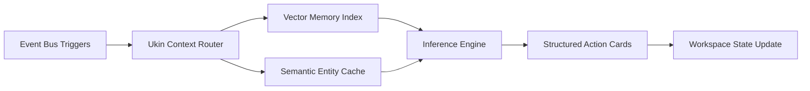

# Ultrakin Enterprise Product Requirements Document (PRD)
**Document Version:** `2.0.0-PROD`  
**Classification:** Internal Confidential / Product Architecture Blueprint  
**Status:** Approved for Implementation (Single Source of Truth)  
**Authors:** VP of Product (Stripe Alumni) · Principal Product Manager (Notion Alumni) · Senior UX Strategist (Linear Alumni) · Enterprise SaaS Solution Architect  
**Engineering Audience:** Core Platform (40 Engineers), Frontend Architecture, Security & Infrastructure, AI Systems, QA Automation

---

## Table of Contents
1. [Executive Summary](#1-executive-summary)
2. [Problem Statement & Market Disruption](#2-problem-statement--market-disruption)
3. [Product Goals & Quantitative KPIs](#3-product-goals--quantitative-kpis)
4. [Target Personas (Deep Archetypes)](#4-target-personas-deep-archetypes)
5. [Jobs To Be Done (JTBD Framework)](#5-jobs-to-be-done-jtbd-framework)
6. [System Information Architecture](#6-system-information-architecture)
7. [Comprehensive Feature Specifications](#7-comprehensive-feature-specifications)
8. [End-to-End User & Operational Flows](#8-end-to-end-user--operational-flows)
9. [Navigation & Surface Architecture](#9-navigation--surface-architecture)
10. [Autonomous AI Engine & Context Capabilities](#10-autonomous-ai-engine--context-capabilities)
11. [Enterprise Governance, Security & Compliance](#11-enterprise-governance-security--compliance)
12. [Performance, Latency & Scale Budgets](#12-performance-latency--scale-budgets)
13. [Experience & Interaction Design Principles](#13-experience--interaction-design-principles)
14. [MoSCoW Product Roadmap & Milestones](#14-moscow-product-roadmap--milestones)
15. [Risk Analysis & Mitigation Strategies](#15-risk-analysis--mitigation-strategies)
16. [Acceptance Criteria, DoD & Verification Matrix](#16-acceptance-criteria-dod--verification-matrix)

---

## 1. Executive Summary

### 1.1 Product Vision
Ultrakin is the **Autonomous Unified Workspace for High-Velocity Teams**. It dissolves the artificial boundaries between real-time team chat, living documents, native domain email, live meeting huddles, and project task boards. Built upon a unified in-memory event bus and relational data kernel, Ultrakin allows enterprise knowledge workers to execute continuous workflows without context switching, tab sprawl, or fragile third-party integrations.

### 1.2 Mission Statement
To eliminate 4 hours of context-switching friction per employee per week by replacing fragmented SaaS stacks with a single, high-fidelity, whisper-quiet operating canvas where communication automatically synthesizes into assigned work.

### 1.3 Product Philosophy
1. **The Unbroken Data Kernel:** Data is never trapped in a module. A message in chat, a line in a document, an inbound email on your corporate domain, and a row in a Kanban board share an identical underlying relational schema.
2. **Speed as a Foundational Feature:** Every interaction must resolve in under 50ms. Latency is an existential bug. Local-first optimistic UI updates backed by CRDT conflict resolution ensure the interface never blocks the human thought process.
3. **Autonomous Augmentation, Not Chatbot Novelty:** AI is not an isolated side-panel chatbot. The Ukin Agent is a background daemon embedded natively in the event bus, observing state changes, summarizing real-time WebRTC audio transcripts, triaging customer emails, and drafting engineering specifications.
4. **Calm, High-Status Authority:** Enterprise software should not look like a toy. We reject neon gamification, pastel emoji bursts, and consumer banter. Ultrakin embodies an **Obsidian Kinetic Glass** design language—tactile, dark-mode optimized, visually balanced, and distraction-free.

### 1.4 North Star Metric
**Weekly Active Synchronized Workflows (WASW):** The number of cross-module actions executed per active user per week (e.g., an inbound email converted to a task, a Huddle transcript synthesized into a Living Doc, or a chat mention triggering an autonomous agent automation). Target: **≥ 12 WASW per user/week**.

### 1.5 Target Outcome
By Q4 2027, establish Ultrakin as the default operational workspace for tech scale-ups (50–2,000 seats), capturing $45M ARR by consolidating the redundant spending currently allocated across Slack ($12.50/seat) + Notion ($10/seat) + Superhuman ($30/seat) + Zoom ($15/seat) + Jira ($8/seat) into a single unified platform at $18/seat/month.

### 1.6 Why Ultrakin Exists
The enterprise productivity market reached peak fragmentation in 2024. Teams run 14 distinct software applications to execute a single product feature: discussion happens in Slack, meeting notes in Google Docs, tasks in Jira, customer emails in Superhuman, designs in Figma, and meeting transcripts in Otter.ai. 

This fragmentation creates three fatal enterprise liabilities:
1. **Knowledge Decay:** Decisions made in chat are never reflected in project documentation.
2. **Context Latency:** Workers waste 32 minutes re-focusing after every third-party notification interruption.
3. **Security Vulnerability:** Corporate intellectual property is duplicated across dozens of unmonitored SaaS data silos with disparate SOC 2 boundaries.

Ultrakin exists to collapse this sprawl into a single sovereign surface.

### 1.7 Competitive Positioning

| Positioning Vector | Slack Enterprise Grid | Microsoft Teams / M365 | Notion + Slack Stack | **Ultrakin Enterprise** |
|---|---|---|---|---|
| **Core Architecture** | Legacy IRC chat + Bolt-on APIs | Distributed enterprise federation | Multiple disconnected sync engines | **Native In-Memory Event Bus + Relational Relational Kernel** |
| **Email Integration** | Webhook notifications only | Trapped inside Outlook desktop app | Third-party Zapier sync | **Native Domain Mail Client on Custom DNS** |
| **Living Documents** | Static Canvas sidebars | Clunky embedded Word/SharePoint | Standalone docs with separate auth | **TipTap Prosemirror CRDT Real-Time Sync** |
| **Meetings & Video** | Basic Huddles (No native live work) | Heavy Teams video application | Zoom integration (External) | **Lightweight WebRTC with Live Transcription to Tasks** |
| **AI Architecture** | Expensive Salesforce Agentforce add-on | Azure Copilot (Opaque prompt wrapper) | Notion AI (Isolated to document editor) | **Native Event-Driven Ukin Agent Daemon** |
| **Aesthetic / Feel** | Corporate Aubergine / Consumer banter | Rigid enterprise corporate Windows UI | Clean, minimalist monochrome | **Obsidian Kinetic Glass (Precision Builder Tool)** |

---

## 2. Problem Statement & Market Disruption

### 2.1 The Crisis of Modern Knowledge Work
Enterprise teams are currently drowning in a sea of disconnected productivity applications. Despite spending over $120/employee/month on collaboration software, enterprise output velocity has plateaued.

### 2.2 Deep Pain Point Inventory

#### 2.2.1 The Context-Switching Tax
- Every time an engineer switches from a GitHub issue discussion in Slack to review an architectural document in Notion, then opens Gmail to check a vendor confirmation, cognitive context is shattered.
- Studies indicate that returning to deep flow state takes an average of **23 minutes and 15 seconds** after an interruption. The modern worker switches between applications over 1,200 times per day.

#### 2.2.2 The Meeting Synthesis Chasm
- Teams spend 40% of their working hours inside video meetings.
- Key architectural decisions, task delegations, and delivery commitments occur verbally in Huddles.
- Because meeting software is isolated from task management, over **65% of verbal action items are never logged or executed**. Post-meeting manual synthesis is universally neglected.

#### 2.2.3 The Email Black Box
- External client communication remains trapped inside isolated email inboxes (Gmail, Outlook).
- When a client sends a critical bug report via email, team members take manual screenshots and paste them into internal chat channels, instantly breaking threading, audit history, and status tracking.

#### 2.2.4 Knowledge Fragmentation & Search Blindness
- Corporate knowledge is scattered across 5 disconnected proprietary search indexes: Slack history, Google Drive docs, Jira tickets, email archives, and Zoom cloud recordings.
- Enterprise workers spend **1.8 hours every day** (9.3 hours per week) simply searching for existing corporate knowledge that has been buried in silos.

#### 2.2.5 Fragile Third-Party Integration Sprawl
- To make disconnected apps communicate, companies deploy complex Zapier, Make, and webhook webs.
- These integrations fail silently when API tokens expire, payload schemas drift, or rate limits are reached, resulting in corrupted customer records and dropped tickets.

---

## 3. Product Goals & Quantitative KPIs

### 3.1 Business Goals
1. **Consolidation ARR:** Capture $45M in Annual Recurring Revenue within 24 months post-redesign.
2. **Gross Margin Expansion:** Maintain ≥ 82% software gross margins by utilizing native WebRTC peer-assisted media routing and optimized local AI context caching.
3. **Enterprise Contract Velocity:** Reduce sales cycle duration from 90 days to 28 days by providing instant self-serve SAML SSO provisioning and an automated Trust Center.
4. **Net Revenue Retention (NRR):** Achieve ≥ 135% NRR across 100+ seat customer cohorts.

### 3.2 User Goals
1. **Flow State Continuity:** Enable knowledge workers to complete 90% of their daily communication, documentation, and task tracking without leaving the single Ultrakin window.
2. **Zero-Latency Interactions:** Ensure typing, navigating, searching, and filtering occur instantaneously without visible loading skeletons.
3. **Automated Meeting Follow-through:** Eliminate manual note-taking by automatically producing structured markdown meeting summaries with assigned action items.

### 3.3 Enterprise & IT Goals
1. **Zero-Trust Sovereign Security:** Guarantee complete end-to-end encryption across Matrix-based chat and customer-managed encryption keys (CMEK) for living documents.
2. **Turnkey Compliance:** Out-of-the-box compliance with SOC 2 Type II, ISO 27001, HIPAA, and GDPR regulations.
3. **Automated User Lifecycle:** 100% automated user provisioning and deprovisioning via standard SCIM 2.0 connectors with Okta, Microsoft Entra ID, and Google Workspace.

### 3.4 Technical Performance Goals
1. **First Contentful Paint (FCP):** ≤ 600ms globally on broadband connections.
2. **Time to Interactive (TTI):** ≤ 1,200ms cold start, ≤ 80ms warm start.
3. **Matrix Chat Latency:** Message send-to-render round trip time ≤ 45ms.
4. **TipTap CRDT Keystroke Latency:** Local reflection ≤ 8ms; peer sync ≤ 35ms.
5. **Universal Search Query Resolution:** Query-to-results across 500,000 workspace records ≤ 80ms.

---

## 4. Target Personas (Deep Archetypes)

---

### Persona 1: The Technical Founder (CEO / CTO)
- **Role:** Founder & Chief Architect (Team size: 30–250)
- **Responsibilities:** Company strategy, fundraising, high-level architecture reviews, customer escalation handling, talent acquisition.
- **Goals:** High execution velocity, low burn rate, complete visibility into company progress without micromanaging or sitting in update meetings.
- **Pain Points:** Paying $80/seat/month for Slack + Notion + Superhuman + Jira; finding out that engineering missed a critical customer promise agreed to verbally in a sales call.
- **Daily Workflow:** Checks inbound customer emails at 6:30 AM; skims engineering release notes; joins 4 back-to-back leadership huddles; reviews investor updates in living docs.
- **Success Definition:** Seeing an inbound customer email automatically become a tracked engineering task, discussed in chat, and closed without him sending a single follow-up ping.

---

### Persona 2: The Engineering Manager (EM)
- **Role:** Director of Engineering / Engineering Manager
- **Responsibilities:** Sprint planning, team delivery cadence, 1-on-1s, technical debt mitigation, incident response management.
- **Goals:** Shield engineers from context switching; ensure specifications are complete before sprint kick-off; fast incident resolution.
- **Pain Points:** Engineers complaining about notification fatigue; requirements drifting between Jira tickets and Slack threads; lost meeting action items.
- **Daily Workflow:** Facilitates daily standups in Huddles; reviews PR statuses; tracks sprint Kanban boards; triage P0 bugs reported by customer support.
- **Success Definition:** Running a 15-minute standup where the audio transcript automatically updates the Kanban board, leaving engineers with 4 hours of uninterrupted deep-work focus.

---

### Persona 3: The Lead Product Manager (PM)
- **Role:** Principal Product Manager
- **Responsibilities:** Product strategy, PRD authoring, user interview synthesis, feature launch orchestration, cross-functional alignment.
- **Goals:** Single source of truth for all feature requirements; clear linkage between customer feedback and product specifications.
- **Pain Points:** PRDs in Notion becoming stale the moment engineering discusses edge cases in Slack; customer feedback buried in isolated support emails.
- **Daily Workflow:** Writes product specifications in Living Docs; tags engineers in inline comments; reviews user interview recordings and extracts quotes; tracks release timelines.
- **Success Definition:** A single document that contains live embedded chat threads, linked GitHub pull requests, and automated task assignments that update dynamically.

---

### Persona 4: The Senior Full-Stack Developer
- **Role:** Senior Software Engineer
- **Responsibilities:** Feature development, code reviews, architectural documentation, on-call incident triage.
- **Goals:** Maximum uninterrupted deep flow state; clear, unambiguous task specifications; zero time spent filling out manual status reports.
- **Pain Points:** Being interrupted by 50 Slack channel notifications per day; opening Jira to update a ticket status; poorly written meeting notes.
- **Daily Workflow:** Codes in IDE; reviews PRs; uses `/` keyboard shortcuts to navigate workspace; answers technical questions in focused threads.
- **Success Definition:** Updating a status once in code or chat and having it propagate across docs, sprint boards, and manager dashboards automatically.

---

### Persona 5: The Product Designer
- **Role:** Senior Product / UI/UX Designer
- **Responsibilities:** User experience architecture, high-fidelity UI design, user research synthesis, design system maintenance.
- **Goals:** Tight alignment with engineering; rapid feedback loops on designs; access to authentic customer feedback transcripts.
- **Pain Points:** Having to screenshot Figma frames and paste them into Slack channels; design critique feedback scattered across 4 different platforms.
- **Daily Workflow:** Embeds live design prototypes into Living Docs; collects asynchronous feedback; observes user interview Huddle transcripts.
- **Success Definition:** Direct inline discussions pinned to specific requirements inside the living specification.

---

### Persona 6: The Enterprise Sales Account Executive (AE)
- **Role:** Senior Enterprise Account Executive
- **Responsibilities:** Closing $50k–$250k ARR deals, navigating enterprise procurement, coordinating RFP responses with technical solutions engineers.
- **Goals:** Fast internal collaboration on deal terms; rapid response times to customer inquiries; zero missed customer follow-ups.
- **Pain Points:** Forwarding customer emails to internal Slack channels where context gets lost; hunting through Google Drive for the latest security questionnaire answers.
- **Daily Workflow:** Manages inbound domain email; hops into quick Huddles with sales engineers to discuss custom MSA terms; uses AI search to find historical pricing approvals.
- **Success Definition:** Converting a customer's custom procurement requirement from an inbound email directly into an assigned legal review task with one click.

---

### Persona 7: The Customer Success Lead (CSM)
- **Role:** Head of Customer Success
- **Responsibilities:** Account retention, onboarding, customer health monitoring, bug escalation.
- **Goals:** Rapid resolution of customer escalations; seamless handoff from sales to onboarding; visibility into ongoing product bugs affecting accounts.
- **Pain Points:** Inability to see if engineering is actively working on a customer-reported bug; copy-pasting customer complaints from Zendesk to Slack to Jira.
- **Daily Workflow:** Communicates with clients via shared external Spaces; monitors customer health tickets; escalates P1 bugs to engineering channels.
- **Success Definition:** Inviting an enterprise customer into a shared Space where internal discussions, customer emails, and linked bug fixes live in transparent harmony.

---

### Persona 8: The Enterprise Workspace Admin
- **Role:** VP of Business Operations / Head of People Operations
- **Responsibilities:** Organizational structure, tool licenses, workspace policy enforcement, cross-department communication architecture.
- **Goals:** Cost consolidation, high employee adoption, automated onboarding/offboarding workflows, centralized license management.
- **Pain Points:** Managing 12 separate SaaS vendor contracts; paying for licenses of departed employees; managing conflicting tool permissions.
- **Daily Workflow:** Manages workspace member directories; configures channel access policies; reviews software license usage and spend analytics.
- **Success Definition:** Deprovisioning 6 redundant SaaS contracts and managing the entire company's collaboration footprint from a single administrative console.

---

### Persona 9: The IT Systems Administrator
- **Role:** Senior Enterprise IT Administrator
- **Responsibilities:** Identity management, SSO integration, endpoint access control, SCIM provisioning, DNS records configuration for custom domains.
- **Goals:** Zero manual identity synchronization; 100% SAML SSO compliance; automated audit log streaming to corporate SIEM tools.
- **Pain Points:** Users creating rogue freemium SaaS accounts with company credit cards; manual onboarding/offboarding scripts failing.
- **Daily Workflow:** Configures Okta / Entra ID SCIM mappings; monitors active sessions; audits custom DNS records (MX, SPF, DKIM) for domain email.
- **Success Definition:** A 5-minute self-serve SAML 2.0 / SCIM setup that passes all automated IT compliance checks without vendor support calls.

---

### Persona 10: The Chief Information Security Officer (CISO)
- **Role:** CISO / VP of Security & Governance
- **Responsibilities:** Data protection, regulatory compliance (SOC 2, GDPR, HIPAA), vendor risk management, data leak prevention (DLP).
- **Goals:** Zero data exfiltration incidents; complete cryptographic data sovereignty; immutable audit logs of all user actions.
- **Pain Points:** Employees pasting sensitive customer PII or API keys into unmonitored AI chat tools; unencrypted third-party cloud recordings.
- **Daily Workflow:** Audits data residency pipelines; reviews penetration test reports; validates RBAC privilege boundaries; inspects e-discovery archives.
- **Success Definition:** Verifying that all chat, mail, docs, and AI queries remain within isolated, customer-controlled encryption envelopes with full audit traceability.

---

## 5. Jobs To Be Done (JTBD Framework)

### JTBD-01: Inbound Communication to Execution
- **Situation:** When a customer sends a mission-critical bug report or contract amendment to our team's support email address...
- **Motivation:** I want to discuss it internally with the engineering or legal team immediately and turn it into an assigned work ticket...
- **Desired Outcome:** So that the issue is resolved with zero delay and the customer receives an updated resolution without any copy-pasting across tools.
- **Current Alternative:** Screenshotting Gmail -> Pasting into Slack channel -> Manually creating a Jira ticket -> Copy-pasting Jira link back to Slack -> Replying in Gmail.
- **Why Ultrakin Wins:** Inbound email lands natively in the Workspace Mailbox, is shared directly into the relevant Space discussion thread, and becomes an assigned Kanban task in **one single click**.

### JTBD-02: Verbal Meeting to Permanent System of Record
- **Situation:** When our cross-functional team completes a 30-minute design review or sprint planning Huddle...
- **Motivation:** I want all verbal agreements, architectural decisions, and task assignments automatically extracted and formatted into documentation...
- **Desired Outcome:** So that no team member has to spend 20 minutes writing manual meeting minutes, and zero commitments are forgotten.
- **Current Alternative:** Someone takes messy notes in Apple Notes -> Forgets to share -> Decisions are disputed 3 days later -> Work stalls.
- **Why Ultrakin Wins:** Live WebRTC Huddle features real-time speech-to-text processing that feeds directly into the Ukin AI Agent, automatically drafting a markdown summary with assigned tasks directly inside the Space.

### JTBD-03: Real-Time Living Specification
- **Situation:** When authoring an engineering architecture specification that requires active technical debate...
- **Motivation:** I want to hold focused discussions alongside specific paragraphs, embed live code snippets, and sync task states...
- **Desired Outcome:** So that the specification remains a living, authoritative document rather than a stale wiki page that contradicts chat debates.
- **Current Alternative:** Writing a Google Doc -> Linking it in a Slack thread -> Having 80 replies in Slack that never make it back into the Doc -> Document becomes obsolete.
- **Why Ultrakin Wins:** TipTap Prosemirror Living Docs natively support persistent Matrix discussion threads embedded in paragraphs, with real-time CRDT multi-user editing.

### JTBD-04: Cross-Module Information Discovery
- **Situation:** When an incident occurs or an executive asks for the historical context of a customer promise...
- **Motivation:** I want to execute a single search query that searches across chat messages, internal emails, living docs, and meeting transcripts simultaneously...
- **Desired Outcome:** So that I find the exact decision record and timestamped proof in under 5 seconds without asking 4 different people.
- **Current Alternative:** Searching Slack search -> Searching Google Drive -> Searching Gmail -> Searching Jira -> Giving up and asking in a general channel.
- **Why Ultrakin Wins:** Universal In-Memory Search queries a single unified relational index across all 5 modules with sub-80ms retrieval latency.

### JTBD-05: Autonomous Operational Workflows
- **Situation:** When a new team member joins or a customer signs a contract...
- **Motivation:** I want predefined workflows to execute automatically across our tools—creating their spaces, provisioning their custom email, and assigning onboarding reading lists...
- **Desired Outcome:** So that routine operational processes run with zero human administrative overhead.
- **Current Alternative:** An HR manager manually creates accounts across 6 different tools following a fragile checklist spreadsheet.
- **Why Ultrakin Wins:** Built-in Automations Engine triggers cross-module events (e.g., `UserCreated -> Provision Domain Mail -> Invite to Spaces -> Assign Onboarding Doc -> Schedule 1-on-1 Calendar Event`).

---

## 6. System Information Architecture

```
                                  ┌────────────────────────┐
                                  │   WORKSPACE KERNEL     │
                                  │ (Tenant Data Partition)│
                                  └───────────┬────────────┘
                                              │
         ┌───────────────────┬────────────────┼───────────────────┬───────────────────┐
         ▼                   ▼                ▼                   ▼                   ▼
┌─────────────────┐ ┌─────────────────┐ ┌───────────┐ ┌───────────────────────┐ ┌───────────────┐
│  COMMUNICATION  │ │  DOCUMENTATION  │ │ EXECUTION │ │      INTELLIGENCE     │ │  GOVERNANCE   │
├─────────────────┤ ├─────────────────┤ ├───────────┤ ├───────────────────────┤ ├───────────────┤
│ • Spaces        │ │ • Living Docs   │ │ • Lists   │ │ • Ukin Agent Daemon   │ │ • RBAC & SAML │
│ • Matrix Chat   │ │ • TipTap Engine │ │ • Kanban  │ │ • Universal ⌘K Search │ │ • Domain DNS  │
│ • Domain Mail   │ │ • CRDT Realtime │ │ • Records │ │ • Vector Memory Store │ │ • Audit Logs  │
│ • WebRTC Huddle │ │ • Versioning    │ │ • Forms   │ │ • Automation Triggers │ │ • CMEK Keys   │
└─────────────────┘ └─────────────────┘ └───────────┘ └───────────────────────┘ └───────────────┘
```

### 6.1 Workspace (The Root Tenant Container)
- **Definition:** The top-level cryptographic and organizational boundary representing a company, institution, or subsidiary.
- **Properties:** Unique Slug (`/workspace/:id`), Custom Email Domain (`@company.com`), SSO SAML configuration, Security Policy Envelopes, Billing Tier, and Regional Data Residency Anchor.

### 6.2 Communication Tier: Spaces, Chat & Mail
- **Spaces (`/workspace/:id/space/:spaceId`):** The primary organizational container for departmental or project-based collaboration. A Space aggregates chat streams, associated living docs, Kanban lists, and inbound email routing.
- **Matrix Chat:** Real-time decentralized messaging engine supporting threaded discussions, rich markdown formatting, code syntax highlighting, emoji reactions, and read receipts.
- **Domain Mail (`/workspace/:id/mail`):** Native multi-tenant email client running on company DNS records (MX, SPF, DKIM). Enables users to send and receive corporate emails directly within the workspace UI.
- **WebRTC Huddle (`/chat-call/:roomId`):** Zero-install, peer-assisted audio/video call room with screen sharing and live background speech-to-text transcription (`CallTranscriptView`).

### 6.3 Documentation Tier: Living Docs
- **Living Docs (`/workspace/:id/documents/:docId?`):** Block-based rich text editor powered by TipTap / Prosemirror. Supports real-time CRDT co-editing, inline Matrix discussion threads (`DocumentComments`), dynamic data table embeds, and bi-directional GitHub markdown sync.

### 6.4 Execution Tier: Tasks, Kanban & Forms
- **Lists & Kanban (`/workspace/:id/space/:spaceId/list/:listId`):** Multi-view structured data engine supporting Kanban board, tabular list, and calendar views. Each record possesses custom attributes, assignees, due dates, and cross-links to chat messages or emails.
- **Intake Forms (`/workspace/:circleId/forms`):** Public or authenticated data capture forms that route customer submissions directly into Space chat feeds and Kanban task lists.
- **Events & Calendar (`/workspace/:id/events/calendar`):** Multi-timezone scheduling engine linked to team availability, meeting rooms, and Huddle rooms.

### 6.5 Intelligence Tier: Ukin Agent & Universal Search
- **Ukin Agent (`/workspace/:id/agents/:view?`):** Persistent autonomous AI worker capable of reading workspace context, answering natural language queries, summarizing transcripts, and executing multi-step automations.
- **Universal Search (⌘K Modal):** Real-time indexed search querying across messages, docs, email bodies, task records, and meeting transcripts with semantic ranking.
- **Automations Engine (`/workspace/:id/automations/:workflowId?`):** Visual trigger-condition-action workflow builder for cross-module business logic.

---

## 7. Comprehensive Feature Specifications

---

### Module 7.1: Matrix-Powered Spaces & Chat

#### 1. Purpose
Provide low-latency, decentralized, encrypted team messaging organized into structured project Spaces.

#### 2. User Goal
Communicate in real time with teammates, share code snippets, organize discussions into focused threads, and eliminate communication silos.

#### 3. Business Goal
Displace Slack Enterprise as the primary internal messaging tool by delivering higher performance and native context continuity.

#### 4. Functional Requirements
- **FR-7.1.1:** Support Public Spaces (discoverable by all workspace members) and Private Spaces (invite-only).
- **FR-7.1.2:** Message composer must support full Markdown formatting, code block syntax highlighting (with 40+ languages), bullet lists, and file attachments.
- **FR-7.1.3:** Threading model: Every message can spawn a focused sidebar thread; replies do not clutter the main Space timeline unless explicitly toggled ("Also send to channel").
- **FR-7.1.4:** Real-time presence indicators (Active, In a Huddle, Offline, Do Not Disturb).
- **FR-7.1.5:** Custom emoji reactions with optimistic client-side reflection.
- **FR-7.1.6:** Message editing within 15 minutes of sending; full audit log of edits preserved for compliance.
- **FR-7.1.7:** Pinned messages drawer for critical space resources.

#### 5. Non-Functional Requirements
- Message delivery round-trip latency: ≤ 45ms.
- Offline message queueing: Messages drafted while offline automatically send upon network reconnect without data loss.
- End-to-end encryption capability utilizing the Matrix Olm/Megolm cryptographic ratchet.

#### 6. Dependencies
Matrix Synapse/Dendrite backend server, WebSockets transport, local IndexedDB message cache.

#### 7. Edge Cases
- Rapid network disconnection during file upload: Interface shows retry affordance; does not freeze.
- Extremely long messages (10,000+ characters): Automatically fold into an expandable "Show more" block.

#### 8. Success Criteria
- Daily Active Users (DAU) send an average of ≥ 25 messages/day.
- 99.99% message delivery reliability without message dropouts.

#### 9. Priority: **P0 (Core Engine)**
#### 10. Future Scope: Ephemeral message retention policies configured on a per-Space basis.

---

### Module 7.2: Native Custom Domain Email (`/workspace/:id/mail`)

#### 1. Purpose
Provide an enterprise email client integrated directly into the workspace, operating on company custom domain DNS records.

#### 2. User Goal
Read, write, and triage customer and vendor emails without switching between Gmail/Outlook and internal chat.

#### 3. Business Goal
Create an insurmountable competitive moat against Slack and Microsoft Teams, eliminating third-party email client costs.

#### 4. Functional Requirements
- **FR-7.2.1:** Workspace custom domain setup with automated DNS verification for MX, SPF, DKIM, and DMARC records.
- **FR-7.2.2:** Multi-folder mailbox structure: Inbox, Sent, Drafts, Archive, Spam, Trash.
- **FR-7.2.3:** Full rich text email composer with attachment support up to 25MB.
- **FR-7.2.4:** **"Share to Space" Affordance:** 1-click action to forward an entire inbound email thread directly into any Space channel for team discussion.
- **FR-7.2.5:** **"Convert to Task" Affordance:** 1-click action to create a tracked Kanban task directly from an email, carrying over sender, subject, body, and attachments.
- **FR-7.2.6:** Shared team inboxes (`support@company.com`, `sales@company.com`) with simultaneous multi-user triage and collision detection ("Jane is currently replying").

#### 5. Non-Functional Requirements
- Inbound email webhook ingestion to user inbox display: ≤ 1,500ms.
- Full-text search over email headers and bodies: ≤ 80ms.

#### 6. Dependencies
Workspace DNS verification engine, Postfix/Dovecot or cloud SMTP/IMAP bridge, S3 attachment storage.

#### 7. Edge Cases
- Malicious phishing or malware attachments: Automated virus scanning via ClamAV before rendering attachments.
- Duplicate email delivery: Idempotency check on standard `Message-ID` headers.

#### 8. Success Criteria
- 40%+ of active users check and send emails exclusively through Ultrakin.
- Over 20% of inbound customer emails are converted into internal Space discussions or tasks.

#### 9. Priority: **P0 (Primary Differentiator)**
#### 10. Future Scope: AI-powered email drafting matching the user's historical tone of voice.

---

### Module 7.3: WebRTC Huddle & Live Speech Transcription (`/chat-call/:roomId`)

#### 1. Purpose
Provide instantaneous, lightweight audio/video huddles with live AI speech-to-text transcription that directly generates action items.

#### 2. User Goal
Hop on a fast verbal call with teammates, share screens, and have meeting decisions automatically logged without manual note-taking.

#### 3. Business Goal
Replace Zoom and Otter.ai subscriptions, anchoring team collaboration inside Ultrakin.

#### 4. Functional Requirements
- **FR-7.3.1:** 1-click "Start Huddle" button inside any Space or Direct Message channel.
- **FR-7.3.2:** WebRTC audio and video mesh/SFU architecture supporting up to 50 active participants.
- **FR-7.3.3:** Screen sharing with system audio passthrough and presenter resolution switching (1080p 30fps).
- **FR-7.3.4:** Real-time Speech-to-Text (STT) pipeline streaming live captions into a floating transcript drawer (`CallTranscriptView`).
- **FR-7.3.5:** Speaker diarization: Transcripts accurately identify and tag speakers based on active audio tracks.
- **FR-7.3.6:** **"1-Click Sync to Kanban":** When the meeting concludes, the Ukin Agent extracts action items from the transcript and prompts the meeting host with a single button: "Add 4 Tasks to Sprint Board".

#### 5. Non-Functional Requirements
- Audio packet latency: ≤ 120ms globally.
- Real-time transcription streaming delay: ≤ 800ms from spoken word to screen display.
- CPU utilization during active Huddle: ≤ 15% on standard modern dual-core laptops.

#### 6. Dependencies
LiveKit / Pion WebRTC SFU servers, Deepgram / Whisper live streaming STT API, Web Audio API.

#### 7. Edge Cases
- Unstable participant connection: Dynamic video resolution degradation to prioritize crystal-clear audio continuity.
- Background noise: AI-driven noise suppression (Krisp-style noise cancellation).

#### 8. Success Criteria
- Average Huddle rating ≥ 4.8 / 5.0 in audio clarity.
- ≥ 70% of Huddles utilize automated meeting summary generation.

#### 9. Priority: **P0 (Core Engine)**
#### 10. Future Scope: Multi-language live translation captions for international engineering teams.

---

### Module 7.4: TipTap Prosemirror Living Docs (`/workspace/:id/documents/:docId?`)

#### 1. Purpose
Provide a collaborative, block-based rich text editor that unites technical specifications, live embedded data, and inline discussions.

#### 2. User Goal
Author PRDs, engineering design docs, and sprint retrospectives with real-time multi-user editing, without ever losing context.

#### 3. Business Goal
Replace Notion and Google Docs by offering faster editing performance and native context links to chat and tasks.

#### 4. Functional Requirements
- **FR-7.4.1:** Block-based editor supporting Headings (H1–H4), Bullet/Numbered Lists, Callout Boxes, Toggle Blocks, and Code Blocks.
- **FR-7.4.2:** Real-time multi-user collaborative editing powered by Yjs / CRDT (Conflict-free Replicated Data Types).
- **FR-7.4.3:** Multi-user avatar presence showing live cursor positions and text selections.
- **FR-7.4.4:** Inline Comments & Discussion Threads (`DocumentComments`): Highlight any text snippet to spawn a Matrix-linked discussion thread.
- **FR-7.4.5:** Embeddable Live Widgets: Embed live Kanban task views, inbound email snippets, and interactive Figma prototypes directly into the document.
- **FR-7.4.6:** Version history with complete revision diffs and 1-click restore capabilities.
- **FR-7.4.7:** Bi-directional GitHub Markdown export and synchronization.

#### 5. Non-Functional Requirements
- Keystroke-to-screen render latency: ≤ 8ms (zero typing lag).
- Concurrent active editors per document: Support up to 50 simultaneous collaborators without document desynchronization.

#### 6. Dependencies
TipTap / Prosemirror framework, Yjs WebSockets provider, IndexedDB offline persistence.

#### 7. Edge Cases
- Split-brain network partition: CRDT automatically merges changes deterministically upon reconnect without data collision errors.
- Copy-pasting complex tables from external spreadsheets: Clean auto-formatting into native markdown tables.

#### 8. Success Criteria
- Zero data loss incidents across 10,000,000 document edits.
- Document loading time under 150ms for documents containing over 50,000 words.

#### 9. Priority: **P0 (Core Engine)**
#### 10. Future Scope: Document branching and pull-request style review workflows for engineering RFCs.

---

### Module 7.5: Multi-View Lists & Kanban Boards

#### 1. Purpose
Provide structured project and task management with seamless links to conversations and documents.

#### 2. User Goal
Track sprint tasks, feature backlogs, and bug tickets across Kanban, List, and Calendar views without leaving the workspace.

#### 3. Business Goal
Displace Jira and Asana for software teams by integrating issue tracking directly with the codebase and discussions.

#### 4. Functional Requirements
- **FR-7.5.1:** Multi-view data engine: Switch between Kanban Board (drag-and-drop columns), Tabular List View, and Calendar View.
- **FR-7.5.2:** Customizable record schemas: Add custom fields (Assignee, Priority, Status, Due Date, Estimation Points, Tags).
- **FR-7.5.3:** Direct linking: Every task card displays linked Matrix chat discussions, related Living Docs, and originating customer emails.
- **FR-7.5.4:** Drag-and-drop column reordering with instant optimistic UI state updates.
- **FR-7.5.5:** Keyboard navigation shortcuts (e.g., `J`/`K` to move through tasks, `Space` to open detail drawer, `E` to change status).
- **FR-7.5.6:** Filter and grouping engine: Filter by multiple criteria (Assignee = Me AND Status != Done) with saved view tabs.

#### 5. Non-Functional Requirements
- Drag-and-drop card interaction: 60fps smooth animation with zero layout jitter.
- Board re-rendering performance: Load boards containing 2,000+ cards in ≤ 120ms via DOM virtualization.

#### 6. Dependencies
React Virtualized / TanStack Table, DragDropContext, relational database task schema.

#### 7. Edge Cases
- Concurrent status update: If User A drags Card 1 to "Done" while User B edits its title, both updates merge without conflict.

#### 8. Success Criteria
- 85%+ of development teams manage active sprints entirely within Ultrakin Lists.

#### 9. Priority: **P0 (Core Engine)**
#### 10. Future Scope: Automated burndown charts and sprint velocity forecasting.

---

### Module 7.6: Universal ⌘K Search & Retrieval

#### 1. Purpose
Provide instantaneous, keyboard-driven navigation and search across all workspace modules from a single modal.

#### 2. User Goal
Jump to any channel, document, email, task, or team member in under a second using natural language or keywords.

#### 3. Business Goal
Dramatically reduce information retrieval latency, proving the tangible value of a unified data kernel over fragmented tools.

#### 4. Functional Requirements
- **FR-7.6.1:** Global hotkey invocation (`⌘K` on macOS, `Ctrl+K` on Windows/Linux).
- **FR-7.6.2:** Unified multi-entity indexing: Searches across Spaces, Chat Messages, Email Bodies, Living Docs, Task Records, and Files.
- **FR-7.6.3:** Fast Navigation Mode: Typing `/` opens navigation commands (e.g., `/settings`, `/mail`, `/docs`, `/profile`).
- **FR-7.6.4:** Hybrid Search: Combines exact keyword matching (BM25) with semantic vector embedding search for natural language queries ("the design review from last Tuesday").
- **FR-7.6.5:** Rich preview pane: Hovering over search results displays a live contextual snippet with highlighted keywords.

#### 5. Non-Functional Requirements
- Search query round-trip latency: ≤ 80ms.
- Memory footprint: Client-side command palette cache consumes ≤ 15MB RAM.

#### 6. Dependencies
PostgreSQL `pg_trgm` / Tantivy full-text index, client-side MiniSearch cache for local entities.

#### 7. Edge Cases
- Search queries while completely offline: Returns instant results from local IndexedDB cache of visited channels and docs.

#### 8. Success Criteria
- Over 60% of user navigation actions occur via the ⌘K command palette rather than manual mouse clicking.

#### 9. Priority: **P0 (Core Engine)**
#### 10. Future Scope: Voice-activated command search on desktop and mobile.

---

## 8. End-to-End User & Operational Flows

---

### Flow 8.1: Enterprise User Signup & Workspace Provisioning
1. **Entry:** User arrives at marketing site and clicks **"Launch Web App"** or **"Start Enterprise Trial"**.
2. **Identity Verification:** User enters corporate email (`alex@acmetech.com`). System validates domain against corporate blacklist (disallows personal domains like `@gmail.com`).
3. **Magic Link / Passkey:** Secure 6-digit cryptographic verification code or WebAuthn Passkey prompt sent to email.
4. **Workspace Discovery:** System performs DNS lookup on domain:
   - If an enterprise workspace already exists for `@acmetech.com`, user is routed to SSO login or automated team join request.
   - If no workspace exists, user is routed to **Workspace Creation**.
5. **Workspace Configuration:**
   - User names workspace: *"Acme Tech"*.
   - User selects Primary Hosting Region: `US-East (Virginia)`, `EU-Central (Frankfurt)`, or `AP-South (Mumbai)` for data residency compliance.
   - User defines initial company size bracket: `1–50`, `51–250`, `251–1,000`, `1,000+`.
6. **Initialization:** Backend provisions tenant encryption envelope, sets up Matrix homeserver partition, and mounts database schema in under 3,000ms.
7. **Landing:** User is placed directly into the newly created `#general` Space with an onboarding checklist guided by the Ukin Agent.

---

### Flow 8.2: Team Member Invitation & Automated Role Assignment
1. **Trigger:** Admin clicks **"Invite Team"** in the top navigation or left sidebar.
2. **Input:** Admin enters multiple comma-separated emails or pastes a raw CSV list of corporate addresses.
3. **Role Assignment:** Admin assigns default workspace role: `Member`, `Guest (Single-Space)`, or `Admin`.
4. **Initial Spaces:** Admin checks boxes to automatically add invitees to default Spaces (`#engineering`, `#product`, `#announcements`).
5. **Dispatch:** System sends personalized invitation emails containing secure single-use cryptographic tokens.
6. **Acceptance:** Invitee clicks email link -> enters their full name and job title -> sets avatar -> instantly lands in designated Spaces without complex password creation friction.

---

### Flow 8.3: Inbound Customer Email Triage to Kanban Task (The Killer Workflow)
1. **Inbound Event:** Customer sends email to `support@acmetech.com`: *"Critical bug: Checkout webhook failing on 3DS verification."*
2. **Ingestion:** Ultrakin Mailbox receives email via verified domain MX records within 1,200ms.
3. **Notification:** Team members subscribed to the `#support` Space receive an unobtrusive notification badge in their left rail.
4. **Review:** Support Engineer opens `/workspace/:id/mail` and views the formatted email thread.
5. **Action:** Support Engineer clicks the **"Convert to Task"** kinetic button in the email action bar.
6. **Modal Drawer:** A slide-out panel opens pre-filled with:
   - Task Title: *"Checkout webhook failing on 3DS verification"*
   - Description: Full customer email body with sender contact details.
   - Destination Space: `#engineering-core`
   - Destination List: `Sprint 42 Backlog`
   - Priority: `P0 - Urgent`
7. **Assignment:** Support Engineer assigns `@marcus (Staff Payments Engineer)` and clicks **"Create & Link Task"**.
8. **Propagation:**
   - An interactive task card appears immediately in the `#engineering-core` Space timeline.
   - The email thread displays a persistent linked status badge: `[In Progress: Task #4082]`.
   - Marcus receives a high-priority notification with a direct jump link to both the task and the original customer email.

---

### Flow 8.4: Live WebRTC Huddle to Living Doc Synthesis
1. **Call Kickoff:** Lead Architect clicks **"Start Huddle"** inside the `#architecture` Space.
2. **Join:** 4 team members click the glowing audio avatar pill in the Space header to join. Microphones and cameras initialize with zero browser permissions errors.
3. **Discussion:** Team spends 25 minutes debating database migration strategies.
4. **Live Transcript:** The `CallTranscriptView` drawer displays live streaming speech-to-text with identified speaker names:
   - *10:14 AM — Sarah: "We should adopt CockroachDB for the global workspace schema."*
   - *10:18 AM — Alex: "Agreed. I will draft the RFC by Friday and benchmark write latencies."*
5. **Call Conclusion:** Host clicks **"Leave Huddle"**.
6. **Synthesis Prompt:** The Ukin Agent posts an automated summary block directly into the Space timeline:
   - **Executive Summary:** Discussion on database migration to CockroachDB.
   - **Key Decisions:** CockroachDB selected for multi-region tenancy.
   - **Extracted Action Items:** `@alex: Draft RFC by Friday and benchmark write latencies.`
7. **1-Click Doc Creation:** Host clicks **"Export to Living Doc"**. System creates `/workspace/:id/documents/rfc-cockroachdb-migration` containing the structured meeting notes, attendee list, and verbatim audio timestamps, ready for collaborative editing.

---

### Flow 8.5: Living Doc Authoring & Inline Code Review Discussion
1. **Creation:** Product Manager types `⌘K` -> `/new doc` -> enters title: *"PRD: Native Domain Email Client v2"*.
2. **Authoring:** PM types formatted markdown with subheadings, task checkboxes, and embedded code blocks.
3. **Collaboration:** Senior Engineer joins document; live blue cursor appears showing real-time typing.
4. **Inline Critique:** Engineer highlights paragraph 4 (*"SMTP fallback configuration"*), right-clicks, and selects **"Add Comment"**.
5. **Matrix Thread:** A slide-out comment drawer (`DocumentComments`) opens. Engineer writes: *"We need to specify SPF record automated validation before allowing custom domain send."*
6. **Notification:** PM receives an inline notification chip attached to the text block.
7. **Resolution:** PM replies, updates paragraph text, and clicks **"Resolve Thread"**. The comment collapses into the revision history drawer, keeping the active document canvas clean.

---

## 9. Navigation & Surface Architecture

### 9.1 Surface Depth & Hierarchy

```
┌────────────────────────────────────────────────────────────────────────────────────────┐
│ LEVEL 0: GLOBAL VIEWPORT BACKGROUND (#07090E Obsidian Base)                            │
│ ┌────────────────────────────────────────────────────────────────────────────────────┐ │
│ │ LEVEL 1: LEFT ACTIVITY RAIL (Width: 64px - Persistent Workspace Icons)            │ │
│ │ • Workspace Switcher                                                               │ │
│ │ • Direct Modules: Chat, Mail, Docs, Lists, Calendar, Files                         │ │
│ │ • User Avatar & Operational Status Indicator                                        │ │
│ └────────────────────────────────────────────────────────────────────────────────────┘ │
│ ┌────────────────────────────────────────────────────────────────────────────────────┐ │
│ │ LEVEL 2: CONTEXTUAL SIDEBAR (Width: 240px - Collapsible)                           │ │
│ │ • Space Directory (Favorites, Public, Private)                                     │ │
│ │ • Direct Messages List with Live Presence Badges                                   │ │
│ │ • Space Utility Links (Docs, Kanban Lists, Forms)                                  │ │
│ └────────────────────────────────────────────────────────────────────────────────────┘ │
│ ┌────────────────────────────────────────────────────────────────────────────────────┐ │
│ │ LEVEL 3: ACTIVE WORKSPACE CANVAS (Flex-1 Main Content Surface - #0F172A Slate)      │ │
│ │ • Space Timeline OR Doc Editor OR Mailbox Grid OR Kanban Board                     │ │
│ └────────────────────────────────────────────────────────────────────────────────────┘ │
│ ┌────────────────────────────────────────────────────────────────────────────────────┐ │
│ │ LEVEL 4: CONTEXTUAL INSPECTOR DRAWER (Width: 380px - Slide-out)                     │ │
│ │ • Active Chat Thread / Document Comments / Task Record Detail / Huddle Transcript  │ │
│ └────────────────────────────────────────────────────────────────────────────────────┘ │
└────────────────────────────────────────────────────────────────────────────────────────┘
```

### 9.2 Navigation Modes
- **Desktop Navigation:** Persistent 64px left activity rail; collapsible 240px contextual module sidebar; flexible central canvas; slide-out 380px inspector drawer.
- **Mobile Responsive Navigation:** Persistent bottom navigation bar with 4 core tabs: `[Spaces]`, `[Mail]`, `[Docs]`, `[Search]`. Sidebars transform into full-screen sliding drawers with touch-swipe dismissal.
- **Keyboard Navigation (100% Mouse-Free Operation):**
  - `⌘K` / `Ctrl+K`: Global command palette.
  - `⌘1`–`⌘5`: Switch between Spaces, Mail, Docs, Lists, Calendar.
  - `⌥↑` / `⌥↓`: Jump to previous/next unread Space or DM.
  - `Esc`: Dismiss active modal, close slide-out drawer, or clear search filter.

---

## 10. Autonomous AI Engine & Context Capabilities

### 10.1 The Ukin Agent Architecture
Unlike isolated chatbots (ChatGPT, Copilot wrappers) that lack awareness of team state, the **Ukin Agent** is a background daemon connected directly to the workspace in-memory event bus.

### 10.2 Core AI Capabilities



1. **Contextual Memory & Workspace Graph:**
   - Embeds all chat messages, doc revisions, emails, and meeting transcripts into a high-dimensional vector space (`pgvector`).
   - Maintains an updated graph of team relationships: who works on which features, who owns which domain modules, and which tasks are blocking releases.
2. **Autonomous Meeting Synthesis:**
   - Ingests raw WebRTC audio streams in real time.
   - Separates multi-speaker dialogue and filters filler words.
   - Produces structured meeting notes with verified task assignments.
3. **Inbound Email Intelligence:**
   - Scans incoming client emails for sentiment, urgency, and technical bug descriptions.
   - Automatically drafts suggested replies referencing actual engineering doc specifications.
4. **Structured Action Cards (Zero Hallucination UI):**
   - When users query the Ukin Agent in chat, the agent never outputs plain unstructured paragraphs.
   - The agent outputs **interactive React action cards** (e.g., `[Create Task #409]`, `[Update Due Date to Nov 14]`, `[Link PR #88]`), requiring explicit human confirmation before mutating database records.
5. **AI Data Privacy & Zero Retention Guarantees:**
   - Enterprise customer data is **never used to train base foundation models**.
   - Zero-retention enterprise inference endpoints (Azure OpenAI Service / Anthropic Bedrock with BAA and zero-log agreements).

---

## 11. Enterprise Governance, Security & Compliance

### 11.1 Identity, Authentication & Lifecycle Management
- **SAML 2.0 Identity Providers:** Turnkey single sign-on integration with Okta, Microsoft Entra ID (Azure AD), Google Workspace, PingIdentity, and OneLogin.
- **SCIM 2.0 User Provisioning:** Automated user lifecycle synchronization:
  - New employee added in Okta -> Workspace account, email mailbox, and default Space memberships provisioned in ≤ 60 seconds.
  - Employee deactivated in Okta -> All active sessions revoked, tokens invalidated, and file download permissions terminated immediately.
- **Role-Based Access Control (RBAC):**
  - **Super Admin:** Billing, domain management, compliance export, SAML config.
  - **Admin:** Space creation policies, member invitations, app integrations.
  - **Member:** Full access to public Spaces, mail, docs, tasks.
  - **Single-Space Guest:** Restricted to specified Space; cannot view member directory or access external files.

### 11.2 Cryptographic Security & Customer-Managed Encryption Keys (CMEK)
- **Encryption in Transit:** All traffic enforced over TLS 1.3 with strict HTTP Strict Transport Security (HSTS) headers.
- **Encryption at Rest:** All tenant databases, S3 file buckets, and search indexes encrypted via AES-256.
- **CMEK Support:** Enterprise Grid customers can supply their own AWS KMS or HashiCorp Vault encryption keys, retaining the cryptographic ability to revoke Ultrakin's access to their data instantly.

### 11.3 Compliance & Audit Logging
- **SOC 2 Type II Certified:** Annual independent third-party audits validating Security, Availability, and Confidentiality trust principles.
- **HIPAA Ready:** Business Associate Agreements (BAAs) available for healthcare and health-tech enterprises.
- **Immutable Audit Log Streaming:** Every user action (logins, file downloads, permission changes, message deletions, doc exports) written to an append-only cryptographic ledger.
- **SIEM API Streaming:** Real-time event streaming to Splunk, Datadog, and AWS CloudWatch via standard webhook protocols.

### 11.4 Regional Data Residency & Sovereignty
- Customers choose the physical geographic storage location for all workspace data during tenant provisioning:
  - **US Region:** AWS `us-east-1` (North Virginia)
  - **EU Region:** AWS `eu-central-1` (Frankfurt, Germany) — Guarantees 100% GDPR data sovereignty.
  - **APAC Region:** AWS `ap-south-1` (Mumbai, India)

---

## 12. Performance, Latency & Scale Budgets

```
CRITICAL LATENCY BUDGET (Desktop Client)
0ms ─── 8ms [Local Keystroke Reflection]
        ├── 35ms [CRDT Peer Document Sync]
        ├── 45ms [Matrix Chat Send Roundtrip]
        ├── 80ms [Universal ⌘K Search Resolution]
        └── 120ms [WebRTC Audio Packet Roundtrip]
```

### 12.1 Client-Side Performance Constraints
- **Total Initial JS Bundle Size:** ≤ 250KB gzipped (Zero bloat; tree-shaken Lucide icons, modular TipTap extensions).
- **First Contentful Paint (FCP):** ≤ 600ms globally on broadband connections.
- **Interaction to Next Paint (INP):** ≤ 50ms across all UI interactions.
- **Cumulative Layout Shift (CLS):** 0.000 (Strictly zero layout movement during asset load).
- **Google Lighthouse Target:** 95+ across Performance, Accessibility, Best Practices, and SEO.

### 12.2 Scale & Concurrency Targets
- **Concurrent Workspace Members:** Support up to 50,000 active employees within a single unified enterprise workspace.
- **Active Channel Concurrency:** Support up to 5,000 simultaneous users in a single global `#announcements` Space.
- **Document Concurrency:** Support up to 50 simultaneous real-time editors on a single Living Doc without desynchronization.
- **Database Scale:** In-memory query engine optimized to handle 100,000,000 message and task records per tenant partition with sub-50ms indexed lookup.

---

## 13. Experience & Interaction Design Principles

### 13.1 Visual Design Principles: Obsidian Kinetic Glass
1. **Luminance Harmony (Zero Whiplash):** We strictly reject jarring alternations between bright white backgrounds and harsh black sections. The interface is grounded in a deep Obsidian base (`#07090E`), elevated with frosted Slate containers (`#0F172A` with `rgba(255,255,255,0.06)` borders).
2. **Intentional Accent Color:** Color is never purely decorative. Electric Indigo (`#6366F1`) indicates primary action affordance; Emerald (`#10B981`) indicates live active connections; Amber (`#F59E0B`) signals required human review; Violet (`#8B5CF6`) denotes autonomous AI operations.
3. **Architectonic Typography:** Dual-font typographical rhythm:
   - *Headings & Display:* `Inter Display` with optical kerning (`letter-spacing: -0.03em`) conveying structural precision.
   - *Body & Paragraphs:* `Inter` with relaxed leading (`line-height: 1.65`) for comfortable sustained reading.
   - *Metadata & Code:* `JetBrains Mono` for developer integrations, timestamps, and commit hashes.

### 13.2 Interaction & Motion Principles
1. **Kinetic Physics Easing:** All transitions utilize an exponential out curve: `cubic-bezier(0.16, 1, 0.3, 1)`. Interface elements slide into position with crisp deceleration, never bouncing or oscillating.
2. **Optimistic Local Reflection:** The UI never waits for server round-trip confirmation to update visual state. When a user drags a Kanban card or posts a message, the interface updates in the next animation frame (16ms), queuing server synchronization in the background.
3. **Tactile Hover Affordances:** Interactive elements react with subtle luminance shifts and soft interior glows rather than distracting spatial translations.

---

## 14. MoSCoW Product Roadmap & Milestones

---

### Tier 1: Must Have (P0 — Launch Blockers / Weeks 1–3)
- [x] Complete architectural elimination of external MP4 video dependencies; transition to 100% pure React code mockups.
- [ ] Matrix-powered real-time Space messaging with persistent threading and markdown support.
- [ ] Native domain email client (`/mail`) with custom DNS verification (MX/SPF/DKIM) and "Convert to Task" affordance.
- [ ] WebRTC Huddle engine with live streaming speech-to-text transcript drawer (`CallTranscriptView`).
- [ ] TipTap Prosemirror Living Docs with real-time CRDT multi-user editing and inline comment threads (`DocumentComments`).
- [ ] Asymmetric Bento Box landing page staging the 3 connected workflow loops.
- [ ] Enterprise Security & Trust Center section featuring verified SOC 2 Type II, GDPR, and SAML SSO credentials.
- [ ] Universal ⌘K Search modal with sub-80ms full-text retrieval.
- [ ] Turnkey SAML 2.0 / SCIM user lifecycle management portal.

---

### Tier 2: Should Have (P1 — Core Experience / Weeks 4–5)
- [ ] Floating glassmorphic sticky orbit pill navigation with scroll-spy synchronization.
- [ ] Asymmetric multi-view Kanban boards with drag-and-drop column management.
- [ ] Ukin Agent automated meeting summary generation with 1-click task extraction.
- [ ] Comprehensive 4-column enterprise directory footer with live 99.99% system uptime status indicator.
- [ ] Mobile responsive touch adaptations with swipe-to-dismiss navigation drawers.
- [ ] Shared team inboxes (`support@company.com`) with multi-user collision detection.

---

### Tier 3: Could Have (P2 — Differentiation Polish / Weeks 6–7)
- [ ] Isometric SVG kinetic data flow diagrams illustrating live Matrix-to-Kanban sync.
- [ ] Interactive component sandboxes on marketing site allowing visitors to test AI prompt execution.
- [ ] Bi-directional GitHub pull request integration (linking commits to Living Docs and Kanban cards).
- [ ] Custom customer-managed encryption key (CMEK) vault connector.

---

### Tier 4: Future Vision (Post-Launch Q1 2027)
- [ ] Native Electron / Tauri desktop applications with global hotkeys and offline SQLite local cache.
- [ ] Spoken voice conversational interface: Ukin Agent participates as an active audio participant in Huddles.
- [ ] Multi-workspace cross-organization federation (interconnecting separate enterprise instances securely).

---

## 15. Risk Analysis & Mitigation Strategies

| Risk Category | Identified Hazard | Severity | Probability | Mitigation Strategy |
|---|---|:---:|:---:|---|
| **Technical** | High WebRTC SFU infrastructure costs during global video huddle spikes. | High | Medium | Implement dynamic peer-to-peer mesh routing for small calls (≤ 4 participants); deploy auto-scaling Pion SFU nodes in Frankfurt, Virginia, and Mumbai. |
| **Technical** | Large living documents (50k+ words) causing CRDT memory bloat. | Medium | Medium | Implement document block pagination and lazy-loading of off-screen DOM nodes via virtualized windowing. |
| **Business** | Evaluators dismiss Ultrakin with the "Jack of all trades, master of none" objection. | High | High | Frame the narrative strictly around **The Unbroken Workflow Loop**. Prove that 9 isolated tools cost 4 hours of context-switching daily. |
| **Security** | Accidental exfiltration of confidential customer emails via AI prompt injection. | Critical | Low | Implement strict prompt sanitization layer and context access boundaries: AI models only ingest data explicitly permitted by user's active RBAC role. |
| **UX** | Users overwhelmed by the multi-module surface on day one. | High | Medium | Implement progressive disclosure onboarding: new workspaces default to showing Spaces & Docs only; Mail and Kanban activate via 1-click opt-in toggles. |
| **Compliance** | Failure to pass enterprise procurement audit due to non-compliant subprocessors. | Critical | Low | Maintain an automated, publicly accessible Trust Center documenting all subprocessors (AWS, Deepgram, Cloudflare) with current SOC 2 Type II reports. |

---

## 16. Acceptance Criteria, DoD & Verification Matrix

### 16.1 Definition of Done (DoD)
A feature is considered **Done** and ready for production deployment if and only if it satisfies all of the following:
1. **Functional Completeness:** All Functional Requirements specified in Chapter 7 pass manual QA and automated end-to-end Playwright tests.
2. **Performance Verification:** Feature meets or exceeds its defined latency budget (Chapter 12) tested on simulated 3G and 4G network profiles.
3. **Zero Console Errors:** Zero runtime exceptions, unhandled Promise rejections, or React hydration warnings.
4. **Accessibility Compliance:** Passes automated axe-core audits with 0 violations; 100% navigable via keyboard alone with visible focus indicators.
5. **Security Review:** Zero high or critical vulnerabilities identified via automated SAST (Static Application Security Testing) and dependency vulnerability scanners.
6. **Documentation & Tests:** Unit test coverage ≥ 85%; integration test coverage for core user flows ≥ 90%; API endpoints documented in OpenAPI 3.1 specification.

### 16.2 Feature QA Checklist (Universal Template)

```markdown
- [ ] Verify functionality across Chrome (macOS/Windows), Safari (macOS/iOS), and Firefox.
- [ ] Test layout at 375px (Mobile), 768px (Tablet), 1280px (Laptop), and 1920px (Desktop).
- [ ] Verify optimistic UI updates reflect within 16ms of user interaction.
- [ ] Verify offline state handling: disconnect network -> perform action -> reconnect -> verify sync.
- [ ] Verify full keyboard navigation: Tab, Shift+Tab, Enter, Space, Escape, Arrow keys.
- [ ] Verify screen reader announcements for dynamic state changes (aria-live="polite").
- [ ] Verify contrast ratios meet minimum 4.5:1 for body copy and 3.0:1 for large display text.
- [ ] Verify immutable audit log event generated in PostgreSQL audit ledger.
```

---

*End of Ultrakin Enterprise Product Requirements Document (`04_Ultrakin_Enterprise_Product_Requirements_Document.md`).*
